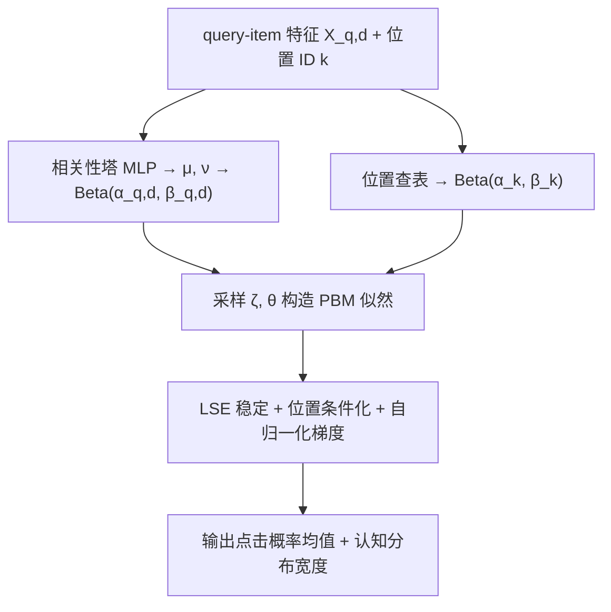
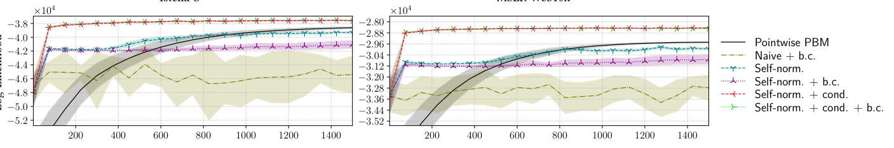
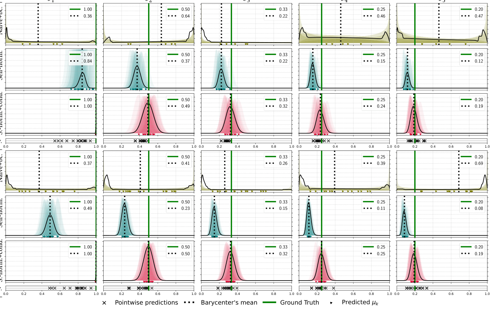
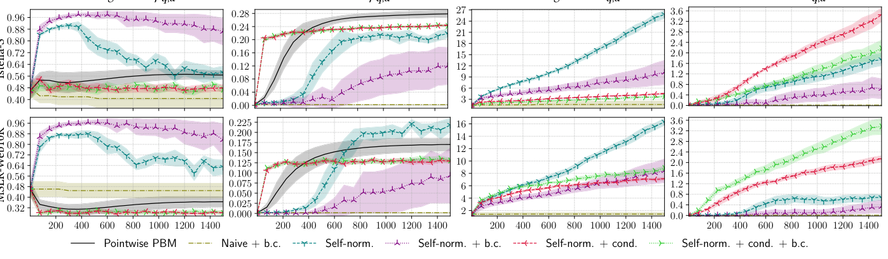
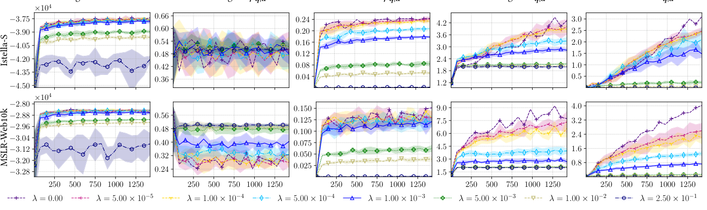
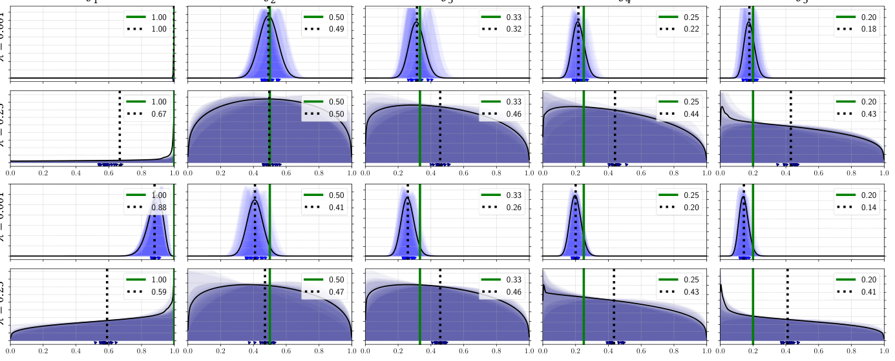
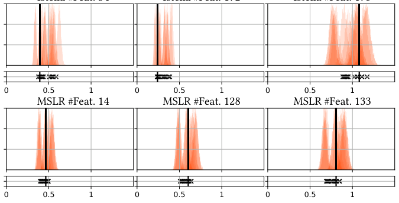
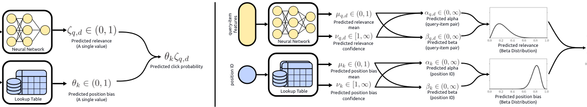

# An Epistemic Position-Based Click Model: From Interactions to Epistemic Distributions of Relevance and Bias (认知位置点击模型：从交互到相关性与偏置的认知分布)

- **会议/期刊**: SIGIR 2026
- **作者与机构**: Oscar Rolando Ramirez Milian, Harrie Oosterhuis（University of Amsterdam；工作完成于 Radboud University Nijmegen）
- **推荐链路定位**: 召回/重排前置的点击建模与无偏离线评估（为 IPS 类无偏 LTR 提供倾向估计）
- **研究方向**: 去偏公平与工业架构 / CTR 预估与特征交叉
- **论文原文**: [https://arxiv.org/abs/2607.18712v1](https://arxiv.org/abs/2607.18712v1)
- **开源代码**: 暂未开源（论文声明发表后放出）

## TL;DR (1分钟核心速览)

位置偏置点击模型（PBM）把点击拆成 $\theta_k\zeta_{q,d}$，但所有现有方法（EM 类点击模型、IPS 无偏 LTR）只给**频率派点估计**，无法回答"这个相关性/偏置估计有多可信"。本文提出首个**上下文认知 PBM**：对每个 $\theta_k$ 与 $\zeta_{q,d}$ 输出一个 Beta 分布（$\alpha,\beta$），用证据深度学习最大化边缘似然。核心难点是优化——朴素 Monte Carlo 策略梯度因似然值极小、维度极高而数值下溢且方差爆炸。作者给出三项技术：log-sum-exp 数值稳定、**对位置偏置条件化**降方差、**自归一化**梯度。在 Istella-S / MSLR-Web10k 半合成点击上，认知 PBM 测试集对数似然**反超点式 PBM**，且 100 epoch 即收敛（点式 1200 epoch 未收敛）。

## Background & Motivation (背景与核心矛盾)

- **主流范式**: PBM 假设 $P[C{=}1|q,d,k]=\theta_k\zeta_{q,d}$，参数通过极大似然（点击模型族）或位置随机化+IPS（无偏 LTR）估计，下游用于去偏排序与离线评估。
- **前人局限**: ① 只输出点估计，无任何置信度信号，下游无法评估"用这个倾向估计做 IPS 的风险"；② PBM 是概率乘积结构，多组 $(\theta,\zeta)$ 可同等解释同一份点击日志（可辨识性差），点估计的方差被完全掩盖。
- **核心洞察 (Key Insight)**: 唯一已有的贝叶斯点击模型（Liu et al. BBM）是**非上下文**的查表模型，无法泛化到未见/长尾 query-item；而 PBM 参数天然落在 $(0,1)$，Beta 分布是共轭且自然的认知分布载体。
- **本文切入点**: 把 PBM 参数视为随机变量，用神经网络从 $X_{q,d}$ 预测 Beta 参数，将"点估计"升级为"认知分布"，并解决由此带来的优化病态问题。

## Method (核心方法设计)

### 1. 整体框架 (Overall Architecture)

输入 query-item 特征 $X_{q,d}$ 与位置 ID；相关性塔（3 层 MLP，64-64-32）输出均值 $\mu\in(0,1)$（sigmoid）与置信度 $\nu\in[1,\infty)$（$|x|+1$），换算为 $\alpha=\mu\nu,\ \beta=(1-\mu)\nu$；位置偏置因 $K$ 很小直接用查表学习 $(\alpha_k,\beta_k)$。所有 $\theta_k,\zeta_{q,d}$ 视为独立 Beta 随机变量，训练目标是最大化对观测点击的边缘似然 $\mathcal{L}=\mathbb{E}_{\theta,\zeta}\big[\prod_{q,d,k}\mathrm{Bin}(M_{q,d,k};N_{q,d,k},\theta_k\zeta_{q,d})\big]$，推理时取分布均值作为点击概率预测，分布宽度即认知不确定性。

### 2. 关键设计拆解 (Key Designs)

1. **认知 PBM 的 Beta 边缘似然（把点估计换成分布）**：痛点是不确定性不可见 $\to$ 令 $\theta_k\sim\mathrm{Beta}(\alpha_k,\beta_k)$、$\zeta_{q,d}\sim\mathrm{Beta}(\alpha_{q,d},\beta_{q,d})$ 且相互独立，目标为
$$\mathcal{L}=\mathbb{E}_{\theta,\zeta}\Big[\textstyle\prod_{q,d,k}\binom{N}{M}(\theta_k\zeta_{q,d})^{M}(1-\theta_k\zeta_{q,d})^{W}\Big].$$
直觉：分布越宽 = 数据越不足以确定该参数，下游可直接读取风险；且 $\nu$ 提供了点式模型没有的"中性初始化"自由度。

2. **位置条件化 + 自归一化梯度（让优化真正跑起来）**：痛点：$\tilde L^{(i)}\ll 1$ 导致下溢，且 $\theta,\zeta$ 联合采样维度极高使策略梯度方差不可用。作者先按 $K\ll|D|$ 的事实**对 $\theta$ 条件化**，把内层 $\zeta$ 期望解析/采样近似为 $\tilde J_{q,d}^{(i)}=\frac{1}{S_{rel}}\sum_j \tilde J_{q,d}(\theta^{(i)},\zeta^{(j)})$，由全方差公式有 $\mathbb{V}_\theta[\mathbb{E}_\zeta[\cdot|\theta]]\le\mathbb{V}_{\theta,\zeta}[\cdot]$，方差严格下降；再用 log-sum-exp 计算 $\log\tilde{\mathcal{L}}=\mathrm{LSE}(\tilde\ell^{(1..S)})-\log S$ 防下溢；最后用自归一化（等价于优化 $\nabla\log\mathcal{L}=\nabla\mathcal{L}/\mathcal{L}$）把近零似然值转成 softmax 权重：
$$\nabla\log\tilde{\mathcal{L}}\approx\frac{1}{S}\sum_i \sigma(\tilde\ell^{(i)})\,\nabla\log p(\tilde\theta^{(i)},\tilde\zeta^{(i)}).$$
直觉：梯度**方向**比幅值重要，自归一化既稳住数值又保留方向。

3. **训练目标、正则与推理开销**：总目标 $\log\tilde{\mathcal{L}}'=\log\tilde{\mathcal{L}}+\lambda\bar{\mathcal{H}}'$，其中 $\bar{\mathcal{H}}'=\frac{1}{|D|}\sum_{q,d}H(\alpha_{q,d},\beta_{q,d})+\frac{1}{K}\sum_k H(\alpha_k,\beta_k)$ 按参数量做归一以平衡位置/相关性两侧；$\lambda$ 温和（$\le 10^{-3}$）可降置信度而不损似然，$\lambda=0.25$ 则分布过宽不可用。无需负采样（似然式训练，非对比式）；推理仅一次前向，成本与点式 PBM 同阶，额外开销在训练期的 $S_{pos}\times S_{rel}=60\times60$ 采样。

## Experimental Setup & Evaluation Protocol (实验设置与评估协议)

- **数据集与预处理**（半合成，因需 ground-truth 参数）：

| 数据集 | #Queries | 平均文档/Query | #Features | 相关性标签 | 说明 |
| :--- | :---: | :---: | :---: | :---: | :--- |
| MSLR-Web10k | 30,000（仅 fold-1） | 125 | 136 | 0–4 | LTR 标准集，自带 train/val/test 划分 |
| Istella-S | 33,018 | 103 | 220 | 0–4 | LTR 标准集，自带划分 |

- **点击生成协议**: 从 train/val/test 均匀采样 $10^5$ 次 query 交互，在 top-5 排序（$K=5$）上按真值 PBM 采样点击：$\theta_k=1/k$，$\zeta_{q,d}=0.9(y_{q,d}/4)+0.1$；日志策略为 2 层 64 单元 MLP 的 Plackett-Luce 排序器（30 个随机训练 query 监督训练）。
- **评估协议**: 在**测试集**上计算点击的**平均对数似然**（越高越好），15 次独立运行，Student-$t$（df=14）95% 置信区间；不确定性质量因无标准指标，采用**分布可视化 + 均值/置信度统计量**（$\mu_{q,d}$、$\nu_{q,d}$ 的均值与样本标准差）间接评估。
- **对比基线**: 点式 PBM（同结构 MLP 直接输出 $\zeta$）、朴素 MC + baseline correction、自归一化（±b.c.）、自归一化+条件化（±b.c.）；训练 1500 epoch，batch 12k（认知）/35k（点式）。

## Key Experimental Results (实验关键数据)

### 1. 主实验对比 (Main Results)

测试集平均对数似然（$10^4$ 量级，越高越好；数值取自图 2 收敛区间）：

| 方法 | Istella-S | MSLR-Web10k | 收敛速度 | 备注 |
| :--- | :---: | :---: | :---: | :--- |
| Pointwise PBM | ≈ -4.55 | ≈ -3.30 | >1200 epoch 未收敛 | 点估计基线 |
| Naïve MC + b.c. | ≈ -4.55（几乎不升） | ≈ -3.30（几乎不升） | 失败 | 梯度不稳 |
| Self-norm. | ≈ -4.30 | ≈ -3.10 | 中等 | 系统性低估参数 |
| Self-norm. + b.c. | 略差于 Self-norm. | 略差于 Self-norm. | 中等 | b.c. 反而有害 |
| **Self-norm. + Cond.** | **≈ -4.05（最优）** | **≈ -2.90（最优）** | **~100 epoch** | 分布贴合真值 |
| Self-norm. + Cond. + b.c. | 与上行相当 | 与上行相当 | ~100 epoch | b.c. 无增益 |

> 说明：原文以学习曲线（图 2）呈现，未给单点表格；上表为曲线收敛平台期的读数量级，趋势在两数据集上高度一致且 95% CI 不重叠。

<figure class="paper-figure" markdown="span">
  <figcaption>图2：使用不同方法训练的点式PBM和认知PBM在1500个训练轮次中预测的测试集点击的对数似然。X轴：训练轮次；Y轴：测试集上点击的平均对数似然。阴影区域表示使用自由度为14的学生t分布计算的95%置信区间。结果基于15次独立运行。</figcaption>
</figure>

### 2. 消融实验 (Ablation Study)

| 配置 | 对数似然 | 位置偏置分布形态 | 相关性 $\mu$/$\nu$ 行为 |
| :--- | :---: | :--- | :--- |
| w/o 自归一化（Naïve+b.c.） | 最差，几乎不学习 | 极宽、无信息 | $\mu$ 的 s.s.d≈0（所有文档同值），$\nu$ 极低且无区分 |
| w/o 条件化（仅 Self-norm.） | 中等 | 过度集中且**系统性低估** | $\nu$ 持续增大 → 过度自信 |
| w/o 熵正则（$\lambda=0$） | 最优 | 贴合真值 | 置信度偏高 |
| $\lambda=10^{-3}$ | 近似最优 | 均值略移、部分变宽 | $\nu$ 下降，仍可用 |
| $\lambda=0.25$ | 显著下降 | 过宽、不可用 | 置信度崩塌 |

<figure class="paper-figure" markdown="span">
  <figcaption>图3：使用不同方法优化的认知PBM预测的分布以及点式PBM的预测。</figcaption>
</figure>
<figure class="paper-figure" markdown="span">
  <figcaption>图4：优化过程中认知PBM的相关性分布统计。X轴：训练轮次；Y轴：所有查询-文档对q,d上预测均值μq,d和置信度νq,d的平均值或采样标准差。</figcaption>
</figure>
<figure class="paper-figure" markdown="span">
  <figcaption>图5：正则化对各种统计量的影响。X轴：训练轮次；Y轴：所指示指标的值。</figcaption>
</figure>
<figure class="paper-figure" markdown="span">
  <figcaption>图6：在权重λ=0.001和λ=0.25下应用熵正则化获得的位置偏差分布（参见图3）。</figcaption>
</figure>

### 3. 关键实验发现 (Key Findings)

1. **认知模型不是"用精度换不确定性"，而是双赢**：Self-norm.+Cond. 的测试对数似然高于点式 PBM，且 100 epoch 收敛 vs. 点式 1200 epoch 仍未收敛；作者归因于 $\nu$ 带来的**中性初始化**（初始近似均匀分布），而点式模型被迫以 logit 初始化"自信地"押注约 0.5 的错误初值。
2. **条件化是分布正确性的分水岭**：仅自归一化时 $\theta_1$–$\theta_5$ 被系统性低估（如 Istella 上 $\theta_2$ 收敛到 0.37 而真值 0.50），加入位置条件化后五个位置分布均覆盖真值（0.50/0.33/0.25/0.20 附近），说明降方差直接转化为参数可辨识性。
3. **熵正则只能"温和使用"**：$\lambda\le10^{-3}$ 时似然几乎不降而 $\nu$ 明显下降（不确定性更诚实）；$\lambda=0.25$ 时似然大幅下滑且位置分布退化为无信息宽分布——这与证据学习"最优点收敛到 Dirac"的理论批评一致，说明熵正则是启发式补丁而非原理性修正。

<figure class="paper-figure" markdown="span">
  <figcaption>图7：使用不同单一特征作为排序器时预期点击数的点式预测和认知预测。垂直线表示真实值。</figcaption>
</figure>

## Highlights, Limitations & Rating (亮点、对比与审稿评价)

- **与代表作对比 (vs. Prior Work)**: 相比 PBM/EM 类点击模型与 IPS 无偏 LTR（Joachims 2017、Wang 2018），本文首次给出**上下文相关**的分布估计而非倾向点值；相比 Liu et al. BBM 的贝叶斯查表模型，本文用特征网络泛化到未见 query-item，解决长尾不可估问题；相比 Knyazev & Oosterhuis (RecSys'23) 的 Beta 置信度推荐，本文把 Beta 证据学习搬到**位置偏置解耦**这一更病态的乘积似然场景并给出专用优化。
- **可迁移亮点**: ① "对低维变量条件化 + 对高维变量采样"的降方差套路可直接用于任何含全局/局部两层隐变量的生成式推荐模型；② 自归一化梯度（softmax 加权策略梯度）是训练似然极小的概率乘积模型（如曝光-点击联合生成模型）的通用稳定器。
- **审稿级局限批判**: ① 评估为**半合成**，真值 PBM 与模型假设完全一致，真实日志下的模型错配（model misspecification）未检验；② 认知分布形状**无客观指标**，仅靠可视化与间接统计量判断，且证据学习已知会收敛到 Dirac，分布宽度的"正确性"缺乏理论保证；③ 训练需 $60\times60$ 采样，成本高于点式模型，工业级日志规模下的可扩展性未讨论。
- **四维评分**: 创新性 ⭐⭐⭐⭐ | 实验扎实度 ⭐⭐⭐ | 方法清晰度 ⭐⭐⭐⭐ | 落地价值 ⭐⭐⭐

## 论文图表

<figure class="paper-figure" markdown="span">
  <figcaption>图1：基于位置的点击模型的两种深度学习实现方式的示意图比较。</figcaption>
</figure>

