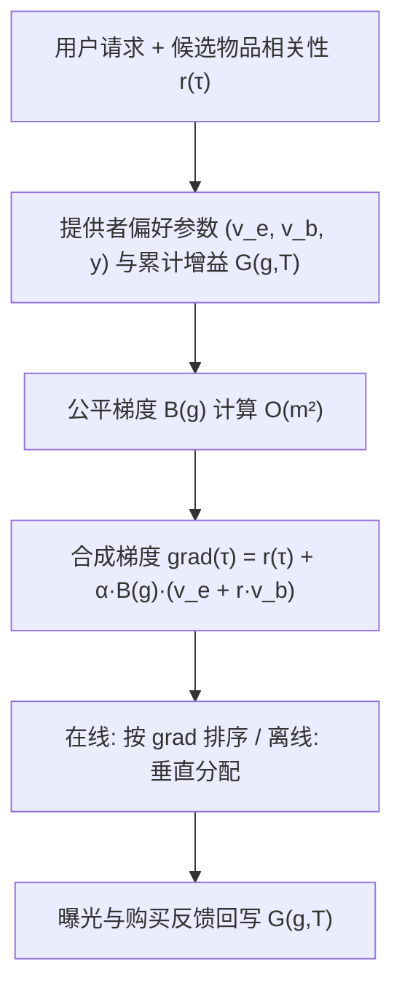

# Equity vs. Equality: Optimizing Ranking Fairness for Tailored Provider Needs (公平 vs. 平等：面向提供者定制需求的排序公平优化)

- **会议/期刊**: SIGIR 2026
- **作者与机构**: Yiteng Tu, Weihang Su, Yiqun Liu, Qingyao Ai* (清华大学), Shuguang Han (阿里巴巴)
- **推荐链路定位**: 重排 (Fair Re-ranking)
- **研究方向**: 去偏公平与工业架构 / 多任务学习与列表级重排
- **论文原文**: [https://arxiv.org/abs/2602.00495v1](https://arxiv.org/abs/2602.00495v1)
- **开源代码**: [https://github.com/RUCAIBox/RecBole](https://github.com/RUCAIBox/RecBole)（基于 RecBole 生成相关性分数，算法本体未单独开源）

## TL;DR (1分钟核心速览)

现有提供者公平排序几乎全部采用 **equality（平等）** 视角：只要内容相似就应获得相似曝光，隐含假设"曝光即收益、所有提供者收益函数相同"。但现实中成熟品牌更看重转化与销量，新兴商家更渴望曝光，统一曝光分配无法反映真实效用。本文提出 **equity（公平）** 框架：为每个提供者显式建模其对曝光与销量两类结果的偏好权重 $(v_e^g, v_b^g)$与期望收益比$y_g$，并给出增益基不公平度量；进而提出 **EquityRank**，用一阶边际近似把非凸组合优化转化为逐项梯度打分$\text{grad}(\tau)$的贪心重排。在 4 个大规模推荐数据集上，离线与在线仿真中 EquityRank 的 unfair.-NDCG 曲线均 Pareto 占优 FairCo/MMF/TFROM，且增益分配与提供者真实偏好比的相关性$\rho$ 从 0.06–0.32 提升至 0.51–0.85。

## Background & Motivation (背景与核心矛盾)

- **主流范式**: 提供者公平排序以 exposure-based / amortized fairness 为主，要求"曝光 ∝ 相关性"，代表算法有 FairCo（比例控制器）、MMF（贪心边际最大化）、TFROM（兼顾用户侧公平）、PG-Rank/PL-Rank（Plackett-Luce 建模）。
- **前人局限**: ① 所有方法假设"曝光即效用"，把 $v_e$固定为 1、$v_b$ 固定为 0，无法刻画提供者对销量/转化的差异化诉求；② 优化目标与真实收益脱钩——两个提供者获得相同曝光，但一个卖爆一个零成交，在 equality 度量下仍被判为"公平"。
- **核心洞察 (Key Insight)**: 社会学中 equality（一视同仁）与 equity（按需分配）的区分正好对应此问题。作者将提供者效用拆为"被检验收益 $v_e^g$"与"被购买收益$v_b^g$"两维，公平应定义为**各提供者获得的增益比例与其期望比例$y_g$ 成正比**，而非曝光量相等。
- **本文切入点**: 用增益基度量统一 equity 与 equality（令 $v_e=1, v_b=0, y_g=r(g)$ 即退化为曝光公平），再设计可在线部署的梯度重排算法。

## Method (核心方法设计)

### 1. 整体框架 (Overall Architecture)

系统在每个时间步 $T$收到一个用户请求，相关性模型给出候选物品的$r(\tau)$；EquityRank 读取平台侧预置的提供者偏好参数$(v_e^g, v_b^g, y_g)$与历史累计增益$G(g,T)$，计算每个物品的"有效性梯度 + 公平修正梯度"合成得分$\text{grad}(\tau)$，按得分降序（在线）或垂直分配（离线）生成 top-$K$ 列表；用户交互后回写曝光/购买统计，进入下一轮。整个流程无需训练、无参数更新，是纯推理期的重排插件。

### 2. 关键设计拆解 (Key Designs)

1. **增益基提供者效用与不公平度量**：痛点是把"曝光"当唯一货币。作者定义提供者 $g$从列表$\pi$ 获得的期望增益为
$$E[G(g|\pi,u)]=\sum_{\tau\in\mathcal{I}_g\cap\pi}p_{\text{rank}(\tau|\pi)}\left(r(\tau,u)\cdot v_b^g+v_e^g\right)$$
即"被检验概率 ×（相关性 × 单次购买收益 + 单次曝光收益）"。公平性要求任意两提供者满足 $G(g_i)/y_{g_i}=G(g_j)/y_{g_j}$，据此定义成对偏差平方和
$$\text{unfair.}(T)=\frac{1}{m(m-1)}\sum_{i=1}^{m}\sum_{j=1}^{m}\left(G(g_i,T)y_{g_j}-G(g_j,T)y_{g_i}\right)^2$$
直觉：$y_g$ 是平台与商家协商的"应得份额"，偏差按份额加权后平方，天然惩罚"大商家吃太多、小商家饿死"的失衡。

2. **边际一阶近似与梯度打分**：原目标 $\max_\pi\ \text{eff.}+\alpha\cdot\text{fair.}$因二次项与排列离散性非凸且组合爆炸。作者利用"$T$时刻排序不影响$T-1$"的性质，将目标差分化，对曝光$\Delta E(\tau)$ 做一阶泰勒展开，得到每步只需排序的线性目标：
$$\max_\pi\sum_{\tau\in\mathcal{I}}\underbrace{\left[r(\tau)+\alpha\cdot B(\text{Group}(\tau))\left(v_e^{\text{Group}(\tau)}+r(\tau)v_b^{\text{Group}(\tau)}\right)\right]}_{\text{grad}(\tau)}\cdot\Delta E(\tau)$$
其中 $B(g)=\frac{4}{m(m-1)}\left[y_g\sum_{g'}G(g')y_{g'}-G(g)\sum_{g'}(y_{g'})^2\right]$是公平项对增益的导数。物理直觉清晰：$B(g)$ 为负表示该提供者已"超额"，其物品梯度被压低；为正表示"欠额"，物品被抬升，形成闭环负反馈。

3. **训练目标、负采样与推理效率**：本方法无训练损失、无负采样，直接复用现成相关性模型输出。单步复杂度为 $O(n\log n+m^2)$（$B(g)$需$O(m^2)$成对计算，物品打分$O(n)$，排序$O(n\log n)$），与 FairCo 同阶；实际$m\ll n$，主导项为排序。离线场景采用垂直分配（vertical allocation）而非水平分配，使高曝光位置被更均匀地跨用户摊分，提升头部公平性。

## Experimental Setup & Evaluation Protocol (实验设置与评估协议)

- **数据集与预处理**: 用户/物品交互数 < 10、提供者关联物品 < 20 者剔除；相关性由 RecBole 默认参数的 NeuMF 生成，4–5 星视为点击。

| 数据集 | #Users | #Items | #Providers | 场景说明 |
| :--- | :---: | :---: | :---: | :--- |
| Amazon-Musical Instruments (MI) | 4,801 | 5,418 | 105 | 品牌为提供者 |
| Amazon-Video Games (VG) | 8,966 | 12,351 | 115 | 品牌为提供者 |
| Google Local-Alaska (AL) | 16,651 | 3,511 | 72 | 商户首类目为提供者 |
| RateBeer (RB) | 12,293 | 22,349 | 533 | 酿酒商为提供者 |

- **数据划分与防穿越**: 离线设定为全量用户一次性出榜（相关性标签已知）；在线设定模拟 $2.5\times10^5$步流式请求，每步服务一个用户，相关性用无偏估计$\hat{r}(\tau)=\text{cumB}(\tau)/E(\tau)$ 在线学习，先用弱 NeuMF 粗筛 top-20（覆盖约 94% 物品）再做公平重排。
- **排名评测协议**: 列表长度 $K=5$，$k_c=K$；有效性用 aNDCG@5（离线）与 cNDCG@5（在线，$\gamma=0.995$）；公平性用上式 unfair.；检验位置偏置$p_k=1/\log_2(k+1)$。提供者收益参数按三种场景随机采样：Common（$v_e\sim\mathcal{N}(10,2.5), v_b\sim\mathcal{N}(100,25), y\sim\mathcal{N}(50,25)$）、Exp1st（$v_e,v_b\sim\mathcal{N}(100,25)$）、Sale1st（$v_b\sim\mathcal{N}(1000,250)$）。
- **对比基线与超参设置**: TopK、PoorK、FairCo、MMF、TFROM，以及按本文 equity 度量改造的 FairCo*/MMF*/TFROM*；$\alpha$不调单一值而是扫全参数空间绘制 unfair.-NDCG 曲线；每实验重复 5 次取均值，显著性$p<0.05$。

## Key Experimental Results (实验关键数据)

### 1. 主实验对比 (Main Results)

离线最小不公平度（越低越好，括号内为标准差）：

| 模型 | MI | VG | AL | RB | 单次耗时(s) |
| :--- | :---: | :---: | :---: | :---: | :---: |
| TopK | 1.38e5 | 2.10e5 | 1.85e5 | 1.92e3 | 0.11–0.49 |
| PoorK | 0.126 | 0.043 | 0.019 | **0.002** | 0.10–0.46 |
| FairCo* | 0.285 | 0.093 | 0.038 | 0.022 | 0.14–0.69 |
| MMF* | 0.126 | 0.043 | 0.019 | **0.002** | 1.75–9.20 |
| TFROM* | 0.106 | 0.056 | 0.013 | 0.046 | 0.25–1.05 |
| EquityRank | 0.499 | 0.151 | 0.037 | 0.103 | 0.13–0.60 |
| **EquityRank_v** | **0.101** | **0.037** | **0.012** | 0.024 | 0.30–1.17 |

增益分配与真实偏好比的一致性（MSD↓ / $\rho$↑，以 MI 为例）：FairCo* 117.3/0.06，PoorK 110.5/0.12，TFROM* 123.2/0.05，EquityRank 29.7/0.58，**EquityRank_v 18.1/0.69**；AL 上 EquityRank_v 达 7.3/0.85。

### 2. 消融实验 (Ablation Study)

| 配置 | MI unfair. | MI $\rho$| AL unfair. | AL$\rho$ | 说明 |
| :--- | :---: | :---: | :---: | :---: | :--- |
| EquityRank（水平分配） | 0.499 | 0.58 | 0.037 | 0.79 | 在线式逐步出榜 |
| EquityRank_v（垂直分配） | **0.101** | **0.69** | **0.012** | **0.85** | 离线批量出榜 |
| 去掉公平项（$\alpha=0$，即 TopK） | 1.38e5 | — | 1.85e5 | — | 公平完全崩塌 |
| 仅用曝光项（$v_b=0$，退化为曝光公平） | ≈FairCo* 量级 | ≈0.06 | — | ≈0.25 | 无法对齐销量偏好 |

### 3. 关键实验发现 (Key Findings)

1. **equality 方法在 equity 度量下几乎失效**：TopK/TFROM 的 unfair. 高达 $10^5$ 量级，FairCo* 在 MI 上仍有 0.285，而 EquityRank_v 仅 0.101；说明"曝光相等"与"收益按需分配"是两个几乎正交的目标，改造损失函数（加 `*`）只能部分缓解。
2. **垂直分配是离线场景的关键增益来源**：同一算法仅换分配方式，MI 上 unfair. 从 0.499 降至 0.101（约 5 倍），$\rho$ 从 0.58 升至 0.69，代价是耗时从 0.226s 增至 0.421s，性价比极高。
3. **在线场景 EquityRank 实现 Pareto 占优**：在 cNDCG 上全面最高，且 unfair.-cNDCG 曲线整体位于左上；在 Exp1st/Sale1st 两种极端偏好场景下仍保持最优或近最优，证明对异质提供者需求的适应性而非对单一分布的过拟合。

## Highlights & Limitations (亮点、对比与审稿批判)

- **与代表作对比 (vs. Prior Work)**: FairCo 用比例控制器调曝光、MMF 用贪心最大化边际相关性+公平、TFROM 引入用户侧公平，三者均把效用锚定在曝光上；本文把效用推广为"曝光+销量"的加权增益，且证明曝光公平是其 $v_e=1,v_b=0$ 的特例，框架更具一般性。相比 PG-Rank/PL-Rank 的 Plackett-Luce 策略梯度，本文的边际一阶近似更轻量、无需训练。
- **可迁移亮点**: ① "把公平约束写成对累计量的导数 $B(g)$ 再叠加到打分上"的负反馈范式，可直接迁移到多业务方流量分配、创作者激励等场景；② 垂直分配在离线批量出榜中的显著收益，可复用到任何需要一次性生成大量榜单的公平重排任务。
- **审稿级局限批判**: ① 提供者收益参数 $(v_e,v_b,y)$在实验中全部为随机采样模拟，真实电商数据缺失，参数获取机制（定价/协商）被明确留作未来工作，削弱了结论的工业可信度；② 在线实验的相关性估计依赖$\text{cumB}/E$的无偏估计，冷启动物品曝光为 0 时该估计不稳定，且$O(m^2)$ 的成对公平梯度在提供者数量达万级时可能成为瓶颈；③ 仅建模曝光与销量两维，未纳入留存、复购等长期效用。

## Rating (四维评分)

- **方法创新性 (Novelty)**: ⭐⭐⭐⭐ （equity 视角的增益基公平度量有清晰的社会学动机与理论包容性，但梯度重排本身是边际近似的工程化组合，算子层面新意中等）
- **评估协议与实验扎实度 (Protocol & Experiments)**: ⭐⭐⭐⭐ （4 个大规模数据集 + 离线/在线双设定 + 三种偏好场景 + 全 $\alpha$ 空间曲线对比 + 5 次重复与显著性检验，但收益参数为模拟采样是硬伤）
- **写作与数学规范度 (Clarity & Rigor)**: ⭐⭐⭐⭐ （从效用定义到梯度推导链条完整，$B(g)$的负反馈直觉解释到位，复杂度分析清晰；部分符号如$y_g$ 的语义依赖脚注补充）
- **工业落地与复现价值 (Industrial & Practical Value)**: ⭐⭐⭐⭐ （无训练、即插即用、复杂度与 FairCo 同阶，工程友好；但依赖平台侧提供者偏好参数，且代码未独立开源，复现需自行实现）

