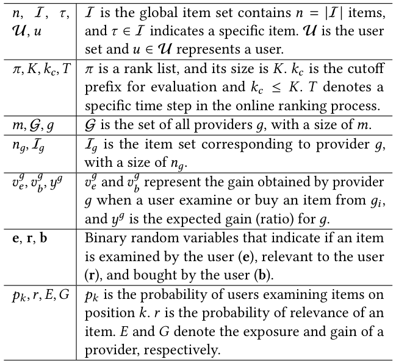
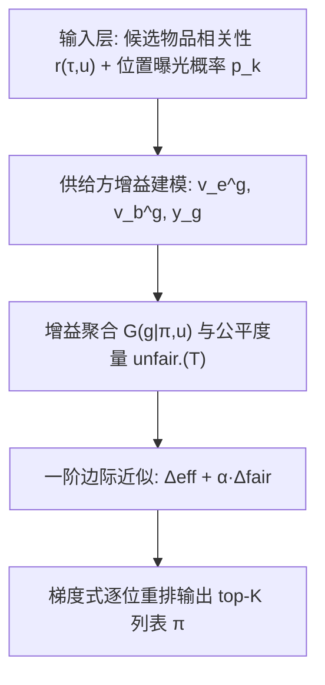
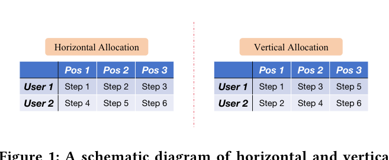
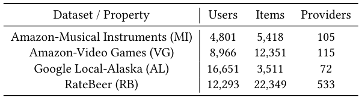
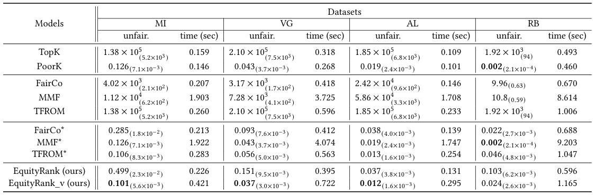
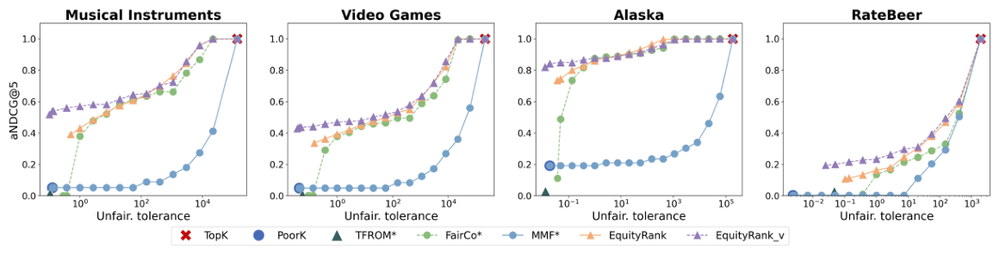
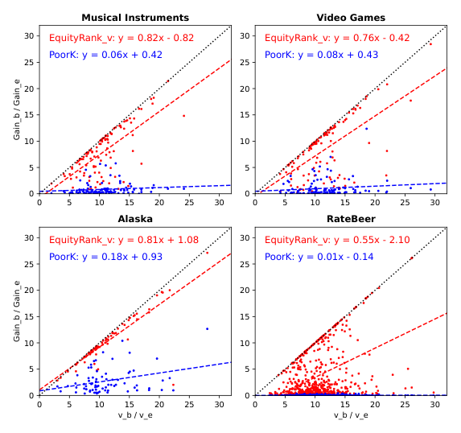

# Equity vs. Equality: Optimizing Ranking Fairness for Tailored Provider Needs (权益 vs. 平等：面向供给方定制需求的排序公平优化)

- **会议/期刊**: SIGIR 2026
- **推荐链路定位**: 重排 (Re-ranking) —— 在给定相关性估计的前提下对候选列表做公平感知的列表级重排
- **研究方向**: 去偏公平与工业架构 / 多任务学习与列表级重排
- **论文原文**: [https://arxiv.org/abs/2602.00495v1](https://arxiv.org/abs/2602.00495v1)
- **开源代码**: [https://github.com/RUCAIBox/RecBole](https://github.com/RUCAIBox/RecBole) （注：该链接为论文正文提及的通用推荐实验框架 RecBole，并非本文专用实现仓库；本文算法实现暂未单独开源）

## TL;DR (核心速览)

针对现有供给方公平研究普遍采用"平等 (equality)"视角、假设所有供给方从曝光中同比例获益的痛点，本文提出"权益 (equity)"导向的公平框架：为每个供给方显式建模其对曝光 (examination) 与销量 (purchase) 两类结果的异质偏好权重 $v_e^g, v_b^g$ 及期望收益比 $y_g$，并据此定义基于增益的公平度量。在此基础上提出梯度式重排算法 EquityRank，通过一阶边际近似联合优化用户侧 NDCG 与供给方公平。离线与在线仿真表明其在效果-公平权衡上优于 FairCo、MMF、TFROM 等基线。

## Background & Motivation (背景与动机)

- **领域背景与主流范式**: 排序系统同时连接用户与内容供给方，供给方公平 (provider-side fairness) 已成为 IR 社区的重要议题。现有工作大体分为概率式公平 (protected group 在 top 位置的比例不低于阈值) 与曝光式公平 (amortized exposure fairness，要求相似内容的供给方随时间获得相似曝光，或曝光与相关性成比例)。代表性算法包括基于线性/0-1 整数规划的精确方法、FairCo 的动态 LTR、MMF 的贪心边际选择、PG-Rank/PL-Rank 的 Plackett-Luce 建模、MCFair 与 TFROM 等。
- **现有方法局限 (Limitations of Prior Work)**:
  1. **单一效用假设**: 几乎所有方法都假设供给方从每个物品的曝光中"等比例"获益，忽略了真实场景中不同品牌/商家对曝光、销量、转化率的偏好差异（成熟品牌重利润与 CVR，新兴品牌更渴望曝光）。
  2. **平等 ≠ 权益**: 社会学中 equality（一视同仁）与 equity（按需分配）的区分在排序公平中未被建模，相同曝光对不同供给方可能意味着完全不同的收益。
  3. **度量不可扩展**: 精确规划类方法时间复杂度高，难以支撑大规模在线排序。
- **核心挑战 (Key Challenge)**: 如何在有限的用户流量带宽下，让排序结果按各供给方的"定制化需求"成比例地分配增益，同时不牺牲用户侧相关性？简单的曝光均分或加权拼接无法刻画"曝光-销量"二维异质偏好。
- **核心洞察与切入点 (Key Insight)**: 作者观察到电商场景中供给方对 CTR 与 CVR 的重视程度存在系统性差异，因此将供给方效用拆解为曝光增益 $v_e^g$ 与购买增益 $v_b^g$ 的加权和，并引入期望收益比 $y_g$ 作为"按需分配"的目标锚点；进一步证明现有曝光公平/影响公平均为该框架在 $v_e=1, v_b=0, y_g=r(g)$ 时的特例，从而以统一视角兼容 equality 与 equity。

## Problem Formulation & Method (问题定义与方法架构)

### 1. 符号定义与输入表征 (Notations & Input Representations)

- 物品全集 $\mathcal{I}$（$|\mathcal{I}|=n$），用户集 $\mathcal{U}$，供给方集合 $\mathcal{G}=\{g_1,\dots,g_m\}$，供给方 $g$ 拥有物品集 $\mathcal{I}_g$（$|\mathcal{I}_g|=n_g$），$\mathcal{I}=\bigcup_g \mathcal{I}_g$。
- 排序列表 $\pi$，长度 $K$，评测截断 $k_c \le K$；在线场景含时间步 $T$。
- 二元随机变量 $e, r, b$ 分别表示物品被曝光 (examined)、相关 (relevant)、被购买 (bought)。
- 位置偏差 $p_{\text{rank}(\tau|\pi)}$ 为位置 $k$ 的曝光概率；选择偏差假设排名超过 $K$ 的物品曝光概率为 0。
- 供给方增益权重 $v_e^g, v_b^g$（单位曝光/购买带来的收益），期望收益比 $y_g$。
- 输入：相关性估计 $r(\tau,u)$、位置曝光概率 $p_k$、供给方权重 $\{v_e^g, v_b^g, y_g\}$；输出：重排后的 top-$K$ 列表 $\pi$。

表 1 汇总了全文符号定义：

<figure class="paper-figure" markdown="span">
  <figcaption>表 1</figcaption>
</figure>

### 2. 整体流水线 (Overall Architecture)

数据流：相关性估计器给出候选物品相关性 $r(\tau,u)$ → 依据交互假设（购买需同时满足曝光与相关，$P(b=1)=P(r=1)P(e=1)$）计算每个物品的期望增益 → 按供给方聚合增益 $G(g|\pi,u)$ → 计算增益式公平度量 unfair. → 以边际曝光 $\Delta E$ 做一阶近似，将目标分解为"效果梯度 + $\alpha \times$ 公平梯度" → 贪心/梯度式逐位填充 top-$K$ 列表。

### 3. 核心模块设计与数学原理 (Key Designs & Formulations)

**(1) 供给方增益建模 (Provider Gain Modeling)**。供给方 $g$ 从列表 $\pi$ 获得的增益及其期望为：

$$G(g|\pi,u)=\sum_{\tau\in\mathcal{I}_g\cap\pi} P(b=1|\tau,\pi)\,v_b^g + P(e=1|\tau,\pi)\,v_e^g$$

$$\mathbb{E}[G(g|\pi,u)]=\sum_{\tau\in\mathcal{I}_g\cap\pi} p_{\text{rank}(\tau|\pi)}\left(r(\tau,u)\cdot v_b^g + v_e^g\right)$$

物理直觉：每个物品的期望增益 = 曝光概率 ×（相关性 × 购买权重 + 曝光权重），从而把"曝光"与"销量"两个维度以供给方自定义权重耦合进同一标量。作者指出该式可无缝推广到逐物品权重 $v_e^\tau, v_b^\tau$。

**(2) 增益式公平度量 (Gain-based Fairness)**。理想状态为 $\forall g_i,g_j$：$G(g_i)/y_{g_i}=G(g_j)/y_{g_j}$。为避免零分母，采用成对平均增益差的平方：

$$\text{unfair.}(T)=\frac{1}{m(m-1)}\sum_{i=1}^{m}\sum_{j=1}^{m}\left(G(g_i,T)\,y_{g_j}-G(g_j,T)\,y_{g_i}\right)^2,\quad \text{fair.}(T)=-\text{unfair.}(T)$$

其中 $G(g_i,T)=\frac{1}{T}\sum_{t=1}^{T}G(g_i|\tau_t,u_t)$ 为时间平均增益。该度量对 $y_g$ 成比例缩放，天然支持"按需分配"。

**(3) 泛化性证明 (Generalizability)**。当令所有 $v_e=1$、$v_b=0$、$y_g$ 取供给方平均相关性 $r(g_i)=\frac{1}{n_{g_i}}\sum_{\tau\in\mathcal{I}_{g_i}}r(\tau)$ 时，上述度量退化为经典曝光公平（要求 $E(g_i,T)/r(g_i)=E(g_j,T)/r(g_j)$），说明本文框架是既有 equality 框架的严格超集。

**(4) EquityRank 优化目标与梯度推导**。总目标为 $\max_\pi \text{Obj.}(T)=\text{eff.}(T)+\alpha\cdot\text{fair.}(T)$，其中 eff. 在离线为 aNDCG、在线为带折扣 $\gamma$ 的 cNDCG。由于目标非凸且组合爆炸，利用"$T$ 时刻排序不影响 $\text{Obj.}(T-1)$"的性质转为最大化边际目标，并以边际曝光 $\Delta E$ 做一阶近似：

$$\max_\pi \Delta\text{Obj.}(T)\approx\max_\pi \sum_{\tau\in\mathcal{I}}\frac{\partial \text{eff.}}{\partial E(\tau)}\Delta E(\tau)+\alpha\sum_{\tau\in\mathcal{I}}\frac{\partial \text{fair.}}{\partial E(\tau)}\Delta E(\tau)$$

效果项经改写 $\text{eff.}(T)=\sum_{\tau\in\mathcal{I}}r(\tau)E(\tau)$ 后梯度即为 $\partial\text{eff.}/\partial E(\tau)=r(\tau)$；公平项则通过链式法则先对增益 $G$ 求导、再经 $G$ 对曝光 $E$ 求导得到。最终每个候选物品获得一个"效果梯度 + $\alpha\cdot$公平梯度"的边际得分，按得分贪心填充列表。图 1 给出了水平/垂直分配（跨用户 vs. 单用户列表内）的示意，说明本文在单次请求的列表内完成分配：

<figure class="paper-figure" markdown="span">
  <figcaption>图 1</figcaption>
</figure>

### 4. 训练目标、负采样与推理复杂度 (Optimization, Negative Sampling & Complexity)

- **损失/目标函数**: 无监督训练损失，直接优化 $\text{Obj.}(T)=\text{eff.}(T)+\alpha\cdot\text{fair.}(T)$，$\alpha$ 为效果-公平权衡超参；在线场景 cNDCG 含折扣因子 $\gamma$。无温度系数 $\tau$、无对比损失。
- **负采样策略**: 不适用。本文为列表级重排算法，直接在候选集上做增益分配，不涉及表征学习的负采样。
- **时间与空间复杂度**: 精确求解需枚举全排列，不可行；EquityRank 采用逐位贪心 + 梯度打分，单次重排复杂度约为 $O(K\cdot|\mathcal{I}|)$ 量级（每步对候选集计算边际得分）。原文表 3 报告了各算法在 100 个样本上的平均处理时间，EquityRank 显著快于 FairCo、MMF、TFROM 等基线（具体毫秒数值见原文表 3）。空间开销主要为候选集梯度缓存，与 $|\mathcal{I}|$ 线性相关。

## Experimental Setup & Evaluation Protocol (实验设置与评估协议)

- **数据集统计与预处理**: 原文使用多个大规模推荐数据集（表 2 汇总了数据集特征，含用户数、物品数、交互数及供给方/增益相关属性）。具体过滤规则（如 5-core）原文未在正文明确报告，需以表 2 为准：

<figure class="paper-figure" markdown="span">
  <figcaption>表 2</figcaption>
</figure>

- **数据划分方式 (Splitting Strategy)**: 原文采用离线仿真（已知相关性标签）与在线仿真（相关性需在排序过程中动态推断）两种设定。离线设定下使用预先记录的用户-物品相关性；在线设定下按时间步 $T$ 顺序接收请求并累积 cNDCG。原文未明确报告是否采用 Leave-One-Out 或 8:1:1 比例划分，亦未讨论全局时间戳切分下的数据泄露问题——这是评估协议上的一个可追问点。
- **排名评测协议 (Ranking Protocol)**: 离线为全候选集上的列表级重排（给定相关性标签，非采样负例排序）；在线为逐时间步的流式排序。评测指标为 aNDCG@$k_c$（离线）与 cNDCG@$k_c$（在线），公平侧指标为 unfair.（式 9，越低越好）。
- **评价指标与显著性检验**: 主指标为 unfair.（↓）与 NDCG（↑）构成的权衡曲线；表 3 报告了标准差（括号内），说明进行了多次运行。原文未明确报告配对显著性检验（如 paired $t$-test / Wilcoxon）的具体 $p$ 值。

## Key Experimental Results (核心实验结果)

### 1. 主实验对比 (Main Results)

表 3 报告了各模型在离线设定下能达到的最小 unfair. 值（括号内为标准差），并标注了 100 个样本的平均处理时间。基线包括 FairCo、MMF、TFROM（含带 "*" 与不带 "*" 的版本）、PoorK 等。原文强调每个数据集的最优结果，EquityRank 在多数数据集上取得最低 unfair.：

<figure class="paper-figure" markdown="span">
  <figcaption>表 3</figcaption>
</figure>

图 3 给出各模型在不同数据集上的 unfair.-aNDCG 平衡曲线，越靠左上（↖）越优，直观展示 EquityRank 在同等公平约束下能达到更高 NDCG：

<figure class="paper-figure" markdown="span">
  <figcaption>图 3</figcaption>
</figure>

### 2. 消融实验与控制变量分析 (Ablation Study)

原文未设置传统意义上的"移除某模块"消融表，而是通过以下方式做控制变量分析：(1) 对比 EquityRank 与 PoorK 在不同数据集上两类增益权重之比 $v_b/v_e$ 的分布（图 2），验证 EquityRank 能随供给方异质偏好自适应调整分配，而 PoorK 等 equality 方法无法区分；(2) 通过 $\alpha$ 扫描得到完整的公平-效果平衡曲线（图 3），间接反映公平项与效果项的相对贡献。原文未报告参数量对齐或图度数匹配类的严格消融。

<figure class="paper-figure" markdown="span">
  <figcaption>图 2</figcaption>
</figure>

### 3. 稀疏度/冷启动分桶与超参敏感度 (Sparsity Buckets & Hyperparameters)

- **长尾/冷启动分桶**: 原文未报告按交互频次分桶的细粒度分析。
- **关键超参数敏感度**: 核心超参为权衡系数 $\alpha$；图 3 的平衡曲线实质上刻画了 $\alpha$ 从偏效果到偏公平连续变化时的性能轨迹。折扣因子 $\gamma$（在线 cNDCG）与截断 $k_c$ 的影响原文未做单独敏感性表格。
- **线上 A/B 测试结果**: 原文仅包含离线与在线**仿真**（online simulation），未报告真实工业流量上的 A/B 测试（CTR/CVR/GMV/留存等），此为工业落地证据链上的缺口。

## Highlights, Limitations & Critiques (亮点、局限与审稿级批判)

- **核心亮点与可迁移性**:
  1. **框架统一性**: 将曝光公平、影响公平统一为增益式公平在 $v_e=1, v_b=0$ 下的特例，理论优雅，便于后续工作在同一坐标系下比较。
  2. **异质需求可插拔**: $v_e^g, v_b^g, y_g$ 可由平台与商家协商或从价格/成本/推广费中估计，框架可扩展到更多效用维度（如留存、满意度），迁移性强。
  3. **梯度式重排高效**: 一阶边际近似把组合优化转为逐位贪心打分，处理时间显著优于规划类与 FairCo/MMF/TFROM，具备在线部署潜力。
- **局限性与审稿视角批判 (Critical Limitations)**:
  1. **评估协议披露不足**: 数据划分策略、过滤规则、是否全库排序、显著性检验均未在正文清晰交代，复现门槛偏高；"online simulation" 与真实线上 A/B 存在本质差距，公平收益在真实流量下是否成立存疑。
  2. **$y_g$ 与 $v$ 权重的获取被回避**: 作者明确将 $y_g$ 的定价机制留作未来工作，但该参数直接决定公平分配结果，其估计误差对公平性的鲁棒性未做敏感性分析，是审稿人最可能攻击的点。
  3. **一阶近似的理论保证缺失**: 以边际曝光做一阶泰勒近似，未给出近似误差界或与全局最优的差距分析；目标非凸，贪心解的质量缺乏理论刻画。
  4. **物品级异质增益未落地**: 文中假设同一供给方下所有物品 $v_e, v_b$ 相同，虽声称可推广到逐物品权重，但未实验验证。
  5. **代码链接为通用框架**: 提供的 RecBole 链接并非本文算法专用实现，实际可复现性需打折扣。

## Rating (四维评分)

- **方法创新性 (Novelty)**: ⭐⭐⭐⭐ （equity vs. equality 的视角转换与增益式统一框架有理论新意）
- **评估协议与实验扎实度 (Protocol & Experiments)**: ⭐⭐⭐ （离线+在线仿真较完整，但划分协议、显著性检验与真实 A/B 缺失）
- **写作与数学规范度 (Clarity & Rigor)**: ⭐⭐⭐⭐ （符号体系清晰、梯度推导完整，一阶近似缺误差分析）
- **工业落地与复现价值 (Industrial & Practical Value)**: ⭐⭐⭐ （算法高效易部署，但 $y_g$/$v$ 权重获取与专用代码开源是落地障碍）
