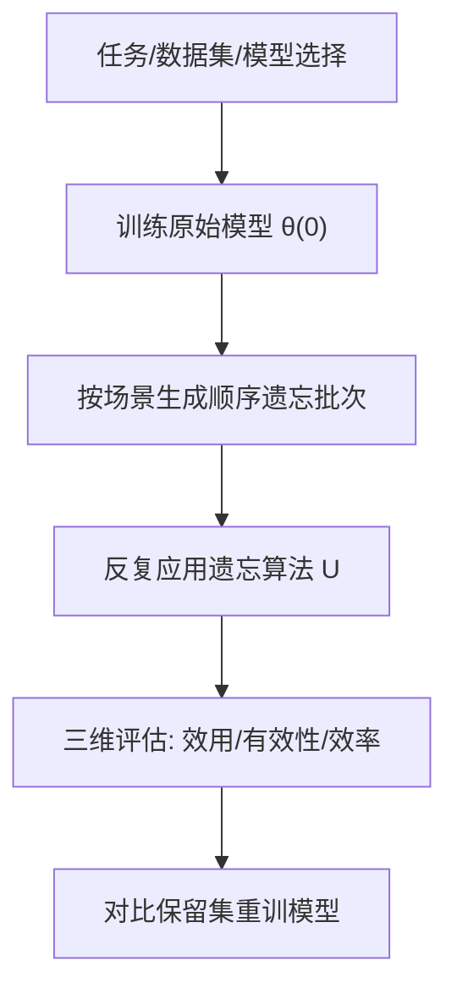
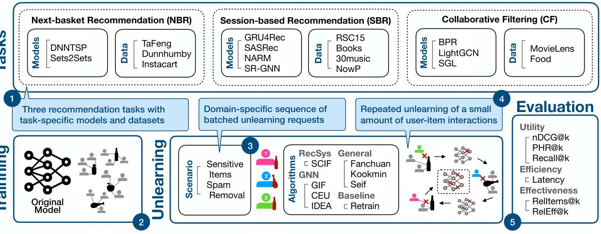
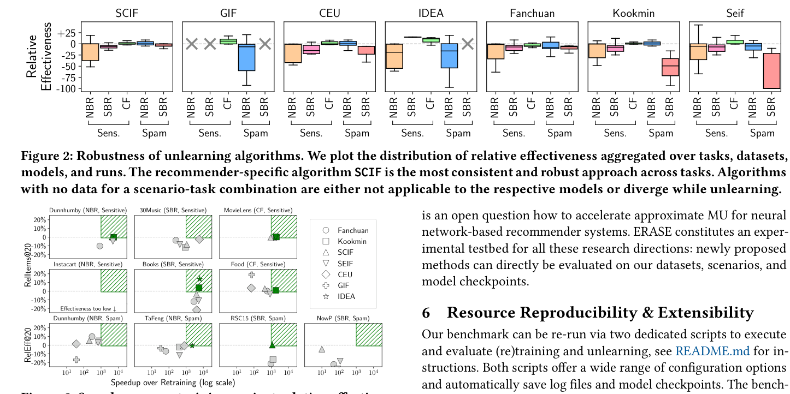

# ERASE -- A Real-World Aligned Benchmark for Unlearning in Recommender Systems (面向真实场景的推荐系统机器遗忘基准)

- **会议/期刊**: SIGIR 2026
- **作者与机构**: Pierre Lubitzsch (BIFOLD & TU Berlin), Maarten de Rijke (University of Amsterdam), Sebastian Schelter (BIFOLD & TU Berlin)
- **推荐链路定位**: 端到端（模型训练后处理 / 遗忘更新）
- **研究方向**: 去偏公平、可信隐私与工业架构 / 序列与会话推荐
- **论文原文**: [论文原文链接](https://arxiv.org/abs/2603.08341v1)
- **开源代码**: [开源代码仓库链接](https://github.com/deem-data/erase-bench)

## TL;DR (1分钟核心速览)

现有推荐系统机器遗忘（MU）基准 CURE4Rec 仅覆盖协同过滤、一次性删除高达 5% 数据、且遗忘耗时仅比重训快一个数量级，严重脱离真实场景。ERASE 构建了覆盖 CF/SBR/NBR 三任务、七种遗忘算法（含 SCIF/GIF/CEU/IDEA 及 NeurIPS'23 通用方法）、九数据集九模型的基准，核心创新是**顺序小批量遗忘**（敏感物品按用户逐批、垃圾数据按 256 用户/批）与三维评估（效用/有效性/效率）。实验表明推荐专用 SCIF 最鲁棒，但多数方法在注意力/循环模型上反复遗忘后性能崩塌，且鲜有方法达到"快 3 个数量级"的部署门槛。

## Background & Motivation (背景与核心矛盾)

- **主流范式**: 机器遗忘通过精确重训或近似参数更新（影响函数、噪声注入、参数重置）移除训练数据影响，以满足 GDPR"被遗忘权"、垃圾数据清理与版权合规。
- **前人局限**: ① CURE4Rec 仅覆盖 CF，忽略电商/娱乐平台主流的 SBR 与 NBR；② 模拟一次性删除 5% 数据，而真实系统是重训周期之间持续到达的小请求；③ 遗忘集随机选取，未反映"敏感物品"或"垃圾用户"的领域模式；④ 遗忘仅快一个数量级，而工业界重训需一天，需快 3 个数量级才可部署。
- **核心洞察 (Key Insight)**: 对欧洲百万级用户推荐系统团队负责人的访谈证实，删除请求目前只能等周/月度重训周期才生效，且现有近似方法在**顺序反复遗忘**下的鲁棒性从未被系统评估。
- **本文切入点**: 以"顺序小批量遗忘 + 领域特定遗忘场景 + 三维评估"重构基准，并释放 1069 个检查点使新算法无需重训即可评测。

## Method (核心方法设计)

### 1. 整体框架 (Overall Architecture)

ERASE 将一次实验定义为「任务-数据集-训练算法-遗忘算法-场景」五元组。首先在选定数据集上训练任务特定模型 $\theta^{(0)}$；随后按场景生成遗忘请求序列$D_f^{(0)},\dots,D_f^{(n-1)}$，顺序执行$\theta^{(i+1)}\leftarrow U(\theta^{(i)},D_r^{(i)},D_f^{(i)})$，其中$D_r^{(i)}=D\setminus\bigcup_{j=0}^{i}D_f^{(j)}$；最终将遗忘模型与在保留集上重训的模型对比，从效用、有效性、效率三维评估。基准基于 RecBole 实现，五随机种子、13000+ GPU 小时、600GB 可复用产物。

<figure class="paper-figure" markdown="span">
  <figcaption>图1：ERASE 概览。1 每个实验首先在选定数据集上训练任务特定模型 2。根据场景定义一系列遗忘请求 3，并重复应用遗忘算法 4。最后，将遗忘后的模型与在保留集上重新训练的模型进行比较，评估其效用、效率和有效性 5。</figcaption>
</figure>

### 2. 关键设计拆解 (Key Designs)

1. **顺序小批量遗忘协议（Sequential Unlearning）**：痛点是一次性大删除无法反映真实请求流。敏感物品场景按用户逐批遗忘、总量仅占交互 0.01%（伦理紧迫性要求低延迟）；垃圾数据场景注入 1% 训练集交互、每批含 256 个垃圾用户（垃圾账号批量操作、无严格延迟约束）。该设计使"反复遗忘后的累积退化"首次可被量化。

2. **领域特定遗忘场景与可解释有效性指标**：摒弃权重空间距离与成员推断攻击（后者结论不确定），改用场景语义指标。敏感物品场景定义 $\text{Sensitive@}k=\frac{1}{|U_s|}\sum_{u\in U_s}\mathbb{I}[R_u^k\cap I_s\neq\emptyset]$，并报告相对重训的$\text{RelItems@}k=\text{Sensitive}_r@k-\text{Sensitive}_u@k$；垃圾场景定义$\text{RelEff@}k=\text{nDCG}_u@k/\text{nDCG}_r@k-1$。直觉：直接度量"用户是否仍被推荐敏感物品"或"模型性能是否被垃圾数据拖累"，比重训权重比对更贴近业务。

3. **训练目标、负采样与推理效率**：遗忘算法分三类——推荐专用 SCIF（影响函数二阶更新，含保留样本防灾难遗忘）、GNN 专用 GIF/CEU/IDEA（$k$ 跳邻域参数选择、认证噪声、剪枝损失差）、通用 Fanchuan/Kookmin/Seif（KL 伪标签+对比、参数重置+微调、高斯噪声+修复）。为适配顺序场景，统一引入 `max_norm=10` 更新裁剪、NaN/Inf 检查、每步保留集按用户会话子采样并排除已遗忘用户，保证各方法运行时可公平比较。

## Experimental Setup & Evaluation Protocol (实验设置与评估协议)

- **数据集与预处理**: 九公开数据集，覆盖三任务：

| 数据集 | 任务 | #Users/Sessions | #Items | #Interactions | 场景说明 |
| :--- | :---: | :---: | :---: | :---: | :--- |
| TaFeng | NBR | 32,266 | 23,812 | 817,741 | 杂货购物 |
| Dunnhumby | NBR | 2,500 | 92,339 | 2,595,732 | 零售 |
| Instacart | NBR | 19,435 | 13,897 | 3,346,083 | 杂货 |
| RSC15 | SBR | 9,249,729 | 52,739 | 33,003,944 | 电商点击 |
| Books | SBR | 10,300,000 | 4,400,000 | 29,500,000 | 亚马逊书评 |
| 30music | SBR | 2,764,474 | 5,600,000 | 31,351,954 | 音乐流 |
| NowP | SBR | 738,200 | 3,734,862 | 1,291,251,677 | 社交媒体音乐 |
| MovieLens | CF | 138,493 | 26,744 | 20,000,263 | 电影评分 |
| Food | CF | 7,000,000 | 603,200 | 14,300,000 | 亚马逊食品 |

- **数据划分与防穿越 (Splitting Strategy)**: 沿用 RecBole 各任务标准划分（SBR/NBR 按会话/篮子序列切分，CF 按用户交互划分），遗忘集与保留集严格互斥，顺序遗忘中已遗忘用户从后续保留加载器中排除以防穿越。
- **排名评测协议 (Ranking Protocol)**: 采用 `Full-Ranking` 全库排序，报告 nDCG@10/20、Recall@10/20、Hit@10/20；有效性用 RelItems@20 / RelEff@20，效率用单请求平均耗时（分钟）与相对重训加速比。
- **对比基线与超参设置**: 九模型（BPR/LightGCN/SGL、GRU4Rec/NARM/SASRec/SR-GNN、DNNTSP/Sets2Sets），七遗忘算法 + Retrain 上界；超参在 RSC15 与 Food 上调优，SCIF 的 `max_norm=10`、Kookmin 的 `kookmin_init_rate=10^{-4}`、垃圾遗忘批大小 $2^8$，五随机种子。

## Key Experimental Results (实验关键数据)

### 1. 主实验对比 (Main Results)

表 2 汇总各场景-任务-数据集最优模型下的相对有效性（RelItems@20↑ / RelEff@20↑，越接近 0 越好，正值表示优于重训）：

| 算法 | 类型 | Dunnhumby(NBR,Sens) | Instacart(NBR,Sens) | 30music(SBR,Sens) | Books(SBR,Sens) | MovieLens(CF,Sens) | Food(CF,Sens) | Dunnhumby(NBR,Spam) | TaFeng(NBR,Spam) | RSC15(SBR,Spam) | NowP(SBR,Spam) |
| :--- | :---: | :---: | :---: | :---: | :---: | :---: | :---: | :---: | :---: | :---: | :---: |
| SCIF | RecSys | +0.00 | -45.01 | -9.05 | -5.19 | -0.92 | **+4.29** | +5.14 | -1.16 | **+0.02** | -4.63 |
| GIF | GNN | n/a | div. | div. | div. | n/a | **+18.33** | n/a | -3.59 | div. | n/a |
| CEU | GNN | n/a | -38.86 | -2.26 | -21.84 | n/a | +3.70 | n/a | -0.66 | -50.78 | n/a |
| IDEA | GNN | n/a | -52.10 | div. | **+14.17** | n/a | div. | n/a | -0.69 | div. | n/a |
| Fanchuan | General | -0.25 | -37.02 | -3.54 | -19.30 | -1.43 | +0.32 | **+9.85** | -7.07 | -22.82 | -16.99 |
| Kookmin | General | -0.18 | -37.40 | -13.42 | +5.17 | +0.06 | +2.06 | +4.90 | -2.06 | -20.54 | -34.72 |
| Seif | General | -6.32 | -22.71 | -9.56 | -2.27 | +0.07 | -2.64 | +2.74 | -11.61 | -99.91 | -23.34 |

### 2. 消融实验 (Ablation Study)

本文为基准论文，消融以"算法×架构族"的鲁棒性分解呈现（图 2 分布 + 附录 A.3 归因）：

| 配置/维度 | 观察结果 | 说明 |
| :--- | :--- | :--- |
| SCIF（推荐专用） | 跨任务方差最低、无发散 | 选择性更新用户/物品嵌入，二阶更新含保留样本 |
| GIF/CEU/IDEA（GNN 专用） | 部分场景有效但频繁发散 | Hessian 逆近似数值脆弱，顺序累积后不稳定 |
| Fanchuan（通用） | 垃圾场景较稳，NBR 敏感场景崩塌 | 均匀伪标签扭曲物品表征，修复预算不足 |
| Kookmin（通用） | 敏感场景好，SBR 垃圾场景退化 15–20% | 重置波及热门物品表征 |
| Seif（通用） | 多批次后严重退化（RSC15 -99.91） | 固定噪声累积扰动超出修复能力 |
| 架构维度 | 注意力/循环模型退化最明显 | 通用方法在 SASRec/GRU4Rec 上反复遗忘后崩塌 |

### 3. 关键实验发现 (Key Findings)

1. **SCIF 是唯一跨任务鲁棒的推荐专用方法**：在 10 个场景-任务组合中无发散、方差最低，Food 敏感场景 RelItems@20 达 +4.29（优于重训），但 Instacart 上仍 -45.01，说明 NBR 敏感遗忘是共性难点。
2. **通用方法在顺序遗忘下累积退化显著**：Seif 在 RSC15 垃圾场景 RelEff@20 低至 -99.91，Kookmin 在 SBR 垃圾场景退化 15–20%，而 Fanchuan 在 NBR 敏感场景性能跌至重训的 <25%，印证噪声/重置的累积扰动假设。
3. **部署门槛几乎无人达标**：以"快 3 个数量级且有效性误差 ≤1%"为绿色可部署区（图 3），多数方法或因延迟过高（SCIF 在 NowP 仅快约 1 个数量级）、或因有效性不足而落空，揭示低延迟近似遗忘仍是开放问题。

<figure class="paper-figure" markdown="span">
  <figcaption>图3：ERASE 中遗忘算法相对于重新训练的加速比与相对有效性的关系。绿色区域标记了适合部署的算法。</figcaption>
</figure>

## Highlights & Limitations (亮点、对比与审稿批判)

- **与代表作对比 (vs. Prior Work)**: 相比 CURE4Rec 仅 CF + 单次 5% 大删除 + 仅 SCIF，ERASE 扩展至三任务、顺序小批量、七算法；相比 NeurIPS'23 通用遗忘竞赛方法，本文首次在推荐架构（GNN/注意力/循环）上系统检验其顺序鲁棒性，发现通用方法在注意力/循环模型上显著退化。
- **可迁移亮点**: ① "顺序小批量 + 相对重训"的评估范式可直接迁移到隐私删除、投毒清理等在线合规场景；② 释放 1069 个检查点使新遗忘算法免重训即可评测，大幅降低研究门槛。
- **审稿级局限批判**: ① 有效性指标为场景语义代理（Sensitive@k / RelEff@k），缺乏 $(\varepsilon,\delta)$ 形式化遗忘保证的验证；② 重训与遗忘共享一天 wall-clock 预算，导致重训可能欠拟合，使部分遗忘模型"看似优于重训"，结论需谨慎解读；③ 仅覆盖九个公开数据集，未含工业级超大规模或图神经网络之外的生成式推荐架构。

## Rating (四维评分)

- **方法创新性 (Novelty)**: ⭐⭐⭐⭐ （基准类贡献，核心新颖点在于顺序小批量遗忘协议与领域场景化有效性指标，而非新算法）
- **评估协议与实验扎实度 (Protocol & Experiments)**: ⭐⭐⭐⭐⭐ （三任务九数据集九模型七算法、五种子、13000+ GPU 小时、三维评估与完整消融，规模与严谨度突出）
- **写作与数学规范度 (Clarity & Rigor)**: ⭐⭐⭐⭐ （形式化遗忘定义与指标公式清晰，但部分算法适配细节下沉附录，主文略简）
- **工业落地与复现价值 (Industrial & Practical Value)**: ⭐⭐⭐⭐⭐ （开源代码+600GB 产物+检查点，直接对接 GDPR 合规与垃圾清理的工业需求，复现成本极低）

