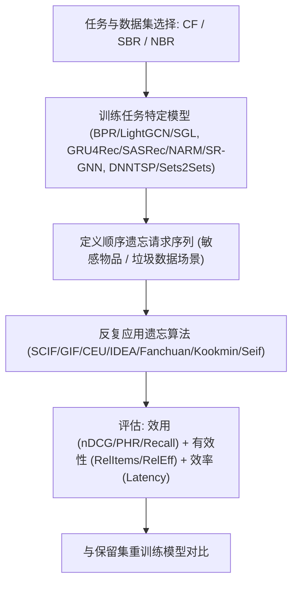
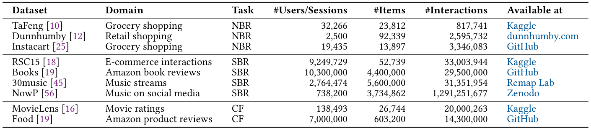
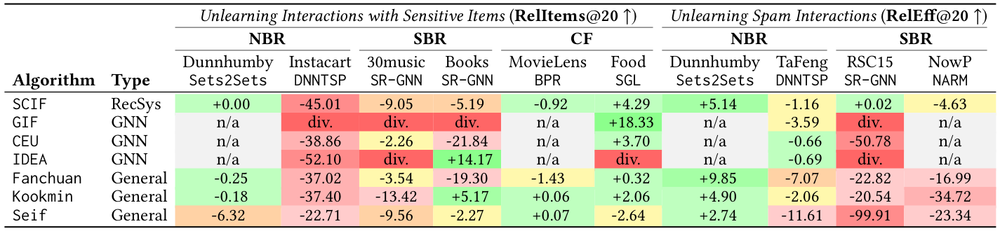
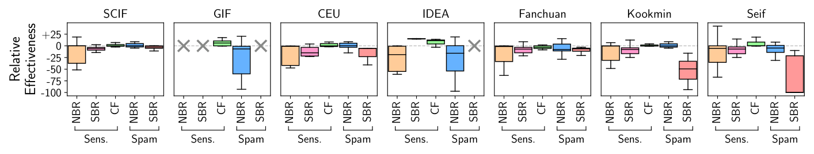
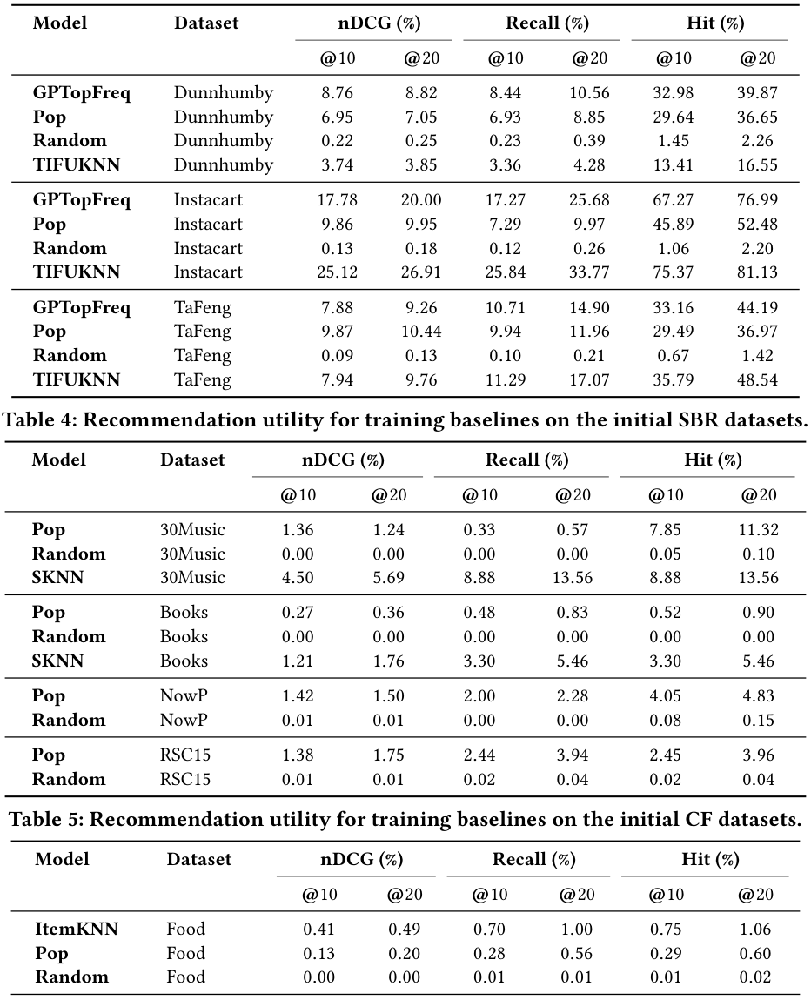

# ERASE -- A Real-World Aligned Benchmark for Unlearning in Recommender Systems (面向推荐系统机器遗忘的真实对齐基准)

- **会议/期刊**: SIGIR 2026
- **推荐链路定位**: 全链路基准评测 (Benchmark) — 覆盖召回/序列建模/下一篮预测的训练后模型遗忘
- **研究方向**: 去偏公平、可信隐私与工业架构 / 序列与会话推荐
- **论文原文**: [https://arxiv.org/abs/2603.08341v1](https://arxiv.org/abs/2603.08341v1)
- **开源代码**: [https://github.com/deem-data/erase-bench](https://github.com/deem-data/erase-bench)

## TL;DR (核心速览)

针对推荐系统机器遗忘 (MU) 现有基准仅覆盖协同过滤、遗忘集过大、忽视顺序遗忘与效率的痛点，本文提出 ERASE 基准：覆盖 CF/SBR/NBR 三任务、七种遗忘算法（通用+推荐专用+GNN 专用）、九数据集九模型，采用**顺序小批量遗忘请求**模拟真实场景。实验表明近似遗忘在部分设置可匹配重训练，但鲁棒性跨数据集/架构差异巨大，通用方法在注意力/循环模型上反复遗忘时失效，推荐专用方法更可靠。

## Background & Motivation (背景与动机)

- **领域背景与主流范式**: 推荐系统依赖用户交互数据训练，GDPR 等法规赋予用户"被遗忘权"，要求从模型中及时删除个人数据。机器遗忘 (MU) 旨在训练后高效移除特定训练数据的影响，使模型行为如同该数据从未参与训练。现有方法从精确重训练到近似参数更新不等。
- **现有方法局限 (Limitations of Prior Work)**:
  1. **任务覆盖窄**: 现有基准 CURE4Rec 仅覆盖协同过滤 (CF)，忽视电商/娱乐平台常见的会话推荐 (SBR) 与下一篮推荐 (NBR)。
  2. **遗忘集不真实**: 现有基准一次性删除高达 5% 数据，而真实系统面临的是重训练周期之间持续到达的小批量删除请求；且遗忘数据选择随机，未反映敏感物品/垃圾用户等有模式的选择。
  3. **效率不足**: CURE4Rec 中遗忘仅比重训练快约一个数量级，而真实部署需快 3 个数量级（秒/分钟级）；且仅含 SCIF 一种近似算法，未评估 NeurIPS'23 竞赛的高分一阶迭代方法。
- **核心挑战 (Key Challenge)**: 为何简单套用通用遗忘算法不够？推荐模型基于大规模稀疏交互训练、频繁更新、依赖序列/图架构，遗忘请求连续到达且需严格延迟约束；通用方法（如重置参数、加噪微调）在注意力/循环架构上反复遗忘时可能累积失效。
- **核心洞察与切入点 (Key Insight)**: 作者通过对欧洲百万级用户推荐系统资深团队负责人的访谈发现：删除请求目前仅在周/月重训练周期后生效（重训练本身可达一天），业界对现有遗忘方法能否部署存疑。据此提出四个指导性问题（有效性、鲁棒性、架构影响、效率），设计真实对齐基准。

## Problem Formulation & Method (问题定义与方法架构)

### 1. 符号定义与输入表征 (Notations & Input Representations)

- 训练数据集 $D$，训练算法 $A$，遗忘算法 $U$，遗忘集 $D_f \subseteq D$，保留集 $D_r = D \setminus D_f$。
- **精确遗忘**: $U$ 为精确遗忘当且仅当对所有 $T \subseteq \mathcal{H}$：$\mathbb{P}(A(D_r) \in T) = \mathbb{P}(U(A(D), D_r, D_f) \in T)$，即遗忘后模型分布应与在 $D_r$ 上从头重训练的模型一致。
- **近似遗忘**: $U$ 为 $(\varepsilon, \delta)$-遗忘当且仅当对所有 $T$：$\mathbb{P}(A(D_r)\in T) \le \exp(\varepsilon)\mathbb{P}(U(\cdot)\in T)+\delta$ 且反向不等式成立，$\varepsilon\in[0,\infty)$、$\delta\in[0,1)$；$(0,0)$ 即精确遗忘。
- **顺序遗忘协议**: 设 $\theta^{(0)}$ 为全量数据训练模型，顺序计算 $\theta^{(i+1)} \leftarrow U(\theta^{(i)}, D_r^{(i)}, D_f^{(i)})$，其中 $D_r^{(i)} = D \setminus \bigcup_{j=0}^{i} D_f^{(j)}$。批次数 $n$ 与每批内容依场景而定（如敏感物品场景按用户逐批遗忘）。

### 2. 整体流水线 (Overall Architecture)

数据流向：选定任务与数据集 → 训练任务特定模型 → 依场景定义顺序遗忘请求序列 → 反复应用遗忘算法 → 对比重训练模型评估效用/效率/有效性。

图 1 展示了 ERASE 的整体流程：① 在选定数据集上训练任务特定模型；② 基于场景定义顺序遗忘请求序列；③ 反复应用遗忘算法；④ 对比保留集重训练模型评估效用、效率与有效性。

<figure class="paper-figure" markdown="span">
  <figcaption>图 1</figcaption>
</figure>

### 3. 核心模块设计与数学原理 (Key Designs & Formulations)

**(1) 三类推荐任务与模型覆盖**:
- **CF**: 经典矩阵分解 BPR、图方法 LightGCN 与 SGL。
- **SBR**: 循环模型 GRU4Rec、NARM，注意力模型 SASRec，图模型 SR-GNN。
- **NBR**: 图模型 DNNTSP，注意力模型 Sets2Sets。

**(2) 七种遗忘算法**（时间复杂均与遗忘集大小线性相关）:
- **推荐/GNN 专用**: SCIF（影响函数，类牛顿步，含保留样本防灾难遗忘：$\tilde{\theta}_{\bar{z}} = \tilde{\theta} - H^{-1}_{\tilde{\theta}}\nabla_{\tilde{\theta}}(\frac{1}{2+b_s}(-\ell(z,\theta)+\ell(\bar{z},\theta)+\sum_{i=1}^{b_s}\ell(z_i,\theta)))$）；GIF（类似 SCIF 但按图距离 $d$ 选参数）；CEU（GNN 边遗忘，先加线性噪声项 $b^T\theta, b\sim\mathcal{N}(0,\sigma^2 I)$ 再影响函数更新）；IDEA（基于原始损失与剪枝损失差异的二阶更新）。
- **通用（NeurIPS'23 竞赛高分）**: Fanchuan（KL 散度对齐均匀伪标签 + 对比损失/保留集微调双模式）；Kookmin（重置梯度最相似的 $p|\theta|$ 参数后微调）；Seif（参数加高斯噪声后微调）。

**(3) 场景特定有效性度量**:
- **敏感物品遗忘**: $\text{Sensitive@}k := \frac{1}{|U_s|}\sum_{u\in U_s}[\mathcal{R}_u^k \cap I_s \neq \emptyset]$，即仍收到敏感物品的请求用户比例；$\text{RelItems@}k := \text{Sensitive}_r@k - \text{Sensitive}_u@k \in [-1,1]$，正值表示遗忘模型比重训练模型多移除 $p|U_s|$ 个用户的敏感物品。
- **垃圾数据移除**: $\text{RelEff@}k := \frac{\text{nDCG}_u@k}{\text{nDCG}_r@k} - 1 \in [-1,\infty)$，正值表示遗忘模型 nDCG 优于重训练模型 $p\%$。

### 4. 训练目标、负采样与推理复杂度 (Optimization, Negative Sampling & Complexity)

- **损失函数**: 各推荐模型沿用其原生训练损失（BPR 的 pairwise 损失、序列模型的交叉熵/CE 等），遗忘算法在其上施加影响函数更新、KL 对齐、参数重置或加噪微调，原文未统一给出单一总损失公式。
- **训练负采样策略**: 原文未报告各推荐模型的负采样细节（属基准复现范畴，沿用各模型原始实现）。
- **时间与空间复杂度**: 遗忘算法时间复杂均与遗忘集大小线性相关（刻意排除 RecEraser、UltraRE 等运行时间依赖训练集大小的精确方法）。效率以遗忘延迟绝对值和相对重训练加速比衡量；ERASE 产出超 600 GB 可复用工件（实验日志与超千个模型检查点），使新算法评估无需重训练推荐器。

## Experimental Setup & Evaluation Protocol (实验设置与评估协议)

- **数据集统计与预处理**: 九个公开数据集，覆盖三任务：

<figure class="paper-figure" markdown="span">
  <figcaption>表 1</figcaption>
</figure>

| 数据集 (Dataset) | 用户/会话数 | 物品数 | 交互数 | 领域/任务 |
| :--- | :---: | :---: | :---: | :--- |
| TaFeng | 32,266 | 23,812 | 817,741 | 杂货购物 / NBR |
| Dunnhumby | 2,500 | 92,339 | 2,595,732 | 零售购物 / NBR |
| Instacart | 19,435 | 13,897 | 3,346,083 | 杂货购物 / NBR |
| RSC15 | 9,249,729 | 52,739 | 33,003,944 | 电商交互 / SBR |
| Books | 10,300,000 | 4,400,000 | 29,500,000 | 亚马逊书评 / SBR |
| 30music | 2,764,474 | 5,600,000 | 31,351,954 | 音乐流 / SBR |
| NowP | 738,200 | 3,734,862 | 1,291,251,677 | 社交媒体音乐 / SBR |
| MovieLens | 138,493 | 26,744 | 20,000,263 | 电影评分 / CF |
| Food | 7,000,000 | 603,200 | 14,300,000 | 亚马逊商品评论 / CF |

- **数据划分方式 (Splitting Strategy)**: 原文未在正文明确报告各数据集的具体划分比例（如 LOO 或比例切分），属基准复现细节；顺序遗忘协议本身按用户/批次顺序切分遗忘集，需注意与重训练基线的一致性对齐。
- **排名评测协议 (Ranking Protocol)**: 原文未明确报告是 Full-Ranking 还是 Sampled Ranking，属基准实现细节（需查阅代码仓库确认）。
- **评价指标与显著性检验**: 效用指标 Recall、PHR (Personalized Hit Ratio)、nDCG；有效性指标 RelItems@20、RelEff@20；效率指标遗忘延迟及相对重训练加速比。原文未报告配对显著性检验。

## Key Experimental Results (核心实验结果)

### 1. 主实验对比 (Main Results)

表 2 报告各场景-任务-数据集组合下最佳模型的有效性（RelItems@20 / RelEff@20，↑ 越高越好）：

<figure class="paper-figure" markdown="span">
  <figcaption>表 2</figcaption>
</figure>

| 场景 | 数据集 | 模型 | 最佳算法 | 指标值 |
| :--- | :--- | :--- | :--- | :---: |
| 敏感物品 (NBR) | Dunnhumby | Sets2Sets | SCIF | +0.00 |
| 敏感物品 (NBR) | Instacart | DNNTSP | Seif | -22.71 |
| 敏感物品 (SBR) | 30music | SR-GNN | CEU | -2.26 |
| 敏感物品 (SBR) | Books | SR-GNN | IDEA | +14.17 |
| 敏感物品 (CF) | MovieLens | BPR | Kookmin | +0.06 |
| 敏感物品 (CF) | Food | SGL | GIF | +18.33 |
| 垃圾移除 (NBR) | Dunnhumby | Sets2Sets | Fanchuan | +9.85 |
| 垃圾移除 (NBR) | TaFeng | DNNTSP | CEU | -0.66 |
| 垃圾移除 (SBR) | RSC15 | SR-GNN | SCIF | +0.02 |
| 垃圾移除 (SBR) | NowP | NARM | SCIF | -4.63 |

关键结论：有效性差异巨大，但多数组合至少有一种算法能匹配重训练模型；SCIF 在垃圾移除场景表现稳定（RSC15 +0.02、Dunnhumby +5.14），GIF 在 Food 上达 +18.33 但多处发散 (div.)。

### 2. 消融实验与控制变量分析 (Ablation Study)

本文为基准论文，无传统消融实验，但通过**跨任务/数据集/模型/算法的系统对比**实现控制变量分析：

<figure class="paper-figure" markdown="span">
  <figcaption>图 2</figcaption>
</figure>

图 2 展示跨任务、数据集、模型与运行聚合的相对有效性分布：推荐专用算法 SCIF 是跨任务最一致、最鲁棒的方案；无数据的场景-任务组合表示算法不适用或发散。通用方法（Fanchuan/Kookmin/Seif）在注意力/循环模型上反复遗忘时暴露弱点。

### 3. 稀疏度/冷启动分桶与超参敏感度 (Sparsity Buckets & Hyperparameters)

- **架构影响**: 注意力/循环模型（SASRec、NARM、GRU4Rec）上通用方法反复遗忘鲁棒性差，推荐专用方法更可靠；GNN 专用方法（GIF/CEU/IDEA）在部分组合发散。
- **效率-有效性权衡**: 图 3 展示遗忘算法相对重训练的加速比与相对有效性，绿色区域标记适合部署的算法——多数算法加速比有限，SCIF 等推荐专用方法在效率-有效性权衡上更优。

<figure class="paper-figure" markdown="span">
  <figcaption>图 3</figcaption>
</figure>

- **训练基线效用**: 表 3 报告初始 NBR 数据集上训练基线的推荐效用，作为遗忘后效用保持的参照。

<figure class="paper-figure" markdown="span">
  <figcaption>表 3</figcaption>
</figure>

- **线上 A/B 测试**: 原文仅包含离线基准实验，无线上 A/B 测试。

## Highlights, Limitations & Critiques (亮点、局限与审稿级批判)

- **核心亮点与可迁移性**: (1) 首个覆盖 CF/SBR/NBR 三任务的推荐遗忘基准，顺序小批量遗忘协议贴近真实部署；(2) 600 GB 可复用工件（日志+超千检查点）使新算法评估无需重训练，极大降低研究门槛；(3) 场景特定有效性度量（RelItems/RelEff）比权重空间距离或成员推断攻击更可解释、更贴近业务；(4) 揭示"通用遗忘方法在注意力/循环架构上反复遗忘失效"这一重要经验结论，对工业部署有直接指导意义。
- **局限性与审稿视角批判**: (1) 正文未明确报告数据划分策略与排名评测协议（Full vs. Sampled Ranking），复现需依赖代码仓库，透明度略欠；(2) 未报告配对显著性检验与多随机种子方差，有效性数值（如 +18.33 vs -99.91）波动大，统计严谨性可加强；(3) 有效性度量依赖与重训练模型的对比，而重训练本身受随机性影响（模型多重性），RelItems/RelEff 的方差未被量化；(4) 仅离线基准，缺乏真实工业系统部署验证；(5) 部分算法在多数组合发散 (div.)，基准的算法覆盖虽广但可用性参差。

## Rating (四维评分)

- **方法创新性 (Novelty)**: ⭐⭐⭐⭐ （基准类工作，创新在于真实对齐的协议设计与系统性经验发现）
- **评估协议与实验扎实度 (Protocol & Experiments)**: ⭐⭐⭐⭐ （覆盖广、工件丰富，但划分/评测协议透明度与统计检验不足）
- **写作与数学规范度 (Clarity & Rigor)**: ⭐⭐⭐⭐ （形式化定义清晰，度量公式严谨）
- **工业落地与复现价值 (Industrial & Practical Value)**: ⭐⭐⭐⭐⭐ （开源代码+600GB 工件+真实访谈驱动，落地与复现价值极高）
