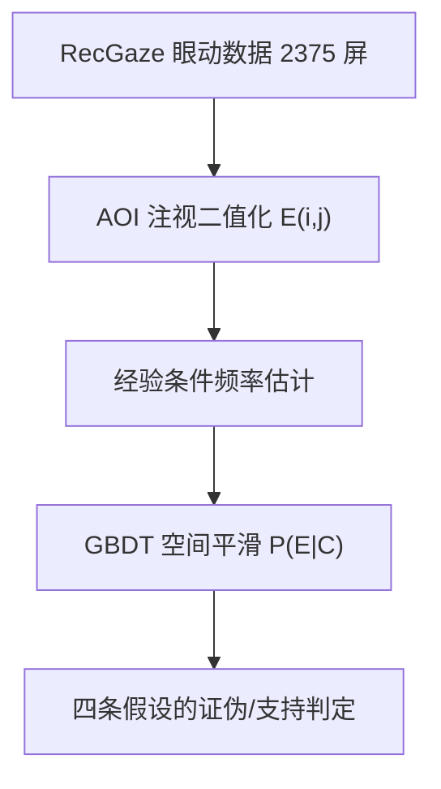
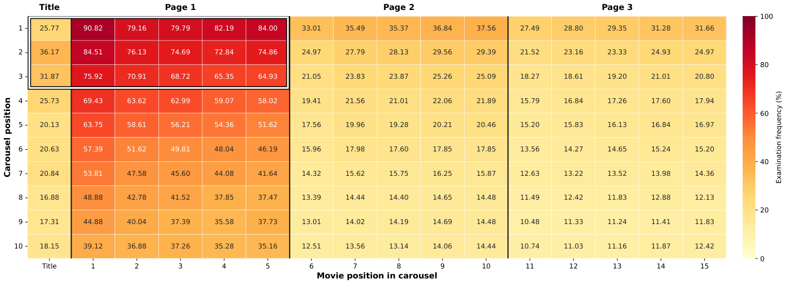

# Following the Eye-Tracking Evidence: Established Web-Search Assumptions Fail in Carousel Interfaces (跟随眼动证据：既有 Web 搜索假设在轮播界面中失效)

- **会议/期刊**: SIGIR 2026 (Proceedings of the 49th International ACM SIGIR Conference, pp. 734-744)
- **作者与机构**: Jingwei Kang, Maarten de Rijke, Harrie Oosterhuis（University of Amsterdam）
- **推荐链路定位**: 重排 / 评估度量与点击模型基础（非模型类工作，属行为实证与偏差建模基础研究）
- **研究方向**: 去偏公平与工业架构 / 多任务学习与列表级重排
- **论文原文**: [https://arxiv.org/abs/2604.21019v1](https://arxiv.org/abs/2604.21019v1)
- **开源代码**: [https://github.com/jkang98/RecGaze-Analysis](https://github.com/jkang98/RecGaze-Analysis)

## TL;DR (1分钟核心速览)

轮播（carousel）界面已是 Netflix/Spotify 的事实标准，但现有 N2DCG 度量与 CCM 点击模型均直接照搬单列 Web 搜索的 F 型注意力、层级浏览与 examination hypothesis 假设，从未被实证检验。本文基于唯一公开的轮播眼动数据集 RecGaze（87 名被试、2375 个有效屏幕、每屏 10 行 × 15 项），用原始频率 + 梯度提升树平滑的条件概率热图逐条证伪四条假设：F 型仅存在于纵向、点击条件下呈轮播特有的 **L 型**注视；同列内条件点击率随行显著波动（$p<0.001$），examination hypothesis 不成立；用户普遍先看封面再看标题。结论是轮播场景的度量折扣与点击模型需整体重估。

## Background & Motivation (背景与核心矛盾)

- **主流范式**: 轮播界面以"纵向堆叠主题行 + 行内横向滑动分页"呈现推荐；由于缺乏行为研究，N2DCG/NDCG2D 直接沿用 Web 搜索的 golden triangle（F 型）折扣，CCM 则假设用户先看行标题决定是否进入、再从左到右顺序浏览，并依赖 examination hypothesis $P(C=1)=P(E=1)\cdot P(C=1\mid E=1)$。
- **前人局限**: 其一，这些假设全部来自单列或规则网格界面，而轮播存在"分页滑动"这一单列界面不存在的交互原语，横向注意力方向可能被机械地反转；其二，CCM 的层级假设要求点击行之前的行被完整浏览，这在随机化行序下极易被证伪却从未检验。
- **核心洞察 (Key Insight)**: 轮播的行序在屏幕构造阶段被完全随机化（每用户看到同一组 30 屏），因此**同一列内不同行的物品分布在统计上同质**——这提供了一个天然的因果对照，使得"同列条件点击率应相等"成为 examination hypothesis 的可检验推论。
- **本文切入点**: 不做新模型，而是把四条假设转写为可计算的条件频率命题，用眼动注视（≥60ms 视为 examined）逐条做假设检验，并给出替代性的行为描述（L 型、双焦点 F 型、镜像 F 型）。

## Method (核心方法设计)

### 1. 整体框架 (Overall Architecture)

分析管线为：RecGaze 自由浏览任务数据（剔除误点屏）→ 以 AOI 内是否存在有效注视定义二元变量 $E_{i,j}$（第$i$行第$j$列）→ 计算三类经验频率：无条件注视频率$\hat{P}(E_{i,j}=1)$、点击条件下注视频率$\hat{P}(E_{i,j}=1\mid C_{i',j'}=1)$、注视条件下点击频率$\hat{P}(C_{i,j}=1\mid E_{i,j}=1)$ → 对稀疏条件频率用梯度提升树做空间平滑 → 以热图与 Z 检验对照四条假设。核心工程难点在于尾部位置点击极稀疏（位置 (6,15)、(9,12) 全程零点击），故平滑是使条件热图可读的必要步骤。

<figure class="paper-figure" markdown="span">
  <figcaption>图3：跨位置和页面的实际查看频率热图。每个小单元中的数字表示该位置的频率。白色框表示初始可见的条目和标题。反驳假设1：我们可以在第1页观察到双焦点 F 形模式，并在第2页和第3页内观察到镜像 F 形模式。重要的是，我们还观察到不存在跨页面的全局 F 形模式。反驳假设4：我们还观察到大多数用户不会查看轮播的标题。第一个轮播的标题（25.77%）与其第一个</figcaption>
</figure>

### 2. 关键设计拆解 (Key Designs)

1. **条件频率估计与机器学习平滑（让稀疏条件热图可信）**：痛点是对尾部位置直接估计 $\hat{P}(E_{i,j}=1\mid C_{i',j'}=1)=\frac{N(E_{i,j}=1\wedge C_{i',j'}=1)}{N(C_{i',j'}=1)}$方差爆炸甚至分母为零。作者以目标位置与条件位置的绝对坐标、相对距离等空间特征训练 GBDT 回归该条件概率，隐含"注意力在界面上空间连续传播"的先验。在至少 10 次点击的 63 个位置上，平滑值与原始频率的 Pearson$r=0.95$、MAE$=6.05$pp，说明平滑保形而非造形；代价是真实偏离邻域的位置会被部分抹平。

2. **L 型模式的发现（点击条件下注视的真正几何形状）**：若 Assumption 2 成立，点击位置应构成视觉边界，其右侧与下方应为空。实测相反：点击在第 2、3 页时，第 1 页整页几乎必然被注视；点击不在页右缘时，其右侧物品也几乎必然被注视。由此归纳出 L 型——第 1 页构成粗竖线，点击所在页延伸出细横线，形似字母 L；此外点击行下方第 1 页物品、以及点击行上方后续页物品也有升高概率。物理直觉是：用户系统性扫完首屏所有可见行，横向滑动基本只发生在最终点击的那一行。

3. **examination hypothesis 的随机化检验（把不可观测的混杂变成可检验命题）**：由于行序随机化，同列不同行的物品分布同质，故假设 3 蕴含 $\forall (i,j),i': P(C_{i,j}=1\mid E_{i,j}=1)=P(C_{i',j'}=1\mid E_{i',j'}=1)$。作者对第 1 页前五列做第 1 行 vs 第 6 行的双侧 Z 检验，第 2、3 列差异显著（$+2.63\%$与$+1.75\%$，$p<0.001$与$p=0.003$，Bonferroni 校正后仍显著），足以拒绝假设。该现象与单列界面的 trust bias 高度类似，提示轮播中同样存在"位置—信任"耦合。

## Experimental Setup & Evaluation Protocol (实验设置与评估协议)

- **数据集与预处理**: 唯一公开轮播眼动数据集 RecGaze，仅取最接近自然行为的 free browsing 任务：

| 数据集 | #Users | #Screens(有效) | 界面规模 | 交互约束 | 特征/场景说明 |
| :--- | :---: | :---: | :---: | :---: | :--- |
| RecGaze (free browsing) | 87 | 2375 | 10 行 × 15 项（3 页 × 5） | 每屏仅 1 次点击 | 行序完全随机；行内按 IMDb 票数降序；仅 2000–2023 影片且剔除票数 Top-150 |

- **数据划分与防穿越 (Splitting Strategy)**: 非训练型工作，无划分；采用全量屏幕的聚合频率统计，剔除被试自报误点的屏幕。
- **排名评测协议 (Ranking Protocol)**: 不适用传统 Full-Ranking / Sampled Ranking；等价协议为**全位置条件频率统计 + 双侧 Z 检验**（显著性 $p<0.05$，Bonferroni 校正后$p<0.01$），并以$r$ 与 MAE 校验平滑保真度。
- **对比基线与超参设置**: 对比对象为四条文献假设（Assumption 1–4）而非模型；注视阈值 60ms 沿用数据集设定；平滑模型为 GBDT，特征含绝对坐标与相对距离。

## Key Experimental Results (实验关键数据)

### 1. 主实验对比 (Main Results)

本文无模型精度对比，核心"结果表"为四条假设的判定与关键统计量：

| 假设 | 内容 | 关键证据 | 判定 |
| :--- | :--- | :--- | :---: |
| A1 | 无条件注视呈全局 F 型 | 第 1 页双焦点 F 型；第 2/3 页为**镜像 F 型**（右→左衰减）；跨页无全局 F 型 | **证伪** |
| A2 | 点击条件下层级顺序浏览 | 点击在第 2/3 页时第 1 页几乎全被注视；非右缘点击时右侧物品亦被注视 | **证伪（呈 L 型）** |
| A3 | 同列条件点击率相等 | 第 2 列 $+2.63\%$($p<0.001$)、第 3 列$+1.75\%$($p=0.003$)，行 1 显著高于行 6 | **证伪** |
| A4 | 先看标题再看内容 | 首行首项注视率 $90.82\%$vs 其标题$25.77\%$（至少$65.05\%$用户只看项不看标题）；标题为首个注视点的比例仅$2.06\%\sim15.09\%$ | **证伪** |

### 2. 消融实验 (Ablation Study)

以"平滑 vs 原始频率"及"任务/位置子集"作为等价消融，考察结论稳健性：

| 配置 | 关键指标 | 结论变化 |
| :--- | :--- | :--- |
| 原始频率（不平滑） | 尾部位置零点击，(6,15)/(9,12) 条件频率未定义 | L 型在 2/3 页不可读 |
| GBDT 平滑（全位置） | $r=0.95$, MAE$=6.05$pp（63 个 ≥10 点击位置） | L 型清晰浮现，结论不变 |
| 仅第 1 页 | 条件点击率列内波动最大 | A3 证伪主要由此页驱动 |
| 仅 free browsing 任务 | 全部四条假设均被拒 | 结论限于该任务设定 |

### 3. 关键实验发现 (Key Findings)

1. **注意力几何是"分页依赖"的**：第 1 页呈双焦点 F 型（左上 + 右上，右上峰疑似寻找滑动箭头），第 2/3 页因滑动后视线从右侧进入而呈镜像 F 型；这意味着任何以左上角为唯一原点、单调递减的二维折扣（如 N2DCG）都与真实注视分布系统性错配。
2. **首屏是"必扫区"而非"跳读区"**：点击落在后续页时第 1 页仍近乎全被注视，说明用户极少跳过整行，横向滑动高度集中于最终点击行——这直接否定了 CCM"按标题逐行筛选"的导航逻辑，也解释了为何标题注视率（首行 25.77%）远低于首项（90.82%）。
3. **位置偏差在轮播中依然存在且可统计检出**：在行序随机化这一强对照下，同列第 1 行与第 6 行的条件点击率仍相差 $1.75\%\sim2.63\%$（$p<0.01$），性质上类似单列界面的 trust bias，提示轮播点击模型必须显式建模行级位置偏置，而不能仅靠 examination 因子吸收。

## Highlights & Limitations (亮点、对比与审稿批判)

- **与代表作对比 (vs. Prior Work)**: 相较 N2DCG/NDCG2D（直接移植 golden triangle 折扣）与 CCM（假设标题优先 + 层级顺序 + examination hypothesis），本文不改模型而是抽掉其行为地基：前者错在折扣原点与方向，后者错在导航顺序与点击因子分解的可分性。
- **可迁移亮点**: ①"界面随机化 → 同列同质性 → 条件率应相等"这一检验范式可迁移到任何存在随机化曝光的重排/位置偏差审计；②用 GBDT 对稀疏条件频率做空间平滑并报告 $r$/MAE 保真度，是眼动与小样本行为分析的实用套路。
- **审稿级局限批判**: ①仅单一数据集、单一 UI 布局与单一 free browsing 任务，作者自承结论未必外推到其他轮播设计与任务框架，且未做被试异质性分析；②平滑的空间连续性先验会抹平真实局部偏离，且 A3 的证伪仅在第 2、3 列达显著，其余列不显著，证据强度不均；③未给出可落地的替代度量或点击模型，仅"排除若干类设计"，工业可用性仍待后续工作兑现。

## Rating (四维评分)

- **方法创新性 (Novelty)**: ⭐⭐⭐⭐ （不提出新模型，但以随机化对照把 examination hypothesis 转为可检验命题，并首次命名轮播特有的 L 型注视，问题重构本身具原创性）
- **评估协议与实验扎实度 (Protocol & Experiments)**: ⭐⭐⭐⭐ （2375 屏、全位置频率 + Z 检验 + 平滑保真度校验严谨，但单数据集、单任务、部分列不显著削弱外推）
- **写作与数学规范度 (Clarity & Rigor)**: ⭐⭐⭐⭐⭐ （四条假设先形式化再逐条检验的结构极清晰，条件概率定义与检验推论推导干净，局限自陈诚实）
- **工业落地与复现价值 (Industrial & Practical Value)**: ⭐⭐⭐⭐ （代码与数据均开源，结论可直接指导轮播场景的折扣设计与位置去偏，但需自建眼动或大规模日志验证后才能上线）

