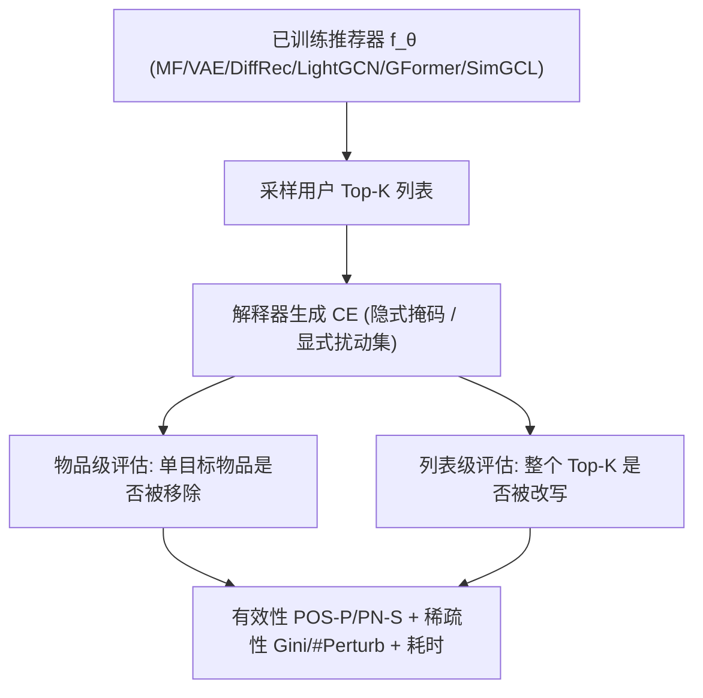

# From Top-1 to Top-K: A Reproducibility Study and Benchmarking of Counterfactual Explanations for Recommender Systems (从 Top-1 到 Top-K：推荐系统反事实解释的可复现性研究与基准测试)

- **会议/期刊**: SIGIR 2026
- **作者与机构**: Quang-Huy Nguyen, Thanh-Hai Nguyen, Khac-Manh Thai 等 (VNU University of Engineering and Technology; Delft University of Technology)
- **推荐链路定位**: 重排 / 解释层（后置解释生成，不改变推荐主链路）
- **研究方向**: 去偏公平与工业架构 / 图神经网络推荐
- **论文原文**: [论文原文链接](https://arxiv.org/abs/2604.19663v1)
- **开源代码**: [开源代码仓库链接](https://github.com/L2R-UET/CFExpRec)

## TL;DR (1分钟核心速览)

推荐系统反事实解释（CE）领域长期存在评估碎片化问题：各方法使用不同数据集、推荐器、指标乃至解释格式（隐式重要性分数 vs. 显式交互扰动集），导致结论无法公平比较。本文系统复现并重新实现 11 种 SOTA CE 方法（含 6 种推荐原生解释器与 5 种迁移自 GNN 的解释器），提出统一基准框架，沿「解释格式 × 评估层级 × 扰动范围」三维度评估，并**首次将评估从单物品级扩展到 Top-K 列表级**，新增位置敏感的 PN-R 指标。在 3 个数据集、6 个推荐器上的实验表明：显式格式下有效性-稀疏性存在强权衡，列表级与物品级结论高度一致，而多种图解释器在大图上存在严重可扩展性瓶颈（OOM 或数千秒级推理）。

## Background & Motivation (背景与核心矛盾)

- **主流范式**: CE 通过寻找「最小交互改动使推荐结果翻转」来提供可操作解释，分为隐式（输出交互重要性掩码）与显式（直接输出需增删的交互子集）两大范式。
- **前人局限**: 其一，各方法自带定制指标（POS-P/NEG-P 用于隐式，PN-S 用于显式），跨范式无法直接比较；其二，几乎所有方法仅解释单个推荐物品，而真实系统输出的是 Top-K 排序列表，单物品结论能否外推到列表级完全未知。
- **核心洞察 (Key Insight)**: 解释器的「有效性」与「稀疏性」并非单调正相关，且图解释器依赖的 $k$-hop 子图假设在推荐场景下未必成立——因为单边扰动会通过消息传递影响多个节点表征。
- **本文切入点**: 构建模型无关的统一评估协议，将 11 种解释器置于同一实验台，并把评估粒度从 Top-1 推进到 Top-K。

## Method (核心方法设计)

### 1. 整体框架 (Overall Architecture)

本文不提出新解释算法，而是构建一个**评估基准框架**：固定已训练推荐器 $f_\theta$ 的参数，对每个用户采样其 Top-K 列表，分别以隐式/显式两种格式生成反事实解释，再在物品级与列表级两个层级上，通过逐步扰动（隐式）或直接干预（显式）测量推荐结果的变化，同时记录稀疏性与推理耗时。框架的核心贡献在于将异构解释器的输出统一映射到可比较的扰动序列上。

### 2. 关键设计拆解 (Key Designs)

1. **列表级评估协议与 PN-R 指标**：痛点在于原 PN-S 仅统计「被移除物品比例」，对所有排名位置一视同仁，无法区分「挤掉第 1 名」与「挤掉第 5 名」的解释力度差异。本文借鉴 NDCG 的位置折扣思想，定义
$$\text{PN-R}@K(u)=1-\frac{\sum_{k=1}^{K}\mathbb{I}[\text{rank}(i_k;\mathbf{x}_u^p)\le K]/\log_2(\text{rank}(i_k;\mathbf{x}_u^p)+1)}{\sum_{k=1}^{K}1/\log_2(k+1)}$$
高排名物品被替换时折扣惩罚更重，从而奖励「撼动头部」的解释。直觉上，这使列表级评估具备排序敏感性，而非仅计数。

2. **隐式格式的扰动序列化评估**：隐式解释器只输出重要性分数 $\mathbf{m}\in[0,1]^{|\mathcal{I}|}$，无法直接得到扰动集。本文按分数降序（POS-P）与升序（NEG-P）逐步置零交互，共$T=10$步，每步移除$100/T\%$ 的交互：
$$\text{POS-P}@K(u)=\frac{1}{TK}\sum_{t=1}^{T}\sum_{k=1}^{K}\mathbb{I}[\text{rank}(i_k;\mathbf{x}_u^{(t,pos)})\le K]$$
POS-P 越低说明高重要性交互被移除后目标越快掉出榜单，NEG-P 越高说明低重要性交互几乎无影响，二者共同刻画解释的充分性。

3. **扰动范围的四级消融设计**：针对图解释器普遍采用的 $k$-hop 子图裁剪，本文设计 Full /$k$-hop / Indirect（仅保留用户-目标物品间$k$-hop 路径）/ User-only 四种范围，系统检验「缩小搜索空间是否损失解释质量」。这一设计直接挑战了 GNN 解释领域「节点表征仅依赖$k$-hop 邻域故可安全裁剪」的默认假设。

## Experimental Setup & Evaluation Protocol (实验设置与评估协议)

- **数据集与预处理**:

| 数据集 | #Users | #Items | #Interactions | 稀疏度 | 特征/场景说明 |
| :--- | :---: | :---: | :---: | :---: | :--- |
| Amazon (Fashion) | 1,275 | 1,374 | 6,973 | 99.60% | 评分 >3 视为正交互，过滤交互数 <3 的用户/物品 |
| ML1M | 6,037 | 3,381 | 575,128 | 97.18% | 经典电影推荐基准 |
| Yahoo | 13,797 | 4,604 | 365,750 | 99.42% | 大规模稀疏新闻/音乐场景 |

- **数据划分与防穿越**: 采用 `8:1:1` 比例划分训练/验证/测试，验证集连续 20 轮不提升即早停；解释生成阶段随机采样 500 用户评估，其余用户供 LXR、CLEAR 等需预训练的方法使用。
- **排名评测协议**: 采用 `Full-Ranking` 语义下的 Top-K 列表评估（$K\in\{3,5\}$），隐式格式扰动步数固定$T=10$；所有指标报告均值与标准差。
- **对比基线与超参设置**: 6 个推荐器（MF、VAE、DiffRec、LightGCN、GFormer、SimGCL）× 11 个解释器（LIME-RS、SHAP、PRINCE、ACCENT、LXR、GREASE、CF-GNNExplainer、CF2、CLEAR、UNR-Explainer、C2Explainer）。所有超参经 Optuna 以 POS-P/PN-S 为目标重新调优，确保公平性。

## Key Experimental Results (实验关键数据)

### 1. 主实验对比 (Main Results)

**隐式格式 + MF 推荐器（Amazon，物品级）**：

| 解释器 | POS-P@3↓ | NEG-P@3↑ | Gini@3↑ | POS-P@5↓ | NEG-P@5↑ |
| :--- | :---: | :---: | :---: | :---: | :---: |
| LIME-RS | 0.1471 | 0.1495 | 0.4256 | 0.1682 | 0.1719 |
| SHAP | 0.1312 | 0.1575 | 0.1396 | 0.1570 | 0.1798 |
| ACCENT | 0.1491 | 0.1453 | 0.4818 | 0.1696 | 0.1688 |
| **LXR** | **0.1161** | **0.1805** | **0.4809** | **0.1481** | **0.1916** |

**显式格式 + LightGCN 推荐器（Amazon，物品级）**：

| 解释器 | PN-S@3↑ | #Perturb@3↓ | PN-S@5↑ | #Perturb@5↓ |
| :--- | :---: | :---: | :---: | :---: |
| GREASE | **0.8513** | 4.99 | **0.8392** | 9.29 |
| CF-GNNExplainer | 0.4467 | **1.12** | 0.3064 | **0.77** |
| CF2 | 0.5422 | 24.87 | 0.4247 | 24.79 |
| CLEAR | 0.6340 | 9.25 | 0.6876 | 9.39 |
| UNR-Explainer | 0.5836 | 1.85 | 0.4833 | 2.05 |
| C2Explainer | 0.6100 | 157.39 | 0.5220 | 111.33 |

**显式格式 + LightGCN（ML1M，物品级）**：CF2 的 PN-S@3 达 0.5453 但需 **62,125** 次扰动；C2Explainer 达 0.9753 但需 **222,184** 次扰动，稀疏性完全崩溃。

### 2. 消融实验 (Ablation Study)

**图扰动范围消融（Amazon + LightGCN，列表级 PN-R@5）**：

| 解释器 | Full | $k$-hop | Indirect | User-only |
| :--- | :---: | :---: | :---: | :---: |
| CF2 | 最优 | 下降 | 无稳定增益 | 弱于 $k$-hop |
| CF-GNNExplainer | 基准 | 相当 | 无稳定增益 | 相当 |
| GREASE | 基准 | 相当 | 无稳定增益 | 相当 |
| CLEAR | 基准 | **提升** | 无稳定增益 | — |
| UNR-Explainer | 基准 | **提升** | 无稳定增益 | — |

### 3. 关键实验发现 (Key Findings)

1. **有效性-稀疏性权衡在显式格式下普遍成立但非绝对**：ML1M 上 CF2 与 C2Explainer 以数万至数十万次扰动换取最高 PN-S，而 Amazon 上 UNR-Explainer 以平均不足 3 次扰动即取得更优有效性，说明「高有效性必然低稀疏」的直觉依赖于数据集密度与优化策略（从大边集收缩 vs. 从小边集扩张）。
2. **列表级与物品级结论高度一致，但存在个别反例**：LXR 在隐式格式下于 Amazon/Yahoo 两个层级均领先，LXR 在显式格式下物品级与列表级分数几乎重合（Amazon PN-S@3 物品级 0.7420 vs. 列表级 0.7660）；但 CLEAR 在 Amazon 上物品级排名第二、列表级却跌至倒数第二，提示单层级评估可能误导。
3. **图解释器可扩展性是硬瓶颈**：CLEAR 在 ML1M/Yahoo 直接 OOM；CF2 在 Yahoo 列表级需 1,688 秒/次解释；C2Explainer 在 ML1M 需 22 万次扰动。相比之下，预训练类方法（LXR 推理 0.001–0.004 秒）与搜索类方法（UNR-Explainer 0.78–213 秒）在效率上更具部署可行性。

## Highlights & Limitations (亮点、对比与审稿批判)

- **与代表作对比 (vs. Prior Work)**: 相较 LXR 原文仅报告隐式格式单物品指标、GREASE 仅在 Amazon 类小图上验证，本文首次将二者与 5 种通用 GNN 解释器置于同一协议下；与既有可复现性研究（如公平性复现、可解释性复现）相比，本文的独特增量在于**列表级评估维度**与**扰动范围的系统消融**。
- **可迁移亮点**: (1) PN-R 的位置折扣设计可直接迁移到任何「列表改写质量」评估场景（如重排多样性、去偏干预效果度量）；(2) 四级扰动范围消融范式可用于检验任何图解释器的子图裁剪假设是否成立。
- **审稿级局限批判**: 其一，CLEAR 在 ML1M/Yahoo 的 OOM 导致图解释器跨数据集结论不完整，削弱了「可扩展性瓶颈」论断的普适性证据；其二，仅采样 500 用户评估且未报告置信区间外的显著性检验，小样本下方差较大（表中标准差常达 0.2–0.4），部分排名差异可能不显著。

## Rating (四维评分)

- **方法创新性 (Novelty)**: ⭐⭐⭐ （非新算法，但列表级评估协议与 PN-R 指标填补了 CE 评估空白，扰动范围消融具方法论价值）
- **评估协议与实验扎实度 (Protocol & Experiments)**: ⭐⭐⭐⭐ （3 数据集 × 6 推荐器 × 11 解释器，Optuna 统一调参，但 500 用户采样与 OOM 缺口略损完整性）
- **写作与数学规范度 (Clarity & Rigor)**: ⭐⭐⭐⭐ （三维度协议定义清晰，公式与指标推导完整，表格信息密度高）
- **工业落地与复现价值 (Industrial & Practical Value)**: ⭐⭐⭐⭐⭐ （全代码开源，直接给出各解释器推理耗时与可扩展性边界，对线上解释服务选型具直接指导意义）

