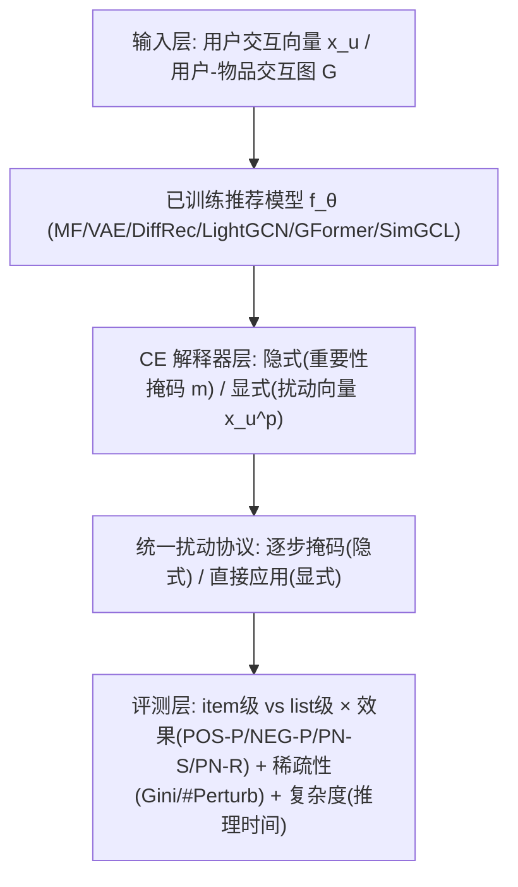
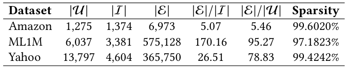
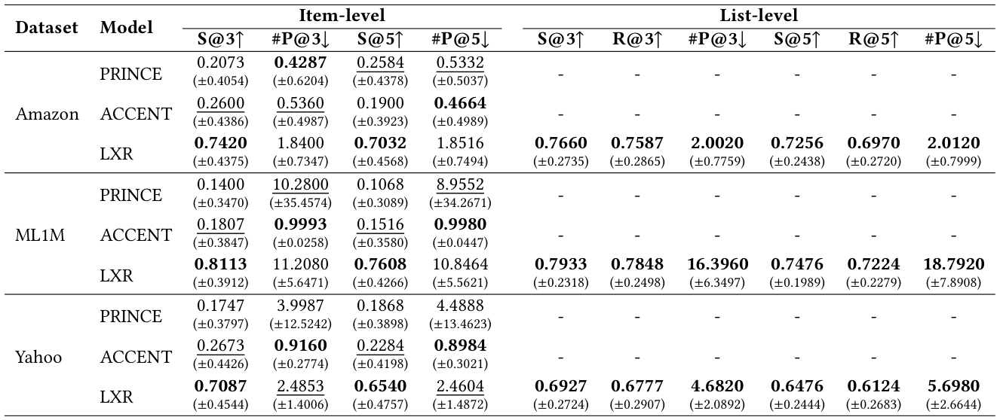
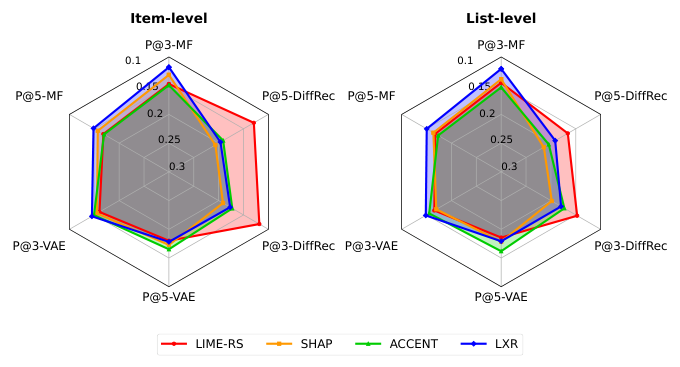
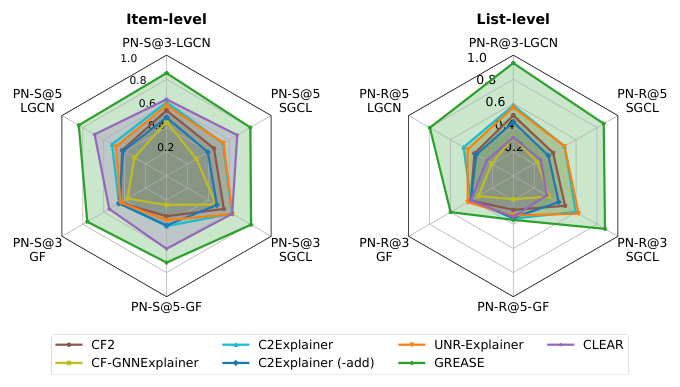
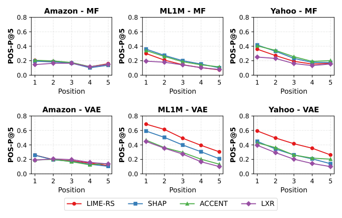
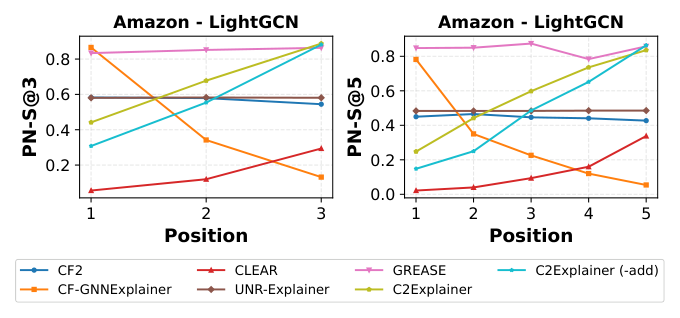

# From Top-1 to Top-K: A Reproducibility Study and Benchmarking of Counterfactual Explanations for Recommender Systems (从 Top-1 到 Top-K：推荐系统反事实解释的可复现性研究与基准测试)

- **会议/期刊**: SIGIR 2026 (第49届国际ACM SIGIR会议，Melbourne, VIC, Australia)
- **推荐链路定位**: 重排/可解释性评测 (Re-ranking / Explainability Evaluation) — 面向已训练推荐模型的**事后解释 (Post-hoc Explanation)** 与可信评测
- **研究方向**: 去偏公平、可信隐私与工业架构 (主) / 对话推荐与智能体仿真 (次，因解释生成与用户交互理解相关)
- **论文原文**: [https://arxiv.org/abs/2604.19663v1](https://arxiv.org/abs/2604.19663v1)
- **开源代码**: [https://github.com/L2R-UET/CFExpRec](https://github.com/L2R-UET/CFExpRec)

## TL;DR (核心速览)

针对推荐系统反事实解释 (CE) 领域"各方法自定协议、无法公平比较"的碎片化痛点，本文系统复现并重实现 11 种 CE 方法（6 种推荐原生 + 5 种 GNN 解释器迁移），提出沿**解释格式 (隐式/显式) × 评测层级 (item/list) × 扰动范围 (用户向量/交互图)** 三维度的统一基准框架，首次将评测从 Top-1 扩展到 Top-K 列表级，并新增位置敏感的 PN-R 指标。在 3 个真实数据集、6 个推荐模型上的实验表明：效果-稀疏性权衡高度依赖方法与设置，item 级与 list 级结论基本一致，而图解释器在大图上存在显著可扩展性瓶颈。

## Background & Motivation (背景与动机)

- **领域背景与主流范式**: 反事实解释通过回答"若用户行为发生何种最小改变，推荐结果会如何变化"的 what-if 问题，为用户提供可操作、可理解的洞察，同时帮助工程师调试模型。现有 CE 方法按输出格式分为两大类：**隐式方法**（输出每个历史交互的重要性分数，如 LIME-RS、SHAP、LXR）与**显式方法**（直接输出需增删的交互子集，如 PRINCE、ACCENT、GREASE）。
- **现有方法局限 (Limitations of Prior Work)**:
  1. **协议异质性**：不同方法使用不同数据集、推荐器、指标甚至解释格式，导致无法公平比较（表 1 系统对比了各方法原始论文的评测维度，可见无任何方法同时覆盖隐式/显式、item/list、向量/图、效果/稀疏/复杂度全部维度）。
  2. **Top-1 视角局限**：绝大多数方法仅解释单个推荐物品，而现代推荐系统输出的是 top-K 排序列表，缺乏列表级解释与评测框架。
  3. **图推荐器覆盖缺失**：多数 CE 方法仅针对用户直接交互过的物品，无法为基于全交互图的 GNN 推荐器生成忠实解释。
- **核心挑战 (Key Challenge)**: 解释目标（重要性分数 vs. 交互子集）与推荐器输入表征（用户向量 vs. 交互图）的异质性，使得"用同一套指标公平比较"在数学上并不平凡——隐式方法需通过逐步掩码来间接评估，显式方法则直接测量扰动效果，二者需要统一的扰动协议才能对齐。
- **核心洞察与切入点 (Key Insight)**: 作者提出以**扰动 (Perturbation)** 为统一语言：无论隐式还是显式，最终都归结为"对输入施加扰动后 top-K 列表的变化程度"。据此设计 POS-P/NEG-P（隐式）、PN-S/PN-R（显式）等指标，并将评测层级从 item 级自然推广到 list 级，从而在单一框架下容纳所有方法。

## Problem Formulation & Method (问题定义与方法架构)

### 1. 符号定义与输入表征 (Notations & Input Representations)

- 用户集 $\mathcal{U}$、物品集 $\mathcal{I}$、交互集 $\mathcal{E}$，建模为二部图 $G=(\mathcal{U}\cup\mathcal{I},\mathcal{E})$，二元交互矩阵 $X\in\{0,1\}^{|\mathcal{U}|\times|\mathcal{I}|}$。
- 用户 $u$ 的交互向量 $x_u\in\{0,1\}^{|\mathcal{I}|}$，$x_u[i]=1$ 表示用户曾交互过物品 $i$；$\mathcal{I}_u$ 为用户交互过的物品集合。
- 已训练推荐模型 $f_\theta$（参数 $\theta$ 在解释过程中**固定不变**），对候选物品 $i\in\mathcal{I}\setminus\mathcal{I}_u$ 打分 $f_\theta(i,x_u)$，按分数降序排列，$\text{rank}(i;x_u)$ 为物品 $i$ 的排名位置。
- 仅关注 top-$K$ 推荐，即 $\text{rank}(i;x_u)\le K$。
- **隐式格式**：解释器输出掩码 $m\in[0,1]^{|\mathcal{I}|}$，每个元素反映对应历史交互的重要性。
- **显式格式**：解释器直接输出扰动后的用户向量 $x_u^p\in\{0,1\}^{|\mathcal{I}|}$。

### 2. 整体流水线 (Overall Architecture)

数据流向：训练推荐模型 $f_\theta$（MF/VAE/DiffRec/LightGCN/GFormer/SimGCL）→ 对每个用户-物品对或 top-K 列表调用 CE 解释器（隐式输出重要性掩码，显式输出扰动向量）→ 按统一协议施加扰动（隐式按重要性排序逐步掩码，显式直接应用扰动）→ 计算效果、稀疏性、复杂度三类指标。

### 3. 核心模块设计与数学原理 (Key Designs & Formulations)

**(1) 三维度基准协议 (Benchmarking Protocol)**

- **解释格式**：隐式（重要性分数）vs. 显式（交互子集）。
- **评测层级**：item 级（为 top-K 中每个物品各生成一个 CE，目标是使该物品移出列表）vs. list 级（为整个 top-K 列表生成**单一** CE，目标是使列表中所有物品同时被移除）。
- **扰动范围**：用户交互向量（MF/VAE/DiffRec）vs. 用户-物品交互图（LightGCN/GFormer/SimGCL）。

**(2) 效果指标 (Effectiveness Metrics)**

隐式格式采用扰动曲线指标。设 $T$ 为扰动步数，每步移除 $(100/T)\%$ 的交互：

$$\text{POS-P@K}(u{-}i)=\frac{1}{T}\sum_{t=1}^{T}\mathbb{1}\big[\text{rank}(i;x_u^{(t,pos)})\le K\big]$$

$$\text{POS-P@K}(u)=\frac{1}{TK}\sum_{t=1}^{T}\sum_{k=1}^{K}\mathbb{1}\big[\text{rank}(i_k;x_u^{(t,pos)})\le K\big]$$

其中 $x_u^{(t,pos)}$ 表示按重要性**降序**移除交互后的扰动输入（NEG-P 则按升序）。POS-P 越低说明移除高重要性交互能快速使目标物品排名下降，NEG-P 越高说明移除低重要性交互几乎无影响，二者共同反映解释的充分性。

显式格式采用必要性概率指标：

$$\text{PN-S@K}(u{-}i)=\mathbb{1}\big[\text{rank}(i;x_u^p)>K\big]$$

$$\text{PN-S@K}(u)=\frac{1}{K}\sum_{k=1}^{K}\mathbb{1}\big[\text{rank}(i_k;x_u^p)>K\big]$$

**本文新增的位置敏感指标 PN-R**（借鉴 NDCG 的位置感知设计），对高排名位置的变化赋予更大权重：

$$\text{PN-R@K}(u)=1-\frac{\sum_{k=1}^{K}\mathbb{1}\big[\text{rank}(i_k;x_u^p)\le K\big]/\log_2\big(\text{rank}(i_k;x_u^p)+1\big)}{\sum_{k=1}^{K}1/\log_2(k+1)}$$

物理直觉：若 CE 导致 top-K 中高位置物品被替换，说明解释对模型输出产生了更强、更有意义的改变，应获得更高分数。

**(3) 稀疏性指标 (Sparsity Metrics)**

隐式格式采用 **Gini Index**（分数越集中说明解释越聚焦于少数关键交互）：

$$\text{Gini}=1-2\sum_{k=1}^{|\mathcal{I}_u|}\left(\frac{\hat{m}_s[k]}{\|\hat{m}_s\|_1}\cdot\frac{|\mathcal{I}_u|-k+0.5}{|\mathcal{I}_u|}\right)$$

其中 $\hat{m}_s$ 为 min-max 归一化后升序排列的重要性分数。显式格式直接计算扰动数量：

$$\#\text{Perturb}=\sum_{i\in\mathcal{I}_u}\mathbb{1}\big[x_u^p[i]\neq x_u[i]\big]$$

**(4) 被评测的 11 种解释器**

- **推荐原生 (6种)**：LIME-RS（线性代理模型）、SHAP（Shapley 值）、PRINCE（Personalized PageRank + 随机游走）、ACCENT（影响函数）、LXR（自监督掩码优化，显式格式用阈值 0.5 二值化）、GREASE（代理模型 + 图结构干预）。
- **GNN 解释器迁移 (5种)**：CF-GNNExplainer 等原用于节点/图分类的方法，被适配到推荐场景，以支持对 GNN 推荐器的解释。

### 4. 训练目标、负采样与推理复杂度 (Optimization, Negative Sampling & Complexity)

- **损失函数**: 本文为**基准评测研究**，不提出新的训练目标；各解释器沿用其原始论文的优化目标（如 LXR 的掩码优化损失、GREASE 的代理模型损失）。推荐模型 $f_\theta$ 在解释过程中参数冻结。
- **训练负采样策略**: 原文未报告（评测聚焦于解释生成，不涉及推荐模型训练阶段的负采样细节）。
- **时间与空间复杂度**: 复杂度以**生成单个 CE 的推理时间**衡量。隐式方法需 $T$ 步扰动评估（每步一次前向传播），显式方法需一次扰动应用。图解释器（如 GREASE、CF-GNNExplainer）需在图上做子图搜索或梯度优化，在大规模推荐图上表现出显著的可扩展性瓶颈（原文定性报告，未给出精确 ms 数值）。

## Experimental Setup & Evaluation Protocol (实验设置与评估协议)

- **数据集统计与预处理**: 原文使用 3 个真实数据集（Amazon 等），具体统计见下表：

<figure class="paper-figure" markdown="span">
  <figcaption>表 2</figcaption>
</figure>

- **数据划分方式 (Splitting Strategy)**: 原文未在提取文本中明确报告划分策略细节（需查阅原文第 3.3/3.4 节完整版）；从评测性质看，解释评测基于已训练模型的固定输出，不涉及未来信息泄露风险。
- **排名评测协议 (Ranking Protocol)**: 采用 **Full-Ranking** 语义下的 top-K 列表评测（对候选物品全量打分后取 top-K），item 级与 list 级两种粒度。
- **评价指标与显著性检验**: 效果指标 POS-P@K、NEG-P@K、PN-S@K、PN-R@K；稀疏性指标 Gini Index、#Perturb；复杂度指标为单次 CE 推理时间。原文未报告配对显著性检验（如 $p<0.05$）。

## Key Experimental Results (核心实验结果)

### 1. 主实验对比 (Main Results)

以 MF 为推荐模型、显式格式下的对比结果见下表（S@K 即 PN-S@K，R@K 即 PN-R@K，#P@K 即 #Perturb@K，粗体为最优解释器，下划线为次优）：

<figure class="paper-figure" markdown="span">
  <figcaption>表 4</figcaption>
</figure>

隐式格式下不同用户向量推荐模型（MF/VAE/DiffRec）的性能对比见图 1（P 表示 POS-P）：

<figure class="paper-figure" markdown="span">
  <figcaption>图 1</figcaption>
</figure>

图格式下不同图推荐模型（LightGCN/GFormer/SimGCL）在显式格式下的性能对比见图 2：

<figure class="paper-figure" markdown="span">
  <figcaption>图 2</figcaption>
</figure>

### 2. 消融实验与控制变量分析 (Ablation Study)

本文为基准研究，**未设置传统意义上的模块消融**，而是通过**控制变量式的多维度交叉分析**替代：固定数据集切换推荐器（6 种）、固定推荐器切换解释格式（隐式/显式）、固定格式切换评测层级（item/list）。核心发现：解释器性能在 item 级与 list 级评测间**基本保持一致**，说明此前基于 item 级的结论具有一定可迁移性；但效果-稀疏性权衡在显式格式下高度依赖具体方法与设置。

### 3. 稀疏度/冷启动分桶与超参敏感度 (Sparsity Buckets & Hyperparameters)

- **位置分桶分析**: 图 3 展示了用户向量解释器在 item 级评测下随物品在 top-5 列表中位置变化的性能；图 4 展示了图解释器在 top-3（左）与 top-5（右）列表中不同位置物品的性能。这揭示了 CE 效果对目标物品排名位置的敏感性。

<figure class="paper-figure" markdown="span">
  <figcaption>图 3</figcaption>
</figure>

<figure class="paper-figure" markdown="span">
  <figcaption>图 4</figcaption>
</figure>

- **关键超参数敏感度**: 原文未系统报告温度系数、损失权重等超参敏感度（基准研究性质决定）。
- **线上 A/B 测试结果**: 原文仅包含离线实验，**未报告线上 A/B 测试**。

## Highlights, Limitations & Critiques (亮点、局限与审稿级批判)

- **核心亮点与可迁移性**:
  1. **统一扰动语言**：以"扰动后 top-K 变化"为统一评测语言，巧妙化解隐式/显式格式的异质性，该思路可直接迁移到其他可解释性评测（如特征归因、样例解释）。
  2. **PN-R 指标设计**：借鉴 NDCG 位置折扣，将列表级解释评测从"是否移除"细化到"在何位置被替换"，对重排/列表级解释研究具有普适价值。
  3. **GNN 解释器迁移**：将 5 种通用 GNN 解释器适配到推荐场景，填补了图推荐器解释评测的空白。
  4. **开源完整**：代码仓库完整可复现，对社区贡献显著。
- **局限性与审稿视角批判 (Critical Limitations)**:
  1. **缺乏统计显著性检验**：未报告多随机种子方差或配对检验，部分结论（如 item/list 一致性）的稳健性存疑。
  2. **复杂度报告偏定性**：图解释器的"可扩展性瓶颈"仅定性描述，缺少精确的 ms/request 与峰值显存数据，工业落地参考价值受限。
  3. **数据集与推荐器覆盖有限**：仅 3 个数据集、6 个推荐器，且未涵盖工业级大规模场景与序列/生成式推荐器。
  4. **超参敏感度缺失**：LXR 的阈值 0.5 等关键设置未做敏感性分析，可能影响显式格式结论的普适性。
  5. **无用户研究**：作为可解释性研究，缺少人类用户对解释可理解性/可操作性的主观评估，仅依赖自动指标。

## Rating (四维评分)

- **方法创新性 (Novelty)**: ⭐⭐⭐（基准研究，创新在于协议统一与 PN-R 指标，而非新算法）
- **评估协议与实验扎实度 (Protocol & Experiments)**: ⭐⭐⭐⭐（三维度协议设计严谨、11 方法 × 6 模型 × 3 数据集覆盖广，但缺显著性检验）
- **写作与数学规范度 (Clarity & Rigor)**: ⭐⭐⭐⭐（符号定义清晰、指标公式完整、表 1 协议对比一目了然）
- **工业落地与复现价值 (Industrial & Practical Value)**: ⭐⭐⭐⭐⭐（完整开源、统一基准，对可信推荐与可解释性工程落地价值极高）
