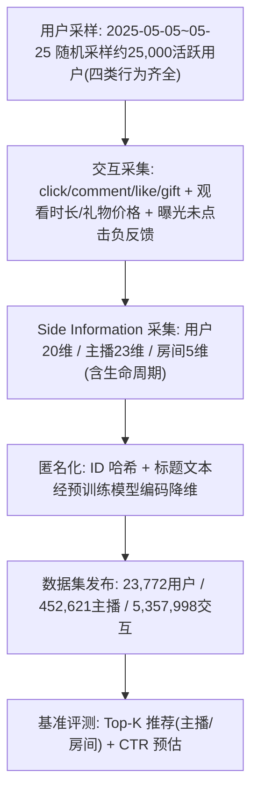
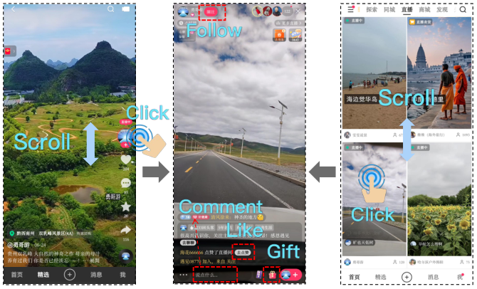
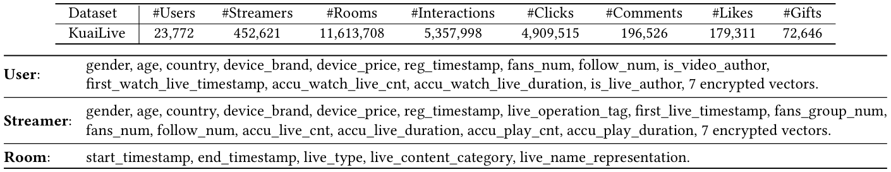
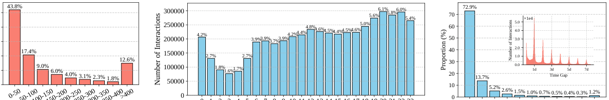
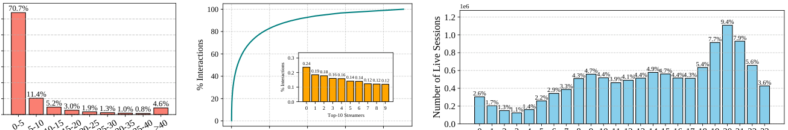
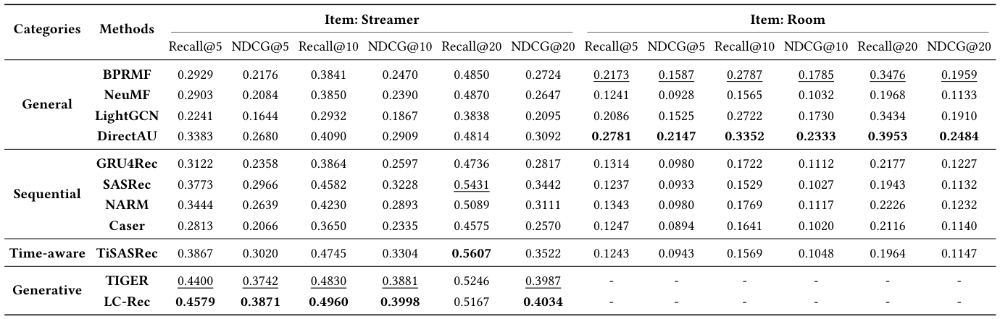
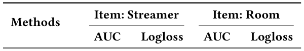

# KuaiLive: A Real-time Interactive Dataset for Live Streaming Recommendation (KuaiLive：面向直播推荐的实时交互数据集)

- **会议/期刊**: SIGIR 2026 (Accepted)
- **推荐链路定位**: 召回 (Retrieval) / 精排 (CTR Prediction) — 本文为数据集与基准论文，覆盖 Top-K 推荐与 CTR 预估两类任务
- **研究方向**: 去偏公平、可信隐私与工业架构 / 序列与会话推荐
- **论文原文**: [https://arxiv.org/abs/2508.05633v2](https://arxiv.org/abs/2508.05633v2)
- **开源代码**: 暂未开源（论文仅提供数据集主页 [https://imgkkk574.github.io/KuaiLive](https://imgkkk574.github.io/KuaiLive)，未检测到代码仓库链接）

## TL;DR (核心速览)

针对直播推荐缺乏公开、含动态候选池与多行为反馈数据集的核心痛点，本文发布快手 KuaiLive 数据集（23,772 用户、452,621 主播、21 天、535 万交互），首次提供直播间起止时间戳、点击/评论/点赞/送礼四类行为与负反馈。在按时间戳约束候选池 + 留一法 + 1 万负采样的协议下，构建 Top-K 与 CTR 双任务基准，生成式方法（LC-Rec）在主播推荐上取得最优 NDCG@10=0.3998。

## Background & Motivation (背景与动机)

- **领域背景与主流范式**: 直播推荐已成为快手等平台的核心业务（直播收入占快手总收入约 30%），工业界已发展出多模态融合、跨域（短视频↔直播）迁移、实时流式窗口等一系列方法。学术界对该场景的建模研究却严重滞后。
- **现有方法局限 (Limitations of Prior Work)**: 现有三个公开直播数据集均存在关键缺陷——(1) **LiveRec** 仅记录观看时长，无直播间生命周期信息；(2) **LSEC** 为电商直播、仅含用户-主播交互，无房间级信息；(3) **Klive** 仅含直播会话的文本与多模态特征，无交互行为类型。三者共同缺失：直播间 start/end 时间戳（无法模拟动态候选池）、多类型实时行为、负反馈与丰富 side information。
- **核心挑战 (Key Challenge)**: 直播场景与短视频/电商推荐存在本质差异——**候选池随时间动态变化**（房间仅在开播期间有效）、**内容与行为实时演化**、**重复消费呈日周期模式**。仅靠 ID 级交互或静态候选集的数据集无法复现这些特性，导致学术模型与工业实践脱节。
- **核心洞察与切入点 (Key Insight)**: 作者以快手 App 真实日志为源（图1 展示了单列混排、直播间内互动、双列直播推荐三种界面），通过保留房间生命周期、四类行为、负反馈与三方（用户/主播/房间）side information，构建首个可支撑"时间约束候选池"仿真的公开数据集，并系统分析其长尾与周期性结构（图2、图3）。

## Problem Formulation & Method (问题定义与方法架构)

### 1. 符号定义与输入表征 (Notations & Input Representations)

- 用户集 $\mathcal{U}$（$|\mathcal{U}|=23{,}772$）、主播集 $\mathcal{S}$（$|\mathcal{S}|=452{,}621$）、直播间集 $\mathcal{R}$（$|\mathcal{R}|=11{,}613{,}708$）。
- 交互记录：四元组 $(u, s, r, b, t)$，其中 $b \in \{\text{click}, \text{comment}, \text{like}, \text{gift}\}$，$t$ 为精确时间戳；房间 $r$ 附带 $[\text{start}_r, \text{end}_r]$ 生命周期区间。
- Side information：用户 20 维特征（性别、年龄、国家、设备品牌/价格、注册时间、粉丝数、关注数、累计观看直播次数/时长等 + 7 个加密向量）；主播 23 维特征（含 live_operation_tag、累计开播次数/时长、累计播放次数/时长等 + 7 个加密向量）；房间 5 维特征（start/end_timestamp、live_type、live_content_category、live_name_representation）。
- 推荐项定义有两种粒度：**主播级**（ID 跨会话稳定、交互更稠密）与**直播间级**（单会话生命周期、交互稀疏、冷启动严重）。

### 2. 整体流水线 (Overall Architecture)

本文为数据集论文，其"流水线"体现为数据构建与基准评测流程：

### 3. 核心模块设计与数学原理 (Key Designs & Formulations)

本文无新模型，核心"设计"在于数据集的四项差异化能力，逐点拆解：

- **动态候选池仿真（生命周期约束）**: 对测试实例 $(u, r, t)$，候选集定义为 $\mathcal{C}_t = \{r' \mid \text{start}_{r'} \le t \le \text{end}_{r'}\}$，即仅保留交互时刻处于开播状态的房间。这是与静态推荐数据集最本质的区别，使离线评测可逼近线上"实时候选池"的真实分布。
- **多行为与负反馈建模**: 行为集合 $\mathcal{B}=\{\text{click},\text{comment},\text{like},\text{gift}\}$，其中 gift 仅占 click 的 1.5%，构成极端稀疏的长尾行为；同时保留"曝光但跳过"的负反馈，使 CTR/GTR 类 XTR 任务具备正负样本对。该设计直接支撑多行为建模与多任务学习研究。
- **长尾公平性分析**: 图3(a) 显示约 70.7% 的主播交互数少于 5，仅 4.6% 超过 40；图3(b) 显示 Top-10 主播占据约 1.5% 的总交互量。作者据此论证 5-core 过滤会扭曲真实分布，并指出该数据天然适合公平感知推荐（扶持冷门主播曝光）研究。

### 4. 训练目标、负采样与推理复杂度 (Optimization, Negative Sampling & Complexity)

- **损失函数**: 本文不提出新损失；各基准沿用原论文损失（BPRMF 用 BPR、CTR 模型用 BCE/LogLoss）。
- **训练负采样策略**: Top-K 评测中，对每个验证/测试实例从**时间戳约束下的活跃候选中采样 10,000 个负例**（Sampled Ranking）；CTR 任务直接使用真实曝光负反馈，按 8:1:1 时间序划分。
- **时间与空间复杂度**: 原文未报告训练耗时、推理延迟或显存占用，仅说明全部实验在 NVIDIA Tesla V100 32G 上完成，统一 embedding 维度 64、batch size 2048、序列最大长度 50。

## Experimental Setup & Evaluation Protocol (实验设置与评估协议)

- **数据集统计与预处理**: 未采用 5-core 过滤（作者明确保留全部用户与主播以保留冷启动样本），正样本定义为 click 行为（最稠密），其余行为作为辅助/多任务信号。

| 数据集 (Dataset) | 用户数 (#Users) | 物品数 (#Items) | 交互数 (#Interactions) | 稀疏度/密度 (Sparsity) | 模态/辅助特征说明 |
| :--- | :---: | :---: | :---: | :---: | :--- |
| KuaiLive | 23,772 | 452,621 主播 / 11,613,708 房间 | 5,357,998（click 4,909,515；comment 196,526；like 179,311；gift 72,646） | 未报告（交互/用户-主播对极稀疏） | 用户 20 维、主播 23 维、房间 5 维（含生命周期与加密向量） |

- **数据划分方式 (Splitting Strategy)**: Top-K 任务采用 **Leave-One-Out (留一法)**，且候选集按时间戳过滤为交互时刻活跃的房间/主播；CTR 任务采用 **按时间顺序的 8:1:1 划分**（chronological split），规避未来信息泄露。整体设计对数据穿越风险控制较好，但留一法本身仍存在"用未来交互预测过去"的经典争议（见批判部分）。
- **排名评测协议 (Ranking Protocol)**: **Sampled Ranking**——每个验证/测试实例配 10,000 个时间约束下的负样本，非全库排序。
- **评价指标与显著性检验**: Top-K 用 Recall@{5,10,20} 与 NDCG@{5,10,20}；CTR 用 AUC 与 LogLoss。Embedding 维度统一为 64。**原文未报告多随机种子方差或配对显著性检验**。

## Key Experimental Results (核心实验结果)

### 1. 主实验对比 (Main Results)

表3（Top-K，推荐项为主播）关键结果：

| 数据集 | 指标 | 传统 CF 最强 (DirectAU) | 序列/时序最强 (TiSASRec) | 本文基准最优 (LC-Rec) | 相对提升 (Improv.) |
| :--- | :--- | :---: | :---: | :---: | :---: |
| KuaiLive (Streamer) | Recall@10 | 0.4090 | 0.4745 | **0.4960** | +4.53% (vs TiSASRec) |
| KuaiLive (Streamer) | NDCG@10 | 0.2909 | 0.3304 | **0.3998** | +21.0% (vs TiSASRec) |
| KuaiLive (Streamer) | Recall@20 | 0.4814 | 0.5607 | 0.5167 | 次优（TIGER 0.5246 亦低于 TiSASRec） |

表3（推荐项为直播间）关键结果：

| 数据集 | 指标 | 传统 CF 最强 (DirectAU) | 序列最强 (NARM) | 本文基准最优 (DirectAU) | 相对提升 (Improv.) |
| :--- | :--- | :---: | :---: | :---: | :---: |
| KuaiLive (Room) | Recall@10 | 0.3352 | 0.1769 | **0.3352** | +89.5% (vs NARM) |
| KuaiLive (Room) | NDCG@10 | 0.2333 | 0.1117 | **0.2333** | +108.9% (vs NARM) |

表4（CTR 预估）关键结果：

| 数据集 | 指标 | FM | DIN | 最优 (Wide&Deep / DeepFM) |
| :--- | :--- | :---: | :---: | :---: |
| KuaiLive (Streamer) | AUC | 0.8455 | 0.8396 | **0.8511** (Wide&Deep) |
| KuaiLive (Room) | AUC | 0.8376 | 0.6650 | **0.8425** (DeepFM) |

核心结论：(1) 主播级推荐中生成式方法（LC-Rec/TIGER）整体最优，说明语义辅助信息比纯 ID 交互更有价值；(2) 房间级推荐性能显著下降，且 CF 反超序列模型——因房间生命周期短、冷启动严重，序列模型难以捕捉重复消费；(3) CTR 任务中 DIN/DIEN 在房间级上崩塌（AUC 0.6650/0.7480），作者归因于匿名化约束下仅保留稀疏特征、稠密语义特征缺失。

### 2. 消融实验与控制变量分析 (Ablation Study)

本文为数据集/基准论文，**未设置模型消融实验**。其"控制变量"体现在基准公平性上：统一 embedding 维度 64、batch size 2048、Adam 优化器、学习率网格 $\{10^{-3},10^{-4},5\times10^{-4},10^{-5}\}$、权重衰减 $\{10^{-5},10^{-6},10^{-7}\}$、序列长度 50。需注意：生成式方法（TIGER/LC-Rec）因算力限制**仅在主播级任务上评测**，房间级缺失，基准完整性存在缺口。

### 3. 稀疏度/冷启动分桶与超参敏感度 (Sparsity Buckets & Hyperparameters)

- **长尾/冷启动分桶**: 原文未做分桶实验，但提供了分布证据——70.7% 主播交互 <5 次、43.8% 用户交互 <50 次、gift 仅占 click 的 1.5%，从数据侧论证了冷启动与长尾公平性研究的必要性（图3）。
- **关键超参数敏感度**: 原文未报告超参敏感度分析。
- **线上 A/B 测试结果**: 原文仅包含离线实验，无线上 A/B 测试。

## Highlights, Limitations & Critiques (亮点、局限与审稿级批判)

- **核心亮点与可迁移性**: (1) **生命周期约束候选池**是本文最具迁移价值的设计，可直接移植到 POI 推荐（营业时间约束）、闪购/限时活动推荐等动态候选场景；(2) 四类行为 + 负反馈 + 观看时长/礼物价格的多粒度标注，天然支撑多任务学习、XTR 预估与可控推荐研究；(3) 不做 5-core 过滤、保留全量冷启动样本，为公平性研究提供了真实长尾分布，这一点在公开数据集中较为稀缺。
- **局限性与审稿视角批判 (Critical Limitations)**:
  1. **评测协议偏弱**：Top-K 采用 10,000 负采样的 Sampled Ranking 而非 Full-Ranking，且留一法在时序数据上存在信息泄露争议（用未来交互构造测试集），与论文强调的"实时动态"叙事存在张力；未报告多随机种子方差与显著性检验，基准数值的可靠性打折。
  2. **基准不完整**：生成式方法仅覆盖主播级任务，房间级缺失；CTR 任务仅用 4 个稀疏特征，导致 DIN/DIEN 等序列模型性能异常崩塌，这一对比对工业实践参考价值有限。
  3. **匿名化与可用性的权衡**：7 个加密向量与降维后的标题表征虽保护隐私，但也削弱了多模态/语义建模研究的可复现性；且数据仅覆盖 21 天、约 2.4 万用户，规模远小于 LiveRec（1.24 亿交互），长周期兴趣漂移研究受限。
  4. **公平性仅停留在"可支持"层面**：论文以长尾分布论证公平研究价值，但未给出任何公平性基线或去偏实验，作为 `debias_fairness_industrial` 方向的工作，实证支撑偏薄。

## Rating (四维评分)

- **方法创新性 (Novelty)**: ⭐⭐⭐（数据集贡献扎实，生命周期候选池设计有新意，但无新模型）
- **评估协议与实验扎实度 (Protocol & Experiments)**: ⭐⭐⭐（基准覆盖广，但采样排序、缺显著性检验、生成式方法覆盖不全）
- **写作与数学规范度 (Clarity & Rigor)**: ⭐⭐⭐⭐（数据分析系统、图表清晰，统计描述规范）
- **工业落地与复现价值 (Industrial & Practical Value)**: ⭐⭐⭐⭐（真实工业日志 + 动态候选池 + 多行为标注，对直播推荐研究有明确推动价值）

## 论文图表

<figure class="paper-figure" markdown="span">
  <figcaption>图1：快手App中直播场景示意图。(a) 单列推荐信息流，用户纵向滑动以接收短视频和直播的混合内容。(b) 直播界面，用户可通过关注、评论、点赞和送礼等操作与主播互动。(c) 双列直播推荐界面，用户滑动浏览直播并点击缩略图进入直播间。</figcaption>
</figure>

<figure class="paper-figure" markdown="span">
  <figcaption>表2：我们提出的KuaiLive的统计信息（上）与特征描述（下）。</figcaption>
</figure>

<figure class="paper-figure" markdown="span">
  <figcaption>图2：KuaiLive数据集中用户交互分析。(a) 展示了每个用户交互次数的分布。(b) 展示了24小时内用户交互的小时分布。(c) 展示了与同一主播交互的分布及重复消费的时间间隔，揭示了明显的日周期模式。</figcaption>
</figure>

<figure class="paper-figure" markdown="span">
  <figcaption>图3：KuaiLive数据集中主播行为分析。(a) 展示了每个主播交互次数的分布。(b) 展示了主播交互的累积分布，表明前10位最受欢迎的主播约占总交互量的1.5%。(c) 展示了24小时内主播开播时间戳的小时分布。</figcaption>
</figure>

<figure class="paper-figure" markdown="span">
  <figcaption>表3：基准模型在KuaiLive上针对两个推荐任务（推荐项为主播或直播间）的总体性能。最佳和次佳结果分别以粗体和下划线字体突出显示。</figcaption>
</figure>

<figure class="paper-figure" markdown="span">
  <figcaption>表4：基准模型在KuaiLive数据集上CTR预测任务的总体性能。最佳和次佳性能方法分别以粗体和下划线字体突出显示。</figcaption>
</figure>

