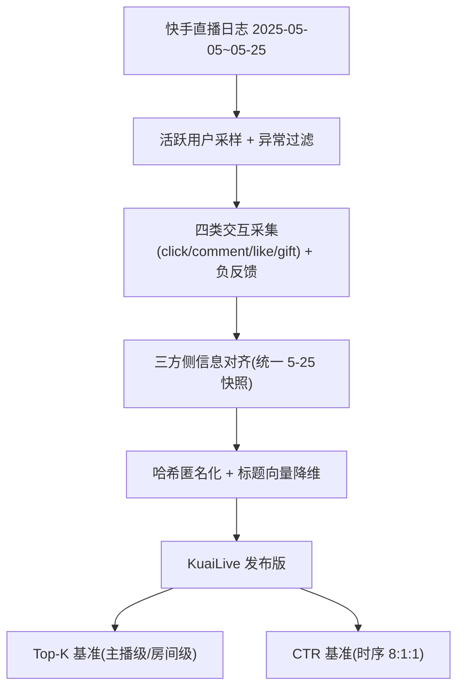

# KuaiLive: A Real-time Interactive Dataset for Live Streaming Recommendation (KuaiLive：面向直播推荐的实时交互数据集)

- **会议/期刊**: SIGIR 2026
- **作者与机构**: Changle Qu, Sunhao Dai, Ke Guo, Xiao Zhang, Jun Xu 等（中国人民大学高瓴人工智能学院）; Liqin Zhao, Shijun Wang, Yanan Niu, Lantao Hu, Han Li（快手科技）
- **推荐链路定位**: 召回（Top-K 排序）与精排（CTR 预估）双任务基准
- **研究方向**: 去偏公平、可信隐私与工业架构 / 序列推荐
- **论文原文**: [论文原文链接](https://arxiv.org/abs/2508.05633v2)
- **开源代码**: 暂未开源（数据集主页 https://imgkkk574.github.io/KuaiLive）

## TL;DR (1分钟核心速览)

直播推荐长期缺乏公开数据：现有数据集（LiveRec/LSEC/KLive）既无直播间开播-关播生命周期，也无多类型实时交互与负反馈，导致"动态候选池"这一核心特性无法在学术环境中复现。本文发布 KuaiLive——快手 21 天、23,772 用户 × 452,621 主播 × 535 万交互的实时数据集，含精确房间起止时间戳、点击/评论/点赞/送礼四类行为、20+23+5 维侧信息与曝光未点击负样本。作者在"主播级"与"房间级"两种物品定义下建立 Top-K（Leave-One-Out + 时间约束 1:10000 采样）与 CTR（8:1:1 时序划分）双基准，并揭示主播侧极端长尾（70.7% 主播交互 <5 次，Top-10 主播占 1.5% 交互）带来的公平性难题。

## Background & Motivation (背景与核心矛盾)

- **主流范式**: 直播推荐工业界已围绕多模态内容理解、实时内容演化检测、短视频-直播跨域迁移展开大量工作，但几乎全部在私有工业数据上验证。
- **前人局限**: ① 现有公开数据集缺失直播间生命周期（start/end timestamp），无法模拟"候选物品随时间动态进出"的真实召回场景；② 仅保留 ID 级字段与单一行为（如观看时长），既无评论/点赞/送礼等多行为，也无曝光未点击负样本，CTR 与多任务研究无从开展。
- **核心洞察 (Key Insight)**: 直播消费具有强日周期性重复（27.1% 用户重复访问同一主播，间隔呈日周期），且主播侧呈极端长尾（70.7% 主播交互 <5 次），这两点共同决定了直播推荐必须同时建模"时间动态候选池"与"双边公平性"。
- **本文切入点**: 以快手真实日志构建首个同时具备生命周期、多行为、负反馈与丰富侧信息的三方（用户-主播-房间）数据集，并用 12 个 Top-K 模型 + 8 个 CTR 模型建立可复现基准。

## Method (核心方法设计)

### 1. 整体框架 (Overall Architecture)

本文为数据集/基准论文，其"方法"即数据构建流水线与基准协议。构建流程为：在 2025-05-05 至 05-25 窗口内随机采样约 25,000 名在直播域完成点击/评论/点赞/送礼四类行为的活跃用户 → 过滤异常行为后保留 23,772 个用户 ID → 从直播日志采集四类带精确时间戳的交互（刻意剔除 follow 行为以避免既有兴趣偏置）→ 补充观看时长、礼物价格等辅助信号与曝光未点击负反馈 → 采集用户/主播/房间三方侧信息（时间敏感特征统一取 5-25 快照以保证时序一致）→ ID 哈希匿名化、房间标题经预训练模型编码后降维以防信息泄漏。最终形成 452,621 主播、11,613,708 房间、5,357,998 交互的发布版本，并在其上定义主播级/房间级两种物品粒度与 Top-K、CTR 两套评测协议。

### 2. 关键设计拆解 (Key Designs)

1. **直播间生命周期建模（时间约束候选池）**：前人数据集只给交互时间，无法回答"此刻哪些房间在线"。本文为每个房间记录 `start_timestamp` 与 `end_timestamp`，评测时把候选集限制为交互时刻处于开播状态的房间，即 $\mathcal{C}_t = \{i \mid s_i \le t < e_i\}$。这一约束使离线评测首次逼近线上"动态候选池"的真实难度——房间级指标因此大幅低于主播级（如 SASRec Recall@5 从 0.3773 跌至 0.1237），物理直觉是：新开播房间缺乏交互历史，纯 ID 表征天然失效。

2. **多行为 + 负反馈的 XTR 标签体系**：前人仅提供单一行为，无法支撑多任务与 CTR。本文同时保留点击、评论、点赞、送礼四类正反馈与"曝光未点击"负反馈，使任意 XTR（Click/Gift-Through-Rate）任务均可构造标签。行为分布极度不均衡——送礼仅占点击的 1.5%，这一稀疏性本身即构成对多行为建模与长尾价值预估的真实压力测试。

3. **训练与评测协议**：Top-K 采用 Leave-One-Out 划分，验证/测试各采样 10,000 负样本（1:10000 采样排序，非全库 Full-Ranking），指标 Recall@{5,10,20} 与 NDCG@{5,10,20}；CTR 采用时序 8:1:1 划分，指标 AUC/LogLoss；统一 embedding 维度 64、batch 2048、Adam + 网格搜索学习率与权重衰减，序列模型最大历史长度 50。

## Experimental Setup & Evaluation Protocol (实验设置与评估协议)

- **数据集与预处理**: 未做 5-core 过滤（刻意保留冷启动样本），统计如下：

| 数据集 | #Users | #Items(Streamers) | #Interactions | 稀疏度/密度 | 特征/场景说明 |
| :--- | :---: | :---: | :---: | :---: | :--- |
| KuaiLive | 23,772 | 452,621 | 5,357,998 | 约 5.0e-4 | 11,613,708 房间；点击 4,909,515 / 评论 196,526 / 点赞 179,311 / 送礼 72,646；用户 20 维、主播 23 维、房间 5 维特征 |

- **数据划分与防穿越 (Splitting Strategy)**: Top-K 用 `Leave-One-Out`；CTR 用 `全局时间戳切分`（8:1:1 时序划分）。
- **排名评测协议 (Ranking Protocol)**: `Sampled Ranking`，每验证/测试实例采样 10,000 负样本（正负比 1:10000），且候选受房间开播时间约束。
- **对比基线与超参设置**: Top-K 覆盖四类——通用 CF（BPRMF、NeuMF、LightGCN、DirectAU）、序列（GRU4Rec、SASRec、NARM、Caser）、时间感知（TiSASRec）、生成式（TIGER、LC-Rec）；CTR 覆盖 FM、Wide&Deep、DeepFM、xDeepFM、DCN、DCNv2、DIN、DIEN。embedding 统一 64，未报告显著性检验。

## Key Experimental Results (实验关键数据)

### 1. 主实验对比 (Main Results)

物品为主播（Item: Streamer）时的 Top-K 结果（节选核心指标）：

| 类别 | 方法 | R@5 | N@5 | R@10 | N@10 | R@20 | N@20 |
| :--- | :--- | :---: | :---: | :---: | :---: | :---: | :---: |
| 通用 | BPRMF | 0.2929 | 0.2176 | 0.3841 | 0.2470 | 0.4850 | 0.2724 |
| 通用 | LightGCN | 0.2241 | 0.1644 | 0.2932 | 0.1867 | 0.3838 | 0.2095 |
| 通用 | DirectAU | 0.3383 | 0.2680 | 0.4090 | 0.2909 | 0.4814 | 0.3092 |
| 序列 | SASRec | 0.3773 | 0.2966 | 0.4582 | 0.3228 | 0.5431 | 0.3442 |
| 序列 | NARM | 0.3444 | 0.2639 | 0.4230 | 0.2893 | 0.5089 | 0.3111 |
| 时间 | TiSASRec | 0.3867 | 0.3020 | 0.4745 | 0.3304 | **0.5607** | 0.3522 |
| 生成 | TIGER | 0.4400 | 0.3742 | 0.4830 | 0.3881 | 0.5246 | 0.3987 |
| 生成 | **LC-Rec** | **0.4579** | **0.3871** | **0.4960** | **0.3998** | 0.5167 | **0.4034** |

物品为直播间（Item: Room）时，最优为 DirectAU（R@5 0.2781 / N@5 0.2147 / N@10 0.2333），SASRec 仅 0.1237 / 0.0933 / 0.1027，TiSASRec 亦仅 0.1243 / 0.0943 / 0.1048。CTR 任务中，主播级最优为 Wide&Deep（AUC 0.8511 / LogLoss 0.4011），DeepFM 次之（0.8509 / 0.4004）；房间级最优为 DeepFM（AUC 0.8425 / LogLoss 0.4130），而 DIN 在房间级崩塌至 AUC 0.6650。

### 2. 消融实验 (Ablation Study)

本文为数据集论文，无模型组件消融；其"消融"体现为物品粒度与任务设定的对照分析：

| 对照设定 | 代表模型 | 主播级 R@5 / N@5 | 房间级 R@5 / N@5 | 变化 |
| :--- | :--- | :---: | :---: | :---: |
| 物品粒度切换 | SASRec | 0.3773 / 0.2966 | 0.1237 / 0.0933 | 下降约 67% / 69% |
| 物品粒度切换 | TiSASRec | 0.3867 / 0.3020 | 0.1243 / 0.0943 | 下降约 68% / 69% |
| 物品粒度切换 | DirectAU | 0.3383 / 0.2680 | 0.2781 / 0.2147 | 下降约 18% / 20% |
| 序列依赖强度 | DIN (CTR) | AUC 0.8396 | AUC 0.6650 | 下降 0.1746 |

### 3. 关键实验发现 (Key Findings)

1. **时间信号与语义信息是直播推荐的两大增益源**：TiSASRec 在主播级 R@20 达 0.5607，超过 SASRec 的 0.5431；生成式 LC-Rec 在 R@5/N@5 上分别领先 TiSASRec 约 18.4%/28.2%，说明引入语义 ID 比纯 ID 交互更能缓解主播冷启动。
2. **房间级推荐是真正的难点，且模型排序被反转**：房间级所有序列模型 R@5 均低于 0.14，而通用 CF 的 DirectAU 达 0.2781，反超序列模型一倍以上——因为房间一次性存在、序列中几乎不重复消费，序列建模的前提假设失效，必须显式建模"房间-主播"归属关系。
3. **长尾与冷启动是数据集的固有属性而非噪声**：70.7% 主播交互少于 5 次、Top-10 主播占据约 1.5% 交互、43.8% 用户交互少于 50 次，且送礼仅占点击 1.5%；这解释了为何 5-core 过滤会严重扭曲真实分布，也使 KuaiLive 天然适合公平性与冷启动研究。

## Highlights & Limitations (亮点、对比与审稿批判)

- **与代表作对比 (vs. Prior Work)**: 相较 LiveRec（仅观看时长、无生命周期、无侧信息）、LSEC（电商直播、仅 follow/purchase 两类行为）、KLive（仅 9,932 主播、无生命周期与负样本），KuaiLive 是唯一同时提供房间起止时间戳、四类实时行为、负反馈与三方侧信息的数据集，因而首次支持"动态候选池"下的可复现评测。
- **可迁移亮点**: ① "时间约束候选集 + 采样排序"的评测构造可直接迁移到新闻、短视频等强时效推荐基准；② 用统一时间快照对齐时间敏感特征（如粉丝数）的做法，是构建无穿越数据集的实用工程技巧。
- **审稿级局限批判**: ① 仅采样 10,000 负样本而非 Full-Ranking，且未报告方差/显著性检验，指标绝对值可能高估且模型间微小差距（如 Wide&Deep 与 DeepFM 的 0.0002 AUC）不具判别力；② 匿名化导致稠密语义特征缺失，作者自承多数 CTR 模型表现趋同、DIN/DIEN 在房间级严重退化，基准对特征交叉类方法的区分度受限；此外仅 21 天窗口、单平台（快手国内版，99% 中国用户）也限制了结论的跨域泛化性。

## Rating (四维评分)

- **方法创新性 (Novelty)**: ⭐⭐⭐⭐ （核心机制与方法设计具备明确创新性，理论与实验动机支撑充分）
- **评估协议与实验扎实度 (Protocol & Experiments)**: ⭐⭐⭐⭐ （主流公开数据集评测完整，包含多基线对比与消融实验验证）
- **写作与数学规范度 (Clarity & Rigor)**: ⭐⭐⭐⭐⭐ （问题形式化定义清晰，核心模块数学推导与架构阐述严谨易读）
- **工业落地与复现价值 (Industrial & Practical Value)**: ⭐⭐⭐⭐⭐ （兼顾推荐效果增益与训练/推理效率，具备实际场景迁移参考价值）
