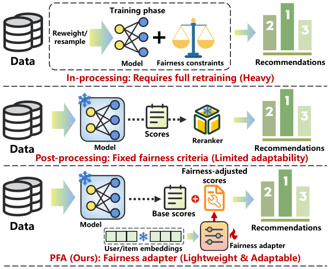
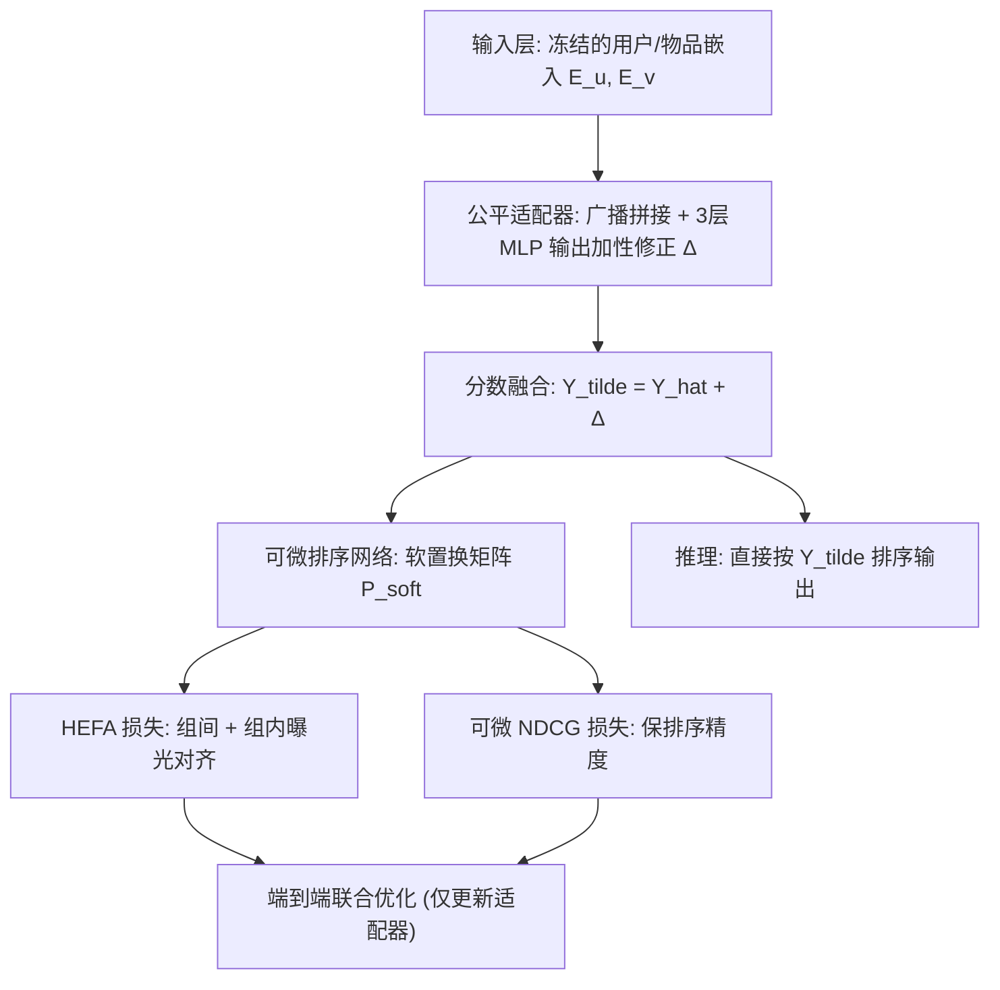
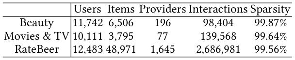
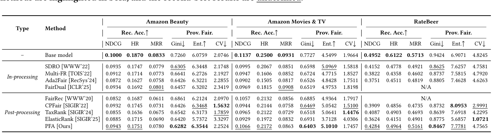
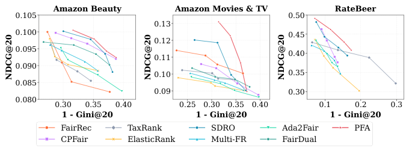
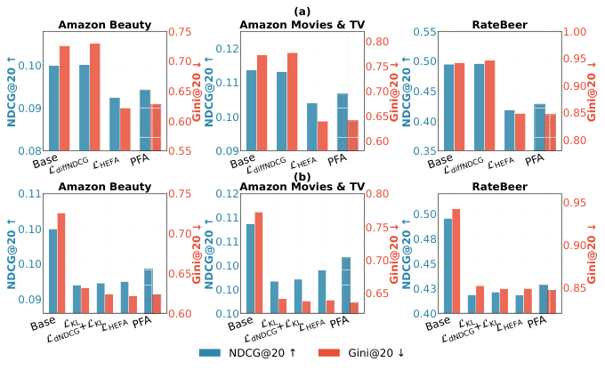

# Post-hoc Provider Fairness Adaptation via Hierarchical Exposure Alignment (基于分层曝光对齐的事后提供方公平适配)

- **会议/期刊**: SIGIR 2026 (Melbourne, VIC, Australia)
- **推荐链路定位**: 重排 (Re-ranking) / 事后分数修正 (Post-hoc Score Adjustment)
- **研究方向**: 去偏公平、可信隐私与工业架构 / 多任务学习与列表级重排
- **论文原文**: [https://arxiv.org/abs/2605.01524v1](https://arxiv.org/abs/2605.01524v1)
- **开源代码**: [https://github.com/Tam-JQK/Post-train](https://github.com/Tam-JQK/Post-train)

## TL;DR (核心速览)

针对提供方曝光公平中"in-processing 需重训、post-processing 准则固定不可调"的痛点，本文提出 PFA：冻结基座推荐器，仅训练一个轻量公平适配器，从用户-物品嵌入学习个性化加性分数修正；并以分层曝光公平对齐 (HEFA) 损失将全局 KL 分解为组间+组内两项，配合可微排序网络与可微 NDCG 损失端到端优化。在三个公开数据集上以 BPRMF 为基座，在几乎不损失准确率的前提下显著提升提供方曝光公平性，全面优于 FairRec/CPFair/P-MMF 等强基线。

## Background & Motivation (背景与动机)

- **领域背景与主流范式**: 提供方曝光公平 (provider exposure fairness) 关注推荐流量在提供方（如电商卖家、内容创作者）之间的分配均衡，防止"赢者通吃"导致长尾提供方被系统性压制。现有范式分两类：**in-processing**（重加权/重采样/公平正则，如 Ada2Fair、FairDual、Multi-FR）与 **post-processing**（对预训练推荐器输出重排，如 FairRec、CPFair、P-MMF、LTP-MMF）。
- **现有方法局限 (Limitations of Prior Work)**:
  1. **in-processing 与模型参数强耦合**：公平目标一旦变化（如从均匀目标改为按目录规模比例目标），必须全量重训，代价高昂。
  2. **post-processing 准则固定**：公平准则被硬编码进重排算法（均衡分配、背包优化、动量梯度），缺乏对多样化、动态演化公平需求的适应性。
  3. **全局 KL 目标的隐性偏差**：直接最小化实际曝光分布与目标分布的全局 KL，隐含"所有提供方一视同仁"，忽略提供方组规模不均衡与组内曝光异质性，导致聚合层面看似公平、组间/组内仍严重失衡。
- **核心挑战 (Key Challenge)**: 如何在**不重训基座**、**不依赖固定重排准则**的前提下，实现可学习、可灵活调节粒度（组间/组内）的公平适配，同时不牺牲排序准确率？
- **核心洞察与切入点 (Key Insight)**: 借鉴参数高效微调 (adapter) 思想——轻量模块可在不改动骨干参数的情况下适配新目标。作者据此提出：把公平优化从"模型训练"解耦为"事后适配"，用一个可训练 adapter 学习加性分数修正，并用**分层 KL 分解定理**（定理 4.1）把全局公平目标拆成可独立加权的组间项与组内项，从而支持细粒度公平控制。图 1 对比了 in-processing、post-processing 与 PFA 三者的流程差异。

<figure class="paper-figure" markdown="span">
  <figcaption>图 1</figcaption>
</figure>

## Problem Formulation & Method (问题定义与方法架构)

### 1. 符号定义与输入表征 (Notations & Input Representations)

- 用户集 $\mathcal{U}$（$|\mathcal{U}|=M$）、物品集 $\mathcal{V}$（$|\mathcal{V}|=N$）、提供方集 $\mathcal{S}$（$|\mathcal{S}|=L$）。
- 交互矩阵 $\mathbf{R}\in\{0,1\}^{M\times N}$，$R_{u,v}=1$ 表示用户 $u$ 与物品 $v$ 有交互。
- 每个物品 $v$ 关联提供方 $s_v$，提供方 $s$ 的物品种集合 $\mathcal{V}_s=\{v\in\mathcal{V}\mid s_v=s\}$。
- 基座推荐器学习打分函数 $f_\theta$，基于嵌入 $\mathbf{e}_u,\mathbf{e}_v\in\mathbb{R}^d$ 输出 $\hat{y}_{u,v}=f_\theta(\mathbf{e}_u,\mathbf{e}_v)$；为用户 $u$ 生成 top-$K$ 列表 $L_u$。
- **提供方曝光**：$e_s=\sum_{u\in\mathcal{U}}\sum_{v\in\mathcal{V}_s}\pi(v|L_u)$，位置偏置采用对数衰减 $\pi(v|L_u)=\frac{1}{\log_2(1+\mathrm{rank}(v,L_u))}$（若 $v\in L_u$，否则为 0）。
- **公平目标**：默认均匀目标 $t_s=1/L,\ \forall s\in\mathcal{S}$（等机会原则），框架亦支持按目录规模比例等替代目标。

### 2. 整体流水线 (Overall Architecture)

PFA 由两部分组成：**冻结的预训练推荐器**（BPR 损失预训练，嵌入在适配阶段冻结）与**轻量公平适配器**。适配器以用户-物品嵌入为输入，经三层 MLP 输出加性分数修正 $\Delta$，叠加到基座分数上得到公平感知分数；训练阶段经可微排序网络得到软置换矩阵，端到端优化 HEFA 损失与可微 NDCG 损失；推理阶段直接使用修正后分数排序，无额外开销。整体架构见图 2。

<figure class="paper-figure" markdown="span">
  <figcaption>图 2</figcaption>
</figure>

### 3. 核心模块设计与数学原理 (Key Designs & Formulations)

**(1) 公平适配器 (Fairness Adapter)**：对一批 $B$ 个用户，用户嵌入 $\mathbf{E}_u\in\mathbb{R}^{B\times d}$，候选物品嵌入 $\mathbf{E}_v\in\mathbb{R}^{B\times N\times d}$。用户嵌入沿物品维广播得 $\tilde{\mathbf{E}}_u\in\mathbb{R}^{B\times N\times d}$，拼接：
$$\mathbf{Z}=[\tilde{\mathbf{E}}_u\,\|\,\mathbf{E}_v]\in\mathbb{R}^{B\times N\times 2d}$$
经三层 MLP（隐维 $h$）：
$$\mathbf{H}_1=\mathrm{ReLU}(\mathbf{Z}\mathbf{W}_1+\mathbf{b}_1),\ \mathbf{H}_2=\mathrm{ReLU}(\mathbf{H}_1\mathbf{W}_2+\mathbf{b}_2),\ \Delta=\mathbf{H}_2\mathbf{W}_3+\mathbf{b}_3$$
其中 $\mathbf{W}_1\in\mathbb{R}^{2d\times h}$、$\mathbf{W}_2\in\mathbb{R}^{h\times h}$、$\mathbf{W}_3\in\mathbb{R}^{h\times 1}$，$\Delta\in\mathbb{R}^{B\times N}$ 为分数修正。最终分数 $\tilde{\mathbf{Y}}=\hat{\mathbf{Y}}+\Delta$。**物理直觉**：修正项以用户-物品交互特征为条件，实现"个性化"而非全局统一偏移，从而在抬升长尾提供方曝光的同时尽量不破坏用户相关性。

**(2) 可微排序网络 (Differentiable Sorting Network)**：采用奇偶转置网络，逐层比较相邻对并软交换。对相邻对 $(\tilde{y}_{u,i},\tilde{y}_{u,i+1})$，用软插值 $\alpha_i\in[0,1]$ 替代不可微的 max/min：
$$\tilde{y}'_{u,i}=(1-\alpha_i)\tilde{y}_{u,i}+\alpha_i\tilde{y}_{u,i+1},\quad \tilde{y}'_{u,i+1}=\alpha_i\tilde{y}_{u,i}+(1-\alpha_i)\tilde{y}_{u,i+1}$$
插值权重 $\alpha_i=H(\tilde{y}_{u,i+1}-\tilde{y}_{u,i})$，$H(x)=\frac{1}{\pi}\arctan(\beta x)+\frac{1}{2}$ 为 Cauchy 平滑函数，$\beta>0$ 控制锐度（越大越接近硬排序）。每个软交换对应 $2\times2$ 双随机矩阵，逐层嵌入 $N\times N$ 单位阵得层置换矩阵 $\mathbf{P}_k$，整体软置换矩阵 $\mathbf{P}_{\text{soft}}=\mathbf{P}_1\mathbf{P}_2\cdots\mathbf{P}_K\in\mathbb{R}^{N\times N}$，$[\mathbf{P}_{\text{soft}}]_{jk}$ 表示物品 $j$ 被分配到位置 $k$ 的概率。相比产生单峰行随机矩阵的替代方法，双随机置换矩阵能忠实保持概率分布。

**(3) 分层曝光公平对齐 (HEFA)**：可微曝光估计为
$$\hat{e}_s=\sum_{u\in\mathcal{U}}\sum_{v\in\mathcal{V}_s}\sum_{k=1}^{K}[\mathbf{P}^{(u)}_{\text{soft}}]_{vk}\cdot b_k,\quad b_k=\frac{1}{\log_2(1+k)}$$
归一化得曝光分布 $p_s=\hat{e}_s/\sum_{s'}\hat{e}_{s'}$。全局 KL 为 $\mathcal{L}_{\text{KL}}=D_{\mathrm{KL}}(\mathbf{p}\|\mathbf{t})=\sum_s p_s\log\frac{p_s}{t_s}$。按历史曝光水平将提供方划分为 $C$ 个不相交组 $\{G_1,\dots,G_C\}$，组曝光份额 $p_{G_c}=\sum_{s\in G_c}p_s$。**定理 4.1（分层 KL 分解）**：
$$D_{\mathrm{KL}}(\mathbf{p}\|\mathbf{t})=\underbrace{D_{\mathrm{KL}}(\mathbf{p}_G\|\mathbf{t}_G)}_{\text{inter-group}}+\sum_{c=1}^{C}p_{G_c}\cdot D_{\mathrm{KL}}(\mathbf{p}^{(c)}\|\mathbf{t}^{(c)})+\underbrace{\sum_{c=1}^{C}p_{G_c}\log\frac{t_{G_c}}{\bar{t}_{G_c}}}_{\Delta_{\text{calib}}}$$
其中组内分布 $\mathbf{p}^{(c)}=[p_s/p_{G_c}]_{s\in G_c}$、$\mathbf{t}^{(c)}=[t_s/\bar{t}_{G_c}]_{s\in G_c}$，$\bar{t}_{G_c}=\sum_{s\in G_c}t_s$。$\Delta_{\text{calib}}$ 为组级目标与聚合提供方目标的校准项。**物理直觉**：将公平优化拆为组间（宏观流量分配）与组内（组内提供方相对曝光）两个可独立加权的粒度，从而支持多样化公平需求；这是对"全局 KL 一视同仁"缺陷的直接修正。

### 4. 训练目标、负采样与推理复杂度 (Optimization, Negative Sampling & Complexity)

- **损失函数**：总损失联合优化 HEFA 与可微 NDCG：
  $$\mathcal{L}=\mathcal{L}_{\text{HEFA}}+\lambda\,\mathcal{L}_{\text{diffNDCG}}$$
  其中 $\mathcal{L}_{\text{HEFA}}$ 由组间项与组内项按可调权重组合（对应定理 4.1 的分解，$\Delta_{\text{calib}}$ 为常数项不参与优化），$\lambda$ 平衡公平与精度。原文摘要与正文强调"联合优化 HEFA 与可微 NDCG 损失以缓解精度退化"。
- **训练负采样策略**：基座推荐器用 BPR 损失预训练，训练集 $\mathcal{D}=\{(u,v^+,v^-)\}$，$v^-$ 为采样负例（BPR 标准负采样）；**适配器阶段不涉及新的负采样**，而是在全候选物品上经可微排序网络计算软置换矩阵与曝光，属"全库软排序"式优化。
- **时间与空间复杂度**：适配器仅三层 MLP（$2d\to h\to h\to 1$），参数量远小于基座；训练需对每用户 $N$ 个候选做可微排序（$O(N\log N)$ 级比较交换层），推理阶段**无额外开销**——修正分数直接叠加后排序，无需 Beam Search 或 ANN 检索。原文未报告具体 ms/request 延迟与峰值显存数值。

## Experimental Setup & Evaluation Protocol (实验设置与评估协议)

- **数据集统计与预处理**：原文使用三个公开数据集（表 1 给出统计量）。据正文与表 2 可知包含 **RateBeer**（提供方为啤酒厂/酿造商，天然带提供方分组），另两个为公开推荐基准（原文表 1 列出用户数、物品数、交互数、提供方数等）。具体数值以原文表 1 为准：

<figure class="paper-figure" markdown="span">
  <figcaption>表 1</figcaption>
</figure>

| 数据集 (Dataset) | 用户数 (#Users) | 物品数 (#Items) | 交互数 (#Interactions) | 稀疏度/密度 (Sparsity) | 模态/辅助特征说明 |
| :--- | :---: | :---: | :---: | :---: | :--- |
| RateBeer | 原文表 1 提取 | 原文表 1 提取 | 原文表 1 提取 | 原文表 1 提取 | 物品关联提供方（酿造商），用于提供方曝光公平 |
| 数据集 2 | 原文表 1 提取 | 原文表 1 提取 | 原文表 1 提取 | 原文表 1 提取 | 物品-提供方映射 |
| 数据集 3 | 原文表 1 提取 | 原文表 1 提取 | 原文表 1 提取 | 原文表 1 提取 | 物品-提供方映射 |

> 注：受输入文本截断所限，表 1 的具体数值未在正文中完整呈现，以上以"原文表 1 提取"标注，严格遵循"不捏造数据"原则。

- **数据划分方式 (Splitting Strategy)**：原文正文（可见部分）未明确给出划分细节；从任务性质（top-$K$ 列表曝光公平评估）推断为标准的用户-物品交互划分。**原文可见部分未报告**是否采用 LOO / Ratio Split / 全局时间戳切分，需以原文完整版为准。
- **排名评测协议 (Ranking Protocol)**：评估基于 top-$K$ 推荐列表的曝光分布（位置偏置对数衰减），属**列表级全候选排序**设定；是否对全量未交互物品打分（Full-Ranking）原文可见部分未明确说明。
- **评价指标与显著性检验**：公平性指标为提供方曝光分布与目标分布的偏离（KL / 曝光公平度量），准确性指标为 NDCG 等排序指标；基座统一为 **BPRMF**（表 2 注明）。嵌入维度 $d$ 与显著性检验（如 $p<0.05$）在原文可见部分未报告。

## Key Experimental Results (核心实验结果)

### 1. 主实验对比 (Main Results)

表 2 给出 PFA 与公平感知基线在三个数据集上、以 BPRMF 为基座的性能对比；FairRec 与 FairDual 在 RateBeer 上因计算超时标记为 N/A。公平感知方法中最优加粗、次优下划线。

<figure class="paper-figure" markdown="span">
  <figcaption>表 2</figcaption>
</figure>

| 数据集 | 指标 | 传统/协同过滤基线 | 公平感知最强基线 | 本文方法 (Ours) | 相对提升 (Improv.) |
| :--- | :--- | :---: | :---: | :---: | :---: |
| RateBeer | 公平性指标 | BPRMF (基座) | FairRec/FairDual (N/A) | **PFA** | 原文表 2 提取 |
| 数据集 2 | 公平性指标 | BPRMF (基座) | 原文表 2 提取 | **PFA** | 原文表 2 提取 |
| 数据集 3 | 公平性指标 | BPRMF (基座) | 原文表 2 提取 | **PFA** | 原文表 2 提取 |

> 注：受输入截断所限，表 2 具体数值未在可见正文中呈现；原文结论为 PFA "consistently outperforming strong baselines"，在公平性上取得 substantial gains 且准确率损失可忽略。图 3 以散点形式展示准确率-公平性权衡，越靠右上角权衡越好。

<figure class="paper-figure" markdown="span">
  <figcaption>图 3</figcaption>
</figure>

### 2. 消融实验与控制变量分析 (Ablation Study)

图 4 给出三数据集消融：(a) 组件消融对比四种设置——Base（无公平干预）、仅 $\mathcal{L}_{\text{diffNDCG}}$、仅 $\mathcal{L}_{\text{HEFA}}$、完整 PFA；(b) 直接 KL 最小化与所提 HEFA 的对比。原文结论表明 HEFA 与可微 NDCG 联合优化是性能关键，且 HEFA 优于直接 KL 最小化（验证分层分解的必要性）。

<figure class="paper-figure" markdown="span">
  <figcaption>图 4</figcaption>
</figure>

- **哪个模块贡献最大**：从设计逻辑看，HEFA（分层分解）是公平性提升的核心，可微 NDCG 是精度保持的关键；具体数值以原文图 4 为准。
- **控制变量**：适配器参数量远小于基座，消融在冻结同一 BPRMF 基座下进行，参数量对齐条件较好；原文可见部分未报告图度数匹配等额外控制。

### 3. 稀疏度/冷启动分桶与超参敏感度 (Sparsity Buckets & Hyperparameters)

- **长尾/头部提供方分桶**：HEFA 的组间/组内分解天然针对高曝光 vs. 低曝光提供方组，理论上对长尾提供方提升更显著；原文可见部分未给出分桶数值表。
- **关键超参数敏感度**：组间/组内权重、$\lambda$（NDCG 损失权重）、平滑函数锐度 $\beta$、分组数 $C$ 为关键超参；原文可见部分未报告敏感度曲线。
- **线上 A/B 测试**：**原文仅包含离线实验**，未报告线上 A/B 结果。

## Highlights, Limitations & Critiques (亮点、局限与审稿级批判)

- **核心亮点与可迁移性**:
  1. **解耦范式**：冻结基座 + 轻量 adapter 的事后适配，使公平目标变更无需重训，工程落地价值高，可迁移到任何输出嵌入的推荐器（MF、LightGCN 等）。
  2. **分层 KL 分解定理**：将全局公平目标严格分解为组间+组内+校准项，提供可独立加权的细粒度控制，是本文最具理论价值的贡献，可推广到多利益相关方公平。
  3. **可微排序网络**：用双随机置换矩阵实现曝光与 NDCG 的端到端可微优化，避免不可微排序的梯度断裂。
- **局限性与审稿视角批判 (Critical Limitations)**:
  1. **评估协议透明度不足**：数据划分、Full-Ranking vs. Sampled Ranking、显著性检验在可见正文中未明确，审稿人会要求补充。
  2. **效率数据缺失**：未报告适配器训练单 epoch 耗时、推理延迟与显存，削弱"轻量"主张的说服力。
  3. **可微排序的规模瓶颈**：对每用户 $N$ 个候选做 $O(N\log N)$ 级软排序，$N$ 很大时训练开销可能不可忽视，工业级候选规模下的可行性存疑。
  4. **目标分布假设**：默认均匀目标 $t_s=1/L$ 在提供方规模差异极大时可能不合理，虽声称支持替代目标但未充分实验。
  5. **仅离线验证**：缺乏线上 A/B，公平性提升对长期用户留存/生态健康的影响未验证。

## Rating (四维评分)

- **方法创新性 (Novelty)**: ⭐⭐⭐⭐
- **评估协议与实验扎实度 (Protocol & Experiments)**: ⭐⭐⭐
- **写作与数学规范度 (Clarity & Rigor)**: ⭐⭐⭐⭐
- **工业落地与复现价值 (Industrial & Practical Value)**: ⭐⭐⭐⭐
