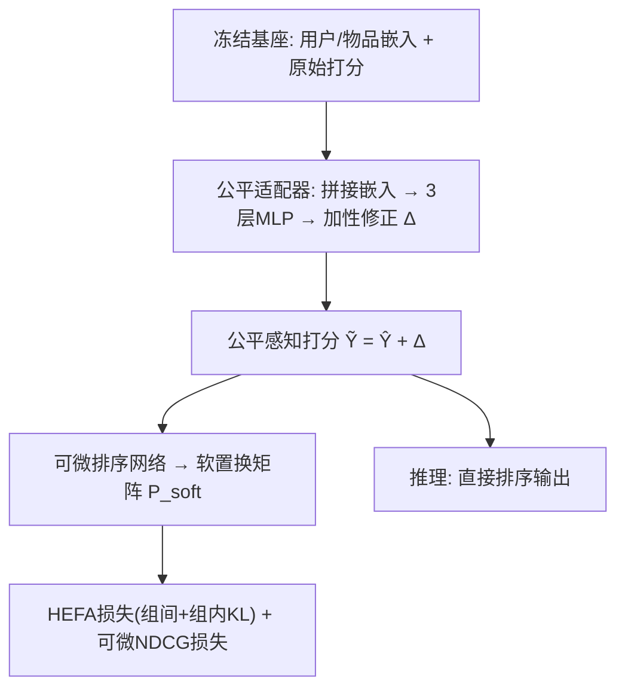
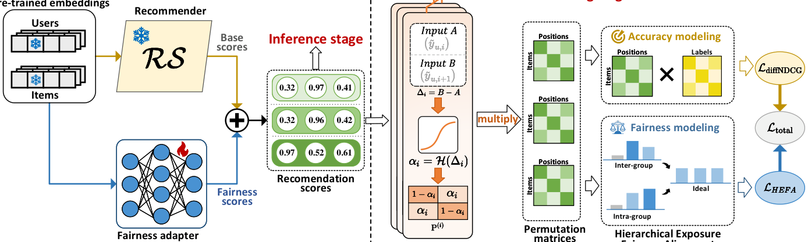

# Post-hoc Provider Fairness Adaptation via Hierarchical Exposure Alignment (基于分层曝光对齐的事后提供方公平适配)

- **会议/期刊**: SIGIR 2026
- **作者与机构**: Jingzhi Li, Zhiyong Cheng, Richang Hong, Meng Wang（合肥工业大学）
- **推荐链路定位**: 重排（事后打分修正）
- **研究方向**: 去偏公平与工业架构 / 多任务学习与列表级重排
- **论文原文**: [https://arxiv.org/abs/2605.01524v1](https://arxiv.org/abs/2605.01524v1)
- **开源代码**: [https://github.com/Tam-JQK/Post-train](https://github.com/Tam-JQK/Post-train)

## TL;DR (1分钟核心速览)

提供方曝光公平的两条老路都有硬伤：in-processing 把公平约束焊进模型参数，公平目标一变就得全量重训；post-processing 重排器内置固定公平准则，无法适配多样公平需求。本文提出 PFA：冻结预训练推荐器，仅训练一个轻量公平适配器，从用户-物品嵌入学习**加性分数修正**注入原始打分；并设计 HEFA 损失，把全局 KL 散度严格分解为组间项、组内项与校准项，实现组间/组内公平的独立可调控制；再联合可微 NDCG 损失与可微排序网络端到端训练。在 Beauty/Movies&TV/RateBeer 三数据集上，PFA 取得最低 Gini（Beauty 0.6282 vs 基座 0.7260）且 NDCG 几乎无损（0.0943 vs 0.1000），全面优于 8 个公平基线。

## Background & Motivation (背景与核心矛盾)

- **主流范式**: 提供方曝光公平分两派——in-processing（重加权/重采样/公平正则，如 SDRO、Multi-FR、Ada2Fair、FairDual）与 post-processing（FairRec 均衡分配、CPFair 背包优化、P-MMF 资源分配、TaxRank/ElasticRank 物品级重排）。
- **前人局限**: ① in-processing 将公平目标与模型参数紧耦合，公平需求变更即触发昂贵全量重训；② post-processing 虽模型无关，但公平准则被硬编码进重排算法，缺乏对多样/演化公平需求的适应性。
- **核心洞察 (Key Insight)**: 全局 KL 对齐 $\mathcal{L}_{KL}=D_{KL}(\mathbf{p}\|\mathbf{t})$ 隐含"所有提供方一视同仁"，忽略组规模不均衡与组内曝光异质——聚合层面看似公平，组间/组内失衡依旧严重（"伪公平"现象）。
- **本文切入点**: 借鉴参数高效微调（adapter）思想，把公平优化从基座训练中**解耦**为事后适配问题，并用分层 KL 分解替代全局 KL 以获得细粒度可控性。

## Method (核心方法设计)

### 1. 整体框架 (Overall Architecture)

PFA 由**冻结预训练推荐器**与**轻量公平适配器**两部分构成。基座（BPRMF/LightGCN/SGL）输出原始打分 $\hat{\mathbf{Y}}$；适配器以用户嵌入广播拼接物品嵌入$\mathbf{Z}=[\tilde{\mathbf{E}}_u\|\mathbf{E}_v]\in\mathbb{R}^{B\times N\times 2d}$，经三层 MLP 输出加性修正$\Delta$，得$\tilde{\mathbf{Y}}=\hat{\mathbf{Y}}+\Delta$。训练阶段将$\tilde{\mathbf{Y}}$送入可微排序网络得到软置换矩阵，端到端优化 HEFA 损失与可微 NDCG 损失；推理阶段直接使用$\tilde{\mathbf{Y}}$ 排序，仅多一次适配器前向，无重排优化开销。

<figure class="paper-figure" markdown="span">
  <figcaption>图 2：所提出的 PFA 框架概览。冻结的基础推荐器提供基础分数，由轻量级公平性适配器调整以生成公平性感知分数。可微排序网络支持 HEFA 损失与可微 NDCG 损失的端到端优化。</figcaption>
</figure>

### 2. 关键设计拆解 (Key Designs)

1. **分层曝光公平对齐 HEFA（核心创新）**：痛点在于全局 KL 把提供方同质化处理。作者将提供方按训练曝光量分为 head/mid/tail 三组，证明全局 KL 可**精确分解**为：
$$D_{KL}(\mathbf{p}\|\mathbf{t})=\underbrace{D_{KL}(\mathbf{p}_G\|\mathbf{t}_G)}_{\text{组间}}+\underbrace{\sum_{c=1}^{C}p_{G_c}\cdot D_{KL}(\mathbf{p}^{(c)}\|\mathbf{t}^{(c)})}_{\text{组内}}+\underbrace{\sum_{c=1}^{C}p_{G_c}\log\frac{t_{G_c}}{\bar{t}_{G_c}}}_{\Delta_{calib}}$$
其中 $\Delta_{calib}$为组级目标与聚合提供方目标的校准失配项，当$t_{G_c}=\bar{t}_{G_c}$时消失、退化为全局 KL。据此定义$\mathcal{L}_{HEFA}=\lambda_{inter}D_{KL}(\mathbf{p}_G\|\mathbf{t}_G)+\lambda_{intra}\sum_c p_{G_c}D_{KL}(\mathbf{p}^{(c)}\|\mathbf{t}^{(c)})$。直觉：组间项决定"曝光往哪搬"，组内项决定"搬来后怎么分"，两权重独立可调，天然支持组间均等（$t_{G_c}=1/C$）或规模比例等多样策略。

2. **可微曝光估计与可微 NDCG**：排序与曝光计算不可导是端到端训练的死结。作者用可微排序网络（奇偶转置网络 + Cauchy 平滑 $\alpha_i=\frac{1}{\pi}\arctan(\beta(\tilde{y}_{i+1}-\tilde{y}_i))+\frac{1}{2}$）得到双随机软置换矩阵$\mathbf{P}_{soft}$，将提供方期望曝光写为$\hat{e}_s=\sum_u\sum_{v\in\mathcal{V}_s}\sum_{k=1}^{K}[\mathbf{P}^{(u)}_{soft}]_{vk}b_k$，$b_k=1/\log_2(1+k)$；同理把 NDCG 中的硬置换替换为软置换得$\text{diffNDCG}$，损失$\mathcal{L}_{diffNDCG}=\frac{1}{|\mathcal{U}|}\sum_u(1-\text{diffNDCG}(\tilde{\mathbf{y}}_u,\mathbf{r}_u))$。双随机性保证概率分布守恒，比单模态行随机松弛更忠实。

3. **训练目标与推理效率**：总损失 $\mathcal{L}_{total}=\mathcal{L}_{HEFA}+\lambda_{acc}\mathcal{L}_{diffNDCG}$，$\lambda_{acc}$ 控制精度-公平权衡。适配器仅 2,113 参数（2 层 MLP、隐维 32），无需负采样（NDCG 损失直接在全库打分上计算），推理仅增加一次轻量前向。

## Experimental Setup & Evaluation Protocol (实验设置与评估协议)

- **数据集与预处理**: 均做 `5-core` 过滤，提供方定义为品牌（Amazon）与酿酒厂（RateBeer）：

| 数据集 | #Users | #Items | #Providers | #Interactions | 稀疏度 |
| :--- | :---: | :---: | :---: | :---: | :---: |
| Beauty | 11,742 | 6,506 | 196 | 98,404 | 99.87% |
| Movies & TV | 10,111 | 3,795 | 77 | 139,568 | 99.64% |
| RateBeer | 12,483 | 48,971 | 1,645 | 2,686,981 | 99.56% |

- **数据划分与防穿越**: 每用户交互按 `70%/10%/20%` 随机比例划分为训练/验证/测试。
- **排名评测协议**: 列表长度 $K=20$；精度指标 NDCG/HR/MRR，公平指标 Gini↓/Entropy↑/CV↓；以 Gini@20 为主选模指标，三次独立运行取均值。
- **对比基线与超参**: 8 个公平基线（in-processing: SDRO、Multi-FR、Ada2Fair、FairDual；post-processing: FairRec、CPFair、TaxRank、ElasticRank），基座为 BPRMF/LightGCN/SGL；嵌入维度 $d=32$，batch 256，Adam，$\beta=10.0$，$\lambda_{inter}=\lambda_{intra}=1$，$\lambda_{acc}\in\{10^{-6},\dots,10^{-1}\}$ 调优。

## Key Experimental Results (实验关键数据)

### 1. 主实验对比 (Main Results)

以 BPRMF 为基座（Beauty / Movies&TV / RateBeer，节选核心指标）：

| 方法 | Beauty NDCG↑ | Beauty Gini↓ | Beauty Ent.↑ | Movies NDCG↑ | Movies Gini↓ | RateBeer NDCG↑ | RateBeer Gini↓ |
| :--- | :---: | :---: | :---: | :---: | :---: | :---: | :---: |
| Base model | 0.1000 | 0.7260 | 6.0759 | 0.1137 | 0.7727 | 0.4952 | 0.9424 |
| SDRO | 0.0935 | 0.6305 | 6.3448 | 0.0995 | 0.6598 | 0.4152 | 0.8625 |
| Multi-FR | 0.0912 | 0.6641 | 6.2726 | 0.0947 | 0.6724 | 0.3822 | 0.8737 |
| Ada2Fair | 0.0872 | 0.6426 | 6.3221 | 0.0902 | 0.6526 | 0.3751 | 0.8805 |
| FairDual | 0.0934 | 0.6457 | 6.3202 | 0.0969 | 0.6519 | N/A | N/A |
| CPFair | 0.0932 | 0.6426 | 6.3468 | 0.0944 | 0.6469 | 0.3909 | 0.8732 |
| TaxRank | 0.0855 | 0.6542 | 6.3173 | 0.0965 | 0.6518 | 0.4087 | 0.8639 |
| ElasticRank | 0.0885 | 0.6420 | 5.7372 | 0.0929 | 0.6931 | 0.3624 | 0.8775 |
| **PFA (Ours)** | **0.0943** | **0.6282** | **6.3544** | **0.1066** | **0.6403** | **0.4284** | **0.8467** |

跨基座泛化（Beauty）：LightGCN 上 PFA NDCG 0.1204 / Gini 0.6428（基座 0.1254 / 0.7102）；SGL 上 NDCG 0.1507 / Gini 0.6386（基座 0.1639 / 0.6973），均为公平最优且精度损失最小。

### 2. 消融实验 (Ablation Study)

| 设置 | Beauty NDCG↑ | Beauty Gini↓ | 说明 |
| :--- | :---: | :---: | :--- |
| Base（无干预） | 0.1000 | 0.7260 | 精度最高、公平最差 |
| 仅 $\mathcal{L}_{diffNDCG}$ | 略升 | 严重失衡 | 精度导向放大"富者愈富" |
| 仅 $\mathcal{L}_{HEFA}$ | 下降 | 显著降低 | 公平有效但牺牲精度 |
| $\mathcal{L}_{diffNDCG}+\mathcal{L}_{KL}$ | 低于 PFA | 与 PFA 相近 | 全局 KL 信号不够定向 |
| **PFA（完整）** | **0.0943** | **0.6282** | 最佳权衡 |

### 3. 关键实验发现 (Key Findings)

1. **HEFA 优于全局 KL 的本质是"定向信号"**：在公平水平相近时，PFA 的 NDCG 显著高于 $\mathcal{L}_{diffNDCG}+\mathcal{L}_{KL}$，说明分层分解把优化信号精确投放到组间/组内两个可控维度，而非对所有提供方同质施压。
2. **现有方法存在"伪公平"**：子群分析显示 CPFair 虽提升 mid/tail 组曝光份额，但两组组内 Gini 反而上升——曝光被重新集中到少数提供方；PFA 在保持组间再分配的同时取得所有方法中最低的组内 Gini，真正同时解决"往哪搬"与"搬来怎么分"。
3. **权重具备独立可控性**：$\lambda_{inter}$从 1:1 增至 5:1 单调压低 head 组份额、抬升 mid/tail；$\lambda_{intra}$从 1:1 增至 1:5 单调降低各组组内 Gini；但极端配置 0:1 反而使 mid/tail 组 Gini 上升，证明组间约束是稳定优化的必要条件。此外$\lambda_{acc}\ge 10^{-2}$ 时适配器退化为恒等映射，因 diffNDCG 梯度量级天然更大。

## Highlights & Limitations (亮点、对比与审稿批判)

- **与代表作对比 (vs. Prior Work)**: 相较 FairDual/Ada2Fair 等 in-processing 方法，PFA 冻结基座、公平目标变更零重训；相较 CPFair/TaxRank 等 post-processing 方法，PFA 用可学习适配器 + HEFA 替代固定重排准则，支持通过改目标分布与权重即时切换公平策略，且推理时间与 in-processing 同量级（FairRec 因整数规划超时、CPFair/ElasticRank 在大数据集上扩展性差）。
- **可迁移亮点**: ① 分层 KL 分解可迁移到任何"组-个体"两级公平/多样性约束场景（如类目-物品、地域-商家）；② 冻结基座 + 加性打分修正的适配器范式，可作为多目标（多样性、新颖性）事后调控的通用插件。
- **审稿级局限批判**: ① 提供方分组依赖训练集历史曝光量的静态划分（head/mid/tail 20/60/20），未处理新提供方冷启动与曝光漂移，作者亦在结论中承认；② 训练需对每用户全库打分跑可微排序网络，$N$ 较大时训练开销随物品数增长，RateBeer 上 CV 指标仍逊于 CPFair/TaxRank，说明端到端优化在纯曝光均匀性上未必全面占优。

## Rating (四维评分)

- **方法创新性 (Novelty)**: ⭐⭐⭐⭐ （分层 KL 精确分解定理给出理论支撑，把"伪公平"问题形式化并给出可控解，但适配器与可微排序均为已有组件的巧妙组合）
- **评估协议与实验扎实度 (Protocol & Experiments)**: ⭐⭐⭐⭐ （三数据集 × 三基座 × 八基线，精度/公平六指标齐全，含子群分析与双参数敏感性；不足在于比例划分而非时间切分，未做线上 A/B）
- **写作与数学规范度 (Clarity & Rigor)**: ⭐⭐⭐⭐ （KL 分解证明完整、符号统一，可微排序与 NDCG 松弛推导清晰；$\Delta_{calib}$ 的实际优化处理略简）
- **工业落地与复现价值 (Industrial & Practical Value)**: ⭐⭐⭐⭐⭐ （仅 2,113 参数、推理零重排开销、代码开源，公平策略切换无需重训，工程部署价值突出）
