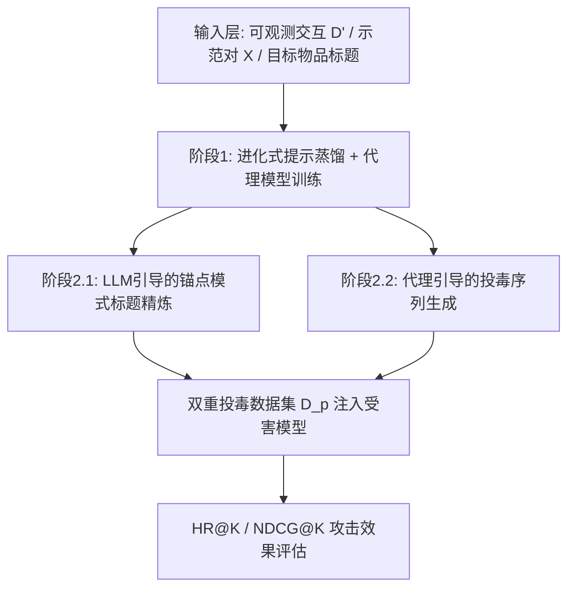
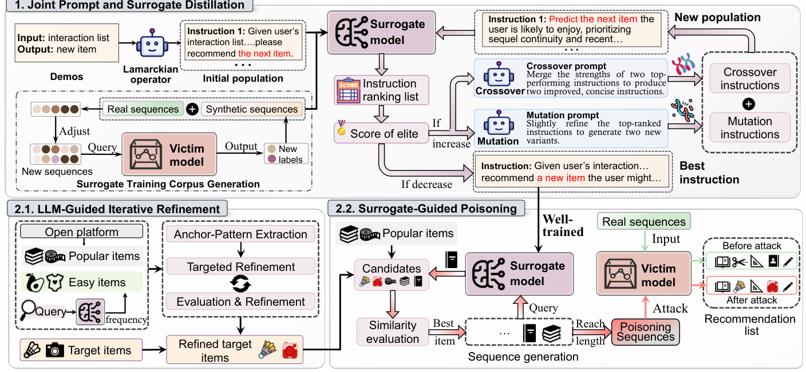
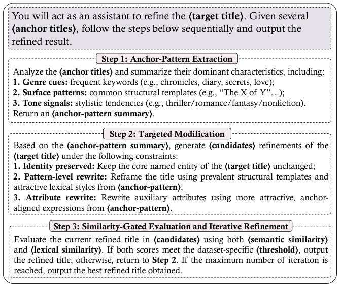
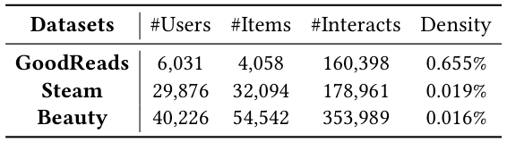
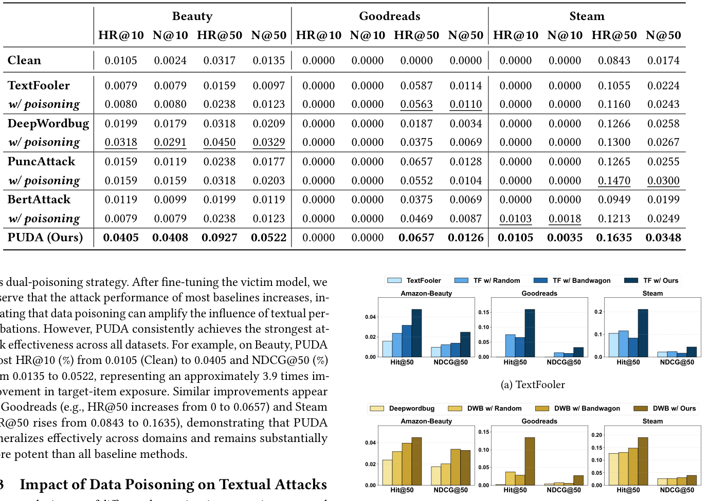
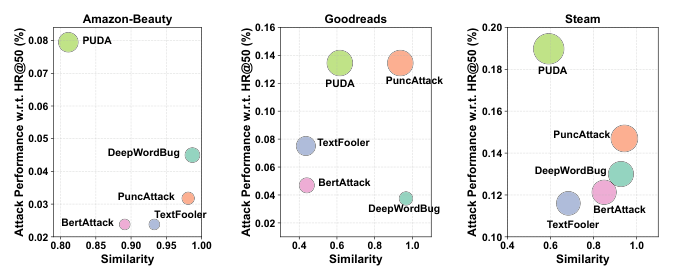
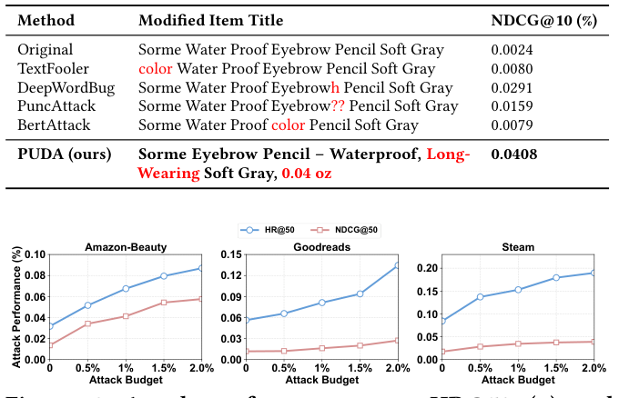
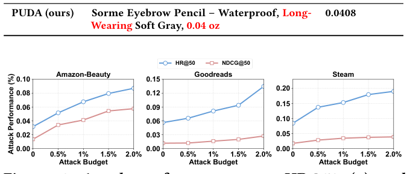
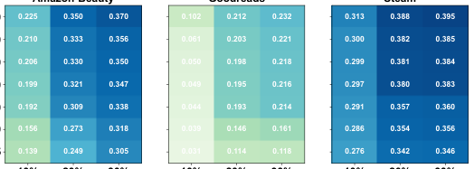

# Prompt-Unknown Promotion Attacks against LLM-based Sequential Recommender Systems (面向LLM序列推荐系统的提示未知推广攻击)

- **会议/期刊**: SIGIR 2026
- **推荐链路定位**: 端到端生成式 (End-to-End Generative) — 攻击对象为 prompt 驱动的 LLM 序列推荐推理链路
- **研究方向**: 去偏公平、可信隐私与工业架构 / 大语言模型推荐 (LLM4Rec)
- **论文原文**: [https://arxiv.org/abs/2604.23640v1](https://arxiv.org/abs/2604.23640v1)
- **开源代码**: 暂未开源（论文正文仅引用 LLaMA-3.2-1B/3B-Instruct 的 HuggingFace 模型权重页面，非本文代码仓库）

## TL;DR (核心速览)

本文针对 LLM 序列推荐系统 (LLM-SRS) 在**系统提示与受害模型均不可见**的真实黑盒场景下的商品推广攻击问题，提出 PUDA 框架：先用 LLM 驱动的进化式提示蒸馏推断隐式系统提示并训练代理模型，再联合"标题语义精炼 + 代理引导投毒序列注入"实施双重投毒。在 Beauty/Goodreads/Steam 三数据集上，以 HR/NDCG 为指标（目标物品视为唯一相关物品）显著超越文本攻击与数据投毒基线，Beauty 上 HR@10 由 0.0105 提升至 0.0405（约 3.9 倍）。

## Background & Motivation (背景与动机)

- **领域背景与主流范式**: LLM-SRS（P5、TALLRec、SPRec 等）将用户交互序列 verbalize 为自然语言提示，通过 prompt 驱动的 in-context 推理完成 next-item 预测。由于推荐系统是工业核心业务，其安全性（投毒、模型抽取、成员推断）长期受关注，其中**推广攻击 (promotion attack)** 是最主流的研究类型。
- **现有方法局限 (Limitations of Prior Work)**:
  1. **不切实际的攻击假设**：CheatAgent 需直接改写系统提示，TextSimu / Zhang et al. 需访问受害模型或提示——而现实中 LLM-SRS 的骨干模型与系统提示均为平台私有、严格不可访问，这类方法在真实部署下"根本性不适定 (ill-posed)"。
  2. **纯文本启发式易被检测**：现有方法通过模仿热门物品的文本特征改写标题/描述，常扭曲原始语义甚至引入误导性描述，易被用户或平台审核机制识别。
  3. **忽视交互级序列依赖**：仅做文本层操纵，忽略用户交互序列中的序列依赖与物品共现模式，无法在交互层生成真实有效的投毒信号。
- **核心挑战 (Key Challenge)**: 在提示未知 + 模型未知的双重黑盒约束下，攻击者既无法获得可控的优化环境（无梯度、无 token 概率、查询预算有限），又只能观测部分交互数据 $\mathcal{D}' \subseteq \mathcal{D}$，如何构造既有效又行为合理的攻击信号？
- **核心洞察与切入点 (Key Insight)**: 作者观察到 LLM-SRS 的排序行为不仅受交互频次影响，也受物品描述语义影响（Clean 模型下极冷门目标物品仍偶有曝光）；且系统提示虽不可见，但可通过"输入-输出示范对"逆向推断。由此引出"先蒸馏提示与代理模型 → 再在代理上做双重投毒"的两阶段思路。

## Problem Formulation & Method (问题定义与方法架构)

### 1. 符号定义与输入表征 (Notations & Input Representations)

- 用户集 $\mathcal{U}$（$|\mathcal{U}|=N$）、物品集 $\mathcal{I}$；用户 $u$ 的时序交互序列 $s_u=\{i_1^{(u)},\dots,i_M^{(u)}\}$，$M$ 为最大序列长度。
- 目标：$i_u^*=\arg\max_{i\in\mathcal{I}} p(i_{M+1}^{(u)}=i\mid s_u)$。
- 提示定义：$P=[I, X_u]$，其中 $I$ 为自然语言指令，$X_u=(s_u,y_u)$ 为示范对（历史序列 + 下一物品标签）。
- 攻击者知识：无模型架构/参数、无系统提示；仅可观测部分交互 $\mathcal{D}'\subseteq\mathcal{D}$；可创建少量虚假账户 $\mathcal{U}_F$ 注入伪造交互，并可对黑盒模型发起**有限次**查询（无 token 概率/梯度）。
- 代理模型：LLaMA-3.2-1B-Instruct；受害模型：LLaMA-3.2-3B-Instruct；代理仅用 20% 真实交互预训练。

### 2. 整体流水线 (Overall Architecture)

数据流：观测示范对 $\mathcal{X}$ → Lamarckian 算子构造初始提示种群 → 交叉/变异进化精炼 → 蒸馏提示 $P^*$ → 结合扰动增广数据训练代理 $S^*$ → 锚点模式提取与标题精炼 → 代理引导自回归生成投毒序列 $\mathcal{D}_p$ → 迁移至受害模型评估。

<figure class="paper-figure" markdown="span">
  <figcaption>图1：所提出的PUDA框架。上方部分（第1部分）展示了联合提示与代理蒸馏阶段。左下区块（第2.1部分）展示了基于锚点模式模仿的LLM引导文本精炼模块，而右下区块（第2.2部分）描述了在黑盒LLM-SRS设置下用于有效商品推广的代理引导投毒序列生成过程。</figcaption>
</figure>

### 3. 核心模块设计与数学原理 (Key Designs & Formulations)

**模块一：联合提示与代理蒸馏 (Joint Prompt and Surrogate Distillation)**

- *初始种群*：用 Lamarckian 算子 $\mathcal{O}_L$ 从示范对逆向推断候选指令，$\mathcal{P}^{(0)}=\mathcal{O}_L(\mathcal{X})=\{P_1^{(0)},\dots,P_K^{(0)}\}$，$K$ 为种群规模。每个提示由代理 $S$ 以 Hit Ratio 打分：
$$\text{score}(P_k^{(0)})=\mathbb{E}_{(s,y)\sim\mathcal{X}}\big[f(S(P_k^{(0)},s),y)\big]$$
- *进化精炼*：交叉算子 $\mathcal{O}_C$ 取两个最高分提示重组，变异算子 $\mathcal{O}_M$ 对 top-$\kappa$ 提示做词法替换/结构改写；精英保留策略组装下一代：
$$\mathcal{P}^{(t+1)}=\{P_{\text{elite}}^{(t)}\}\cup\mathcal{P}_{\text{cross}}^{(t)}\cup\mathcal{P}_{\text{mut}}^{(t)}$$
收敛条件为精英分数不再提升：$\text{score}(P_{\text{elite}}^{(t+1)})\le\text{score}(P_{\text{elite}}^{(t)})$，最终 $P^*=P_{\text{elite}}^{(T)}$。
- *代理训练*：对观测序列施加扰动算子集 $\mathcal{T}=\{\tau_o\}_{o=1}^O$（物品交换、删除、子序列采样），查询受害模型得软监督 $\tilde{y}=V^*(\tilde{s})$，构造 $\mathcal{D}_{st}=\mathcal{D}'\cup\mathcal{D}_{syn}$，以自回归语言建模目标 SFT：
$$\theta^*=\arg\min_\theta \mathbb{E}_{(s,y)\in\mathcal{D}_{st}}\Big[-\frac{1}{|y|}\sum_{t=1}^{|y|}\log S_\theta(y_t\mid P^*,s,y_{<t})\Big]$$

**模块二：LLM 引导的迭代标题精炼 (LLM-Guided Iterative Refinement)**

- 构造两个锚点集：热门物品集 $\mathcal{I}_{pop}$（平台公开统计）与"易推荐"物品集 $\mathcal{I}_{easy}=\{i\mid \text{Freq}_{S^*}(i)\ge\gamma\}$（代理推荐频次超阈值的长尾物品，捕捉系统归纳偏置）。
- 三步推理（图 2）：① 锚点模式提取（题材线索/结构模板/语气信号）；② 在保持核心命名实体不变前提下按模板重写标题；③ 相似度门控评估——语义相似度 $\text{Sim}_{sem}=\cos(e(T_{i_t}),e(\tilde{T}_{i_t}))$ 与词法相似度 $\text{Sim}_{lex}=\frac{|W(T_{i_t})\cap W(\tilde{T}_{i_t})|}{|W(T_{i_t})\cup W(\tilde{T}_{i_t})|}$ 均需超过数据集自适应阈值（Beauty: 0.9/0.7；Goodreads & Steam: 0.9/0.3），否则迭代重写。

<figure class="paper-figure" markdown="span">
  <figcaption>图2：基于三步推理的目标标题精炼过程（由于篇幅限制，图中仅展示关键提示词）。</figcaption>
</figure>

**模块三：代理引导的投毒序列生成 (Surrogate-Guided Poisoning)**

- 每个恶意用户以热门种子物品 $i_0\in\mathcal{I}_{pop}$ 初始化前缀，自回归扩展。每步构造候选池：
$$\mathcal{C}=\mathcal{R}_J^{(t)}\cup\mathcal{I}_{tar}\cup\mathcal{I}_{pop}^{10\%}$$
其中 $\mathcal{R}_J^{(t)}=\text{Top}_J(S^*(P^*,s_{\tilde{u}}[0:t-1]))$，$\mathcal{I}_{pop}^{10\%}$ 为最热门 10% 物品以强化共现。
- 行为合理性打分（SentenceTransformer 文本嵌入的余弦相似度）：
$$\text{BehSim}(c\mid s_{\tilde{u}}[0:t-1])=\text{Sim}(e_{s'},e_{avg}),\quad s'=[s_{\tilde{u}}[0:t-1];c]$$
$$\hat{c}_t=\arg\max_{c\in\mathcal{C}}\text{BehSim}(c\mid s_{\tilde{u}}[0:t-1])$$
直至序列长度达 $L$，聚合得投毒集 $\mathcal{D}_p$，先在代理上验证增益，再迁移至受害模型评估。

### 4. 训练目标、负采样与推理复杂度 (Optimization, Negative Sampling & Complexity)

- **损失函数**: 代理模型采用标准自回归 SFT 交叉熵（式 8），无对比/排序损失项；标题精炼为 LLM 生成 + 相似度门控，非梯度优化；投毒序列为贪心 argmax 选择，无显式损失。
- **负采样策略**: 原文未采用显式负采样——LLM-SRS 以生成式 next-token 预测建模，攻击评估将目标物品视为唯一相关物品计算 HR/NDCG。
- **时间与空间复杂度**: 原文未报告具体训练耗时、单次推理延迟 (ms/request) 或峰值显存。定性上：提示蒸馏需 $T$ 代 × $K$ 个提示的代理评估（每代含交叉/变异 LLM 调用）；代理训练仅用 20% 真实数据 + 扰动增广；投毒序列生成每步需一次代理前向 + 候选池 BehSim 计算；受害模型查询受预算约束。整体依赖 GPT-4o 做提示蒸馏与标题精炼，LLM 调用成本为主要开销。

## Experimental Setup & Evaluation Protocol (实验设置与评估协议)

- **数据集统计与预处理**: Amazon-Beauty、GoodReads、Steam，沿用 [33] 的预处理，移除交互数少于 5 的用户与物品（**5-core 过滤**）。

<figure class="paper-figure" markdown="span">
  <figcaption>表1：数据集统计</figcaption>
</figure>

| 数据集 (Dataset) | 用户数 (#Users) | 物品数 (#Items) | 交互数 (#Interactions) | 密度 (Density) | 模态/辅助特征说明 |
| :--- | :---: | :---: | :---: | :---: | :--- |
| GoodReads | 6,031 | 4,058 | 160,398 | 0.655% | 图书标题文本 |
| Steam | 29,876 | 32,094 | 178,961 | 0.019% | 游戏标题文本 |
| Beauty | 40,226 | 54,542 | 353,989 | 0.016% | 美妆商品标题文本 |

- **数据划分方式 (Splitting Strategy)**: 沿用序列推荐标准做法（与 SPRec 一致），每个用户序列**保留最后两个交互分别作验证与测试**，其余前缀作训练——即近似 Leave-One-Out 的尾部留出策略。原文未讨论数据泄露风险。
- **排名评测协议 (Ranking Protocol)**: 原文未明确说明是 Full-Ranking 还是 Sampled Ranking；评估时将**目标物品视为唯一相关物品**计算 HR@10/50 与 NDCG@10/50，数值越高表示推广效果越强。另用 Agreement (AGR@10/50) 衡量代理-受害模型推荐列表重叠度。
- **评价指标与显著性检验**: HR@10/50、NDCG@10/50、AGR@10/50；所有结果为**三次独立运行的平均值**；原文未报告配对显著性检验（如 $p<0.05$）。攻击预算：恶意用户占全体用户 2%，每个恶意用户交互数与正常用户均值相同；选取 5 个最冷门物品为目标物品。

## Key Experimental Results (核心实验结果)

### 1. 主实验对比 (Main Results)

<figure class="paper-figure" markdown="span">
  <figcaption>表2：在Beauty、Goodreads和Steam数据集上的整体攻击性能。结果以不同截断下的命中率（HR）（%）和NDCG（N）（%）报告。Clean表示未受任何攻击（即无文本修改或投毒）训练的受害模型。文本攻击基线分别在无投毒和有投毒（记为“w/ poisoning”）下评估。</figcaption>
</figure>

| 数据集 | 指标 | Clean（无攻击） | 最强文本攻击基线 (w/ poisoning) | 本文方法 (PUDA) | 相对提升 |
| :--- | :--- | :---: | :---: | :---: | :---: |
| Beauty | HR@10 | 0.0105 | 0.0318 (DeepWordBug) | **0.0405** | +27.4% |
| Beauty | NDCG@50 | 0.0135 | 0.0329 (DeepWordBug) | **0.0522** | +58.7% |
| Goodreads | HR@50 | 0.0000 | 0.0563 (TextFooler) | **0.0657** | +16.7% |
| Steam | HR@50 | 0.0843 | 0.1470 (PuncAttack) | **0.1635** | +11.2% |
| Steam | NDCG@50 | 0.0174 | 0.0300 (PuncAttack) | **0.0348** | +16.0% |

Beauty 上 HR@10 相对 Clean 提升约 3.9 倍；Goodreads 上 HR@50 从 0 提升至 0.0657；Steam 上 HR@50 从 0.0843 升至 0.1635。PUDA 在所有数据集、所有截断上均为最优。

### 2. 消融实验与控制变量分析 (Ablation Study)

原文未设置传统"逐模块移除"的消融表，而是通过**组件替换式对照**分析：

- **投毒策略对照（图 3）**：TextFooler / DeepWordBug 分别搭配 Random、Bandwagon、本文代理引导投毒。无投毒时攻击效果最低；Random/Bandwagon 提升有限且跨数据集不稳定；本文代理引导投毒在三数据集上均取得最高性能，说明投毒数据生成策略是主要增益来源。
- **提示蒸馏对照（图 4）**：与 RLPrompt、APE 比较 AGR@10/50 与 HR@10/50。本文蒸馏提示在代理-受害一致性上全面领先，RLPrompt 常产生语义不连贯提示，APE 缺乏面向推荐任务的优化机制；一致性更高的代理带来更高 HR。
- **文本相似度-攻击效果联合分析（图 5、表 3）**：PUDA 在保持较高语义相似度的同时取得最强攻击效果；基线多保留高词法相似度但推广效果有限或不稳定。表 3 示例中，PUDA 将 "Sorme Water Proof Eyebrow Pencil Soft Gray" 改写为含 "Waterproof, Long-Wearing, 0.04 oz" 等属性的一致标题，NDCG@10 达 0.0408，远超各文本攻击基线（0.0079–0.0291）。

<figure class="paper-figure" markdown="span">
  <figcaption>图5：在Amazon-Beauty、Goodreads和Steam上的攻击性能（HR@50（%））与标题级相似度比较。</figcaption>
</figure>

<figure class="paper-figure" markdown="span">
  <figcaption>表3：目标商品标题修改示例及相应的推广性能（Beauty上的NDCG@10）。结果按100倍缩放。</figcaption>
</figure>

### 3. 稀疏度/冷启动分桶与超参敏感度 (Sparsity Buckets & Hyperparameters)

- **目标物品选择**：实验专门选取**最冷门的 5 个物品**作为目标，本质即长尾/冷启动物品推广场景；PUDA 在极冷门物品上的提升显著。
- **攻击规模敏感度（图 6）**：在 0.5%–2.0% 攻击预算下，三数据集 HR@50 与 NDCG@50 随规模增大而上升，PUDA 在各预算下均保持优势。
- **训练数据比例敏感度（图 7）**：分析不同训练数据比例下代理与受害模型在不同推荐列表长度上的一致性，验证代理在有限数据下的可迁移性。
- **关键超参数**：相似度阈值（Beauty 语义 ≥0.9/词法 ≥0.7；Goodreads & Steam 语义 ≥0.9/词法 ≥0.3）、易推荐阈值 $\gamma$、候选池大小 $J$、投毒序列长度 $L$、种群规模 $K$、进化代数 $T$。原文对 $\gamma$、$J$、$L$、$K$、$T$ 的具体取值与敏感度曲线**未在可见正文中完整报告**。
- **线上 A/B 测试**: 原文仅包含离线实验，未报告线上 A/B 结果。

<figure class="paper-figure" markdown="span">
  <figcaption>图6：在不同攻击规模下，三个数据集上的攻击性能（HR@50（%）和NDCG@50（%））。</figcaption>
</figure>

<figure class="paper-figure" markdown="span">
  <figcaption>图7：在不同训练数据比例下，三个数据集中代理模型与受害模型在不同推荐列表长度上的一致性分析。</figcaption>
</figure>

## Highlights, Limitations & Critiques (亮点、局限与审稿级批判)

- **核心亮点与可迁移性**:
  1. **首次系统研究"提示+模型双未知"黑盒下的 LLM-SRS 推广攻击**，攻击假设显著更贴近真实部署，安全威胁论证更有说服力。
  2. **进化式离散提示蒸馏**（Lamarckian 初始化 + 交叉/变异 + 精英保留）可迁移至任意黑盒 LLM 推荐系统的行为克隆与代理建模。
  3. **双重投毒协同设计**（语义层标题精炼 + 行为层序列注入）与**相似度门控**机制兼顾攻击强度与隐蔽性，行为合理性约束（BehSim）值得防御方借鉴。
- **局限性与审稿视角批判 (Critical Limitations)**:
  1. **评估协议披露不足**：未明确 Full-Ranking 还是 Sampled Ranking；HR/NDCG 将目标物品视为唯一相关物品，数值极小（如 0.0000–0.16），统计波动敏感，却仅报告三次运行均值而无方差与显著性检验。
  2. **代理-受害模型规模差距有限**：代理 LLaMA-1B vs 受害 LLaMA-3B，同家族模型可能高估蒸馏可迁移性；跨家族（如 GPT 系受害模型）泛化性未验证。
  3. **成本与可复现性**：提示蒸馏与标题精炼依赖 GPT-4o 大量调用，原文未报告查询预算、LLM 调用次数与总耗时；代码未开源，复现门槛高。
  4. **防御讨论缺失**：论文仅呼吁"需要更鲁棒的防御手段"，未实验评估任何防御（如文本审核、序列异常检测、提示水印）对 PUDA 的抑制效果。
  5. **超参敏感度不完整**：$\gamma$、$J$、$L$ 等关键超参的取值与敏感度分析在可见正文中缺失，削弱方法鲁棒性论证。

## Rating (四维评分)

- **方法创新性 (Novelty)**: ⭐⭐⭐⭐（黑盒双未知设定 + 进化提示蒸馏 + 双重投毒组合有新意，但各组件均为已有技术的新颖组合）
- **评估协议与实验扎实度 (Protocol & Experiments)**: ⭐⭐⭐（三数据集 + 多类基线较全面，但排名协议未明示、缺显著性检验与防御评估）
- **写作与数学规范度 (Clarity & Rigor)**: ⭐⭐⭐⭐（符号与算法流程清晰，公式完整；部分超参与复杂度细节缺失）
- **工业落地与复现价值 (Industrial & Practical Value)**: ⭐⭐⭐（安全审计与红队视角价值高，但代码未开源、依赖 GPT-4o 成本高、缺防御实验）
