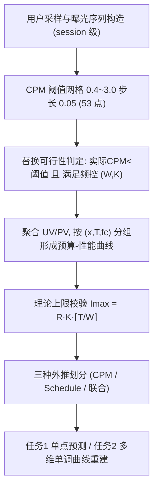
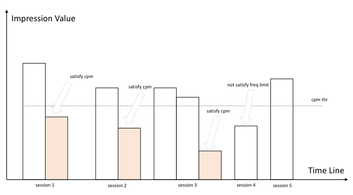
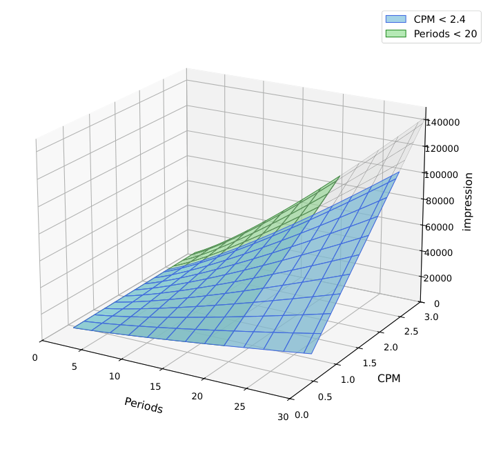
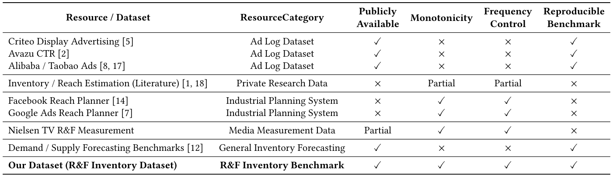
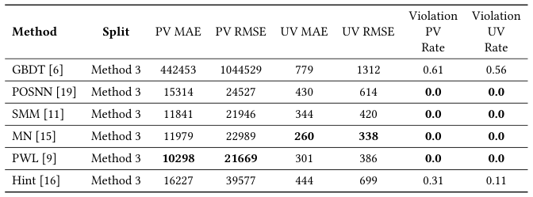

# R&F-Inventory: A Large-Scale Dataset for Monotonic Inventory Estimation in Reach and Frequency Advertising (面向触达与频次广告单调库存预估的大规模数据集)

- **会议/期刊**: SIGIR 2026（7 pages，Dataset/Resource 类论文）
- **推荐链路定位**: 库存预估 / 合约投放规划（Inventory Forecasting & R&F Planning），服务于品牌广告合约创建阶段的预算-性能曲线生成，非传统召回/精排链路
- **研究方向**: 去偏公平、可信隐私与工业架构（主）/ CTR 预估与特征交叉（次，因涉及单调约束回归与结构化预测）
- **论文原文**: [https://arxiv.org/abs/2604.16821v1](https://arxiv.org/abs/2604.16821v1)
- **开源代码**: [https://github.com/pengyunshan/RF-Inventory](https://github.com/pengyunshan/RF-Inventory)

## TL;DR (核心速览)

针对 R&F（Reach & Frequency）合约广告缺乏公开、含"预算-性能曲线"结构的数据集这一空白，本文发布 R&F-Inventory 数据集：以"定向-排期-频控"三元组为上下文，提供同一上下文下 53 个 CPM 阈值点的 UV/PV 观测，天然满足单调性与边际递减，并推导理论曝光上限 $I_{max}=R\cdot K\cdot\lceil T/W\rceil$ 作一致性校验。定义单点预测与多维单调曲线重建两任务，在联合外推划分（Method 3）下评测 6 个基线，显式单调约束模型（PWL/SMM/MN）将 PV MAE 从 GBDT 的 442453 降至约 1.0e4 量级且违例率趋近 0。

## Background & Motivation (背景与动机)

- **领域背景与主流范式**: 程序化广告机器学习研究长期聚焦 CTR/CVR 点级预估，依赖 Criteo、Avazu、阿里/淘宝等公开日志数据集，样本单元为单次曝光或点击事件。
- **现有方法局限 (Limitations of Prior Work)**:
  1. **数据结构错配**：公开广告日志把每次曝光视为独立样本，不含预算维度、排期与频控约束，无法刻画同一合约上下文下 UV/PV 随预算变化的**曲线级依赖结构**；
  2. **工业系统闭源**：Google Ads Reach Planner、Meta Reach & Frequency Buying 等虽能产出 R&F 预估，但模型与数据均闭源，输出仅经封闭接口提供，学术界无法复现与系统比较；
  3. **约束被隐式化**：排期与时窗频控（如"5 天内不超过 3 次"）在既有工作中多作为隐式假设，而非显式建模与评估协议的一部分，导致点级误差虽小但输出违反物理可行性、在实际系统中不可用。
- **核心挑战 (Key Challenge)**: R&F 库存预估的输出不是孤立标量而是受硬结构约束的曲线——须同时满足预算维度单调递增、边际收益递减、以及由排期与频控决定的理论曝光上限。简单增加网络深度或做点级回归无法保证这些约束，而缺乏带曲线级监督的公开数据使约束学习方法无从评测。
- **核心洞察与切入点 (Key Insight)**: 作者以"定向-排期-频控"三元组为基本上下文单元，在同一上下文内保留多个预算点的联合观测，从而把库存预估形式化为**带偏序单调约束的结构化回归问题**；并利用频控规则解析推导曝光上限，作为数据质量与模型可行性的双重校验器。

## Problem Formulation & Method (问题定义与方法架构)

### 1. 符号定义与输入表征 (Notations & Input Representations)

- 定向特征 $x$（地域、年龄段、性别等筛选条件）；
- 排期长度 $T$（单位：天）；
- 频控规则 $fc=(W,K)$：窗口长度 $W$ 天内单用户曝光上限 $K$；
- 预算 $b$、触达 UV $R$、曝光 PV $I$，满足 $\text{CPM}=1000\cdot b/I$；
- 每条记录为 6 元组 $\langle x, T, fc, b, R, I\rangle$；同一 $(x,T,fc)$ 组合下的记录聚合为一条预算-性能曲线。
- 任务 2 的映射形式：$(x, W, fc; T, B)\rightarrow(\hat{R},\hat{I})$，实际使用中可简化为 $(x,W,fc;T,\text{cpm})\rightarrow(\hat{R},\hat{I})$，预算作为派生量用于一致性校验。

### 2. 整体流水线 (Overall Architecture)

数据构建流程：用户采样 → 构造时间窗内按时间排序的曝光序列（每次广告请求由 session ID 标识，可返回 1–2 条广告）→ 对给定 CPM 阈值判断能否以 R&F 广告替换实际 CPM 更低的非 R&F 广告且满足频控 → 可行则该用户贡献 +1 PV 与 +1 UV → 在 53 个 CPM 阈值点（0.4–3.0，步长 0.05）上汇总形成曲线。

<figure class="paper-figure" markdown="span">
  <figcaption>图1：单用户插入CPM广告的模拟示意图</figcaption>
</figure>

### 3. 核心模块设计与数学原理 (Key Designs & Formulations)

**(1) 时窗频控下的理论曝光上限推导。** 给定排期 $T$、频控 $(W,K)$，单用户在整个投放周期内的最大曝光次数为

$$m_{max}(T;W,K)=K\cdot\left\lceil \frac{T}{W}\right\rceil \tag{1}$$

进而合约层面的理论最大总曝光量为

$$I_{max}=R\cdot K\cdot\left\lceil \frac{T}{W}\right\rceil \tag{2}$$

该式是全文的结构核心：它把"排期长度"与"频控窗口"耦合为一个可解析计算的物理天花板，既用于数据集样本的一致性检查，也作为模型预测阶段的可行域约束。物理直觉在于——频控以滑动窗口限制单位时间曝光密度，排期越长可容纳的窗口数越多，二者共同决定累积曝光上界。

**(2) 偏序单调约束的形式化。** 对同一上下文（同 $x$ 与非单调字段），在投放条件空间引入偏序：若 $T_1\le T_2$ 且 $B_1\le B_2$，则要求

$$\hat{R}(u_1)\le \hat{R}(u_2),\quad \hat{I}(u_1)\le \hat{I}(u_2) \tag{6}$$

作者强调这是**偏序（partial-order）单调性**而非全序：仅当所有单调维度均不降且至少一维严格增时才施加约束，避免对不可比条件点施加不必要约束，与真实 R&F 规划逻辑一致。

**(3) 三种外推式数据划分。** 不做样本级随机划分，而是在固定定向与频控窗口前提下按两个业务控制变量切分（见图 2）：Method 1 按 CPM 阈值切分（低 CPM 训练、高 CPM 测试，对应"保守试投推断激进策略"）；Method 2 按排期长度切分（短排期训练、长排期测试，对应"短期评估、长期规划"）；Method 3 为联合外推，测试集满足 $\text{cpm}\ge\tau_{cpm}\wedge T\ge\tau_T$，训练集仅见低 CPM、短排期样本，是最严苛的泛化设定。

<figure class="paper-figure" markdown="span">
  <figcaption>图2：数据集划分方法示意图</figcaption>
</figure>

### 4. 训练目标、负采样与推理复杂度 (Optimization, Negative Sampling & Complexity)

- **损失函数**: 原文未报告具体损失函数形式与超参数（作为数据集论文，基线实现细节交由开源仓库，正文未给出公式化的 $\mathcal{L}$、温度系数或分项权重）。
- **训练负采样策略**: 不适用。本文为回归型库存预估任务，无负采样环节；UV 与 PV 分别独立建模（作者在结论中明确指出这是局限之一，两目标未共享底层参数）。
- **时间与空间复杂度**: 原文未报告训练单 epoch 耗时、推理延迟（ms/request）或峰值显存。可推断的复杂度特征：CPM 网格固定为 53 点，曲线重建需对每上下文输出 53 个条件点预测；数据集构建依赖离线模拟（用户采样 + 序列替换判定），属离线预处理开销。

## Experimental Setup & Evaluation Protocol (实验设置与评估协议)

- **数据集统计与预处理**: 原文**未报告**用户数、物品数、交互数、稀疏度等常规统计量，也未给出记录总条数或上下文组数。可确认的结构性统计为：CPM 阈值网格 0.4–3.0、步长 0.05、共 **53 个阈值点**；每条记录为 6 元组 $\langle x,T,fc,b,R,I\rangle$；数据基于用户采样与离线模拟生成，不释放任何可识别个人身份的信息。

| 数据集 (Dataset) | 用户数 (#Users) | 物品数 (#Items) | 交互数 (#Interactions) | 稀疏度/密度 (Sparsity) | 模态/辅助特征说明 |
| :--- | :---: | :---: | :---: | :---: | :--- |
| R&F-Inventory | 原文未报告 | 原文未报告 | 原文未报告 | 原文未报告 | 定向特征 $x$、排期 $T$、频控 $(W,K)$、预算 $b$、UV $R$、PV $I$；53 个 CPM 阈值点 |

- **数据划分方式 (Splitting Strategy)**: 采用**外推式划分（Extrapolation Split）**，共三种：Method 1（CPM 外推）、Method 2（排期外推）、Method 3（CPM–排期联合外推）。所有划分均在固定定向与频控窗口前提下进行，作者明确声明此举用于**避免简单数据泄露**。主实验仅在 Method 3 下报告。
- **排名评测协议 (Ranking Protocol)**: 不适用。本文非排序任务，无 Full-Ranking / Sampled Ranking 之分；评测为回归误差 + 结构一致性。
- **评价指标与显著性检验**:
  - 点级误差：UV 的 MAE / RMSE、PV 的 MAE / RMSE；除全测试集整体误差外，还报告**按上下文平均**的误差，以避免大规模上下文主导整体结果；
  - 结构一致性：**Violation Rate**（满足偏序的点对中违反单调约束的比例）与 **Violation Magnitude**（违例点对中预测下降幅度的均值），UV 与 PV 分别计算；
  - 原文**未报告**多随机种子方差、配对显著性检验（$t$-test / Wilcoxon / Bootstrap）或 Embedding 维度对齐等控制变量说明。

## Key Experimental Results (核心实验结果)

### 1. 主实验对比 (Main Results)

<figure class="paper-figure" markdown="span">
  <figcaption>表1：广告库存预测资源与相关系统的比较。</figcaption>
</figure>

表 1 从"公开可得 / 单调性 / 频控 / 可复现基准"四维度对比现有资源：Criteo、Avazu、阿里/淘宝日志均公开且可复现但**不含单调性与频控**；库存/触达估计文献使用私有数据、仅部分具备单调性且不可复现；Facebook Reach Planner 与 Google Ads Reach Planner 具备单调性与频控但**闭源**；Nielsen TV R&F 部分公开；通用需求/供给预测基准（M5）无单调性与频控。本文数据集是唯一四项全满足的资源。

主实验在 Method 3 联合外推划分下评测 6 个基线（GBDT 及 POSNN、SMM、MN、PWL、Hint 等单调约束模型）：

<figure class="paper-figure" markdown="span">
  <figcaption>表2：基线方法之间的性能比较。每列中最佳性能以粗体显示</figcaption>
</figure>

| 数据集 | 指标 | GBDT（无约束基线） | 最强单调约束基线 | 本文数据集上的最优基线 | 相对提升 (Improv.) |
| :--- | :--- | :---: | :---: | :---: | :---: |
| R&F-Inventory (Method 3) | PV MAE | 442453 | PWL 10298 | **PWL 10298** | 较 GBDT 降低约 97.7% |
| R&F-Inventory (Method 3) | PV RMSE | 1044529 | SMM 21946 | **SMM 21946** | 较 GBDT 降低约 97.9% |
| R&F-Inventory (Method 3) | UV MAE | 779 | MN 260 | **MN 260** | 较 GBDT 降低约 66.6% |
| R&F-Inventory (Method 3) | UV RMSE | 1312 | MN 338 | **MN 338** | 较 GBDT 降低约 74.2% |
| R&F-Inventory (Method 3) | PV Violation Rate | 0.61 | 0.0（POSNN/SMM/MN/PWL） | **0.0** | 违例率归零 |
| R&F-Inventory (Method 3) | UV Violation Rate | 0.56 | 0.0（POSNN/SMM/MN/PWL） | **0.0** | 违例率归零 |

注：原文表 2 未以粗体明确标注每列最优值，上表"最优基线"列为按数值推断；Hint 模型 PV MAE 16227、PV RMSE 39577、UV MAE 444、UV RMSE 699，违例率 0.31 / 0.11，介于 GBDT 与完全单调模型之间。原文未报告相对提升百分比，上表百分比为按原文数值计算所得。

### 2. 消融实验与控制变量分析 (Ablation Study)

原文**未设置**传统意义上的模块消融实验（作为数据集论文，其"消融"体现为不同基线族之间的对照）。可提炼的对照结论：

- **显式单调约束 vs. 无约束**：GBDT 在 PV 上 MAE 达 442453、违例率 0.61，而 POSNN/SMM/MN/PWL 将 PV MAE 压至 1.0e4–1.6e4 量级、违例率归零，说明结构约束的引入同时改善精度与一致性，而非精度-一致性权衡；
- **弱约束（Hint）vs. 强约束**：Hint 通过单调性提示软约束，PV MAE 16227、违例率 0.31，明显优于 GBDT 但不及硬约束模型，表明约束强度是性能的连续调节因子；
- **精度最优模型不唯一**：PWL 在 PV MAE 最优（10298），SMM 在 PV RMSE 最优（21946），MN 在 UV 两项指标均最优（260 / 338），说明不同单调参数化方式在不同目标上各有优势；
- 原文**未**进行参数量对齐或图拓扑度数匹配等控制变量分析。

### 3. 稀疏度/冷启动分桶与超参敏感度 (Sparsity Buckets & Hyperparameters)

- **分桶表现**: 原文未按交互频次或长尾程度分桶；其对应分析为三种外推划分下的泛化表现，但主实验仅报告 Method 3，Method 1 与 Method 2 的数值结果**原文未报告**。
- **关键超参数敏感度**: 原文未报告 $\tau_{cpm}$、$\tau_T$ 等划分阈值或模型超参的敏感度分析。
- **线上 A/B 测试结果**: 原文仅包含离线实验，**未报告**任何线上 A/B 结果（CTR/CVR/GMV/留存等均无）。

## Highlights, Limitations & Critiques (亮点、局限与审稿级批判)

- **核心亮点与可迁移性**:
  1. **结构先验的可解析化**：式 (2) 的 $I_{max}=R\cdot K\cdot\lceil T/W\rceil$ 把频控与排期耦合为闭式天花板，这一思路可直接迁移到任何带时窗配额约束的资源分配问题（如推送频控、优惠券发放上限、会员权益触达）；
  2. **外推式划分协议**：以业务控制变量（强度、时长）而非随机种子切分，天然规避数据泄露并直接对应"保守试投→激进投放""短期评估→长期规划"的真实决策链，值得作为时序/预算类任务的划分范式参考；
  3. **精度与一致性双轨评测**：Violation Rate + Violation Magnitude 的组合为约束学习提供了可量化的结构评估工具，可迁移至任何单调回归场景（价格-需求曲线、出价-曝光曲线）。
- **局限性与审稿视角批判 (Critical Limitations)**:
  1. **数据规模与统计信息缺失**：全文未报告记录条数、上下文组数、用户规模等基本统计量，作为 Dataset 论文这是显著短板，读者无法判断数据规模是否足以支撑深度模型训练；
  2. **UV/PV 解耦建模**：作者自承 UV 与 PV 分别估计、基线不共享底层参数，未探索二者内在关系（$R\le I$ 的天然约束未被利用），这实际上浪费了一个强结构信号；
  3. **频控维度未作为单调变量**：频控窗口 $W$ 与其数量关系被当作固定特征处理，而"更宽松频控不应降低投放结果"这一单调性未被纳入约束与评测，削弱了任务 2 "多维单调"的完整性；
  4. **理论上限未进入评测**：作者明确说明 $I_{max}$ 未作为评估指标，理由是基线均未显式建模饱和边界——但这恰恰意味着数据集最具特色的物理可行性校验在实验中未被激活，削弱了其宣称的"consistency check"价值；
  5. **实验覆盖不足**：主实验仅报告 Method 3，Method 1/2 结果缺失；无多随机种子方差、无显著性检验、无超参敏感度分析；6 个基线中 GBDT 与单调模型差距达两个数量级，基线选择偏弱，缺少现代深度结构化预测模型（如单调 Transformer、约束神经网络）对照；
  6. **模拟数据的真实性边界**：数据由离线模拟生成（用户采样 + 替换判定），虽声称反映真实广告系统反馈，但模拟器本身的保真度未做验证，分布偏移风险未知；
  7. **隐私与合规**：声称不释放可识别个人信息，但未给出具体的匿名化或差分隐私机制说明。

## Rating (四维评分)

- **方法创新性 (Novelty)**: ⭐⭐⭐（作为数据集论文，核心贡献在于问题定义与结构先验的显式化，$I_{max}$ 闭式推导与偏序单调形式化有实用价值，但方法层面无新模型）
- **评估协议与实验扎实度 (Protocol & Experiments)**: ⭐⭐（外推划分协议设计良好且防泄露，但仅报告一种划分、无方差与显著性检验、基线偏弱、统计信息缺失）
- **写作与数学规范度 (Clarity & Rigor)**: ⭐⭐⭐（式 (1)(2)(6) 推导清晰、任务定义严谨，但 6 元组定义在 3.2 节重复出现两次，表 2 未标注粗体最优值，多处关键统计量缺失）
- **工业落地与复现价值 (Industrial & Practical Value)**: ⭐⭐⭐⭐（填补 R&F 公开基准空白，代码开源，直接对应品牌广告合约规划的真实业务痛点，对工业界库存预估系统有较高参考价值）
