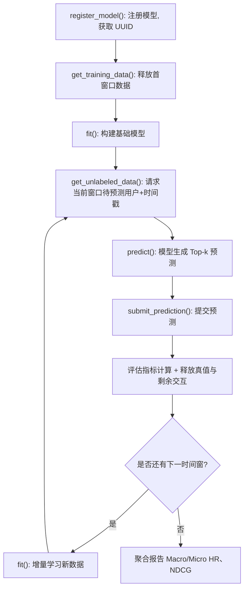

# RecNextEval: A Reference Implementation for Temporal Next-Batch Recommendation Evaluation (面向时间序贯批次推荐的评估参考实现)

- **会议/期刊**: SIGIR 2026 (Demo Track, 5 pages)
- **推荐链路定位**: 评测基础设施 (Evaluation Infrastructure) — 覆盖召回/排序模型的离线时序评估，不涉及具体推荐算法实现
- **研究方向**: 去偏公平、可信隐私与工业架构 / 序列与会话推荐
- **论文原文**: [https://arxiv.org/abs/2604.13665v1](https://arxiv.org/abs/2604.13665v1)
- **开源代码**: [https://github.com/hiiamtzekean/recnexteval](https://github.com/hiiamtzekean/recnexteval) （配套 Web UI: [recnexteval-studio](https://github.com/hiiamtzekean/recnexteval-studio)）

## TL;DR (核心速览)

针对现有 RecSys 评测工具包普遍忽视时间动态性、易发生数据穿越（data leakage）的问题，本文提出 RecNextEval——一个基于**滑动时间窗 (sliding time-window)** 的 next-batch 推荐评估参考实现。它通过 API 约束数据释放节奏，强制模型沿全局时间线"预测→接收真值→增量学习→再预测"，并支持宏/微平均的 HR/NDCG 聚合。在 MovieLens-100K 上以 7 个时间窗演示了 ItemKNNIncremental、RecentPopularity、DecayPopularity 三个样例模型的评估流程。本文为 Demo 论文，不含算法性能提升主张。

## Background & Motivation (背景与动机)

- **领域背景与主流范式**: RecSys 研究长期依赖离线评估，已有大量工具包（Elliot、RecBole、LensKit、RecPack、DaisyRec 2.0、BARS、ReChorus2.0 等）推动公平评估与可复现性。主流做法是随机划分或 user-based leave-last-one-out，配合全库/采样排序计算 HR/NDCG。
- **现有方法局限 (Limitations of Prior Work)**:
  1. **忽视时间动态性**：多数工具包假设随机划分或 leave-last-one-out 足够，未考虑用户行为随时间的演化，导致未来信息泄露（data leakage）。
  2. **固定时间点切分的两难**：RecPack、DaisyRec 2.0 虽支持按固定时间戳切分，但（a）结果高度依赖单一分割点的选择；（b）无法反映 concept drift（趋势、季节性、外部因素导致的偏好漂移）。
  3. **缺乏增量学习模拟**：现有工具包多为静态训练-测试，无法模拟生产中"新数据持续到达、模型需迭代更新"的真实场景。
- **核心挑战 (Key Challenge)**: 如何在离线评估中既保证全局时间线一致性（防穿越），又能产生**多轮评估实例**以捕捉动态偏好，同时给模型提供增量学习的机会？
- **核心洞察与切入点 (Key Insight)**: 借鉴数据流挖掘中的 test-then-train 协议与 Sun [SIGIR'23] 提出的 Timeline 评估方案，将评估组织为沿全局时间线滑动的多个时间窗，每个窗口内执行"预测阶段 → 结果释放阶段"两阶段操作，模型在窗口间增量学习。

## Problem Formulation & Method (问题定义与方法架构)

### 1. 符号定义与输入表征 (Notations & Input Representations)

- 用户集 $\mathcal{U}$、物品集 $\mathcal{I}$，所有用户-物品交互均关联时间戳 $t$，组织于全局时间线。
- 时间线被划分为若干窗口 $w \in W$（如 "Jan-Feb"、"Mar"、"Apr"），首个窗口数据用于构建基础模型（base model），后续窗口用于评估。
- $U_w$ 表示窗口 $w$ 中被评估的用户集合；$HR^w_u$ 表示用户 $u$ 在窗口 $w$ 内的 Hit Rate。
- 模型输入：初始训练数据（首窗口交互）+ 每轮释放的真值与剩余交互；输出：对指定用户 ID 的 Top-$k$ 预测列表（每用户最大预测数可配置，图 1 示例中为 2）。

### 2. 整体流水线 (Overall Architecture)

数据流向：注册模型 → 释放初始训练数据构建基础模型 → 对每个时间窗循环执行 [请求预测用户与时间戳 → 模型预测 → 提交预测 → 评估并释放真值+剩余交互 → 模型增量学习] → 全部窗口结束后聚合报告宏/微平均指标。

图 1 展示了数据释放、预测与结果释放三阶段的设计：1-2 月数据释放用于构建基础模型，3 月窗口内模型须在接收真值前生成预测；用户 $u_3$ 在 3 月前无交互记录，属未知用户（冷启动），框架提供"启用/禁用未知用户评估"两种配置（图 1 中 $u_3'$ 表示启用未知用户评估的替代设定）。

### 3. 核心模块设计与数学原理 (Key Designs & Formulations)

**(1) 两阶段窗口操作（Prediction Phase + Result Release Phase）**

- **预测阶段**：框架向模型请求一组用户 ID 及其对应交互的精确时间戳，预测请求数随用户实际活跃度自适应（如 $u_1$ 在 3 月有两次交互则请求两次预测，$u_2$ 仅一次则请求一次）。此阶段模型**仅**收到用户级预测请求，不接触任何真值。
- **结果释放阶段**：释放（a）此前预测请求对应的真值物品；（b）该窗口内其余全部交互。模型据此增量学习，准备下一窗口。若用户在某窗口无交互（如 $u_1$ 在 4 月），则不产生预测请求——框架动态适应用户活跃度。

**(2) 未知用户/未知物品的可配置处理**

未知用户（窗口内有交互但无历史训练数据）与未知物品（未在训练中出现）均可通过配置选择"评估"或"忽略"。禁用未知用户时，$u_3$ 在 3 月不接收预测请求，但其 3 月交互在结果释放阶段被释放，此后 $u_3$ 不再是未知用户，4 月起正常评估。该设计使框架可支持冷启动、增量学习等多种评估模式。

**(3) 宏/微平均指标聚合**

以 Hit Rate@$k$ 为例，四级计算：
- 用户级：$HR^w_u$（用户 $u$ 在窗口 $w$ 内可能有多条预测请求，先算用户级 HR）；
- 窗口级：$HR^w = \frac{1}{|U_w|}\sum_{u \in U_w} HR^w_u$；
- 宏平均：$HR_M = \frac{1}{|W|}\sum_{w \in W} HR^w$（每窗口等权）；
- 微平均：$HR_m = \frac{\sum_{w \in W}\sum_{u \in U_w} HR^w_u}{\sum_{w \in W}|U_w|}$（每用户等权）。

物理直觉：宏平均反映"窗口维度"的稳定性（对活跃度低的窗口给予同等权重），微平均反映"用户维度"的整体准确性（活跃窗口贡献更大），二者结合可揭示模型在不同时间段的差异化表现。

### 4. 训练目标、负采样与推理复杂度 (Optimization, Negative Sampling & Complexity)

- **损失函数**: 本文为评估框架，**不定义训练损失**；被评估模型自行实现 `fit()` 的优化逻辑。
- **训练负采样策略**: 框架层面**不规定负采样**；预测为 Top-$k$ 列表生成，评估基于真值命中（HR/NDCG），原文未报告采样负例协议。
- **时间与空间复杂度**: 原文未给出理论复杂度分析。实现层面采用 SciPy 稀疏矩阵与缓存优化降低内存与计算开销；作者明确指出**增量学习与时间窗评估均引入显著计算成本**，需进一步研究（见结论）。框架本身不提供推荐算法实现，因适配增量学习对各模型而言非平凡（non-trivial）。

## Experimental Setup & Evaluation Protocol (实验设置与评估协议)

- **数据集统计与预处理**: 演示仅使用 **MovieLens-100K**，原文未报告用户数/物品数/交互数/稀疏度等统计量，亦未说明过滤规则（如 5-core）。初始时间切分点设为 $t = 875156710$（1997 年 9 月 25 日 03:05:10）。

| 数据集 (Dataset) | 用户数 (#Users) | 物品数 (#Items) | 交互数 (#Interactions) | 稀疏度/密度 (Sparsity) | 模态/辅助特征说明 |
| :--- | :---: | :---: | :---: | :---: | :--- |
| MovieLens-100K | 原文未报告 | 原文未报告 | 原文未报告 | 原文未报告 | 仅时间戳，无多模态特征 |

- **数据划分方式 (Splitting Strategy)**: **滑动时间窗切分 (Sliding Time-Window Split)**，沿全局时间线划分多个窗口（演示中为 7 个时间窗），首窗口构建基础模型，后续窗口逐一评估。该设计**显式以消除数据穿越为目标**——未来交互在预测阶段前不释放给模型。
- **排名评测协议 (Ranking Protocol)**: 原文未明确说明是 Full-Ranking 还是 Sampled Ranking；评估基于模型提交的 Top-$k$ 预测列表与真值的命中计算，每用户最大预测数可配置（图 1 示例为 2）。
- **评价指标与显著性检验**: 指标包括 Precision@$k$、Recall@$k$、Hit Rate@$k$、NDCG 等，演示中报告 **HitRate@$k$ 与 NDCG@$k$** 的宏/微平均。**未进行任何配对显著性检验**（Demo 论文，无多随机种子方差报告）。Embedding 维度 $d$ 不适用（框架不涉及表征学习）。

## Key Experimental Results (核心实验结果)

### 1. 主实验对比 (Main Results)

本文为 Demo 论文，**不包含与传统基线的方法性能对比表**。演示使用三个样例模型（ItemKNNIncremental、RecentPopularity、DecayPopularity）在 MovieLens-100K 上展示框架能力，图 4 报告了宏/微平均的 NDCG 与 Hit Rate 结果（原文未给出具体数值表格），图 5 绘制了三个模型在 7 个时间窗上的 Hit Rate@10 曲线。

| 数据集 | 指标 | 传统/协同过滤基线 | 序列/图/多模态最强基线 | 本文方法 (Ours) | 相对提升 (Improv.) |
| :--- | :--- | :---: | :---: | :---: | :---: |
| MovieLens-100K | HitRate@10 / NDCG@10 | ItemKNNIncremental / RecentPopularity / DecayPopularity（样例模型，非竞争基线） | 不适用 | 不适用（框架论文） | 原文未报告 |

</figure>

</figure>

### 2. 消融实验与控制变量分析 (Ablation Study)

**原文未进行消融实验**。作为评估框架的参考实现，本文不涉及模块级消融；其核心贡献在于协议设计与工程实现，而非算法组件贡献度分析。

### 3. 稀疏度/冷启动分桶与超参敏感度 (Sparsity Buckets & Hyperparameters)

- **用户/物品交互频次分桶表现**: 原文未报告分桶实验。但框架通过"未知用户/未知物品"配置项显式支持冷启动场景评估（图 1 中 $u_3$/$u_3'$ 示例）。
- **关键超参数敏感度**: 原文未报告。可配置项包括：每用户最大预测数、未知用户/未知物品是否评估、初始时间切分点、时间窗粒度。
- **线上 A/B 测试结果**: **原文仅包含离线演示实验**，无线上 A/B 测试。

</figure>

</figure>

</figure>

## Highlights, Limitations & Critiques (亮点、局限与审稿级批判)

- **核心亮点与可迁移性**:
  1. **协议设计的可迁移性**：滑动时间窗 + test-then-train 的 next-batch 评估范式，可直接迁移到序列推荐、CTR 预估、生成式推荐等任何具有时间戳的推荐任务的离线评测，尤其适合需要模拟 concept drift 与增量学习的场景。
  2. **工程实现规范**：OOP 分层设计（datasets/settings/evaluators/metrics 等 10 个模块）、Strategy/Builder/Iterator 设计模式、SciPy 稀疏矩阵与缓存优化、`uv` 依赖版本锁定、PyPI 发布、Docker 编排的 Web UI（PostgreSQL + FastAPI + React/Vite），可复现性与易用性较好。
  3. **API 抽象清晰**：`register_model / get_training_data / fit / get_unlabeled_data / predict / submit_prediction` 六个接口将"数据释放约束"与"模型实现"解耦，便于社区贡献新模型。
  4. **宏/微平均双视角**：同时报告窗口等权与用户等权指标，有助于诊断模型在时间维度上的稳定性，这一报告规范值得推广。

- **局限性与审稿视角批判 (Critical Limitations)**:
  1. **评估协议细节缺失**：未说明是 Full-Ranking 还是 Sampled Ranking，未报告数据集统计量与过滤规则，未说明 Top-$k$ 的 $k$ 取值与每用户预测请求数的具体配置，削弱了结果的可解释性。
  2. **演示规模过小**：仅在 MovieLens-100K 上以 3 个简单样例模型（ItemKNN、Popularity 变体）演示，未在 Amazon/Yelp 等更大规模或序列模型上验证框架的通用性与可扩展性；未报告运行耗时、内存占用等效率数据。
  3. **增量学习适配成本被回避**：作者承认"适配各模型至增量学习非平凡"，但框架未提供任何适配指南或参考实现（除样例模型外），实际落地门槛可能被低估。
  4. **缺乏与现有工具包的定量对比**：未与 RecPack、DaisyRec 2.0 等在相同数据上的评估结果做一致性/差异性分析，难以量化"滑动窗口 vs 固定时间点"对模型排名的影响。
  5. **统计严谨性不足**：无多随机种子、无显著性检验；单一数据集、单一初始切分点，结论的稳健性存疑。
  6. **Demo 论文定位**：作为 5 页 Demo，方法创新性有限（核心思想源自 Sun [SIGIR'23] 的 Timeline 方案），主要贡献在工程实现与可用性，不宜以研究论文的创新性标准苛求，但审稿时仍应指出其协议验证的不足。

## Rating (四维评分)

- **方法创新性 (Novelty)**: ⭐⭐⭐（评估范式沿用已有 Timeline 思想，创新主要在工程实现与 API 抽象）
- **评估协议与实验扎实度 (Protocol & Experiments)**: ⭐⭐（协议设计理念先进，但实验规模小、细节缺失、无统计检验）
- **写作与数学规范度 (Clarity & Rigor)**: ⭐⭐⭐⭐（结构清晰、图示直观、指标公式定义完整，工程描述规范）
- **工业落地与复现价值 (Industrial & Practical Value)**: ⭐⭐⭐⭐（开源完整、依赖锁定、提供 Web UI 与 Docker 部署，对推动时序评估规范化有实际价值）
