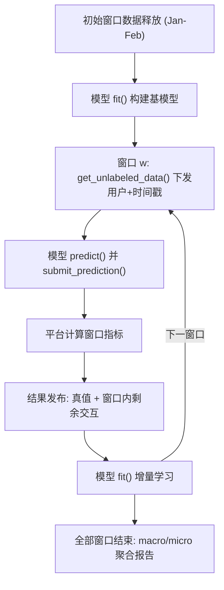
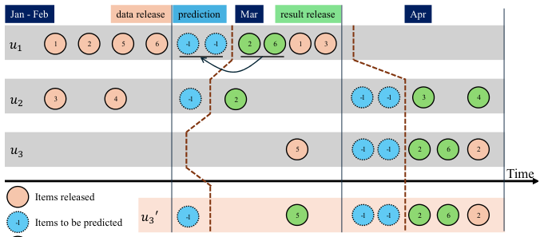

# RecNextEval: A Reference Implementation for Temporal Next-Batch Recommendation Evaluation (面向时序下一批次推荐的评估参考实现)

- **会议/期刊**: SIGIR 2026 (Demo Track)
- **作者与机构**: Tze-Kean Ng, Joshua Teng-Khing Khoo, Aixin Sun（南洋理工大学）
- **推荐链路定位**: 评测基准（覆盖召回/排序模型的离线-流式评估全链路）
- **研究方向**: 去偏公平、可信隐私与工业架构 / 序列与会话推荐
- **论文原文**: [https://arxiv.org/abs/2604.13665v1](https://arxiv.org/abs/2604.13665v1)
- **开源代码**: [https://github.com/hiiamtzekean/recnexteval](https://github.com/hiiamtzekean/recnexteval)（Web UI: [recnexteval-studio](https://github.com/hiiamtzekean/recnexteval-studio)）

## TL;DR (1分钟核心速览)

现有 RecSys 工具包（RecBole、RecPack、DaisyRec 2.0 等）虽支持固定时间点切分，但单一切分点使结果高度依赖切分位置，且无法刻画概念漂移下的模型自适应能力。本文提出 RecNextEval：以**滑动时间窗 + 预测/结果发布两阶段 API** 强制全局时间线，模型在每个窗口先预测、后接收真值与剩余交互并增量学习，最终以 macro/micro 双平均聚合多轮指标。在 MovieLens-100K 上以 7 个时间窗演示，揭示流行度基线在时序视角下依然强劲。

## Background & Motivation (背景与核心矛盾)

- **主流范式**: 多数工具包（RecBole、Elliot、TorchRec 等）聚焦模型实现与指标丰富度，默认采用随机划分或 user-based leave-last-one-out，评估设计中对时间维度基本缺位。
- **前人局限**: ① 随机/LOO 划分造成未来交互泄漏，离线指标虚高；② RecPack、DaisyRec 2.0 虽支持固定时间戳切分，但**单一切分点**使结论对切分位置敏感，且一次性训练无法反映概念漂移（趋势、季节性）下的模型适应力。
- **核心洞察 (Key Insight)**: 生产环境本质是"数据流 + 反复预测-反馈-再训练"的闭环；评估应模拟 test-then-train 流式协议，在**多个时间窗**上重复测量，而非在单一静态快照上打分。
- **本文切入点**: 不做算法，只做"约束数据释放"的评估平台——通过 API 强制模型只能看到当前时刻之前的数据，把时间泄漏从"靠自觉"变为"架构上不可能"。

## Method (核心方法设计)

### 1. 整体框架 (Overall Architecture)

所有交互带时间戳并沿全局时间线组织。初始窗口（如 Jan–Feb）数据释放给模型构建基模型，其余数据由平台扣留。此后每个时间窗执行两阶段：**预测阶段**平台按用户真实活跃度下发预测请求（含精确时间戳，每用户请求数可配）；**结果发布阶段**平台回传对应真值及该窗口内剩余交互，模型据此增量更新，进入下一窗口，直至数据流结束。最终聚合所有窗口的 HR/NDCG 等指标。该设计同时天然暴露冷启动（窗口内首次出现的未知用户/物品）与增量学习两大现实挑战。

<figure class="paper-figure" markdown="span">
  <figcaption>图1：使用三个示例用户说明数据发布、预测和结果发布阶段的示意图。每个用户交互过的物品沿时间线绘制。1月至2月的数据被发布用于构建基础模型，在每个时间窗口（例如3月）内，模型需在接收真实物品及剩余用户交互之前生成预测。</figcaption>
</figure>

### 2. 关键设计拆解 (Key Designs)

1. **滑动窗口 + 两阶段数据释放（防泄漏的核心机制）**：固定切分点只能测一次"未来"，且结果方差大。RecNextEval 将时间线切成 $|W|$ 个窗口，窗口 $w$ 内模型仅能访问 $t < w$ 的数据；预测请求数按用户在该窗口的真实交互数动态生成（图 1 中 $u_1$ 得 2 次请求、$u_2$ 仅 1 次、$u_1$ 在 4 月无交互则零请求）。直觉上，这把"离线评估"改造成了对生产流量模式的逐窗复现，泄漏在接口层面被物理阻断。

2. **未知用户/物品的可配置评估模式**：冷启动是生产常态但离线评估常被回避。平台提供开关：关闭时，窗口内首次出现的用户 $u_3$ 不接收预测请求，其交互在结果发布阶段才进入训练集（此后不再是未知用户）；开启时则对 $u_3'$ 强制冷启动预测。未知物品同理可排除，使评估仅在已曝光物品集上进行。这一设计让研究者能显式量化冷启动惩罚，而非被平均指标掩盖。

3. **Macro/Micro 双平均聚合与增量训练接口**：单窗口指标不足以概括全时间线表现。设用户 $u$ 在窗口 $w$ 的命中率为 $HR^w_u$，则窗口级 $HR^w=\frac{1}{|U_w|}\sum_{u\in U_w}HR^w_u$；macro 为 $\frac{1}{|W|}\sum_{w}HR^w$（各窗口等权），micro 为 $\frac{\sum_w\sum_{u}HR^w_u}{\sum_w|U_w|}$（各用户等权）。二者差异直接反映"活跃窗口 vs. 稀疏窗口"的贡献失衡。模型侧仅需实现 `register_model / get_training_data / fit / get_unlabeled_data / predict / submit_prediction` 六个接口，无损失函数与负采样约束（平台不干预模型内部训练策略）。

## Experimental Setup & Evaluation Protocol (实验设置与评估协议)

- **数据集与预处理**: 演示仅用 MovieLens-100K（约 10 万交互、943 用户、1682 物品），未做 5-core 过滤；要求全部交互带时间戳。

| 数据集 | #Users | #Items | #Interactions | 稀疏度/密度 | 特征/场景说明 |
| :--- | :---: | :---: | :---: | :---: | :--- |
| MovieLens-100K | 943 | 1,682 | 100,000 | ≈6.3% | 电影评分，含时间戳；演示用 |

- **数据划分与防穿越 (Splitting Strategy)**: **全局时间戳切分 + 滑动窗口**。初始切分点 $t=875156710$（1997-09-25 03:05:10），其后划为 7 个时间窗；每窗内严格"先预测、后释放真值与剩余交互"，杜绝未来信息穿越。
- **排名评测协议 (Ranking Protocol)**: 平台按用户请求返回 Top-$k$ 列表，指标为 HitRate@$k$ 与 NDCG@$k$；未交互物品是否计入候选由 unknown-item 开关控制（演示中开启未知用户与未知物品评估）。**注意：本文未规定统一的负采样比例或全库排序协议**，候选集构造交由模型侧 `predict()` 自行决定，这是该框架在可比性上的一个开放缺口。
- **对比基线与超参设置**: 演示三个内置样例模型——ItemKNNIncremental、RecentPopularity、DecayPopularity；未设 embedding 维度等超参对比，亦无显著性检验（Demo 性质）。

## Key Experimental Results (实验关键数据)

### 1. 主实验对比 (Main Results)

原文未提供传统意义上的 SOTA 对比表，仅以图 4/图 5 报告三模型在 7 个窗口上的 macro/micro 指标与逐窗 HR@10 曲线。据图 5 趋势整理如下（数值为曲线读数的定性归纳，非原文表格）：

| 模型 | 逐窗 HR@10 走势 | 时序视角下的表现 |
| :--- | :--- | :--- |
| RecentPopularity | 中高位波动，窗口间起伏明显 | 在 MovieLens 上具竞争力 |
| DecayPopularity | 整体最高或接近最高 | 时间衰减建模带来稳定增益 |
| ItemKNNIncremental | 相对偏低且波动 | 增量更新下协同信号滞后 |

### 2. 消融实验 (Ablation Study)

本文为评估框架 Demo，**未设组件消融实验**。可视为"隐式消融"的对照是 macro vs. micro 两种聚合口径（图 4）：同一批预测在两种平均下排序可能变化，说明聚合方式本身即是一个影响结论的"超参"。

### 3. 关键实验发现 (Key Findings)

1. **窗口间性能显著分化**：图 5 中三模型的 HR@10 在 7 个窗口上均呈明显起伏，说明单一切分点评估得到的单一数值无法代表模型在全时间线上的真实水平——这正是固定时间点方案（RecPack/DaisyRec 2.0）的结构性盲区。
2. **流行度基线在时序设定下依然强劲**：DecayPopularity 整体领先或持平于 ItemKNNIncremental，呼应近期关于"时序感知下流行度基线被低估"的批评，提示新模型必须以时序协议重新对标。
3. **macro/micro 口径会改变模型排序**：由于各窗口活跃用户数 $|U_w|$ 不等，micro 平均被高活跃窗口主导，与 macro 结论存在偏差；报告结果时必须双口径并列，否则结论可被聚合方式"操纵"。

## Highlights, Limitations & Rating (亮点、对比与审稿评价)

- **与代表作对比 (vs. Prior Work)**: 相较 RecBole/Elliot 等"模型库+静态指标"，本文把评估重心移到时间维度；相较 RecPack、DaisyRec 2.0 的固定时间戳切分，本文以多窗口滑动 + 增量学习接口消除了"单切分点依赖"；相较 [13] 提出的 Timeline 方案，本文贡献在于**可运行的参考实现 + 六接口规范 + Web UI**，把协议落地为工程标准。
- **可迁移亮点**: ① "预测前扣留、预测后释放"的两阶段 API 契约可直接移植到任何需要防泄漏的离线回测系统；② macro/micro 双口径报告应成为时序评估的默认规范。
- **审稿级局限批判**: ① **候选集与负采样协议未统一**，不同模型可自选候选空间，跨模型可比性存疑；② 增量学习 + 逐窗重训带来显著算力开销（作者自认），且演示仅覆盖 MovieLens-100K 与三个轻量基线，缺乏深度学习模型与大规模数据验证；③ 未提供统计显著性检验与窗口长度/初始切分点的敏感性分析。
- **四维评分**: 创新性 ⭐⭐⭐ | 实验扎实度 ⭐⭐ | 方法清晰度 ⭐⭐⭐⭐⭐ | 落地价值 ⭐⭐⭐⭐

