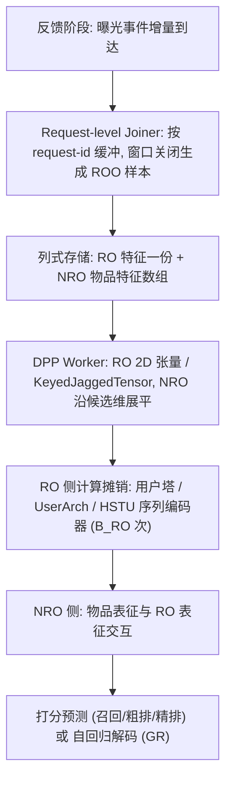
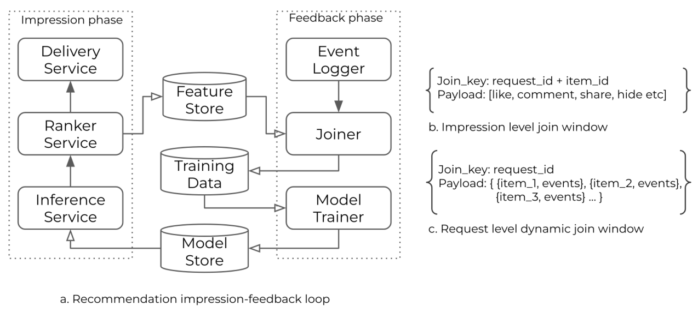
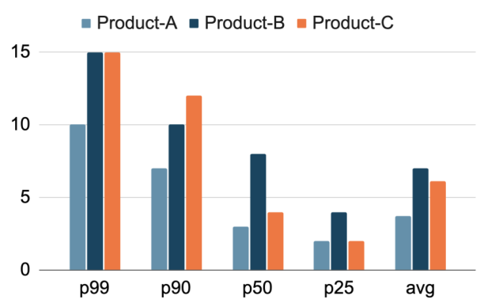
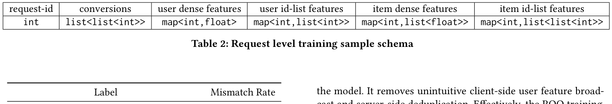
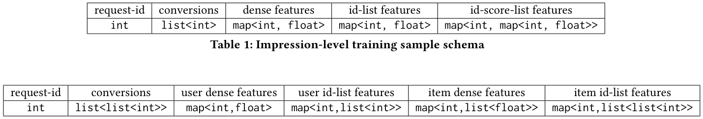
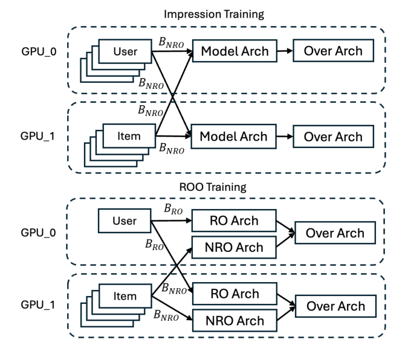
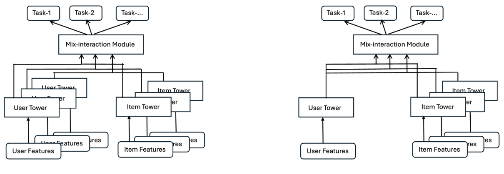

# Request-Only Optimization for Recommendation Systems (面向推荐系统的仅请求级优化)

- **会议/期刊**: SIGIR 2026
- **推荐链路定位**: 召回 (Retrieval) / 粗排 (Early-Stage Ranking) / 精排 (Late-Stage Ranking) / 端到端生成式 (Generative Recommenders)
- **研究方向**: 去偏公平、可信隐私与工业架构 / 生成式推荐与离散语义 ID
- **论文原文**: [https://arxiv.org/abs/2508.05640v3](https://arxiv.org/abs/2508.05640v3)
- **开源代码**: 暂未开源

## TL;DR (核心速览)

针对工业推荐系统"以曝光 (impression) 为训练样本单元"导致同一请求内用户特征被重复存储与重复计算的根因性低效，本文提出 Request-Only Optimization (ROO) 范式：将一次用户请求作为训练样本单元，把特征划分为仅请求级 (RO) 与曝光级 (NRO) 两部分，在数据格式、数据管道与模型架构三层协同设计。ROO 使同存储下训练样本量提升 43%–150%，召回/粗排训练吞吐最高提升 570%，精排提升 32%–100%，并借助计算摊销将 HSTU 生成式推荐模型 FLOPs 扩展 7 倍，在十亿用户级产品上取得显著离线与线上指标收益。

## Background & Motivation (背景与动机)

- **领域背景与主流范式**: 工业级 DLRM 以 PB 级数据训练、服务十亿级用户，单样本计算量已达 TFLOPs 量级。主流范式是"两阶段"数据管道：请求阶段下发多个候选内容形成多次曝光 (impression)，反馈阶段收集用户行为并与特征 join，**以单次曝光为训练样本单元**。为利用长用户历史，序列建模（Transformer/HSTU）被广泛采用，用户侧稀疏序列特征构成训练样本特征的绝大部分。
- **现有方法局限 (Limitations of Prior Work)**:
  1. **源头特征冗余**：一次请求平均产生 4–7 次曝光（图 2），曝光级 event-feature joiner（图 1b）会把完全相同的用户特征在每条曝光样本中重复存储，冗余沿存储、网络带宽、GPU 计算全链路级联放大。
  2. **训练/推理栈割裂**：推理侧已有请求级优化（客户端广播 + 服务端去重）作为"wrapper"叠加在曝光级数据之上，增加系统复杂度却未触及训练侧根因。
  3. **规模化瓶颈**：序列建模与生成式推荐 (GR) 依赖的恰是被冗余处理的用户序列特征，导致高复杂度架构在训练成本上不可行。
- **核心挑战 (Key Challenge)**: 曝光级数据格式已深度嵌入客户端与服务端基础设施，且反馈阶段曝光事件是增量到达的，因此简单的"批内去重"或"加深网络"无法在数据生成源头消除冗余；必须从数据格式层面重构样本单元。
- **核心洞察与切入点 (Key Insight)**: 同一请求内所有曝光共享同一份用户特征（RO 特征），因此用户塔/序列编码器的计算与通信可在请求级**精确摊销一次**。作者据此将计算与通信复杂度从 $O(B_{NRO})$ 降至 $O(B_{RO})$，并指出该摊销恰好为 HSTU 等重用户侧架构打开规模化空间。

## Problem Formulation & Method (问题定义与方法架构)

### 1. 符号定义与输入表征 (Notations & Input Representations)

- 用户集 $\mathcal{U}$、物品集 $\mathcal{I}$；一次请求 $r$ 对应 $m$ 个候选物品（曝光），批内请求数为 $B_{RO}$，批内曝光总数为 $B_{NRO}$，平均 $B_{NRO}/B_{RO}\approx 4\text{–}7$。
- 特征被显式划分为两类：
  - **RO (Request-Only) 特征**：用户稠密特征 `map<int,float>`、用户 ID-list 特征 `map<int,list<int>>`，每个请求仅存一份；
  - **NRO (Non-Request-Only / 曝光级) 特征**：物品稠密特征 `map<int,list<float>>`、物品 ID-list 特征 `map<int,list<list<int>>`，沿候选维度展平。
- 张量化：RO 用户浮点特征为 2D 张量，RO 用户 ID-list 为 PyTorch `KeyedJaggedTensor`；NRO 同理，并以 NRO 张量显式记录"每个 ROO 样本含多少曝光"以避免批大小对齐时的用户特征复制。
- 序列建模记号：用户历史 $RO_0,\dots,RO_{n-1}$（$n$ 常达数千），请求内目标物品 $NRO_0,\dots,NRO_{m-1}$（$m$ 常为数十），每项附行为特征 $a$ 与上下文特征 $c$（surface type、时间戳等），嵌入维度 $d$（实验场景取 $d=256$）。

### 2. 整体流水线 (Overall Architecture)

数据流向：反馈阶段由 **request-level joiner** 按 request-id 缓冲用户-物品交互事件，join 窗口关闭后生成一条紧凑 ROO 样本（RO 部分一份用户特征 + NRO 部分物品特征数组）→ 以 feature flattening 列式格式落盘（提升压缩比）→ DPP worker 读入并转为 RO/NRO 两套张量 → 模型侧 RO 塔/序列编码器只对 $B_{RO}$ 个请求计算一次，结果 fanout 给该请求下所有曝光 → 与 NRO 物品表征交互后打分或自回归解码。

图 1 展示了传统曝光级 joiner 与本文请求级 joiner 的对比；图 3 以 $B_{NRO}=4,B_{RO}=1$ 为例说明 RO 侧 embedding lookup 与 all-to-all 通信如何从 4 次降为 1 次；图 4 对比了双塔类模型在曝光级训练 (a) 与 ROO 训练 (b) 下的结构差异。

### 3. 核心模块设计与数学原理 (Key Designs & Formulations)

**(1) 请求级数据格式与 join 质量保障。** 表 1 与表 2 分别给出曝光级与请求级样本 schema：曝光级需为每条曝光重复 `user dense features` 与 `user id-list features`，请求级则将其提升为请求维度（`map<int,float>` / `map<int,list<int>>`），物品特征改为嵌套 list。为避免请求级 join 引入分布偏移，作者用固定时间策略或动态训练触发器提前关闭 join 窗口，实测最早交互事件到请求最后一条物品的平均时间差在 16 分钟内，数据落地延迟约为固定窗口的一半；表 3 显示转化率与视频观看时长等关键标签的分布失配率极低（转化失配 0.023%–0.16%，观看时长失配 0.01%–1.07%），用户样本与特征覆盖率和曝光级数据持平。

**(2) UserArch：RO 侧特征压缩与规模化。** 精排模型中用户-物品交互发生得早，ROO 收益主要限于 embedding lookup 与跨 GPU 通信。为此作者在进入 post-ROO 架构前用 Linear Compress Embedding (LCE) 压缩用户特征维度。设用户特征张量 $X\in\mathbb{R}^{B,d_{in},n_{in}}$：

$$f(X)=b+g(X)\odot W,\quad b\in\mathbb{R}^{1,n_{out}},\ W\in\mathbb{R}^{n_{in},n_{out}}$$

其中 $g(X)$ 将 $X$ reshape/permute 为 $\mathbb{R}^{B\times d,n_{in}}$；再接一层线性投影到输出维度：

$$f'(f(X))=b'+g'(f(X))\odot W',\quad b'\in\mathbb{R}^{1,d_{out}},\ W'\in\mathbb{R}^{d_{in},d_{out}}$$

物理直觉：先在特征数维 $n_{in}\to n_{out}$ 压缩、再在嵌入维 $d_{in}\to d_{out}$ 投影，使"增加用户侧特征"不再线性推高 post-ROO 交互架构的规模，而 UserArch 自身的计算又被 ROO 摊销，从而在同等算力下容纳更多用户信号。

**(3) ROO 自回归建模与 HSTU 摊销。** 对基于 self-attention 的序列转导架构，曝光级设置下总开销为 $m\cdot(n^2d+nd^2)$；ROO 设置下历史与请求内目标拼接为一条序列，开销降为 $(n+m)^2d+(n+m)d^2$。在 $n=1000,m=10,d=256$ 的中等场景下，序列编码器计算节省达 **9.82×**。检索场景中序列编码器仅输入用户历史，排序场景中目标信息亦输入编码器（图 5b）。作者据此在用户序列上部署 HSTU（面向工业级大而动态词表的 Transformer 变体），把省下的算力全部投入模型 FLOPs 扩展。

### 4. 训练目标、负采样与推理复杂度 (Optimization, Negative Sampling & Complexity)

- **损失函数**: 原文未给出统一的显式损失公式（属工业系统论文，各产品沿用其原有训练目标）；核心贡献在于样本组织与计算图重构，而非新损失项。
- **训练负采样策略**: 原文未报告负采样细节（召回/粗排沿用各产品既有配置）。
- **时间与空间复杂度**:
  - RO 侧 embedding lookup、embedding all-to-all 通信、RO-only 架构的 FLOPs 由 $O(B_{NRO})$ 降为 $O(B_{RO})$（图 3）；
  - 序列编码器由 $m(n^2d+nd^2)$ 降为 $(n+m)^2d+(n+m)d^2$；
  - 存储侧：同容量下训练样本量提升 43%–150%（表 4）；
  - 推理侧：ROO 统一训练与推理输入格式，移除客户端用户特征广播与服务端去重，模型内部完成用户特征 fanout；
  - 理论加速比 300%–600%（对应每请求 4–7 次曝光）。

## Experimental Setup & Evaluation Protocol (实验设置与评估协议)

- **数据集统计与预处理**: 本文不使用公开学术基准，实验载体为某十亿用户级平台上三个（部分段落提及四个）主要推荐产品的真实工业数据，分别记为 product-A/B/C(/D)。原文未报告用户数、物品数、交互数等统计量。

| 数据集 (Dataset) | 用户数 (#Users) | 物品数 (#Items) | 交互数 (#Interactions) | 稀疏度/密度 (Sparsity) | 模态/辅助特征说明 |
| :--- | :---: | :---: | :---: | :---: | :--- |
| Product-A | 原文未报告 | 原文未报告 | 原文未报告 | 原文未报告 | 用户稠密/ID-list 序列特征 + 物品特征 |
| Product-B | 原文未报告 | 原文未报告 | 原文未报告 | 原文未报告 | 同上 |
| Product-C | 原文未报告 | 原文未报告 | 原文未报告 | 原文未报告 | 同上 |

- **数据划分方式 (Splitting Strategy)**: 原文未报告离线训练/验证/测试的具体切分比例；工业场景下按时间顺序的在线数据流训练，请求级 join 窗口（固定时间或动态触发）决定样本落地时点，理论上存在"等待窗口内后续曝光"的轻微时序耦合，但表 3 的标签分布对齐分析表明失配可忽略。
- **排名评测协议 (Ranking Protocol)**: 原文未报告 Full-Ranking 或 Sampled Ranking 协议；评测以工业离线指标与线上 A/B 指标为主。
- **评价指标与显著性检验**: 原文摘要与正文提及"显著离线与线上指标收益"，但抽取文本中未给出具体指标名称、数值与显著性检验（如 paired $t$-test）细节；嵌入维度在序列建模复杂度分析中取 $d=256$。

## Key Experimental Results (核心实验结果)

### 1. 主实验对比 (Main Results)

本文主实验为系统效率与样本量对比，而非与传统推荐基线的精度对比表。核心结果如下：

| 维度 | 指标 | 传统曝光级训练 | 本文 ROO | 相对提升 (Improv.) |
| :--- | :--- | :---: | :---: | :---: |
| 样本量 (Product-A) | 同存储下训练样本数 | 基准 | +43% | +43% |
| 样本量 (Product-B) | 同存储下训练样本数 | 基准 | +150% | +150% |
| 样本量 (Product-C) | 同存储下训练样本数 | 基准 | +100% | +100% |
| 训练吞吐 (召回/粗排) | Training throughput | 基准 | 最高 6× | 最高 +570% |
| 训练吞吐 (精排) | Training throughput | 基准 | — | +32% ~ +100% |
| 模型规模 (HSTU) | 同等训练算力下 FLOPs | 基准 | 7× | +600% |
| 序列编码器计算 | $n=1000,m=10,d=256$ | $m(n^2d+nd^2)$ | $(n+m)^2d+(n+m)d^2$ | 9.82× 节省 |

### 2. 消融实验与控制变量分析 (Ablation Study)

原文未提供传统意义上的逐模块消融表。可视为"设计对照"的证据包括：(a) 图 3 的通信/计算去重示意与理论复杂度推导；(b) 表 3 的请求级 join 数据质量对照（相对曝光级数据的标签失配率）；(c) 图 4 的曝光级 vs. ROO 双塔结构对照。各模块贡献的定量拆分（如 UserArch 单独移除的降幅）原文未报告。

### 3. 稀疏度/冷启动分桶与超参敏感度 (Sparsity Buckets & Hyperparameters)

- **分桶表现**: 原文未按用户/物品交互频次分桶分析。
- **超参敏感度**: 原文未报告温度系数、损失权重等超参敏感性；仅给出序列长度 $n$ 与请求规模 $m$ 对加速比的理论影响趋势（$n$ 越大、$m$ 越大，ROO 摊销收益越显著）。
- **线上 A/B 测试结果**: 论文声明 ROO 已部署至三个十亿级活跃用户产品，并"取得显著离线与线上指标收益"，但抽取文本中未列出具体业务指标（CTR/CVR/停留时长等）数值、实验周期与流量占比，属原文未充分报告项。

## Highlights, Limitations & Critiques (亮点、局限与审稿级批判)

- **核心亮点与可迁移性**:
  1. **根因级重构**：不在既有曝光级管线上打补丁，而是把样本单元从 impression 改为 request，从数据生成源头消除冗余，这一思路可迁移到任何"一请求多候选"的排序/召回/生成式系统。
  2. **三层协同设计**：数据格式（表 2）、基础设施（request-level joiner、列式压缩、变长 batch sharding）、模型架构（UserArch、ROO 序列模型、HSTU）形成闭环，且训练/推理格式统一，显著降低系统复杂度。
  3. **算力再投资**：把摊销节省的算力转化为 7× FLOPs 的模型扩展，是"效率换质量"的典范工程论证。
- **局限性与审稿视角批判**:
  1. **可复现性不足**：无开源代码、无公开数据集、无具体超参与损失公式，学术读者难以复现；核心收益高度依赖 Meta 内部基础设施（TorchRec、feature flattening）。
  2. **评估协议不透明**：未报告数据划分、排序协议（Full vs. Sampled）、离线指标定义与显著性检验，线上 A/B 仅给结论不给数值，削弱说服力。
  3. **join 窗口的时序耦合**：请求级 join 需等待窗口内后续曝光，虽实测延迟约减半且标签失配极低，但在强实时性场景下可能引入训练-服务偏差，论文对此的量化边界讨论有限。
  4. **适用边界**：收益与 $B_{NRO}/B_{RO}$ 强相关；对单候选请求或用户特征占比低的场景，摊销收益会显著缩水，论文未给出失效条件的系统分析。

## Rating (四维评分)

- **方法创新性 (Novelty)**: ⭐⭐⭐⭐
- **评估协议与实验扎实度 (Protocol & Experiments)**: ⭐⭐⭐
- **写作与数学规范度 (Clarity & Rigor)**: ⭐⭐⭐⭐
- **工业落地与复现价值 (Industrial & Practical Value)**: ⭐⭐⭐⭐⭐

## 论文图表

<figure class="paper-figure" markdown="span">
  <figcaption>图 1</figcaption>
</figure>

<figure class="paper-figure" markdown="span">
  <figcaption>图 2</figcaption>
</figure>

<figure class="paper-figure" markdown="span">
  <figcaption>表 1</figcaption>
</figure>

<figure class="paper-figure" markdown="span">
  <figcaption>表 2</figcaption>
</figure>

<figure class="paper-figure" markdown="span">
  <figcaption>图 3</figcaption>
</figure>

<figure class="paper-figure" markdown="span">
  <figcaption>图 4</figcaption>
</figure>

