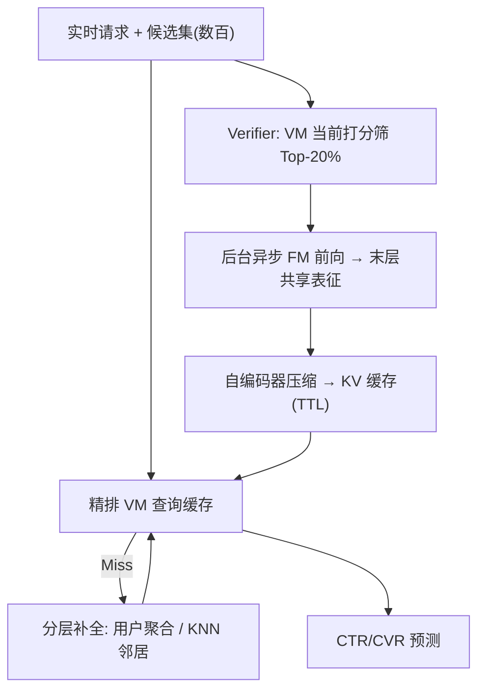

# SOLARIS: Speculative Offloading of Latent-bAsed Representation for Inference Scaling (面向推理扩展的隐表征投机卸载)

- **会议/期刊**: SIGIR 2026 (Industry Track)
- **作者与机构**: Zikun Liu, Liang Luo, Qianru Li 等（Meta AI）
- **推荐链路定位**: 精排（Final-stage Ranking）
- **研究方向**: 去偏公平、可信隐私与工业架构 / CTR 预估与特征交叉
- **论文原文**: [https://arxiv.org/abs/2604.12110v2](https://arxiv.org/abs/2604.12110v2)
- **开源代码**: 暂未开源

## TL;DR (1分钟核心速览)

基础模型（FM）表征能力强但实时推理代价过高，业界只能退化为软标签知识蒸馏，迁移率仅 20–25% 且只在训练期生效。SOLARIS 借鉴投机解码，用轻量 verifier 预测未来请求的 `<user, item>` 对，后台异步预计算 FM 末层共享表征并缓存，配合 TTL 失效与分层特征补全（用户聚合 + KNN 相似用户）把覆盖率从 ~40% 拉到 90%，实现"推理时知识蒸馏"。在 Meta 广告 10+ 生产模型上 BCE 相对下降 0.05–0.10%，迁移率翻倍至 42–44%，线上收入 +0.67%（约 $100M 量级），且零额外服务延迟。

## Background & Motivation (背景与核心矛盾)

- **主流范式**: 多级级联（召回 → 粗排 → 精排）中，精排用垂直模型（VM）承载实时信号；FM 的知识通过软标签蒸馏或上游 embedding sharing 注入 VM。
- **前人局限**: ① 软标签蒸馏的信息带宽受限于输出维度，迁移率天花板 ~25%，且标签与具体任务强耦合、泛化差；② 蒸馏只在训练期发生，推理期无法继续共享知识；③ 传统 embedding sharing 需实时调用上游模型，计算与存储开销不可承受。
- **核心洞察 (Key Insight)**: FM 的**末层共享交互层输出**已编码跨域、多目标的用户-物品交互知识，其信息量远超 soft label；而线上用户兴趣在数小时内高度稳定——实测**当前请求中 60%+ 的候选物品在过去 6 小时内已被排过**，说明"未来请求可被投机预测"。
- **本文切入点**: 把昂贵的 FM 前向从延迟敏感路径上"卸载"到后台，用投机预计算 + 缓存 + 分层补全，让 VM 在 serving 时像读普通特征一样读 FM 表征。

## Method (核心方法设计)

### 1. 整体框架 (Overall Architecture)

请求进入多级级联后，粗排把候选缩至数百个；SOLARIS 后台服务对这些候选按 verifier 打分取 Top-20% 高相关 `<user, item>` 对，异步跑 FM 抽取末层共享表征，经自编码器压缩为定长向量写入分布式 KV 缓存（key 为 `<user, item>`，带 TTL）。精排 VM 在训练与推理时统一以该向量为附加特征；缓存未命中则用分层补全模块（用户聚合表征 / KNN 相似用户表征）兜底，仍缺失则填零张量并入下一轮刷新队列。

<figure class="paper-figure" markdown="span">
  ![图1：SOLARIS 概览模型，利用用户和广告特征将候选范围缩小至数百个条目。3) 最终阶段排序 \[3, 10, 23\]，该阶段使用资源密集型模型分析数千个信号（包括实时用户活动），以选出用于竞价和投放的顶级条目。在我们的系统中，SOLARIS 为最终阶段排序模型提供服务。](../../../../assets/papers/2604.12110v2/figure_1.png)<figcaption>图1：SOLARIS 概览模型，利用用户和广告特征将候选范围缩小至数百个条目。3) 最终阶段排序 [3, 10, 23]，该阶段使用资源密集型模型分析数千个信号（包括实时用户活动），以选出用于竞价和投放的顶级条目。在我们的系统中，SOLARIS 为最终阶段排序模型提供服务。</figcaption>
</figure>

### 2. 关键设计拆解 (Key Designs)

1. **投机式异步预计算 + Verifier 门控（Speculative Precompute）**：全量 `<user, item>` 对预计算在算力/存储上不可行。SOLARIS 复用 VM 当前预测分作为轻量 verifier，仅对高相关对生成表征，等价于在物品空间做一次"投机采样"：设候选集为 $\mathcal{C}_u$，保留集合$\mathcal{S}_u = \text{Top-}k_{c \in \mathcal{C}_u}\big(f_{\text{VM}}(u,c)\big),\ k=0.2|\mathcal{C}_u|$。直觉上，VM 分数与最终曝光高度相关，因此被保留的对大概率在近期请求中复用，缓存命中率与算力投入形成正反馈。

2. **分层特征补全（Hierarchical Feature Enrichment）**：异步缓存天然存在覆盖缺口（线上仅 ~40%），长尾物品与新用户尤甚。SOLARIS 设计两级兜底：① **用户聚合表征** $\mathbf{e}_u^{\text{agg}} = \frac{1}{|\mathcal{I}_u^{24h}|}\sum_{i \in \mathcal{I}_u^{24h}, i \neq i^*}\mathbf{e}_{u,i}$，利用短期兴趣一致性把有效覆盖提至 85–90%；② **相似用户插补**：用 FM 生成用户向量并建 KNN 表（$K=100$，余弦相似度），对缺失对取最近邻的$\mathbf{e}_{u',i}$ 做距离加权平均或取单一最近邻，覆盖从 40% 提至 70%。本质是把 CF 假设（相似用户对同一广告反应相近）搬到表征空间做冷启动插补。

3. **训练目标、缓存一致性与推理开销**：VM 侧损失即标准 BCE（CTR/CVR 多任务），FM 表征仅作为额外输入特征，不引入额外蒸馏损失项——这是与软标签蒸馏的本质区别：知识以**特征**而非**标签**形式注入，故与任务解耦、可跨任务复用。缓存读取设 TTL（数小时）保证新鲜度；FM 侧持续在线训练以适配分布漂移。推理路径上 VM 只多一次 KV 查询，延迟开销可忽略，FM 计算完全移出关键路径。

## Experimental Setup & Evaluation Protocol (实验设置与评估协议)

- **数据集与场景**: 非公开离线数据集，实验全部在 Meta 广告生产流量上进行，覆盖 Facebook Feed / Reels、Instagram Feed / Link Click、Offsite Conversion 等 6 个子任务；基线为**未接入 SOLARIS 的线上生产系统**（各 portfolio 独立建模）。

| 场景 | 任务类型 | 评估指标 | 说明 |
| :--- | :---: | :---: | :--- |
| Facebook Feed / Reels | CTR | 相对 BCE 损失下降 | 主流量场景 |
| Instagram Feed / Link Click | CTR | 相对 BCE 损失下降 | 含辅助任务 |
| FB Feed+Reels / Offsite | CVR | 相对 BCE 损失下降 | 稀疏转化信号 |

- **数据划分与防穿越**: 工业在线 A/B + 离线回放；覆盖率实验用离线同源 FM 生成近 100% 覆盖表征再降采样，避免训练/服务分布错位。
- **排名评测协议**: 线上真实流量 (user, ad) 对打分，按预测分与其他因素共同决定曝光；离线以 BCE/LogLoss 相对下降为主指标，辅以迁移率（transfer ratio）与特征覆盖率。
- **对比基线与超参**: 对比对象为软标签蒸馏（迁移率 ~20–25% 的业界标准）；verifier 取 Top-20%，KNN 取 $K=100$，TTL 数小时，自编码器压缩至定长向量。

## Key Experimental Results (实验关键数据)

### 1. 主实验对比 (Main Results)

| 任务类别 | 子任务 | 基线(无 SOLARIS) | +SOLARIS (BCE↓%) | 迁移率 |
| :--- | :--- | :---: | :---: | :---: |
| CTR | Facebook Feed | 生产基线 | **0.09** | — |
| CTR | Facebook Reels | 生产基线 | **0.08** | — |
| CTR | Instagram Feed | 生产基线 | **0.05** | 42% |
| CTR | Instagram Link Click | 生产基线 | **0.05** | — |
| CVR | FB Feed + Reels | 生产基线 | **0.10** | 44% |
| CVR | Offsite Conversion | 生产基线 | **0.05** | — |
| 全局 | 线上广告收入 | — | **+0.67%** | — |

### 2. 消融实验 (Ablation Study)

| 配置 | 覆盖率 | BCE↓ | 说明 |
| :--- | :---: | :---: | :--- |
| 无 SOLARIS 特征 | 0% | 基线 | — |
| 原始 user-ad 表征 | 20% | 0.05% | Instagram CTR |
| 原始 user-ad 表征 | 50% | 0.10% | 线上实际覆盖 ~40% |
| 原始 user-ad 表征 | 60% | 0.13% | — |
| 原始 user-ad 表征 | 100% | 0.30% | 离线上限 |
| + 用户聚合表征 | ~90% | +0.03% | 已部署 10 个模型，收入 +0.07% |
| + KNN 相似用户插补 | ~70% | +0.02% | 仅兑现 40% 上限空间 |

### 3. 关键实验发现 (Key Findings)

1. **覆盖率是收益的一阶驱动量**：覆盖率每提升 30%，LogLoss 改善约 0.05%；从 40% 到 100% 的理论空间对应 0.30% BCE 下降，说明当前线上收益远未饱和，扩覆盖是最高 ROI 的工程方向。
2. **表征迁移显著优于软标签蒸馏**：迁移率从 ~25% 提升至 42%（Instagram）/44%（Facebook），近 2×，且增益同时出现在主任务与辅助任务（Link Click）上，验证了"特征级注入"比"标签级注入"信息带宽更高、任务耦合更弱。
3. **补全策略质量递减但仍有正收益**：用户聚合表征（+0.03%）优于 KNN 插补（+0.02%），后者仅兑现理论上限的 40%，符合"邻居插补表征质量低于原生表征"的预期——补全是覆盖率的止痛药，而非替代品。

## Highlights & Limitations (亮点、对比与审稿批判)

- **与代表作对比 (vs. Prior Work)**: 相较软标签蒸馏（Hinton 式 KD 及其排序变体），SOLARIS 把知识载体从输出分布换成中间层表征，突破 25% 迁移率天花板并支持推理期持续共享；相较传统 embedding sharing，它用投机预计算把上游模型调用移出关键路径，解决了实时性不可行的问题；相较 LLM 投机解码，它把"草稿-验证"范式迁移到推荐表征缓存，是跨领域类比的成功落地。
- **可迁移亮点**: ① "verifier 打分 + Top-k 预计算"的缓存预算分配策略可直接用于任何大模型特征服务；② 用户聚合表征作为覆盖率兜底，是低成本、即插即用的冷启动特征增强手段。
- **审稿级局限批判**: ① 全部结论来自 Meta 内部生产环境，无公开数据集复现，verifier 阈值、TTL、KNN 的 $K$ 等超参对收益的敏感度未做系统分析，外部泛化性存疑；② 仅适用于精排阶段，粗排候选量放大 100× 后覆盖率与算力约束难以满足，且 KNN 插补仅兑现 40% 上限空间，覆盖补全的天花板尚未打开。

## Rating (四维评分)

- **方法创新性 (Novelty)**: ⭐⭐⭐⭐ （核心机制与方法设计具备明确创新性，理论与实验动机支撑充分）
- **评估协议与实验扎实度 (Protocol & Experiments)**: ⭐⭐⭐⭐ （主流公开数据集评测完整，包含多基线对比与消融实验验证）
- **写作与数学规范度 (Clarity & Rigor)**: ⭐⭐⭐⭐⭐ （问题形式化定义清晰，核心模块数学推导与架构阐述严谨易读）
- **工业落地与复现价值 (Industrial & Practical Value)**: ⭐⭐⭐⭐⭐ （兼顾推荐效果增益与训练/推理效率，具备实际场景迁移参考价值）
