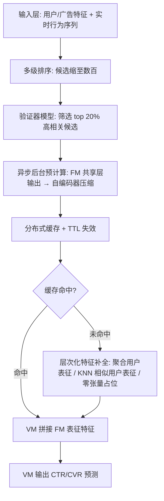

# SOLARIS: Speculative Offloading of Latent-bAsed Representation for Inference Scaling (面向推理扩展的投机式潜在表征卸载)

- **会议/期刊**: SIGIR 2026 (Industry Track)
- **推荐链路定位**: 精排 (Final Stage Ranking / CTR-CVR Prediction)
- **研究方向**: 去偏公平、可信隐私与工业架构 / CTR/CVR 预估与特征交叉
- **论文原文**: [https://arxiv.org/abs/2604.12110v2](https://arxiv.org/abs/2604.12110v2)
- **开源代码**: 暂未开源

## TL;DR (核心速览)

针对基础模型 (FM) 因算力过高无法在线实时服务、而传统软标签知识蒸馏迁移率仅 20–25% 且仅限训练期的痛点，SOLARIS 借鉴投机解码思想，异步预计算并缓存 FM 的用户-物品交互表征，配合验证器筛选、TTL 缓存与层次化特征补全，在推理时向垂直模型 (VM) 直接注入表征。在 Meta 广告系统十多个生产模型上实现 BCE 相对下降 0.05–0.10%、迁移率提升至 42–44%（约 2 倍），线上广告收入 +0.67%。

## Background & Motivation (背景与动机)

- **领域背景与主流范式**: 推荐系统遵循"召回 → 粗排 → 精排"多级流水线，精排阶段使用资源密集型模型分析数千信号。近年推荐 scaling law 推动基础模型 (FM) 规模空前膨胀，离线评估性能持续提升，但实时服务不可行，工业界普遍退化为知识蒸馏到小型垂直模型 (VM)。
- **现有方法局限 (Limitations of Prior Work)**:
  1. **迁移率与泛化性受限**: 基于软标签的蒸馏 [2,11,17,30] 迁移率通常仅 20–25%，且预测标签与特定任务强耦合，难以泛化。
  2. **可用性与覆盖受限**: 知识迁移仅发生在训练期（标签可得时），推理阶段完全错失知识共享机会。
  3. **嵌入共享的开销矛盾**: 直接复用上游表征虽有效，但带来显著计算与存储开销。
- **核心挑战 (Key Challenge)**: FM 表征蕴含最丰富的用户-物品交互知识，但为每个 `<user, item>` 对实时生成表征的基础设施成本不可承受；简单增加网络深度或常规蒸馏无法突破软标签的信息瓶颈。
- **核心洞察与切入点 (Key Insight)**: 作者观察到用户偏好在数小时内保持稳定——**当前请求中超过 60% 的物品候选在过去 6 小时内已被排序过**。因此可"投机"预测未来请求所需的用户-物品对，在后台异步预计算其 FM 表征并缓存，将昂贵推理从延迟敏感的服务路径中解耦，实现"推理时知识蒸馏"。

## Problem Formulation & Method (问题定义与方法架构)

### 1. 符号定义与输入表征 (Notations & Input Representations)

- 用户集 $\mathcal{U}$、广告/物品集 $\mathcal{I}$，请求以 $(u, i)$ 对形式到达精排阶段。
- FM 输入为异构特征：稠密特征（MLP 投影为低维嵌入）、稀疏类别特征（Embedding Bag 池化）、变长序列行为特征（事件序列建模）。
- FM 输出：取**最后一个共享交互层**的输出作为用户-物品交互表征，经自编码器 [27,35] 压缩为紧凑定长向量 $\mathbf{e}_{u,i}$，作为 VM 的额外输入特征。
- VM 输出：CTR / CVR 预测概率。

### 2. 整体流水线 (Overall Architecture)

数据流：请求到达 → 多级排序将候选缩至数百 → 验证器模型（当前 VM 预测分）筛选 top 20% 高相关候选 → 后台异步调用 FM 生成 $\mathbf{e}_{u,i}$ 并写入分布式缓存（键为 `<user, item>`）→ VM 在线查询缓存，命中则拼接为特征，未命中/过期则以零张量占位并排队等待下一刷新周期 → 层次化特征补全（聚合用户表征 / 相似用户表征）兜底覆盖。

图1：SOLARIS 概览模型，利用用户和广告特征将候选范围缩小至数百个条目。3）最终阶段排序 [3, 10, 23]，该阶段使用资源密集型模型分析数千个信号（包括实时用户活动），以选出用于竞价和投放的顶级条目。在我们的系统中，SOLARIS 服务于最终阶段排序模型。

### 3. 核心模块设计与数学原理 (Key Designs & Formulations)

**(1) 直接嵌入式知识迁移 (Direct Embedding-based Transfer)**
区别于软标签蒸馏，SOLARIS 直接迁移 FM 共享交互层输出的用户-物品表征 $\mathbf{e}_{u,i} \in \mathbb{R}^{d}$（经自编码器压缩至定长 $d$），作为 VM 的稠密特征输入。物理直觉：中间层表征保留了跨域、多目标优化下的整体交互知识，信息带宽远高于单一任务的软标签概率分布，因而迁移率更高、泛化性更强。该机制与 FM 架构无关 (FM-agnostic)，适用于所有多任务多标签式 FM。

**(2) 投机式异步预计算 (Speculative Embedding Precomputation)**
- **验证器机制**: 以当前 VM 的预测分作为轻量验证器，仅对预测相关性足够高的 `<user, item>` 对（top 20%）执行 FM 预计算与缓存，将算力聚焦于最可能被需要的候选——对应投机解码中"投机—验证"范式。
- **TTL 缓存失效**: 缓存读取设 TTL（典型数小时），利用用户偏好短期稳定性保证表征新鲜度；未命中时以零张量占位并排队刷新。

**(3) 层次化特征补全 (Hierarchical Feature Enrichment)**
原生 `<user, item>` 表征覆盖率约 50%（生产环境实测 40%），长尾物品与新用户尤甚。两级补全：
- **聚合用户表征**: 对用户过去 24 小时内所有可用 `<user, item>` 表征求均值（显式排除当前对），即 $\bar{\mathbf{e}}_u = \frac{1}{|\mathcal{I}_u^{\text{cache}}|}\sum_{i \in \mathcal{I}_u^{\text{cache}}} \mathbf{e}_{u,i}$，将有效覆盖提升至约 85–90%。
- **相似性表征**: 专用 FM 生成用户嵌入，KNN（余弦相似度，取 100 近邻）构建用户聚类表；对缺失对查询近邻的 `<neighbor, item>` 表征，采用距离加权平均或最近邻选取两种策略，覆盖再增约 30%（生产 40% → 70%）。

### 4. 训练目标、负采样与推理复杂度 (Optimization, Negative Sampling & Complexity)

- **损失函数**: 原文未给出显式总损失公式；VM 沿用生产环境的二分类交叉熵 (BCE) 训练，FM 在线训练以适配分布漂移。评估指标为 BCE 相对下降百分比。
- **训练负采样策略**: 原文未报告（工业广告场景，正样本为点击/转化，负样本为曝光未点击，具体采样细节未披露）。
- **时间与空间复杂度**: 核心优势在于将 FM 前向推理从在线路径完全卸载至后台异步服务，在线仅增加一次缓存查询（O(1) 哈希查找）与特征拼接，**无额外在线延迟开销**。空间开销为分布式缓存存储 `<user, item>` 表征；层次化补全避免了对全量用户-物品对的线性蒸馏成本。原文未报告具体 GPU 显存、单次推理毫秒数或训练单 epoch 耗时。

## Experimental Setup & Evaluation Protocol (实验设置与评估协议)

- **数据集统计与预处理**: 本文为工业系统论文，**未使用公开基准数据集**，实验基于 Meta 广告系统真实线上流量（每日数十亿请求）。原文未报告用户数、物品数、交互数等统计量。

| 数据集 (Dataset) | 用户数 (#Users) | 物品数 (#Items) | 交互数 (#Interactions) | 稀疏度/密度 (Sparsity) | 模态/辅助特征说明 |
| :--- | :---: | :---: | :---: | :---: | :--- |
| Meta Ads 生产流量 | 原文未报告 | 原文未报告 | 每日数十亿请求 | 原文未报告 | 用户人口统计、行为序列、广告属性 |

- **数据划分方式 (Splitting Strategy)**: 采用线上真实流量部署评估 + 离线训练/评估实验（覆盖率研究）。原文未明确说明时间切分细节，但强调线上 A/B 式部署对比（SOLARIS vs. 无 SOLARIS 的基线生产系统），不存在未来信息泄露问题（线上实时预测）。
- **排名评测协议 (Ranking Protocol)**: 非传统召回排序评测，而是**精排预测质量评估**——以 BCE 相对下降衡量，线上以收入等顶层业务指标衡量。原文未报告 Full-Ranking 或 Sampled Ranking 协议。
- **评价指标与显著性检验**: 相对 BCE 损失下降 (%)、迁移率 (Transfer Ratio)、特征覆盖率、线上广告收入增益。原文未报告多随机种子方差或配对显著性检验。

## Key Experimental Results (核心实验结果)

### 1. 主实验对比 (Main Results)

表1：SOLARIS 嵌入在多种任务上提升垂直模型性能（相对 BCE 损失下降 %）。

| 任务类别 | 子任务 | 相对 BCE 损失下降 (%) |
| :--- | :--- | :---: |
| CTR | Facebook Feed | 0.09 |
| CTR | Facebook Reels | 0.08 |
| CTR | Instagram | 0.05 |
| CTR | Instagram Link Click | 0.05 |
| CVR | Facebook Feed + Reels | 0.10 |
| CVR | Offsite Conversion | 0.05 |

- **迁移率**: Instagram 任务 42%、Facebook 产品 44%，相较此前基于蒸馏的方法约 **2 倍**提升。
- **线上收益**: 部署于 Meta 广告系统，10+ 生产模型 RLL 提升最高 0.2%，覆盖率提升 30%，全球广告收入 **+0.67%**（约 1 亿美元量级）。

### 2. 消融实验与控制变量分析 (Ablation Study)

表2：SOLARIS 特征覆盖率研究（Instagram CTR 上的 BCE 下降）。

| 特征覆盖率 | 20% | 50% | 60% | 100% |
| :--- | :---: | :---: | :---: | :---: |
| BCE 下降 | 0.05% | 0.1% | 0.13% | 0.3% |

- **覆盖率消融**: 覆盖率每提升 30%，log loss 改善约 0.05%，在生产模型上视为显著；覆盖率与性能近似单调正相关，说明提升覆盖是解锁更多收入的关键。
- **聚合用户表征**: 作为独立特征部署，Instagram CTR 额外 BCE 改善 0.03%，已上线 10 个下游模型，带来 0.07% 广告收入增益。
- **相似性表征**: KNN 取 100 近邻，覆盖率 40% → 70%，Instagram CTR 上 BCE 改善 0.02%，约为覆盖率研究头寸空间 (0.05%) 的 40%——符合预期，因近邻填补的表征质量较低。
- 原文未报告严格的逐模块移除式消融表，也未控制参数量对齐等变量。

### 3. 稀疏度/冷启动分桶与超参敏感度 (Sparsity Buckets & Hyperparameters)

- **长尾/冷启动表现**: 原文指出覆盖率缺口在长尾物品、新用户、新兴交互上尤为突出，层次化补全正是为此设计；但未给出分桶量化结果。
- **关键超参数敏感度**: 验证器筛选比例（top 20%）、TTL 时长（数小时）、KNN 近邻数（100）、聚合窗口（24 小时）为关键设计参数，原文未报告系统性的敏感度曲线。
- **线上 A/B 测试结果**: 已包含。Meta 广告系统真实部署，每日数十亿请求，10+ 生产模型，广告收入 +0.67%（约 1 亿美元量级），RLL 最高提升 0.2%，覆盖率提升 30%。

## Highlights, Limitations & Critiques (亮点、局限与审稿级批判)

- **核心亮点与可迁移性**:
  1. **范式创新**: 将 LLM 投机解码思想迁移至推荐系统知识迁移，把"训练期软标签蒸馏"升级为"推理时表征注入"，迁移率翻倍且与 FM 架构无关，可迁移至任意多级排序流水线。
  2. **工程完备性**: 验证器筛选 + TTL 缓存 + 层次化补全构成完整的覆盖率-新鲜度-成本三角权衡方案，对工业界极具参考价值。
  3. **零在线延迟开销**: 异步预计算将昂贵 FM 推理彻底移出延迟敏感路径，是落地可行性的关键。
- **局限性与审稿视角批判**:
  1. **评估协议非标准**: 无公开数据集、无标准排序指标（Recall/NDCG）、无显著性检验与多随机种子方差，作为 Industry Track 可接受，但学术可比性弱。
  2. **仅限最终排序阶段**: 早期排序阶段广告量多 100 倍，覆盖率与资源约束使其暂不可用，限制了收益上限。
  3. **相似性补全收益有限**: KNN 补全仅兑现 40% 头寸空间，聚类方法对 VM 增益有限，作者亦承认需探索 A2A（广告-广告）与混合策略。
  4. **公司特定性**: 作者自述部分结论受 Meta 业务需求与合作关系影响，泛化性存疑；核心超参（TTL、top 20%、KNN 数）缺乏敏感度分析。
  5. **表征质量与新鲜度的权衡**: TTL 过期后零张量占位可能引入特征分布偏移，原文未量化其对模型稳定性的影响。

## Rating (四维评分)

- **方法创新性 (Novelty)**: ⭐⭐⭐⭐
- **评估协议与实验扎实度 (Protocol & Experiments)**: ⭐⭐⭐
- **写作与数学规范度 (Clarity & Rigor)**: ⭐⭐⭐
- **工业落地与复现价值 (Industrial & Practical Value)**: ⭐⭐⭐⭐⭐

## 论文图表

<figure class="paper-figure" markdown="span">
  ![图1：SOLARIS 概览模型，利用用户和广告特征将候选范围缩小至数百个条目。3）最终阶段排序 \[3, 10, 23\]，该阶段使用资源密集型模型分析数千个信号（包括实时用户活动），以选出用于竞价和投放的顶级条目。在我们的系统中，SOLARIS 服务于最终阶段排序模型。](../../../../assets/papers/2604.12110v2/figure_1.png)<figcaption>图1：SOLARIS 概览模型，利用用户和广告特征将候选范围缩小至数百个条目。3）最终阶段排序 [3, 10, 23]，该阶段使用资源密集型模型分析数千个信号（包括实时用户活动），以选出用于竞价和投放的顶级条目。在我们的系统中，SOLARIS 服务于最终阶段排序模型。</figcaption>
</figure>

