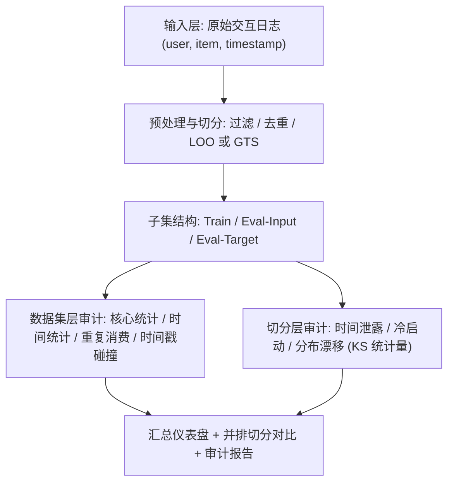
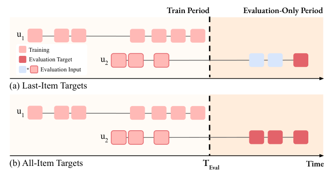
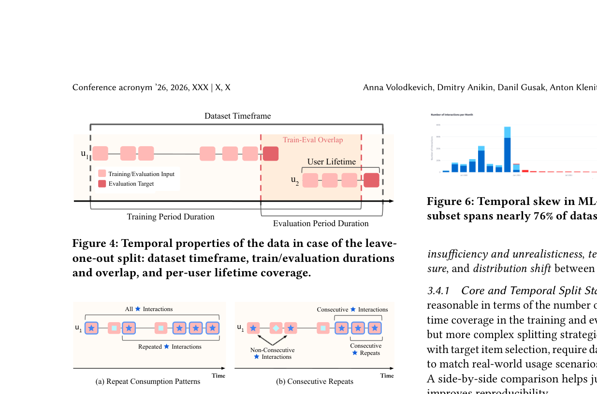
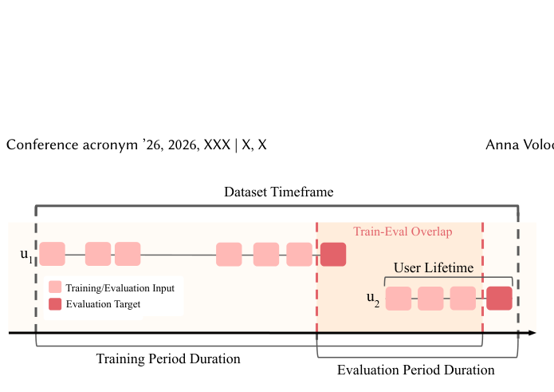
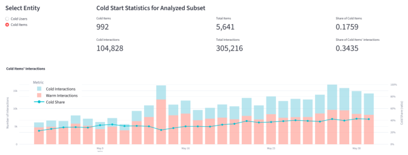
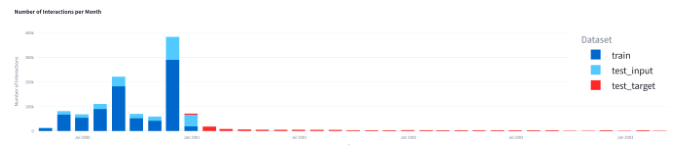

# SplitLight: An Exploratory Toolkit for Recommender Systems Datasets and Splits (面向推荐系统数据集与切分的探索性审计工具箱)

- **会议/期刊**: SIGIR 2026
- **推荐链路定位**: 离线评估协议与数据准备（Data Preparation / Evaluation Protocol），服务于召回/精排/序列推荐等全链路的可复现评测
- **研究方向**: 去偏公平、可信隐私与工业架构 / 序列与会话推荐（评估协议侧）
- **论文原文**: [https://arxiv.org/abs/2602.19339v1](https://arxiv.org/abs/2602.19339v1)
- **开源代码**: [https://github.com/monkey0head/SplitLight](https://github.com/monkey0head/SplitLight)（MIT License，含 Streamlit 在线 Demo：https://splitlight.streamlit.app）

## TL;DR (核心速览)

本文针对推荐系统离线评估中"数据准备与切分决策不透明、不可复现"的痛点，提出开源审计工具箱 SplitLight：给定交互日志与切分产物，自动量化核心/时间统计、重复消费模式、时间戳异常，并诊断时间泄露、冷启动暴露与训练-评估分布漂移，支持多切分策略并排对比。在 6 个公开数据集上揭示出如 Diginetica LOO 切分下 89% 目标存在数据泄露、冷物品交互占比随时间从约 20% 升至 40% 等关键问题。本文为工具/资源型论文，不提出新推荐模型，故无模型精度提升指标。

## Background & Motivation (背景与动机)

- **领域背景与主流范式**: 推荐系统离线评估的标准起点是数据预处理与切分（过滤、去重、留一法 LOO、全局时间切分 GTS 等）。主流论文通常只报告"切分类型 + 比例"（如 LOO 或 80/10/10 GTS），但很少披露训练/输入/目标子集的精确边界。
- **现有方法局限 (Limitations of Prior Work)**:
  1. **决策不透明导致排序翻转**：过滤准则、重复交互处理、冷物品处理、目标定义等"看似微小"的选择会显著改变模型排名，偏袒特定算法族（如依赖学习型 embedding 的方法在 warm-start 主导的评估中占优）。
  2. **时间泄露普遍存在**：序列推荐中时间戳碰撞、会话化选择、训练-评估时间重叠会虚高 next-item 指标；LOO 切分下训练与评估时间段高度重叠，未来信息可被利用。
  3. **缺乏统一审计工具**：已有工作分别讨论时间戳碰撞、用户生命周期、切分后数据充分性与评估子集偏斜，但没有形成可操作的"该检查什么"清单，也没有统一工具落地。
- **核心挑战 (Key Challenge)**: 为什么不能靠"多报告几个统计量"解决？因为问题横跨数据集层（核心/时间统计、重复消费）与切分层（泄露、冷启动、分布漂移）两个层面，且需要**并排对比多种切分策略**才能做出可辩护的选择；零散脚本无法保证一致性与可复现性。
- **核心洞察与切入点 (Key Insight)**: 作者将切分结果形式化为"训练子集 / 评估输入子集 / 评估目标子集 / 排除数据"四元结构（图 2），并据此提炼六大审计维度（核心与时间属性、时间分布、重复消费、泄露指标、冷启动、分布漂移），以 Python 库 + 无代码 Streamlit 界面双形态交付，降低严谨评估的门槛。

## Problem Formulation & Method (问题定义与方法架构)

### 1. 符号定义与输入表征 (Notations & Input Representations)

- 交互日志核心表示为三元组 $(u, i, t)$：用户 $u \in \mathcal{U}$、物品 $i \in \mathcal{I}$、时间戳 $t$。作者刻意**不要求**评分值、交互类型、上下文与用户/物品侧信息（公开数据集不一致、工业界常为私有），但**强制要求时间戳**，以保证序列有序并防止未来信息泄露。
- 输入：原始数据（raw）、预处理数据（preprocessed）、切分后的训练/验证/测试子集；每个评估子集进一步拆为 **input**（推理时提供给模型的历史）与 **target**（待预测真值）。
- 输出：各子集的核心/时间统计、分布图、泄露/冷启动/漂移诊断指标、汇总仪表盘与并排对比报告。

### 2. 整体流水线 (Overall Architecture)

数据流向：原始交互日志 → 预处理与切分（用户自建或 SplitLight 内置工具）→ 对 raw / preprocessed / train / eval-input / eval-target 各子集计算统计与诊断 → 汇总仪表盘（可配置阈值、颜色编码卡片）→ 下钻至各详细页面 → 并排对比不同切分策略并导出审计摘要。

图 1 展示了 SplitLight 在数据准备流水线中的定位：从原始数据到切分子集，审计数据特征、标记问题，并支持并排比较替代切分策略以论证所选评估协议。

<figure class="paper-figure" markdown="span">
  <figcaption>图 1</figcaption>
</figure>

### 3. 核心模块设计与数学原理 (Key Designs & Formulations)

**(1) 切分结构形式化（图 2）**：作者主张切分结果必须显式区分四类数据——训练用、推理输入用、评估目标用、排除。对全局时间切分（GTS），按分位数 $q$ 划定训练期与评估期；目标定义分两种：**last-item targets**（每用户仅最后一个交互为目标）与 **all-items targets**（评估期内所有交互为目标）。评估输入包含目标之前该用户的全部历史。这一形式化是后续所有诊断的语义基础，也暴露了 LOO 与 GTS 在时间覆盖上的本质差异（图 4）。

<figure class="paper-figure" markdown="span">
  <figcaption>图 2</figcaption>
</figure>

**(2) 数据集层审计指标**：
- 核心统计：交互数、用户数、物品数、物品流行度、序列长度、密度及其分位数/直方图分布。
- 时间统计：数据集时间跨度（首末交互间隔）、同用户相邻交互时间差、**时间戳碰撞率**（同一用户历史中相同时间戳出现频率，碰撞会使基于时间的切分非确定）、用户/物品生命周期（首末交互间隔）。
- 重复消费：区分**重复交互**（物品首次出现后的任意再次出现）与**连续重复**（同一物品紧邻出现），按用户统计绝对数与相对占比及分布（图 5）。

<figure class="paper-figure" markdown="span">
  <figcaption>图 5</figcaption>
</figure>

**(3) 切分层诊断**：
- **时间泄露**：检查 (i) 训练与评估子集共享交互；(ii) 时间范围重叠（图 4）；(iii) 受泄露影响的评估目标分布与占比（图 7）。
- **冷启动**：将验证/测试中未在训练集出现的用户/物品定义为冷用户/冷物品，报告数量、占比及冷交互占比随时间的演化（图 3）。
- **分布漂移**：将目标 **time-gap**（最后输入交互到目标的时间间隔）分布与参考分布（raw/preprocessed 中全部相邻间隔）对比，用 **Kolmogorov-Smirnov 统计量**量化差异；同理比较目标在用户序列中的**位置分布**，以检测切分引入的系统性偏移。

<figure class="paper-figure" markdown="span">
  <figcaption>图 4</figcaption>
</figure>

### 4. 训练目标、负采样与推理复杂度 (Optimization, Negative Sampling & Complexity)

- **损失函数**: 本文为工具型论文，**不涉及模型训练**，无损失函数、无负采样策略（原文未报告）。
- **训练负采样策略**: 不适用（原文未报告）。
- **时间与空间复杂度**: 原文未给出形式化复杂度分析。从实现看，各诊断均为对交互日志的单遍或多遍扫描（计数、分位数、直方图、KS 统计量），复杂度与交互数 $|\mathcal{D}|$ 近似线性；Streamlit 界面支持交互式探索，Python 库可提取中间结果供后续处理。原文未报告具体耗时与显存开销。

## Experimental Setup & Evaluation Protocol (实验设置与评估协议)

- **数据集统计与预处理**: 原文使用 6 个广泛使用的数据集——3 个评分数据集（MovieLens-1M、MovieLens-20M、Amazon Beauty）、2 个电商点击流数据集（Diginetica、Dressipi）以及 1 个音乐流媒体数据集（原文在 4.1 节末尾被截断，名称未完整给出）。**原文未提供完整的 #Users / #Items / #Interactions 统计表**，故下表仅列数据集与类型，数值标注"原文未报告"：

| 数据集 (Dataset) | 用户数 (#Users) | 物品数 (#Items) | 交互数 (#Interactions) | 稀疏度/密度 (Sparsity) | 模态/辅助特征说明 |
| :--- | :---: | :---: | :---: | :---: | :--- |
| MovieLens-1M (ML-1M) | 原文未报告 | 原文未报告 | 原文未报告 | 原文未报告 | 评分数据集，含时间戳 |
| MovieLens-20M (ML-20M) | 原文未报告 | 原文未报告 | 原文未报告 | 原文未报告 | 评分数据集，含时间戳 |
| Amazon Beauty | 原文未报告 | 原文未报告 | 原文未报告 | 原文未报告 | 评分数据集，含时间戳 |
| Diginetica | 原文未报告 | 原文未报告 | 原文未报告 | 原文未报告 | 电商点击流，含时间戳 |
| Dressipi | 原文未报告 | 原文未报告 | 原文未报告 | 原文未报告 | 电商点击流，含时间戳 |
| 音乐流媒体数据集（名称截断） | 原文未报告 | 原文未报告 | 原文未报告 | 原文未报告 | 音乐流媒体，含时间戳 |

- **数据划分方式 (Splitting Strategy)**: 案例研究覆盖 **Leave-One-Out (LOO)** 与 **Global Temporal Split (GTS，含分位数 $q$ 选择，如 $q_{0.9}$)** 两类切分，并对比 last-item 与 all-items 两种目标定义。SplitLight 的核心用途正是**量化不同切分策略引入的泄露、冷启动与漂移风险**，而非固定采用某一种。
- **排名评测协议 (Ranking Protocol)**: 本文不训练推荐模型、不报告 Recall/NDCG 等排序指标，因此不涉及 Full-Ranking 或 Sampled Ranking 协议（原文未报告）。
- **评价指标与显著性检验**: 诊断指标包括时间戳碰撞率、重复/连续重复占比、训练-评估时间重叠率、受泄露影响目标占比、冷用户/冷物品占比、KS 统计量等；**原文未进行配对显著性检验**（工具型论文，无模型对比）。

## Key Experimental Results (核心实验结果)

### 1. 主实验对比 (Main Results)

本文为工具/资源型论文，**不包含推荐模型精度对比表**（原文未报告 Recall/NDCG/AUC 等指标及相对提升）。核心"结果"为案例研究中揭示的数据问题：

| 数据集 | 切分/设置 | 诊断发现 | 数值 |
| :--- | :--- | :--- | :---: |
| Diginetica | LOO | 训练与评估子集时间 100% 重叠，大量目标受数据泄露影响 | 89% 目标存在泄露（图 7） |
| Diginetica | 测试目标子集 | 冷物品交互占比随时间增长 | 从约 20% 升至 40%，整体 34.35%（图 3） |
| ML-1M | GTS $q_{0.9}$ | 测试目标子集时间跨度占数据集时间跨度比例 | 近 76%（图 6） |

<figure class="paper-figure" markdown="span">
  <figcaption>图 3</figcaption>
</figure>

<figure class="paper-figure" markdown="span">
  <figcaption>图 6</figcaption>
</figure>

### 2. 消融实验与控制变量分析 (Ablation Study)

原文**未设置传统意义上的模块消融实验**（无模型子模块可移除）。其"对照分析"体现为：对同一数据集并排比较不同切分策略（LOO vs. GTS、last-item vs. all-items 目标）下的统计与诊断差异，以及讨论重复交互折叠/聚合对 RS 性能的影响（4.4 节，原文正文截断处提及）。原文未报告参数量或图拓扑度数的控制变量分析。

### 3. 稀疏度/冷启动分桶与超参敏感度 (Sparsity Buckets & Hyperparameters)

- **冷启动分桶**: 图 3 显示 Diginetica 测试目标子集中冷物品交互占比随时间从近 20% 增长至 40%，整体达 34.35%，说明切分策略会显著改变冷/暖交互比例，进而影响对内容型与 embedding 型方法的相对偏好。
- **关键超参数敏感度**: 主要"超参"为 GTS 的分位数 $q$（如 $q_{0.9}$）与汇总仪表盘的可配置告警阈值；图 6 表明 $q_{0.9}$ 下 ML-1M 测试目标子集时间跨度接近数据集时间跨度的 76%，体现分位数选择对评估期覆盖的强影响。原文未报告系统的超参扫描曲线。
- **线上 A/B 测试结果**: 原文仅包含离线数据分析案例，**无线上 A/B 测试**。

## Highlights, Limitations & Critiques (亮点、局限与审稿级批判)

- **核心亮点与可迁移性**:
  1. **切分四元结构形式化**（train / eval-input / eval-target / excluded）具有普适性，可直接作为论文与工业评估文档的强制报告模板，显著提升跨论文可比性。
  2. **KS 统计量量化分布漂移**、**泄露目标占比**、**冷交互时间演化**等诊断算子设计简洁且可迁移到 IR 日志、交易数据等任意含 (user, item, timestamp) 的领域。
  3. **双形态交付**（Python 库 + 无代码 Streamlit）降低工程与审稿场景的使用门槛，MIT 协议开源、附 Demo 与视频，复现价值高。
- **局限性与审稿视角批判 (Critical Limitations)**:
  1. **缺乏定量"影响评估"**：工具能诊断问题，但案例研究主要展示"问题存在"，未系统量化"不同切分选择导致模型排名翻转多少"（如 Kendall $\tau$ 排名相关性），削弱了"必须审计"的说服力。
  2. **数据集统计披露不全**：正文未给出 6 个数据集的完整规模统计表，且第 6 个数据集名称在提取文本中被截断，影响读者对案例覆盖面的判断。
  3. **诊断阈值主观**：汇总仪表盘依赖可配置阈值，但原文未给出推荐默认值或基于社区共识的校准依据，可能导致不同团队报告口径不一。
  4. **无复杂度与性能报告**：未报告在大规模工业日志上的运行耗时与内存开销，"轻量级"主张缺乏实证支撑。
  5. **评估维度有限**：未覆盖负采样协议偏差、流行度偏差等排序评估侧的偏置诊断，与"去偏"主分类的契合度偏工具化而非方法论化。

## Rating (四维评分)

- **方法创新性 (Novelty)**: ⭐⭐⭐（工具整合与形式化有价值，但各诊断指标多为已有工作的系统化落地）
- **评估协议与实验扎实度 (Protocol & Experiments)**: ⭐⭐⭐（案例揭示的问题真实且重要，但缺定量影响分析与完整数据集统计）
- **写作与数学规范度 (Clarity & Rigor)**: ⭐⭐⭐⭐（切分结构形式化清晰、图表组织良好，复杂度与超参细节略欠）
- **工业落地与复现价值 (Industrial & Practical Value)**: ⭐⭐⭐⭐⭐（开源、双形态、可直接嵌入数据准备流水线与审稿审计流程）
