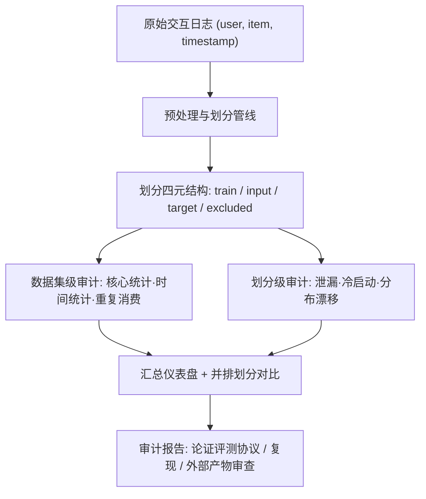
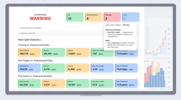

# SplitLight: An Exploratory Toolkit for Recommender Systems Datasets and Splits (面向推荐系统数据集与划分的探索性审计工具箱)

- **会议/期刊**: SIGIR 2026
- **作者与机构**: Anna Volodkevich, Dmitry Anikin, Danil Gusak, Anton Klenitskiy, Evgeny Frolov, Alexey Vasilev (SB AI Lab / AI Center / HSE University)
- **推荐链路定位**: 离线评测协议与数据准备（贯穿召回至重排的全链路前置环节）
- **研究方向**: 去偏公平、可信隐私与工业架构 / 冷启动与长尾推荐
- **论文原文**: [https://arxiv.org/abs/2602.19339v1](https://arxiv.org/abs/2602.19339v1)
- **开源代码**: [https://github.com/monkey0head/SplitLight](https://github.com/monkey0head/SplitLight)

## TL;DR (1分钟核心速览)

离线评测中过滤规则、重复处理、冷启动处理与划分策略等"看似微小"的决策会显著重排模型排名，却长期缺乏统一审计工具。本文提出 SplitLight——一个开源 Python 工具箱 + Streamlit 无代码界面，将数据集与划分结果结构化为 `train / eval-input / eval-target` 三元组，系统诊断时间泄漏、冷启动暴露、重复消费、时间戳碰撞与分布漂移。在 6 个主流数据集上以 SASRec + NDCG@10 验证：保留连续重复可带来最高 +60% 虚高，纳入冷物品使指标下降 1.2%–20%，时间戳碰撞乱序导致最高 9.5% 下降。

## Background & Motivation (背景与核心矛盾)

- **主流范式**: 当前推荐系统离线评测以 `(user, item, timestamp)` 交互三元组为核心，普遍采用 5-core 过滤 + Leave-One-Out (LOO) 或全局时间划分 (GTS) 构造训练/验证/测试集。
- **前人局限**: 其一，划分描述仅报告"LOO 或 80/10/10"远不足以复现——未说明哪些数据作训练、哪些作推理输入、哪些作评测目标、哪些被剔除；其二，现有数据集管理工作 [12,17,23] 只覆盖基础统计报告，未聚焦预处理与划分步骤本身，导致时间戳碰撞 [8]、用户生命周期偏斜 [2,13]、划分后数据充分性与评测子集偏斜 [6,9,19,26] 等已知问题散落各处、无统一"该查什么"清单与工具。
- **核心洞察 (Key Insight)**: 作者将划分结果形式化为四元结构——训练子集、评测输入子集 (input)、评测目标子集 (target)、被排除数据，并指出**同一划分名称下 input/target 定义不同即可使结果不可比**；同时观察到 ML-1M 中位交互间隔为 0s、时间戳碰撞率高达 52.89%，LOO 下 Diginetica 训练/评测时段 100% 重叠、89% 目标存在泄漏。
- **本文切入点**: 不做新模型，而是把"数据准备决策"变成**可测量、可比较、可报告**的审计对象，以工具箱 + 检查清单形式落地。

## Method (核心方法设计)

### 1. 整体框架 (Overall Architecture)

SplitLight 接收原始交互日志及其派生划分子集（raw / preprocessed / train / val-input / val-target / test-input / test-target），沿三条分析轴输出诊断：**数据集级**（核心统计、时间统计、时间分布、重复消费）、**划分级**（划分统计对比、时间泄漏、冷启动、分布漂移）、**汇总仪表盘**（可配置阈值的红黄绿健康检查卡片，链接至明细页）。所有统计既可对单一子集计算，也可与参考子集（通常为 raw 或 preprocessed）并排对比，从而支持"备选划分策略的并排比较"这一核心诉求。工具同时提供 Python API（可抽取中间结果二次处理）与 Streamlit 无代码界面（降低严谨评测门槛），MIT 协议开源。

<figure class="paper-figure" markdown="span">
  <figcaption>图1：数据准备流程中的SplitLight。从原始数据集到划分后的子集，SplitLight审计数据特征、标记问题，并支持对备选划分策略进行并排比较，以证明所选评估协议的合理性。</figcaption>
</figure>

### 2. 关键设计拆解 (Key Designs)

1. **划分四元结构形式化（Split Protocol Specification）**：痛点在于"LOO / GTS-q0.9"这类标签无法确定模型推理时看到什么。SplitLight 强制将评测子集拆为 input（推理时喂给模型的历史）与 target（待预测真值），并显式记录 excluded 数据；对 GTS 进一步区分 **last-item target**（每用户仅最后一个交互作目标）与 **all-items target**（评测时段内全部交互作目标）两种定义（图 2）。这一拆分使"训练/评测时段重叠率"与"目标受泄漏比例"成为可计算量，而非口头声明。

2. **时间泄漏与冷启动的量化诊断**：泄漏检测三件套为 (i) 训练与评测子集的共享交互数、(ii) 两者时间区间的重叠度、(iii) 受泄漏影响的评测目标占比；冷启动则将 val/test 中未在训练集出现的用户/物品标记为 cold，报告其数量、占比及**随时间的演化曲线**（图 3 显示 Diginetica 冷物品交互占比从近 20% 升至 40%，总体 34.35%）。物理直觉：冷启动比例不受控时，评测会隐性偏向依赖已学习 Embedding 的方法而压制内容/混合方法。

3. **分布漂移的 KS 统计量度量与重复消费双口径**：对 target 的 time-gap 分布（最后一条 input 交互到目标的间隔）与参考分布（raw 中全部相邻间隔）计算 Kolmogorov-Smirnov 统计量，同理比较 target 在用户序列中的位置分布，从而量化"划分引入的系统性偏移"。重复消费区分两级：**repeated interactions**（物品首次出现后的任意再次出现）与 **consecutive repeats**（同一物品紧邻重复），后者常为日志伪影（如 Zvuk 中位间隔 0.25s 疑为跳过行为），需单独统计并决定折叠或聚合。

4. **训练目标与推理开销**：本文无模型损失函数；工具箱本身为纯统计计算，复杂度对交互数线性，Streamlit 界面支持交互式下钻，工程开销可忽略。

## Experimental Setup & Evaluation Protocol (实验设置与评估协议)

- **数据集与预处理**: 6 个数据集覆盖评分、电商点击流、音乐流媒体三类场景；4.3–4.4 节实验统一施加 `5-core` 过滤 + 连续重复去除，时间戳碰撞用户保留原始事件顺序。

| 数据集 | #Users | #Items | #Interactions | 平均序列长 | 密度(%) | 连续重复(%) | 重复交互(%) |
| :--- | :---: | :---: | :---: | :---: | :---: | :---: | :---: |
| Beauty | 22,363 | 12,101 | 198,502 | 8.88 | 0.07 | 0.00 | 0.00 |
| Diginetica | 310,324 | 122,993 | 1,235,380 | 3.98 | 0.003 | 5.85 | 13.62 |
| Dressipi | 1,000,000 | 23,496 | 4,743,820 | 4.74 | 0.02 | 7.25 | 13.39 |
| ML-1M | 6,040 | 3,706 | 1,000,209 | 165.60 | 4.47 | 0.00 | 0.00 |
| ML-20M | 138,493 | 26,744 | 20,000,263 | 144.41 | 0.54 | 0.00 | 0.00 |
| Zvuk | 20,000 | 391,322 | 10,867,482 | 543.37 | 0.14 | 21.50 | 68.17 |

- **数据划分与防穿越 (Splitting Strategy)**: 对比三种协议——(i) **GTS-q0.9 + all-items target**（最近 10% 交互为测试、次近 10% 为验证）；(ii) **Leave-One-Out (LOO)**；(iii) **GTS-q0.9 + last-item target**。所有划分在预处理后生成并保持用户内时序。
- **排名评测协议 (Ranking Protocol)**: 采用 SASRec 作为探针模型，指标为 **NDCG@10 (N@10)**，5 个随机种子取平均；默认过滤验证/测试集中的冷物品。未报告显著性检验，属工具演示性质。
- **对比基线与超参设置**: 无传统模型基线对比；实验设计为"固定基线配置 + 单因素扰动"：①保留连续重复、②时间戳碰撞不保序（随机打乱）、③不过滤冷物品。

## Key Experimental Results (实验关键数据)

### 1. 主实验对比 (Main Results)

原文以"同一划分下不同数据治理协议"作为对比维度（表 4），核心指标 NDCG@10：

| 数据集 | LOO 基线 | 碰撞乱序 (LOO) | GTS-q0.9 基线 | 保留连续重复 (GTS) | 非连续目标 (GTS) | 纳入冷物品 (GTS) |
| :--- | :---: | :---: | :---: | :---: | :---: | :---: |
| Beauty | 0.0566 | 0.0521 (-7.9%) | 0.0348 | — | — | **0.0280** (-19.5%) |
| Diginetica | 0.1663 | — (<1% 碰撞) | 0.1443 | **0.2118** (+46.8%) | 0.1364 | 0.1427 (-1.1%) |
| Dressipi | 0.1318 | — (<1% 碰撞) | 0.1343 | **0.2168** (+61.4%) | 0.1225 | 0.0965 (-28.1%) |
| ML-1M | 0.1861 | 0.1685 (-9.5%) | 0.0905 | — | — | 0.0907 (+0.2%) |
| ML-20M | 0.1601 | 0.1469 (-8.2%) | 0.0836 | — | — | **0.0704** (-15.8%) |
| Zvuk | 0.2594 | — (<1% 碰撞) | 0.1529 | **0.2653** (+73.5%) | 0.1247 | 0.1362 (-10.9%) |

### 2. 消融实验 (Ablation Study)

以"移除单项治理措施"为消融口径（GTS-q0.9 + last-item target 为参照）：

| 配置 | 受影响数据集 | NDCG@10 变化 | 说明 |
| :--- | :--- | :---: | :--- |
| w/o 保序（碰撞乱序） | ML-1M / ML-20M / Beauty | -9.5% / -8.2% / -7.9% | 碰撞率 52.89% / 20.96% / 38.99% |
| w/o 去连续重复 | Dressipi / Zvuk / Diginetica | +61.4% / +73.5% / +46.8% | 虚高，非真实能力 |
| 仅评非连续目标 | Zvuk / Dressipi / Diginetica | 0.1247 / 0.1225 / 0.1364 | 泛化能力真实暴露 |
| w/o 过滤冷物品 | Dressipi / Beauty / ML-20M | -28.1% / -19.5% / -15.8% | 冷目标占比 32.59% / 22.32% / 28.40% |

### 3. 关键实验发现 (Key Findings)

1. **连续重复是最大的指标放大器**：在重复率不可忽略的数据集上保留连续重复，NDCG@10 最高虚增 73.5%（Zvuk 0.1529→0.2653）；而一旦把评测限制在非连续目标，性能骤降至 0.1247，说明模型学到的是"记忆短期信号"而非泛化偏好——这直接解释了跨论文结果不可比的根源。
2. **时间戳碰撞的乱序处理造成稳定但幅度较小的性能损失**：碰撞率越高的数据集损失越大（ML-1M 52.89% 碰撞 → -9.5%），且该效应仅在 LOO 下出现、在 GTS-last-item 下消失，作者归因于 LOO 更易诱发"记忆优于泛化"。
3. **冷启动暴露与指标下降强相关**：纳入冷物品后 NDCG@10 下降 1.2%–20%（Dressipi 降幅最大，对应 32.59% 冷目标占比）；同时 GTS-q0.9 在 Diginetica/Dressipi 上产生 100% 冷用户、ML-20M 上 82.6%，说明这些数据集天然适合冷启动评测，但若不作声明则评测语义完全漂移。

## Highlights & Limitations (亮点、对比与审稿批判)

- **与代表作对比 (vs. Prior Work)**: 相较数据集管理/基准变异类工作 [12,17,23] 仅报告高层统计，SplitLight 首次把**预处理与划分步骤本身**作为审计对象并给出可执行清单；相较 Dacrema 等对算法复现性的批判，本文把矛头指向"数据侧不可复现"；相较零散的泄漏/碰撞研究 [6,8,9]，本文将其统一进单一工具与四元划分结构。
- **可迁移亮点**: ① `train / input / target / excluded` 四元划分描述可直接作为论文与工业评测文档的强制模板；② 用 KS 统计量对比 target time-gap 与参考分布，是检测"划分引入偏移"的轻量通用手段，可迁移至 CTR 延迟反馈与序列推荐场景。
- **审稿级局限批判**: ① 实验仅用 SASRec 单一探针模型与 NDCG@10 单指标，未验证结论在 GNN/生成式推荐架构上的稳健性，也无显著性检验；② 工具输出的是"诊断"而非"修复"，对碰撞/重复/冷启动的最优处理策略仍依赖人工判断，且 Streamlit 界面在大规模工业日志（亿级交互）上的交互式下钻性能未作评估。

## Rating (四维评分)

- **方法创新性 (Novelty)**: ⭐⭐⭐ （非模型创新，但四元划分形式化与"审计清单"填补了评测协议规范化的空白，理论深度有限）
- **评估协议与实验扎实度 (Protocol & Experiments)**: ⭐⭐⭐⭐ （6 个异构数据集 + 单因素扰动设计清晰有力，但仅单模型单指标、缺显著性检验）
- **写作与数学规范度 (Clarity & Rigor)**: ⭐⭐⭐⭐ （划分结构与统计定义表述严谨、图表自解释性强，公式化程度较低属工具论文常态）
- **工业落地与复现价值 (Industrial & Practical Value)**: ⭐⭐⭐⭐⭐ （MIT 开源、Python + 无代码双形态、可直接嵌入现有数据管线做上线前健康检查，落地门槛极低）
