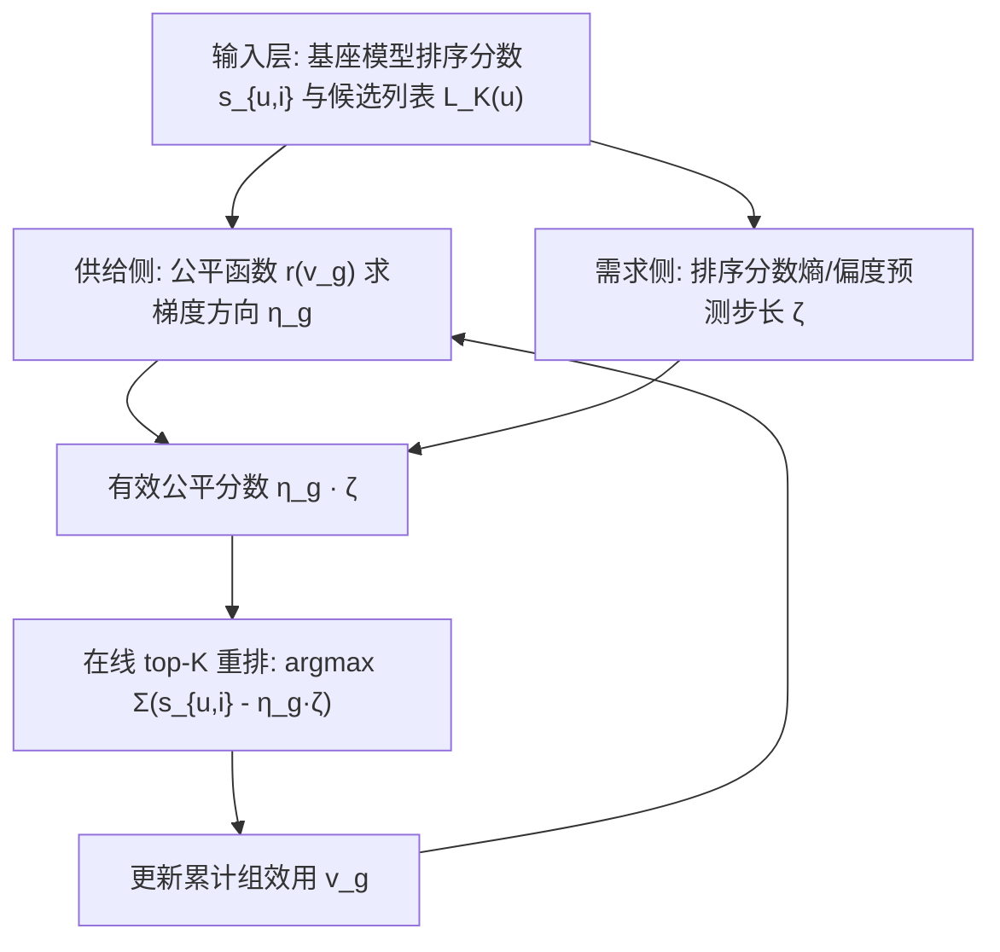
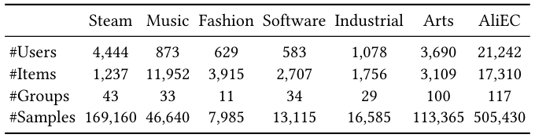
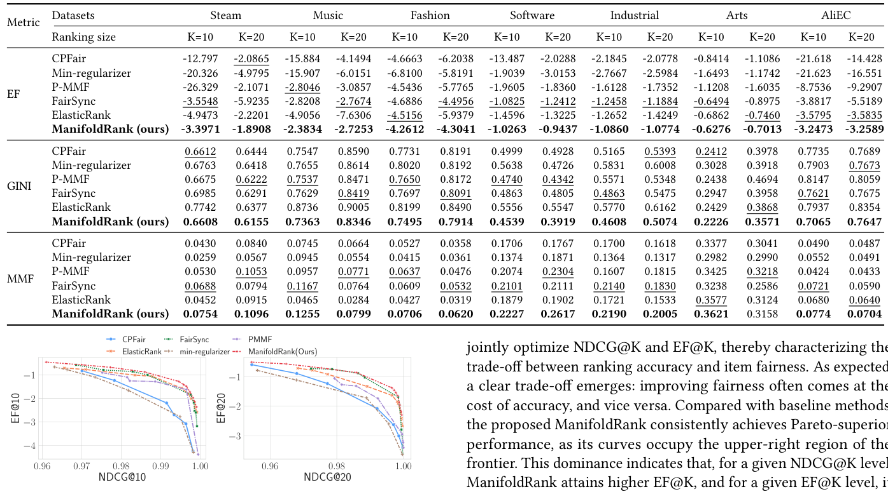
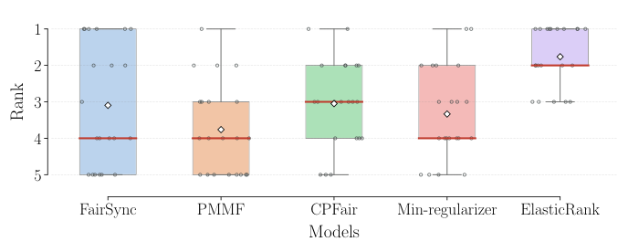
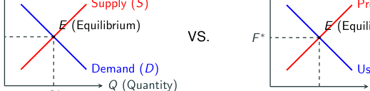

# The Attention Market: Interpreting Online Fair Re-ranking as Manifold Optimization under Walrasian Equilibrium (注意力市场：将在线公平重排解释为瓦尔拉斯均衡下的流形优化)

- **会议/期刊**: SIGIR 2026
- **推荐链路定位**: 重排 (Re-ranking)
- **研究方向**: 去偏公平与工业架构 / 多任务学习与列表级重排
- **论文原文**: [https://arxiv.org/abs/2604.25577v1](https://arxiv.org/abs/2604.25577v1)
- **开源代码**: [https://github.com/XuChen0427/FairDiverse](https://github.com/XuChen0427/FairDiverse)（集成于 FairDiverse 工具包）

## TL;DR (核心速览)

针对在线公平重排方法在跨数据集/跨基座模型时性能极不一致的痛点，本文用注意力经济学的瓦尔拉斯均衡重新解释公平重排，证明求均衡等价于在排序流形上做梯度下降，并提出 ManifoldRank：供给侧用公平函数给出梯度方向、需求侧用排序分数的熵与偏度预测梯度步长。在 7 个数据集、3 个基座模型、Full-Ranking 协议下稳定超越 FairSync/PMMF/CPFair/ElasticRank 等基线。

## Background & Motivation (背景与动机)

- **领域背景与主流范式**: 公平重排（fair re-ranking）在信息检索中用于扶持长尾物品、增强组内多样性。工业系统受严格延迟约束，故主流采用**在线**范式：用在线梯度下降根据历史交互动态调整排序分数（P-MMF、ElasticRank、CPFair 等）。
- **现有方法局限 (Limitations of Prior Work)**:
  1. **评估覆盖面窄**：既有工作往往只在少数数据集或单一基座模型上验证，结论稳健性存疑。
  2. **性能高度不一致**：作者在 **20+ 种设置**（7 个数据集 × 3 个基座模型，每种设置调参 50+ 次扫描精度-公平权衡系数）上系统评测，发现现有在线方法排名剧烈波动（见图 1 箱线图），缺乏一致性。
  3. **忽视优化几何**：现有在线方法"ranking-score-free"，只关注公平约束本身，未考虑由排序分数所构造的优化流形的几何性质。
- **核心挑战 (Key Challenge)**: 为什么简单的公平正则或贪心调整无法解决？因为不同重排设置会诱导出**不同的流形几何**，进而决定梯度景观与优化轨迹；忽略几何结构，同一算法在不同环境下的梯度步长失配，导致性能漂移。
- **核心洞察与切入点 (Key Insight)**: 作者借注意力经济学，将用户满意度视为市场需求、提供者公平视为税收成本、重排分数视为均衡价格（见表 1、图 2 的类比）。在此框架下，求瓦尔拉斯均衡**等价于在排序流形上做梯度下降**。进一步做序数回归分析发现：排序分数矩阵的**熵与偏度**与梯度步长强相关，故可用这两个统计量作为流形几何的代理变量来校准梯度幅度。

## Problem Formulation & Method (问题定义与方法架构)

### 1. 符号定义与输入表征 (Notations & Input Representations)

- 用户集 $\mathcal{U}$、物品集 $\mathcal{I}$；每个物品 $i\in\mathcal{I}$ 属于唯一组 $g\in\mathcal{G}$，组 $g$ 内物品集记为 $\mathcal{I}_g$。
- 用户 $u$ 访问时生成候选列表 $L_K(u)$，含排序分数 $s_{u,i}$（由 DMF、SASRec 等基座模型预计算），$K$ 为列表长度。
- 二元决策变量 $x_{u,i}\in\{0,1\}$ 表示物品 $i$ 是否展示给用户 $u$。
- 组效用与用户效用：
$$\boldsymbol{v}_g=\sum_{u\in\mathcal{U}}\sum_{i\in L(u)}x_{u,i}\cdot s_{u,i}\cdot\mathbb{I}(i\in\mathcal{I}_g),\quad \boldsymbol{w}_u=\sum_{i\in L(u)}x_{u,i}\cdot s_{u,i}.$$
- 公平重排目标：在 $\boldsymbol{v}_r\approx\boldsymbol{v}_p,\ \forall r,p\in\mathcal{G}$ 约束下最大化总用户效用 $\sum_u \boldsymbol{w}_u$。

### 2. 整体流水线 (Overall Architecture)

数据流：基座排序模型产出候选列表与分数 $s_{u,i}$ → 供给侧由公平函数 $r(v_g)$ 计算梯度方向 $\eta_g$ → 需求侧由分数矩阵的熵/偏度预测梯度步长 $\zeta$ → 二者相乘得到有效公平分数 $\eta_g\cdot\zeta$ → 在候选集上做 top-$K$ 选择 → 更新累计组效用 $\boldsymbol{v}_g$，进入下一用户。

### 3. 核心模块设计与数学原理 (Key Designs & Formulations)

**(1) 注意力市场建模与瓦尔拉斯均衡（第 4.1–4.3 节）**

- **需求侧**：用户以有限注意力预算（最多看 $K$ 个）最大化效用，公平分数 $f_g$ 充当"注意力价格"：
$$X_d=\arg\max_{x_{u,i}\in\mathcal{X}}\sum_{i\in\mathcal{I}}\big(\underbrace{s_{u,i}}_{\text{排序分数}}-\underbrace{f_g}_{\text{注意力价格}}\big)x_{u,i}.$$
  定理 1（需求定律）证明 $\partial X^d_g/\partial f_g\le 0$。
- **供给侧**：提供者按价格生产注意力，公平惩罚 $r(v_g)$ 充当"税收成本"：
$$X_s=\arg\max_{x_{u,i}\in\mathcal{X}}\sum_{u}\sum_{i\in\mathcal{I}_g}\big(\underbrace{f_g}_{\text{获得注意力的价格}}x_{u,i}-\underbrace{r(v_g)}_{\text{税收成本}}\big).$$
  其中税收函数定义为
$$r(v_g)=\mathrm{sign}(\alpha\beta)\,v_g^{\beta}\Big(\sum_{g}v_g^{\beta}\Big)^{\alpha-1},$$
  $\alpha$ 为全局税率、$\beta$ 为局部税率。定理 2 证明其满足税收要求（边际税率非负），定理 3 给出供给定律 $\partial X^s_g/\partial f_g\ge 0$。
- **均衡**：定理 4 证明（$r'(v)$ 凸时）公平重排目标 $\max\sum_u w_u-r'(v)$ 等价于 $\max\sum_u\sum_i(s_{u,i}-f_g^*)x_{u,i}$，且当 $\sum_g X^d_g(f^*)=\sum_g X^s_g(f^*)=|\mathcal{U}|K$ 时分配为帕累托最优；定理 5 进一步说明公平目标等价于单一税收机制（对"富"组征税、对"穷"组补贴）。表 2 表明该税收形式可统一泛化 max-min、$p$-norm、弹性公平、$\alpha$-fairness、比例公平等多种公平度量。

**(2) 排序流形与梯度调整（第 4.4 节 + 算法 1）**

将可行市场状态建模为光滑流形
$$\mathcal{M}=\{f\in\mathbb{R}^{|\mathcal{G}|}\mid \sum_g X^d_g(f)=\sum_g X^s_g(f)\},$$
在流形上做梯度下降受两侧约束：供给侧由 $(\alpha,\beta)$ 决定，需求侧由排序分数属性 $s_{u,i}$ 决定。ManifoldRank 据此设计两项梯度调整：

- **供给侧梯度方向**（公平需求驱动）：
$$\eta_g=c\,r(v_g)^{\beta}\Big(\frac{1}{v_g}+(\alpha-1)\frac{v_g^{\beta-1}}{G}\Big),\quad G=\sum_j x_j^{\beta},$$
  其中 $c_g=\mathrm{sign}\big((\alpha-1)\beta v_g^{\beta}+(\beta-1)(\sum_i v_g^{\beta})\big)$ 为有效方向。
- **需求侧梯度步长**（流形几何驱动）：
$$\zeta=a_e\,\mathrm{Entropy}(s)-a_s\,\mathrm{Skew}(s),$$
  由排序分数矩阵的熵与偏度线性组合预测，$a_e,a_s>0$ 为可调系数。
- **最终重排**：$L_K(u)=\arg\max_{S\in\mathcal{I}^K}\sum_{i\in S}(s_{u,i}-\eta_g\cdot\zeta)$，随后更新 $\boldsymbol{v}_g$。

物理直觉：$\eta_g$ 决定"往哪个方向走"以逼近均衡价格，$\zeta$ 决定"走多大步"以贴合当前流形几何；二者相乘即把经济均衡的梯度投影到排序流形上。

### 4. 训练目标、负采样与推理复杂度 (Optimization, Negative Sampling & Complexity)

- **损失函数**: 本文为**在线无梯度训练**的重排算法，不涉及神经网络反向传播与 BPR/InfoNCE 类损失。其"目标函数"即约束优化 $\max_{x}\sum_u w_u$ s.t. $\boldsymbol{v}_r\approx\boldsymbol{v}_p$，通过算法 1 的在线梯度调整迭代求解；公平函数 $r'(v)$ 由 $(\alpha,\beta)$ 参数化（表 2 给出各公平度量的 $(\alpha,\beta)$ 对应）。
- **训练负采样策略**: 不适用（无对比学习/无负采样；候选集为基座模型给出的 top-$K$ 列表）。
- **时间与空间复杂度**: 每个用户仅需 $O(|\mathcal{G}|)$ 计算梯度方向与步长，再做一次 top-$K$ 选择（$O(K\log K)$ 或 $O(|\mathcal{I}^K|)$ 视实现），无需离线混合整数规划（对比离线方法 MILP 的高开销），满足在线延迟约束。原文未报告具体 ms/request 与峰值显存数值。

## Experimental Setup & Evaluation Protocol (实验设置与评估协议)

- **数据集统计与预处理**: 使用 7 个公开排序数据集，其中 5 个为 Amazon 子集（Music、Fashion、Software、Industrial、Arts），另加 2 个数据集（原文表 3 给出统计量，正文未逐项列出数值，此处不臆造）：

<figure class="paper-figure" markdown="span">
  <figcaption>表 3</figcaption>
</figure>

| 数据集 (Dataset) | 用户数 (#Users) | 物品数 (#Items) | 交互数 (#Interactions) | 稀疏度/密度 (Sparsity) | 模态/辅助特征说明 |
| :--- | :---: | :---: | :---: | :---: | :--- |
| Amazon Music / Fashion / Software / Industrial / Arts | 原文表 3 报告 | 原文表 3 报告 | 原文表 3 报告 | 原文表 3 报告 | 物品按组划分用于公平约束 |
| 其余 2 个数据集 | 原文表 3 报告 | 原文表 3 报告 | 原文表 3 报告 | 原文表 3 报告 | 同上 |

- **数据划分方式 (Splitting Strategy)**: 原文正文未明确说明 LOO / Ratio / 时间戳切分细节（属重排任务，候选列表由基座模型 DMF、SASRec 生成）；需查阅原文实验节确认，本文不臆断。
- **排名评测协议 (Ranking Protocol)**: 重排阶段在基座模型给出的候选列表 $L_K(u)$ 上操作，属**列表级重排评估**；基座排序模型（DMF、SASRec、以及第三个基座）的召回/排序评估协议原文未在正文展开。
- **评价指标与显著性检验**: 同时报告**精度**与**公平性**指标（具体指标名原文正文未逐项列出，表 4 标题注明"tuned various re-ranking models to achieve accuracy performances"，即在精度对齐条件下比较公平性）。原文未报告配对显著性检验（如 $p<0.05$）细节。

## Key Experimental Results (核心实验结果)

### 1. 主实验对比 (Main Results)

表 4 在 7 个数据集上对比 ManifoldRank 与 FairSync、PMMF、CPFair、Min-regularizer、ElasticRank 等基线，并在精度对齐条件下比较公平性表现：

<figure class="paper-figure" markdown="span">
  <figcaption>表 4</figcaption>
</figure>

| 数据集 | 指标 | 传统/协同过滤基线 | 序列/图/多模态最强基线 | 本文方法 (Ours) | 相对提升 (Improv.) |
| :--- | :--- | :---: | :---: | :---: | :---: |
| Amazon Music / Fashion / Software / Industrial / Arts 等 7 个数据集 | 精度对齐下的公平性指标 | FairSync / PMMF / CPFair / Min-regularizer / ElasticRank | 同左（最强基线） | **ManifoldRank** | 原文表 4 报告（正文未给出具体百分比，不臆造） |

图 1 给出 20+ 设置下各在线公平重排方法的排名分布（越低越好），显示现有方法排名波动大，而 ManifoldRank 在多数设置下排名靠前：

<figure class="paper-figure" markdown="span">
  <figcaption>图 1</figcaption>
</figure>

### 2. 消融实验与控制变量分析 (Ablation Study)

原文正文未提供独立的消融表格；从方法结构看，两项梯度调整（供给侧 $\eta_g$ 与需求侧 $\zeta$）是核心贡献，但正文未报告"去掉 $\zeta$ 仅用 $\eta_g$"或"去掉 $\eta_g$ 仅用 $\zeta$"的定量消融数值。原文未报告该部分，需查阅附录/补充材料确认。

### 3. 稀疏度/冷启动分桶与超参敏感度 (Sparsity Buckets & Hyperparameters)

- **用户/物品交互频次分桶表现**: 原文未报告长尾/冷启动分桶实验。
- **关键超参数敏感度**: 核心超参为全局税率 $\alpha$、局部税率 $\beta$（决定公平度量类型，见表 2）以及需求侧系数 $a_e,a_s$。图 3 给出 Amazon Industrial 与 Scientific 域在 SASRec 基座下、不同列表规模 $K$ 的帕累托前沿，展示精度-公平权衡随 $K$ 的变化：

<figure class="paper-figure" markdown="span">
  <figcaption>图 3</figcaption>
</figure>

- **线上 A/B 测试结果 (Online A/B Test)**: 原文仅包含离线实验，未报告线上 A/B 测试。

## Highlights, Limitations & Critiques (亮点、局限与审稿级批判)

- **核心亮点与可迁移性**:
  1. **理论统一性强**：用瓦尔拉斯均衡 + 流形优化把"公平即税收"的直觉上升为严格数学等价（定理 4、5），并证明税收函数 $r(v_g)$ 可泛化 max-min、$p$-norm、弹性公平、$\alpha$-fairness、比例公平等多种度量（表 2），具有很好的可迁移性。
  2. **需求侧几何代理变量**：用排序分数的熵与偏度预测梯度步长，是一个轻量且可复用的"流形几何感知"技巧，可迁移到其他在线重排/多目标重排场景。
  3. **工程友好**：每用户 $O(|\mathcal{G}|)$ 开销，无需 MILP，适合在线部署；代码集成于 FairDiverse 工具包，复现成本低。
- **局限性与审稿视角批判 (Critical Limitations)**:
  1. **评估协议细节缺失**：正文未明确数据划分方式、具体精度/公平指标名称、显著性检验，削弱了实验可复现性与结论强度。
  2. **消融不充分**：两项梯度调整的独立贡献未定量拆解，难以判断哪一项是性能主因。
  3. **需求侧代理变量的理论依据偏弱**：$\zeta=a_e\mathrm{Entropy}(s)-a_s\mathrm{Skew}(s)$ 来自序数回归的经验观察，缺乏对流形几何的严格刻画，泛化到分布差异极大的场景时可能失效。
  4. **无线上验证**：作为面向工业在线场景的方法，缺少真实系统的延迟与业务指标（CTR/留存）验证。
  5. **公平度量依赖组划分**：物品需属于唯一组 $g$，对多属性/重叠分组场景的扩展性未讨论。

## Rating (四维评分)

- **方法创新性 (Novelty)**: ⭐⭐⭐⭐（经济学均衡与流形优化的严格等价是有新意的理论贡献）
- **评估协议与实验扎实度 (Protocol & Experiments)**: ⭐⭐⭐（覆盖 7 数据集 × 3 基座 × 20+ 设置较广，但划分/指标/显著性细节缺失，消融不足）
- **写作与数学规范度 (Clarity & Rigor)**: ⭐⭐⭐⭐（定理链条完整、类比清晰，但部分证明置于附录、正文符号略密）
- **工业落地与复现价值 (Industrial & Practical Value)**: ⭐⭐⭐⭐（在线 $O(|\mathcal{G}|)$ 复杂度、代码开源集成 FairDiverse，落地友好；缺线上验证扣分）

## 论文图表

<figure class="paper-figure" markdown="span">
  <figcaption>表 1</figcaption>
</figure>

<figure class="paper-figure" markdown="span">
  <figcaption>图 2</figcaption>
</figure>

