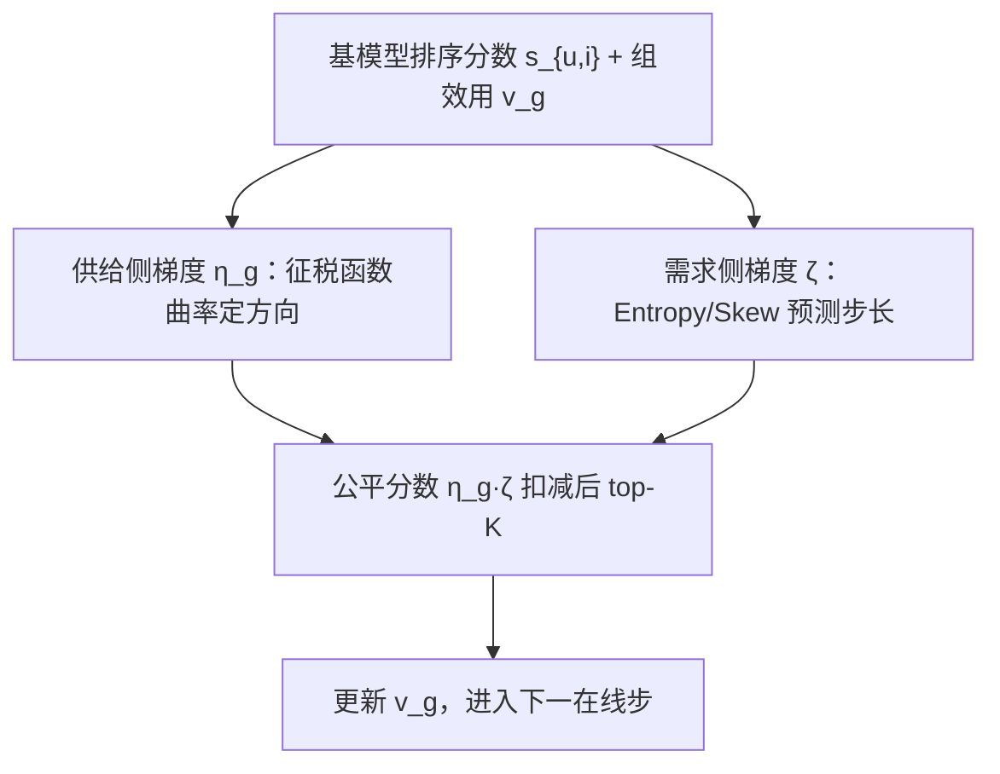

# The Attention Market: Interpreting Online Fair Re-ranking as Manifold Optimization under Walrasian Equilibrium (注意力市场：将在线公平重排解释为瓦尔拉斯均衡下的流形优化)

- **会议/期刊**: SIGIR 2026
- **作者与机构**: Chen Xu, Wei Chu, Wenyu Hu, Fengran Mo, Jun Xu (通讯), Maarten de Rijke；中国人民大学高瓴人工智能学院、蒙特利尔大学、阿姆斯特丹大学
- **推荐链路定位**: 重排（在线 post-processing）
- **研究方向**: 去偏公平与工业架构 / 列表级重排
- **论文原文**: [https://arxiv.org/abs/2604.25577v1](https://arxiv.org/abs/2604.25577v1)
- **开源代码**: [https://github.com/XuChen0427/FairDiverse](https://github.com/XuChen0427/FairDiverse)

## TL;DR (1分钟核心速览)

现有在线公平重排方法在 7 数据集 × 3 基模型 × 50+ 超参扫描的 20 余种设置下性能排名剧烈波动（图 1），作者将其归因于"忽略了排序分数所构造优化流形的几何性质"。本文将公平重排重构为注意力市场中的瓦尔拉斯均衡（公平=征税），证明求均衡等价于在排序流形上做梯度下降，进而提出 ManifoldRank：供给侧用闭式曲率梯度定方向，需求侧用排序分数的熵/偏度预测步长。在 NDCG 保持 99% 以上的约束下，42 个公平性设置中 41 个最优。

## Background & Motivation (背景与核心矛盾)

- **主流范式**: 工业系统受时延约束，公平重排以在线梯度下降为主（P-MMF、ElasticRank、FairSync），按历史交互动态调整排序分数 $s_{u,i}$。
- **前人局限**: ① 现有方法"ranking-score-free"，只按曝光缺口调分，完全不感知排序分数矩阵的分布形态；② 在跨数据集/跨基模型时性能排名极不稳定，缺乏可迁移的调参先验。
- **核心洞察 (Key Insight)**: 把用户注意力视为稀缺商品、公平约束视为征税，则最优公平分数即市场出清价格（瓦尔拉斯均衡）；而不同设置对应不同的流形几何，几何差异直接决定梯度景观与优化轨迹——这正是性能不一致的根因。
- **本文切入点**: 用流形优化语言统一供需两侧，把"公平分数"拆成"方向 × 步长"两个可闭式计算的梯度项。

## Method (核心方法设计)

### 1. 整体框架 (Overall Architecture)

用户 $u$到来时，基模型（SASRec 等）给出候选列表$L_K(u)$的分数$s_{u,i}$；ManifoldRank 计算组级公平分数$\eta_g(v_g)\cdot\zeta$，对每个物品做扣减后取 top-$K$，再按曝光结果累加组效用$v_g$进入下一轮。供给侧梯度由征税函数$r(v_g)$ 的解析曲率给出，需求侧梯度由当前用户分数向量的熵与偏度经验预测，二者相乘即为该用户在该市场几何下的"价格"。

### 2. 关键设计拆解 (Key Designs)

1. **公平即征税：供需均衡的等价性（Theorem 4/5）**：将重排目标改写为 $\max_{x}\sum_u w_u-r'(v)$，其中征税函数统一为$r(v_g)=\mathrm{sign}(\alpha\beta)v_g^{\beta}(\sum_g v_g^{\beta})^{\alpha-1}$。该形式可退化为 Max-min、$p$-norm、Elastic、$\alpha$-fairness、比例公平（表 2），从而把"选哪个公平指标"变成"选哪组$(\alpha,\beta)$"。直觉：$\alpha$是全局税率、$\beta$是局部累进率，$\beta<1$补贴最差组、$\beta>1$ 重罚富裕组。

2. **供给侧梯度：方向 + 曲率（式 9–11）**：价格正比于 $\partial r/\partial v_g$，得$\eta_g=c_g\cdot r(v_g)\gamma_g$，曲率$\gamma_g=\beta[1/v_g+(\alpha-1)v_g^{\beta-1}/G]$，$G=\sum_g v_g^{\beta}$。方向$c_g=\mathrm{sign}(\partial^2 r'/\partial v_g^2)$ 强制总成本凸性，保证均衡存在且帕累托最优。这是纯算术闭式，无需求解 LP。

3. **需求侧梯度：用分数统计量代理流形（式 12）**：$\zeta=a_e\mathrm{Entropy}(s)-a_s\mathrm{Skew}(s)$。高熵=偏好分散，征税几乎不损精度可放心加税；高偏度=偏好集中，重税会显著伤精度需减税。作者用序回归验证（图 6）：熵与偏度的均值系数显著，峰度等接近 0，故仅取这两项。总损失即在线逐步的$\arg\max\sum_{i\in S}(s_{u,i}-\eta_g\zeta)$，**无需负采样、无需训练**，每步仅$O(|L_K|)$ 算术。

## Experimental Setup & Evaluation Protocol (实验设置与评估协议)

- **数据集与预处理**: 少于 10 个物品的组统一并入 "infrequent group"。

| 数据集 | #Users | #Items | #Groups | #Samples | 场景说明 |
| :--- | :---: | :---: | :---: | :---: | :--- |
| Steam | 4,444 | 1,237 | 43 | 169,160 | 游戏平台 |
| Music (Amazon) | 873 | 11,952 | 33 | 46,640 | 稀疏长尾 |
| Fashion (Amazon) | 629 | 3,915 | 11 | 7,985 | 小规模 |
| Software (Amazon) | 583 | 2,707 | 34 | 13,115 | 中等 |
| Industrial (Amazon) | 1,078 | 1,756 | 29 | 16,585 | 中等 |
| Arts (Amazon) | 3,690 | 3,109 | 100 | 113,365 | 多组 |
| AliEC | 21,242 | 17,310 | 117 | 505,430 | 电商广告 |

- **数据划分与防穿越**: 按时间排序，前 80% 交互训练基模型，后 20% 作为重排测试流（时序切分，无穿越）。
- **排名评测协议**: 全候选列表重排（$K=10/20$），精度用 NDCG@K，公平用 EF@K、GINI@K、MMF@K（最差 20% 组聚合分数）。**关键约束**：所有方法调参至 NDCG 达到基模型 99% 以上再比公平性，模拟线上"精度损失 <1% 可忽略"。
- **对比基线与超参**: CPFair（贪心背包）、Min-regularizer、P-MMF（镜像梯度）、ElasticRank、FairSync；$\alpha,\beta\in[-3,3]$，$a_e,a_s\in[0.1,1]$；$t$-test$p<0.05$。

## Key Experimental Results (实验关键数据)

### 1. 主实验对比 (Main Results)

SASRec 基模型，$K=10$（$K=20$ 趋势一致），EF 越接近 0 越好、GINI 越低越好、MMF 越高越好：

| 数据集 | 指标 | CPFair | Min-reg | P-MMF | FairSync | ElasticRank | **ManifoldRank** | Improv. |
| :--- | :--- | :---: | :---: | :---: | :---: | :---: | :---: | :---: |
| Steam | EF@10 | -12.797 | -20.326 | -26.329 | -3.5548 | -4.9473 | **-3.3971** | +4.4% vs FairSync |
| Steam | GINI@10 | 0.6612 | 0.6763 | 0.6675 | 0.6985 | 0.7742 | **0.6608** | -5.4% |
| Steam | MMF@10 | 0.0430 | 0.0259 | 0.0530 | 0.0688 | 0.0452 | **0.0754** | +9.6% |
| Music | EF@10 | -15.884 | -15.907 | -2.8046 | -2.8208 | -4.9056 | **-2.3834** | +15.5% |
| Music | MMF@10 | 0.0745 | 0.0945 | 0.0957 | 0.1167 | 0.0465 | **0.1255** | +7.5% |
| Industrial | EF@10 | -2.1845 | -2.7667 | -1.6128 | -1.2458 | -1.2652 | **-1.0860** | +12.8% |
| Industrial | GINI@10 | 0.5165 | 0.5831 | 0.5571 | 0.4863 | 0.5770 | **0.4608** | -5.2% |
| Arts | MMF@10 | 0.1700 | 0.1364 | 0.1607 | 0.2140 | 0.1721 | **0.2190** | +2.3% |
| AliEC | EF@10 | -21.618 | -21.623 | -8.7536 | -3.8817 | -3.5795 | **-3.2473** | +9.3% |
| AliEC | GINI@10 | 0.7735 | 0.7903 | 0.8147 | 0.7621 | 0.7937 | **0.7065** | -7.3% |

### 2. 消融实验 (Ablation Study)

| 配置 | BPR EF@10 | GRU4Rec EF@10 | SASRec EF@10 | 说明 |
| :--- | :---: | :---: | :---: | :--- |
| FairSync | -0.1861 | -0.9317 | -1.0610 | 最强基线 |
| ElasticRank | -0.0136 | -1.1096 | -1.0514 | 次强基线 |
| **ManifoldRank** | **-0.0120** | **-0.7876** | **-0.9124** | 三基模型全胜 |
| w/o 需求侧 $\zeta$（$\zeta\equiv1$） | 退化至纯供给侧 | — | — | 图 6 序回归证明熵/偏度是有效代理 |
| $\alpha$ 增大 | EF 改善、NDCG 下降 | — | — | 全局税率单调生效 |
| $\beta\in[-2,1]$增大 | EF 变差、NDCG 变好 | — | — | 局部税率非单调，$\beta>1$ 后反转 |

### 3. 关键实验发现 (Key Findings)

1. **公平性几乎全面占优**：42 个（数据集 × $K$ × 指标）设置中 41 个最优，仅 1 个例外；在 AliEC 上 GINI 从 FairSync 的 0.7621 降至 0.7065（-7.3%），说明供给侧曲率项在大规模电商流上收益最显著。
2. **帕累托前沿整体右上移**（图 3）：在相同 NDCG 水平下 EF 更高、相同 EF 下 NDCG 更高，证明"精度 99% 约束下的公平增益"不是靠牺牲精度换来的，而是流形对齐带来的免费午餐。
3. **需求侧代理项是必要且可解释的**：图 6 序回归显示熵系数为正、偏度系数为负且置信区间远离 0，峰度等接近 0；图 5 显示 ManifoldRank 前 140 步公平提升较缓但长期反超 FairSync，且全程 NDCG 更高，适合长周期大规模部署。

## Highlights & Limitations (亮点、对比与审稿批判)

- **与代表作对比 (vs. Prior Work)**: P-MMF 用镜像梯度只优化最差组、ElasticRank 用曝光弹性当梯度、FairSync 用在线梯度保底曝光——三者均与排序分数分布解耦；本文首次把排序分数矩阵的统计几何（熵/偏度）显式注入梯度步长，并用瓦尔拉斯均衡给出帕累托最优的理论背书。
- **可迁移亮点**: ① "公平分数 = 方向 × 步长"的解耦范式可直接移植到多样性重排、曝光配额控制；② 用 $(\alpha,\beta)$ 统一 5 种公平指标，工程上只需调两个标量即可切换业务口径。
- **审稿级局限批判**: ① 需求侧 $\zeta$是经验代理而非严格流形等价（作者自认），缺乏收敛性保证；② 理论仅覆盖固定$K$的静态设定，未处理动态候选池与长期留存；③ 每步需重算全组$v_g$与$G$，组数达数百时（如 AliEC 117 组）在线开销需实测。

## Rating (四维评分)

- **方法创新性 (Novelty)**: ⭐⭐⭐⭐ （注意力市场 + 流形几何的双重理论包装扎实，Theorem 4/5 给出帕累托最优与单一税制的严格对应，但需求侧代理偏启发式）
- **评估协议与实验扎实度 (Protocol & Experiments)**: ⭐⭐⭐⭐⭐ （7 数据集 × 3 基模型 × 2 个 $K$× 3 公平指标，先做 20 余设置的一致性诊断再提方法，$t$-test 显著性齐全，消融覆盖参数敏感度与在线轨迹）
- **写作与数学规范度 (Clarity & Rigor)**: ⭐⭐⭐⭐ （供需曲线类比清晰、附录五个定理证明完整，但正文符号 $f_g$与$r(v_g)$ 混用略增阅读成本）
- **工业落地与复现价值 (Industrial & Practical Value)**: ⭐⭐⭐⭐ （闭式梯度仅需算术运算、无训练无负采样，代码已并入 FairDiverse 工具包，唯一待验证的是大组数下的在线时延）

