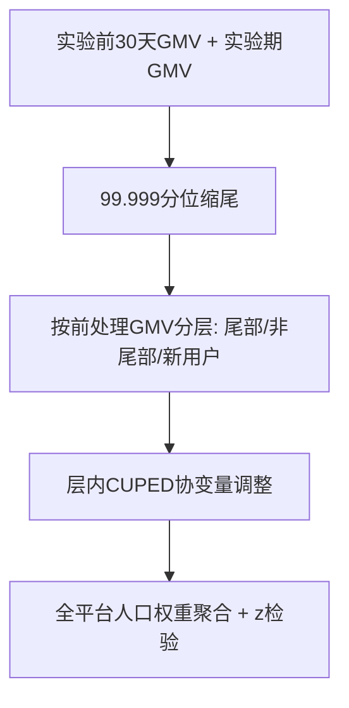

# Variance Reduction for Heavy-Tailed Monetization Metrics in Ranking Experiments via Post-Stratification (基于后分层的排序实验重尾变现指标方差缩减)

- **会议/期刊**: SIGIR 2026 (Industry Track)
- **作者与机构**: Neeti Pokharna, Yatharth Saraf (ShareChat); Olivier Jeunen (Aampe); Aleksei Ustimenko (Simulacra Research)
- **推荐链路定位**: 在线评估 / A/B 实验（服务于召回-排序-推荐全链路迭代）
- **研究方向**: 去偏公平与工业架构 / 工业级评测基准
- **论文原文**: [https://arxiv.org/abs/2606.04110v1](https://arxiv.org/abs/2606.04110v1)
- **开源代码**: 暂未开源

## TL;DR (1分钟核心速览)

排序/推荐系统常以 GMV、创作者收益等**重尾变现指标**做在线评估，极少数"鲸鱼用户"主导方差，导致 CLT 在小流量下失效、实验严重欠功效。本文提出**后分层 (Post-Stratification) + CUPED** 的生产级框架：用实验前 30 天 GMV 将用户划入同质层，层内做 CUPED 协变量调整，再以**全平台人口权重**聚合层效应。在 ShareChat/Moj 40+ 个 >1M 用户的线上实验中，方差降低 >99%，等效置信度下节省约 **45% 流量**，决策时间缩短约 50%。

## Background & Motivation (背景与核心矛盾)

- **主流范式**: 在线 A/B 实验以用户为随机化单元，用差值均值估计 ATE；CUPED 利用实验前协变量做回归调整以降低方差，是工业界标配。
- **前人局限**: ① 变现指标呈幂律重尾，top 0.01% 用户主导方差，A/A 检验的 $z$ 统计量在 1%–20% 流量下显著偏离标准正态（图 2），CLT 收敛需 ≥50% 流量；② CUPED 的增益受限于实验前信号的预测力，对尾部噪声几乎无能为力，团队只能延长实验周期或放宽阈值。
- **核心洞察 (Key Insight)**: 重尾方差并非"不可约"，而是**被少数高方差用户以近似均匀权重放大**；若把尾部用户隔离进一个权重 $w\approx 10^{-4}$的独立层，其对总方差的贡献被$w^2$压缩约$10^{-8}$ 量级。
- **本文切入点**: 将抽样调查中的后分层引入 IR 实验，与 CUPED 正交叠加，并给出无偏性证明、分层阈值敏感性、失败模式与部署护栏。

## Method (核心方法设计)

### 1. 整体框架 (Overall Architecture)

流程为：先按用户聚合实验前 30 天 GMV 与实验期 GMV；对超过 99.999 分位的极端值做缩尾（通常 <5 人）；用**实验前** 30 天 GMV 将用户划为尾部/非尾部/新用户（未付费）三层，阈值在观测任何实验结局前冻结；层内计算 CUPED 调整后的 GMV；最后用全平台人口比例 $w_s=N_s/N$加权聚合层均值与层方差，得到$z$统计量与$p$ 值。关键点在于分层变量只依赖前处理信息，因此层归属不受处理影响，无偏性成立。

### 2. 关键设计拆解 (Key Designs)

1. **后分层估计量（隔离尾部方差）**：痛点是用差值均值时尾部用户以等权进入方差。改为层内估计再按人口权重聚合：
$$\hat{\tau}_{PS}=\sum_{s\in S} w_s\cdot\hat{\tau}^{\text{CUPED}}_s,\qquad w_s=\frac{N_s}{N}$$
无偏性由 CUPED 无偏性与全期望定律给出：$\mathbb{E}[\hat{\tau}_{PS}]=\sum_s w_s\tau_s=\tau$。直觉是尾部层虽方差巨大，但其权重平方$w^2$ 把贡献压到可忽略，同时不改变总体估计目标。

2. **层内 CUPED 调整（消除层内可预测变异）**：分层只处理层间异质性，层内仍有可预测波动，故在每层内做协变量回归：
$$\text{GMV}^{\text{CUPED}}=\text{GMV}-\frac{\text{Cov}(\text{GMV},\widetilde{\text{PreGMV}})}{\sigma^2_{\widetilde{\text{PreGMV}}}}\cdot\widetilde{\text{PreGMV}}$$
其中 $\widetilde{\text{PreGMV}}=\text{PreGMV}-\mu_{\text{PreGMV}}$。层内同质化后协变量与结局相关性更强，CUPED 的方差削减效率随之提升，二者形成"层间 + 层内"双重降噪。

3. **方差聚合、护栏与推理开销**：层方差按 $\sigma^2=\sum_s w_s^2\sigma_s^2/n_{T,s}$聚合，$z=(\mu_T-\mu_C)/\sqrt{\sigma_T^2+\sigma_C^2}$。工程护栏包括：阈值预注册防 p-hacking、最小层样本 50 人、层规模漂移与权重异常监控、同时向实验方展示原始与后分层指标。推理侧仅需一次离线前处理管道与人口权重作业，无在线服务开销。

## Experimental Setup & Evaluation Protocol (实验设置与评估协议)

- **数据集与场景**: 无公开离线数据集，评估基于 ShareChat 与 Moj 两个平台的 **40+ 个线上生产 A/B 实验**，每个实验 >1M 用户，覆盖直播打赏排序与推荐系统变更；指标为 GMV（直播虚拟币充值总额），并扩展至游戏收入与金币收益。

| 场景 | 实验数 | 单实验用户量 | 主指标 | 分层依据 |
| :--- | :---: | :---: | :---: | :--- |
| ShareChat 直播 | 40+ | >1M | GMV | 前 30 天 GMV 分位 |
| Moj 直播 | 同上 | >1M | GMV | 同上 |
| 扩展指标 | — | — | 游戏收入/金币 | 同上 |

- **数据划分与防穿越**: 分层阈值由**实验前**人群计算并在观测结局前冻结，属严格前处理划分，杜绝处理污染层归属。
- **评测协议**: 以 A/A 模拟（1%–50% 流量）检验 $z$统计量分布与假阳性率，以生产 A/B 检验方差削减、MDE、决策一致性与时间到决策；显著性沿用双侧$z$检验（名义$\alpha=0.05$）。
- **对比基线**: 原始 GMV、CUPED 调整 GMV、后分层（缩尾/原始尾部）、对数变换、截尾均值、非参数检验；分层方案对比分位分层 vs 行为特征分层 vs k-means 聚类。

## Key Experimental Results (实验关键数据)

### 1. 主实验对比 (Main Results)

| 方法 | 方差削减 | 中位相对 $z$ | 等效流量节省 | 经验 Type-I 误差 |
| :--- | :---: | :---: | :---: | :---: |
| Raw GMV | — | 1.00 | — | 1.0% |
| CUPED-adjusted GMV | 47.62% | 1.10 | ≈17% | 2.6% |
| Post-strat (winsorized) | **99.3%** | **1.35** | **≈45%** | 6.1% |
| Post-strat (raw tails) | **99.7%** | **1.36** | **≈45%** | 6.1% |

在 10% 流量下，MDE 从原始 GMV 的约 136% 均值降至约 10%；40+ 实验中平均时间到决策缩短约 50%，第 1 周检出的效应在第 2 周保持 91% 方向一致，且无一次上线后回滚。

### 2. 消融实验 (Ablation Study)

| 配置 | 方差削减 | 说明 |
| :--- | :---: | :--- |
| 仅分位分层（无 CUPED） | >60% | 分层是主贡献项 |
| 分位分层 + CUPED | 99.3% | 完整方法 |
| 行为特征分层（创作者身份/DAU 等） | 25–35% | 显著弱于结局分层 |
| k-means 用户特征聚类分层 | 方差上升 | 聚类层与结局弱相关 |
| 缩尾阈值 99.9 分位 | 95.2% | 阈值放宽仍 >95% |
| 缩尾阈值 99.99 分位 | 99.3% | 采用值 |

### 3. 关键实验发现 (Key Findings)

1. **分层而非缩尾是方差削减的主因**：缩尾版与原始尾部版仅差 0.4%（99.3% vs 99.7%），说明 $w^2$ 权重压制才是核心机制，缩尾仅作数据管道异常的轻量保险。
2. **$z$提升远小于方差削减是预期行为**：$z$随方差平方根反比缩放，且降权尾部同时缩小分子中的均值差；中位相对$z=1.36$对应$1.36^2\approx1.85$ 倍数据效率，即约 45% 流量节省，而 CUPED 仅约 17%。
3. **结局导向分层优于行为分层**：分位 GMV 分层 >60% 削减，行为特征分层仅 25–35%，k-means 甚至增方差——分层变量必须与结局强相关，而非与用户画像相关。

## Highlights & Limitations (亮点、对比与审稿批判)

- **与代表作对比 (vs. Prior Work)**: 相较标准 CUPED（Deng et al.）仅做全局协变量调整，本文在其上叠加层间异质性控制，方差削减从 48% 提升至 99%；相较对数变换/截尾均值，本文**保持原始指标尺度与总体 ATE 估计目标**，避免估计目标漂移与方向性冲突；相较非参数检验，保留了可解释的分层归因。
- **可迁移亮点**: ① "前处理结局分位分层 + 层内 CUPED" 可直接迁移到长尾查询参与度、广告转化价值、市场流动性等重尾指标；② 同时展示原始与后分层指标、以二者方向分歧作为"尾部集中效应"的代理信号，是低成本高价值的工程实践。
- **审稿级局限批判**: ① 经验 Type-I 误差升至 6.1%（高于名义 5%），源于有限样本层方差估计与层间效应异质性，高风险上线仍需长周期确认；② 当处理效应真实集中于尾部（如 VIP 功能）时方法失效，40+ 实验中即有 1 例方差反升；③ 缺乏公开离线基准与开源代码，可复现性依赖平台自有前处理管道。

## Rating (四维评分)

- **方法创新性 (Novelty)**: ⭐⭐⭐ （后分层与 CUPED 均为经典工具，创新在于面向重尾变现指标的层设计、无偏性论证与失败模式刻画，属扎实的工程组合创新而非理论突破）
- **评估协议与实验扎实度 (Protocol & Experiments)**: ⭐⭐⭐⭐ （40+ 生产实验、A/A 模拟覆盖 1%–50% 流量、阈值敏感性与分层方案消融齐全，唯缺离线公开基准）
- **写作与数学规范度 (Clarity & Rigor)**: ⭐⭐⭐⭐ （无偏性证明简洁、$w^2$ 方差压制直觉清晰，并诚实区分模拟 0% 与生产 6.1% 两类 Type-I 误差的来源）
- **工业落地与复现价值 (Industrial & Practical Value)**: ⭐⭐⭐⭐⭐ （已作为 ShareChat 默认变现指标，节省约 45% 流量、决策时间减半，护栏设计完整，落地价值极高）

