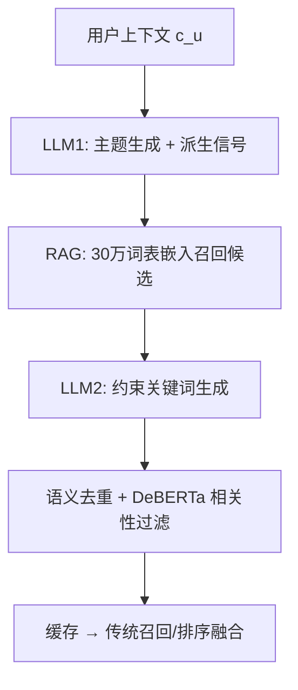
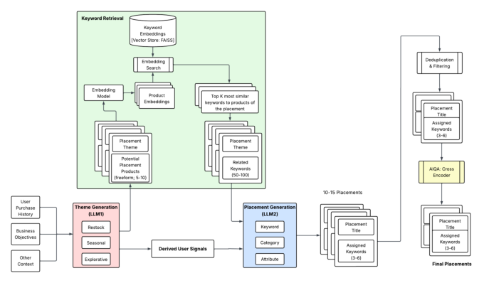

# A Cascaded Generative Approach for e-Commerce Recommendations (面向电商推荐的级联生成式方法)

- **会议/期刊**: SIGIR 2026
- **作者与机构**: Moein Hasani, Hamidreza Shahidi 等 (Instacart, Penn State 等)
- **推荐链路定位**: 召回（生成式内容构建 + 传统排序融合）
- **研究方向**: 生成式推荐与离散语义 ID / 大语言模型推荐
- **论文原文**: [论文原文链接](https://arxiv.org/abs/2605.11118v2)
- **开源代码**: 暂未开源

## TL;DR (1分钟核心速览)

传统电商货架由人工策展的固定主题 + 独立召回 + 逐点排序拼装，难以深度个性化且缺乏跨投放语义连贯性。本文提出**自顶向下级联生成**框架：LLM1 依据用户上下文生成有序投放主题，LLM2 在 RAG 检索到的 30 万关键词子集上做约束解码生成检索关键词，再经语义去重与 DeBERTa 交叉编码器质量过滤，最后与传统排序服务融合。教师-学生蒸馏（Llama-3.2-3B + LoRA）逼近 GPT-5 教师质量，线上 A/B 在数十万用户上取得每页浏览购物车添加 **+2.7%**（$p=0.0001$）的显著提升。

## Background & Motivation (背景与核心矛盾)

- **主流范式**: 货架 = 人工预定义投放主题 + 每投放独立召回源 + 逐点排序模型，优化聚合偏好。
- **前人局限**: ① 内容人工策展成本高、一经创建即对所有用户通用，无法按季节/瞬时需求深度个性化；② 多策展人各自为政导致页面语义割裂，缺乏跨投放连贯性与多样性控制。
- **核心洞察 (Key Insight)**: 自底向上直接生成商品（TIGER/HSTU 路线）受制于高基数商品词表、频繁目录变更与推理延迟成本；而货架的**语义规划层**（主题 + 关键词）基数低、可约束，更适合生成式建模。
- **本文切入点**: 将货架构建分解为「主题生成 → 约束关键词生成」两级级联，生成结果仅驱动检索而非直接出商品，从而兼容既有召回排序基础设施。

## Method (核心方法设计)

### 1. 整体框架 (Overall Architecture)

四阶段流水线：① 页面设计智能体以用户上下文 $c_u$（购买史、互动信号、膳食偏好）为输入，用闭源 LLM 约束解码输出$m$个有序主题$\{t_i^u\}_{i=1}^m$ 及用户画像/自由商品概念等派生信号；② 每个主题经 RAG 从 30 万词表召回候选关键词，LLM2 约束生成检索兼容描述符；③ 语义去重 + 微调交叉编码器做主题-商品相关性过滤（AIQA）；④ 输出缓存，由既有商品/投放排序服务取回并重排，实现生成式召回与传统排序的解耦融合。

<figure class="paper-figure" markdown="span">
  <figcaption>图1：级联式生成内容架构。LLM1 从原始信号生成个性化投放主题。LLM2 将这些主题与 RAG 检索到的候选关键词结合，为每个投放生成最终关键词。输出经过后处理和 AI 质量保证（AIQA）过滤，以确保质量、多样性和政策合规性。</figcaption>
</figure>

### 2. 关键设计拆解 (Key Designs)

1. **级联主题-关键词分解（Cascaded Decomposition）**：痛点在于单 LLM 直出商品需透传全词表、成本爆炸。本文将页面目标 $Y_u(H_u \mid c_u, P, B)$拆为两级条件生成：$t_i^u \sim p(\cdot \mid c_u)$，$k_i^u \sim p(\cdot \mid t_i^u, \mathcal{R}(t_i^u))$，其中$\mathcal{R}(\cdot)$ 为 RAG 候选集。直觉：把高熵的"整页生成"降维成低熵的"意图→词"映射，既保留页面级连贯性又让每步输出可被约束与校验。
2. **RAG 约束 + 教师学生蒸馏（RAG-Constrained Distillation）**：LLM2 仅接收嵌入近邻检索出的关键词子集而非全库，生产环境推理成本降 15–20%；同时用闭源教师生成监督数据（小样本人工校验），LoRA 微调内部学生模型模仿教师，避免每主题透传全词表的上下文开销。
3. **训练目标、负采样与推理效率**：本文为工业落地型工作，未采用 BPR/InfoNCE 式对比损失，而是以监督微调（下一 token 交叉熵）蒸馏教师分布，辅以 AIQA 标签清洗；质量过滤侧用 DeBERTa-v3-base 交叉编码器在教师标注的主题-商品对上学二分类相关性，相对 LLM-as-a-judge 推理成本降 **99%+**，与真值对齐率 >90%。线上靠主题/关键词激进缓存摊薄生成开销，端到端延迟无显著变化。

## Experimental Setup & Evaluation Protocol (实验设置与评估协议)

- **数据集与预处理**: 数据与商品目录为 Instacart 专有，不可直接复现；离线评估在跨策略一致的数千用户随机样本上进行。

| 数据集 | #Users | #Items | #Interactions | 稀疏度/密度 | 特征/场景说明 |
| :--- | :---: | :---: | :---: | :---: | :--- |
| 生产电商货架（专有） | 数十万（线上） | 千万级商品 | 未披露 | 未披露 | 杂货电商，30 万关键词分类体系 |

- **数据划分与防穿越 (Splitting Strategy)**: 未披露标准划分；离线采用固定用户采样集做跨策略对比，线上为大规模 A/B 分流。
- **排名评测协议 (Ranking Protocol)**: 非传统 Full-Ranking/Sampled Ranking，而是**内容质量评测**：P-T@K（投放标题与 Top-K 商品相关性）、K-U（关键词-用户画像相关性）、Density（每投放平均召回量），由多层级 LLM-as-a-judge 打分。
- **对比基线与超参设置**: 基线为生产策展系统（Control）与 GPT-5 教师；学生模型覆盖 Llama-3.1 8B、Qwen2.5 7B/32B、Llama-3.2 3B，LoRA 微调，线上显著性以 $p$-value 检验。

## Key Experimental Results (实验关键数据)

### 1. 主实验对比 (Main Results)

| 模型 | P-T@5 | P-T@20 | K-U | Density |
| :--- | :---: | :---: | :---: | :---: |
| Control（生产基线） | 0.824 | 0.842 | **0.980** | **18.020** |
| GPT-5（教师） | **0.931** | **0.913** | 0.985 | 15.590 |
| Llama-3.1 8B | 0.905 | 0.892 | 0.974 | 15.980 |
| Llama-3.1 8B + AIQA 标签 | 0.914 | 0.901 | 0.976 | 16.146 |
| Qwen2.5 7B + AIQA 标签 | 0.902 | 0.886 | 0.979 | 16.183 |
| Qwen2.5 32B + AIQA 标签 | 0.908 | 0.893 | **0.980** | 16.086 |
| **Llama-3.2 3B + AIQA 标签** | **0.915** | **0.901** | 0.977 | 16.350 |

线上 A/B（数十万用户、千万级商品）：

| 指标 | 相对提升 | $p$-value |
| :--- | :---: | :---: |
| 每页浏览购物车添加 | **+2.7%** | 0.0001 |
| 每次访问购物车添加 | +1.0% | 0.01 |
| 与历史订单行为一致性 | +2.3% | — |

### 2. 消融实验 (Ablation Study)

| 配置 | P-T@5 | 说明 |
| :--- | :---: | :--- |
| Llama-3.1 8B（原始标签） | 0.905 | 无 AIQA 清洗 |
| Llama-3.1 8B + AIQA 标签 | 0.914 | 标签质量过滤 +0.9pt |
| Qwen2.5 7B + AIQA | 0.902 | 小模型族对比 |
| Qwen2.5 32B + AIQA | 0.908 | 参数量增大收益有限 |
| Llama-3.2 3B + AIQA | **0.915** | 最小模型反而最优 |

### 3. 关键实验发现 (Key Findings)

1. **AIQA 标签清洗是蒸馏的关键杠杆**：同为 Llama-3.1 8B，仅换用 AIQA 过滤后的监督标签，P-T@5 从 0.905 升至 0.914，说明教师数据的噪声而非模型容量是学生质量瓶颈。
2. **小模型可反超**：3B 的 Llama-3.2 以 P-T@5=0.915 超过 8B/32B 变体并逼近 GPT-5 教师（0.931），在服务延迟与成本上具备压倒性优势，验证了"任务窄化 + 高质量标签"下蒸馏的性价比。
3. **精度-召回存在刻意权衡**：所有生成策略 Density（15.6–16.4）均低于基线 18.0，即用更小但更相关的召回集换取 P-T@5 从 0.824 到 0.915 的大幅精度跃升；线上 +2.7% 购物车添加证明该权衡在业务上净收益为正，且水果/乳制品/零食等高频偏好驱动品类收益最高。

## Highlights & Limitations (亮点、对比与审稿批判)

- **与代表作对比 (vs. Prior Work)**: 相较 TIGER/HSTU 的自底向上语义 ID 序列生成，本文在**语义规划层**生成主题与关键词，规避高基数商品词表与目录漂移；相较 ARAG 的智能体式 RAG，本文用嵌入检索在固定分类体系内约束生成，兼顾召回与相关性；相较 Product-RAG 的查询补全，本文面向个性化投放主题的关键词生成。
- **可迁移亮点**: ① "生成高层意图 + 约束低层检索词"的两级分解可迁移到首页楼层、广告创意、搜索导购等场景；② 用微调交叉编码器替代 LLM-as-a-judge 做在线质量闸门，成本降 99% 且对齐率 >90%，是工业过滤的通用范式。
- **审稿级局限批判**: ① 数据与目录专有、无开源代码，离线指标为 LLM 自评，缺乏公开基准与人工标注的严格相关性验证，可复现性弱；② 级联存在阶段间误差传播，且监督微调引入流行度偏置、固定分类体系限制新概念发现，召回密度下降在目录覆盖不足时有"轮播塌陷"风险。

## Rating (四维评分)

- **方法创新性 (Novelty)**: ⭐⭐⭐⭐ （自顶向下级联生成 + RAG 约束的规划层建模思路清晰，但各组件均为已有技术的工程化组合）
- **评估协议与实验扎实度 (Protocol & Experiments)**: ⭐⭐⭐ （线上 A/B 显著且规模大，但离线仅 LLM 自评、无公开数据与标准排名协议，消融较薄）
- **写作与数学规范度 (Clarity & Rigor)**: ⭐⭐⭐⭐ （工业系统叙述流畅、公式简洁，问题形式化到位，但缺复杂度与误差传播的定量分析）
- **工业落地与复现价值 (Industrial & Practical Value)**: ⭐⭐⭐⭐⭐ （真实生产部署、缓存摊薄延迟、蒸馏降本与 99% 过滤成本节省，落地价值极高；扣分项为未开源）

