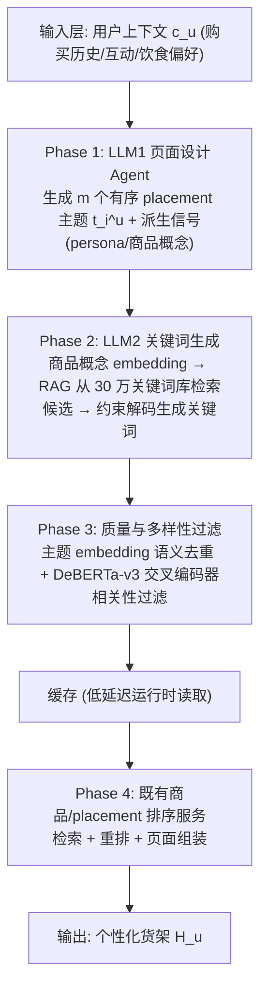
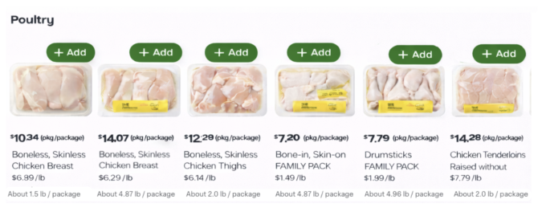
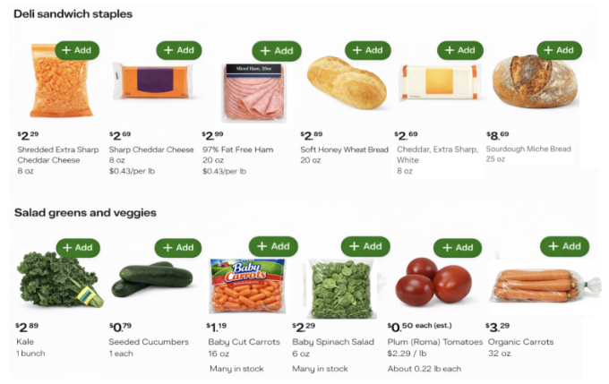
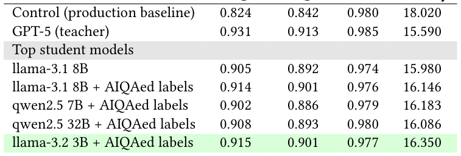
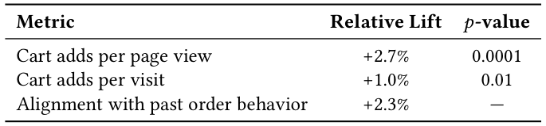

# A Cascaded Generative Approach for e-Commerce Recommendations (面向电商推荐的级联生成式方法)

- **会议/期刊**: SIGIR 2026
- **推荐链路定位**: 召回 (Retrieval) —— 生成式货架结构规划 + 关键词驱动商品召回，并与传统排序服务融合
- **研究方向**: 生成式推荐与离散语义 ID / 大语言模型推荐 (LLM4Rec)
- **论文原文**: [https://arxiv.org/abs/2605.11118v2](https://arxiv.org/abs/2605.11118v2)
- **开源代码**: 暂未开源（原文与预提取均未发现开源代码链接；数据集与商品目录为 Instacart 专有，作者明确说明不可直接复现）

## TL;DR (核心速览)

针对电商首页货架（storefront）由人工静态主题 + 独立检索 + 逐点排序拼装导致的个性化受限与页面语义割裂问题，本文提出**自顶向下级联生成式商品运营框架**：LLM1 依据用户上下文生成有序的 placement 主题，LLM2 结合 RAG 从 30 万关键词库中检索候选并受约束地生成检索关键词，再经语义去重与 DeBERTa 交叉编码器质量过滤，最后交由既有排序服务融合。采用 GPT-5 教师 → Llama-3.2-3B 学生的 LoRA 蒸馏以控制延迟成本。离线 P-T@5 达 0.915（基线 0.824），线上 A/B 每页面浏览加购量 **+2.7%（p=0.0001）**。

## Background & Motivation (背景与动机)

- **领域背景与主流范式**: 大规模电商货架通常采用模块化流水线：(1) 人工运营为每个页面区块（placement，常为商品轮播）预定义标题与检索源；(2) 检索系统按 placement 拉取候选商品；(3) 排序模型对 placement 与商品排序以优化固定业务指标。该范式在优化聚合偏好上有效，但内容库"一刀切"。
- **现有方法局限 (Limitations of Prior Work)**:
  1. **个性化内容难以规模化**：新内容由人工为特定目标构思，一旦创建即对所有用户普遍可用，生成与评估均靠手工，成本高、周期长，无法按用户、季节与瞬态维度深度个性化。
  2. **页面缺乏连贯性 (Lack of cohesion)**：多位运营者各自为政地生产内容，最终呈现给用户的多个 placement 组合杂乱，用户只能盲目滚动，难以按需求导航页面。
  3. **生成式路线的两难**：自底向上（bottoms-up，如 TIGER 语义 ID 自回归、HSTU 万亿参数序列转导）直接生成商品，灵活性高但词表巨大、目录频繁变动、延迟与成本难以承受，且难以满足页面级多样性约束；自顶向下（top-down）则先在语义规划层生成结构，再生成检索实体。
- **核心挑战 (Key Challenge)**: 为什么不能简单加大排序模型或直接上大模型生成商品？因为商品词表基数极高且目录高频变化，直接生成 item 的推理成本与幻觉风险不可控；而单纯堆叠 LLM 又会在生产延迟与成本约束下不可部署。
- **核心洞察与切入点 (Key Insight)**: 作者的关键判断是——**在"语义规划层"而非"商品层"做生成**。先生成有序主题结构化整页，再为每个主题生成"检索兼容的描述符"（关键词/类目节点）去驱动既有检索系统，从而既获得深度个性化与页面连贯性，又完全复用下游检索与排序基础设施（混合架构）。同时用教师-学生蒸馏 + RAG 约束 + 轻量交叉编码器过滤，把成本压到可上线水平。

## Problem Formulation & Method (问题定义与方法架构)

### 1. 符号定义与输入表征 (Notations & Input Representations)

- 用户集 $U$，用户 $u$ 的上下文 $c_u$（购买历史、互动信号、饮食与其他派生家庭偏好）。
- 商品全集 $P$，约束集合 $B$（延迟、业务与政策约束，如增长目标、品牌合规）。
- 目标输出：用户个性化货架 $H_u$，由 $m$ 个有序 placement 组成：

$$H_u = \left[\, z_i^u\left(t_i^u, s_i^u\right) \right]_{i=1}^{m}$$

其中每个 placement $z_i^u$ 包含语义意图主题 $t_i^u$（即 placement 标题）与对应商品列表 $s_i^u \subseteq P$。
- 优化目标：最大化页面级用户效用 $Y_u(H_u \mid c_u, P, B)$，$Y$ 为多分量目标（平衡短期与长期互动）。
- 输入表征：原始用户信号 → LLM1 输出主题 + 派生信号（用户画像 persona、与 placement 意图契合的自由形式商品概念 product concepts）；这些派生信号被复用为 Phase 2 的输入，避免重复摄入原始信号以节省 token。

### 2. 整体流水线 (Overall Architecture)

四阶段顺序流水线：(1) 页面设计与主题生成 → (2) 检索关键词生成 → (3) 质量与多样性过滤 → (4) 商品与页面级排序。前三阶段构成本文的生成式内容架构（图 1），第四阶段调用其输出并与既有排序系统集成。

<figure class="paper-figure" markdown="span">
  <figcaption>图 1</figcaption>
</figure>

### 3. 核心模块设计与数学原理 (Key Designs & Formulations)

**(1) Phase 1 页面设计与主题生成（LLM1）**
使用闭源权重 LLM，配合**约束解码 (constrained decoding)** 与结构化输出，保证下游可用性。每个主题代表一个离散且连贯的购物意图，直接作为 placement 标题（如 "Flavor builders for weeknight meals"、"Functional hydration, lower sugar"）。LLM1 同时输出 placement 实体与派生信号（用户画像、商品概念），供 Phase 2 直接消费以削减冗余 token。输出后接护栏（guardrails）强制业务与政策约束，生成失败或低质时走**确定性回退 (deterministic fallback)**。物理直觉：把"页面该长什么样"这一高层规划交给生成模型，把"具体卖什么"留给检索系统，从而在语义层获得跨 placement 的全局连贯性（这是逐点排序器无法建模的）。

**(2) Phase 2 检索关键词生成（LLM2 + RAG + 教师-学生蒸馏）**
- 每个主题 $t_i^u$ 作为上下文，生成一个或多个检索兼容描述符（搜索 query 串、目录分类节点等）；作者探索多种描述符表示，**结构化节点表现最佳**，统称为 keywords。
- **RAG 约束**：对 LLM1 产出的自由形式商品概念生成 embedding，在 **30 万词条关键词语料**中做最近邻检索，仅将精炼子集作为候选喂给 LLM2 做约束生成。这既降低幻觉又提升 prompt 效率——生产环境总推理成本降低 **15–20%**。关键动机：若用单个 LLM 端到端完成，需将全量关键词语料作为上下文透传，成本不可接受。
- **教师-学生微调**：闭源 LLM（GPT-5）生成高质量监督数据，小样本人工校验；内部模型用 **LoRA 适配器**微调模仿教师。消融维度包括：Llama / Qwen 家族内多基座探索、LoRA rank 变化、微调样本量扩充、AIQA 标签质量过滤。最优为 **Llama-3.2-3B + AIQA 标签**，性能逼近教师。

**(3) Phase 3 质量与多样性过滤（两级）**
- **语义去重**：对每个生成主题生成 embedding，按相似度阈值去重，剔除同一用户下的冗余主题。
- **微调交叉编码器做主题-商品相关性**：基于 **DeBERTa-v3-base** 架构微调，训练数据为闭源教师模型生成 + 人工在环校验的主题-商品相关性真值对；学生模型与真值标签对齐率 **>90%**。运行时凡被判定为质量违规的 placement 在部署前剪枝。相较闭源 LLM-as-a-judge 等价方案，推理成本降低 **>99%**，使得在线实验中可对全量用户做过滤。

**(4) Phase 4 商品与页面级排序（混合集成）**
最终有序 placement 与关键词被缓存以供低延迟读取；既有商品与 placement 排序服务拉取生成内容、做额外重排并返回页面。该设计将生成式检索与传统排序服务**解耦**，保留向更深生成式控制演进的路径。

<figure class="paper-figure" markdown="span">
  <figcaption>图 2</figcaption>
</figure>

<figure class="paper-figure" markdown="span">
  <figcaption>图 3</figcaption>
</figure>

### 4. 训练目标、负采样与推理复杂度 (Optimization, Negative Sampling & Complexity)

- **损失函数**: 原文未报告具体损失函数形式与温度系数（属工业系统论文，仅说明学生模型采用**监督微调 (SFT) + LoRA** 模仿教师输出；交叉编码器亦为监督微调）。原文未给出 BPR / InfoNCE / BCE 等显式公式。
- **训练负采样策略**: 原文未报告负采样方案（任务为条件文本生成与相关性二分类，非对比检索训练）。RAG 阶段使用 embedding 最近邻做候选约束而非负采样。
- **时间与空间复杂度**:
  - 离线：教师模型批量生成监督数据 + 人工小样本校验；学生 LoRA 微调（基座 3B/7B/8B/32B 对比）。
  - 在线：LLM1 + LLM2 级联推理，但通过**对主题与关键词的激进缓存**将生成成本摊销到多次用户会话，原文报告**端到端整体延迟无显著变化**。RAG 使总推理成本下降 15–20%；DeBERTa 交叉编码器替代 LLM 评审使过滤成本下降 >99%。
  - 原文未报告具体 ms/request 延迟数值、峰值显存或单 epoch 训练耗时。

## Experimental Setup & Evaluation Protocol (实验设置与评估协议)

- **数据集统计与预处理**: 数据集与商品目录为 Instacart **专有**，原文未披露用户数、商品数、交互数、稀疏度等统计量，亦未说明 5-core 等过滤规则。线上实验覆盖**数十万用户**、商品目录**数千万级 item**。关键词语料规模为 **30 万词条**。

| 数据集 (Dataset) | 用户数 (#Users) | 物品数 (#Items) | 交互数 (#Interactions) | 稀疏度/密度 (Sparsity) | 模态/辅助特征说明 |
| :--- | :---: | :---: | :---: | :---: | :--- |
| Instacart 专有数据（离线） | 原文未报告 | 原文未报告 | 原文未报告 | 原文未报告 | 购买历史、互动信号、饮食/家庭派生偏好；30 万关键词分类语料 |
| Instacart 线上 A/B | 数十万 (hundreds of thousands) | 数千万级 (tens of millions) | 原文未报告 | 原文未报告 | 同上 |

- **数据划分方式 (Splitting Strategy)**: 原文未报告离线训练/验证/测试的具体划分比例或时间切分方式。线上采用大规模 A/B 实验（对照 = 生产基线，实验 = 生成式策略）。**数据泄露风险**：由于采用 LLM-as-a-judge 在随机抽样的数千用户上做跨策略一致性评估，且教师模型参与生成监督标签，存在**教师-评估同源偏置**风险（评估器与被评估生成器可能共享同一闭源模型家族），原文未做该偏置的对照分析。
- **排名评测协议 (Ranking Protocol)**: **非传统 Top-K 排序评测**。离线采用多层级 LLM-as-a-judge（页面级 / placement 级 / 商品级）+ 指标型信号（召回密度、既有 $p(\text{Conversion})$ 分数）。核心离线指标：
  - **P-T@K**（product-theme precision）：跨所有 placement，top-K 商品与 placement 标题相关的平均百分比；
  - **K-U**（keyword-user precision）：跨所有 placement，关键词与用户画像相关的百分比；
  - **Density**：每个 placement 的平均商品召回量。
- **评价指标与显著性检验**: 线上指标为每页面浏览加购量、每次访问加购量、与历史订单行为对齐度；报告 $p$ 值（$p=0.0001$、$p=0.01$）。原文未报告多随机种子方差、配对 $t$ 检验 / Wilcoxon / Bootstrap 细节，亦未报告 embedding 维度 $d$ 或 LoRA rank 的具体取值。

## Key Experimental Results (核心实验结果)

### 1. 主实验对比 (Main Results)

离线评估结果（表 1，所有学生模型均经监督微调）：

| 模型 | P-T@5 | P-T@20 | K-U | Density |
| :--- | :---: | :---: | :---: | :---: |
| Control（生产基线） | 0.824 | 0.842 | 0.980 | 18.020 |
| GPT-5（教师） | **0.931** | **0.913** | 0.985 | 15.590 |
| llama-3.1 8B | 0.905 | 0.892 | 0.974 | 15.980 |
| llama-3.1 8B + AIQAed labels | 0.914 | 0.901 | 0.976 | 16.146 |
| qwen2.5 7B + AIQAed labels | 0.902 | 0.886 | 0.979 | 16.183 |
| qwen2.5 32B + AIQAed labels | 0.908 | 0.893 | 0.980 | 16.086 |
| **llama-3.2 3B + AIQAed labels** | **0.915** | **0.901** | 0.977 | 16.350 |

关键观察：
- 教师 GPT-5 建立质量上限，P-T@5 相对生产基线 0.824 → 0.931（**+13.0% 相对提升**）。
- AIQA 标签一致提升学生质量：Llama-3.1 8B 的 P-T@5 从 0.905 → 0.914。
- **3B 小模型 + AIQA 标签取得学生中最高精度**（P-T@5 0.915、P-T@20 0.901），匹配甚至超过更大参数变体，同时服务延迟与成本显著更优。
- 所有生成式策略的召回密度均低于生产基线（15.6–16.4 vs. 18.0），这是**有意权衡**：生成式系统产出更聚焦、组合式的查询，召回集更小但更相关。

<figure class="paper-figure" markdown="span">
  <figcaption>表 1</figcaption>
</figure>

线上 A/B 结果（表 2，每次访问可能含多个页面浏览）：

| 指标 | 相对提升 | $p$ 值 |
| :--- | :---: | :---: |
| 每页面浏览加购量 (Cart adds per page view) | **+2.7%** | 0.0001 |
| 每次访问加购量 (Cart adds per visit) | +1.0% | 0.01 |
| 与历史订单行为对齐度 | +2.3% | — |

<figure class="paper-figure" markdown="span">
  <figcaption>表 2</figcaption>
</figure>

### 2. 消融实验与控制变量分析 (Ablation Study)

原文的"消融"以**学生模型选型消融**形式呈现（表 1），而非传统模块移除式消融：
- **基座模型家族与规模**：Llama-3.1 8B / Qwen2.5 7B / Qwen2.5 32B / Llama-3.2 3B 对比，3B 反而最优，说明任务对基座规模不敏感、对标签质量更敏感。
- **AIQA 标签过滤**：Llama-3.1 8B 加 AIQA 标签后 P-T@5 +0.009、P-T@20 +0.009、Density +0.166，是唯一被单独量化贡献的模块，贡献明确但幅度温和。
- **LoRA rank 变化、微调样本量扩充**：原文声明做了这两项消融，但**未报告具体数值结果**。
- **参数量对齐控制**：原文未做严格的参数量对齐或图度数匹配式控制变量分析；3B 与 8B/32B 的对比本身构成规模维度的对照，但训练数据量、LoRA 配置等潜在混淆因素未完全披露。

### 3. 稀疏度/冷启动分桶与超参敏感度 (Sparsity Buckets & Hyperparameters)

- **长尾个性化**：作者称当前分类体系规模配合 RAG 对尾部类目与商品覆盖良好，能为手工运营难以触达的小众偏好生成相关轮播；但**未给出长尾/头部用户或物品的分桶量化对比**。
- **类目级洞察**：按轮播级"每次曝光加购量"分析，**水果、乳制品、零食**类目表现最佳，说明生成式个性化在高频、偏好驱动的杂货类目上尤其有效（这些类目口味差异大）。
- **关键超参数敏感度**：原文未报告温度系数、损失权重、网络层数、码本大小等超参敏感度曲线（本文不涉及 RQ-VAE 码本）。LoRA rank 仅声明探索未给数值。
- **线上 A/B 测试结果**: 已包含（见上表 2）。实验对象为大型杂货电商生产用户，初始线上实验因基础设施限制，主题与关键词生成**均使用 GPT-5 教师模型**，所有线上策略均启用 DeBERTa 交叉编码器做相关性过滤。原文未报告实验周期与流量占比的具体数值。

## Highlights, Limitations & Critiques (亮点、局限与审稿级批判)

- **核心亮点与可迁移性**:
  1. **"语义规划层生成 + 实体层检索"的解耦范式**极具迁移性：把生成式能力限制在高层结构（主题/意图/查询），把高基数、易变的实体交给成熟检索系统，规避了 TIGER/HSTU 类自底向上路线的词表爆炸与延迟问题，可直接迁移到内容社区、本地生活、视频首页等货架式场景。
  2. **RAG 作为"生成约束器"而非"知识注入器"**：用 30 万词条语料做候选裁剪，同时降低幻觉与 15–20% 推理成本，这一"约束式 RAG"思路对任何需要生成受控词表输出的工业系统都有参考价值。
  3. **蒸馏 + 轻量判别器替代 LLM 评审**：DeBERTa 交叉编码器以 >99% 成本降幅达到 >90% 对齐率，是 LLM-as-a-judge 工业化落地的实用范式。
  4. **诚实的权衡陈述**：明确承认召回密度下降是设计取舍而非缺陷，并给出类目级归因。
- **局限性与审稿视角批判 (Critical Limitations)**:
  1. **可复现性严重不足**：专有数据、未开源代码、未披露数据统计量与划分方式，离线指标（P-T@K、K-U）由 LLM 评审产生且评审器与被蒸馏教师可能同源，存在**评估循环性 (evaluation circularity)** 风险，缺少人工标注的独立金标准验证。
  2. **线上实验与离线结论存在错配**：线上用的是 GPT-5 教师而非论文主推的 3B 学生模型，因此"+2.7% 加购"无法直接归因于蒸馏方案的有效性；学生模型的实际线上收益**原文未报告**。
  3. **缺少关键工程数据**：端到端延迟仅以"无显著变化"定性描述，未给 P50/P99 延迟、缓存命中率、单请求成本；未报告多随机种子方差与置信区间（仅给 $p$ 值）。
  4. **级联误差传播**：作者自认 Phase 1 低质主题会污染下游，但未量化该误差传播幅度，也未给出纠错机制的实验。
  5. **固定分类体系天花板**：依赖固定关键词 taxonomy，无法发现体系外的新概念；SFT 引入流行度偏置，可能损害小众兴趣——这与论文宣称的"长尾个性化"卖点存在张力，且缺少长尾分桶证据支撑。
  6. **基线强度**：离线对照
