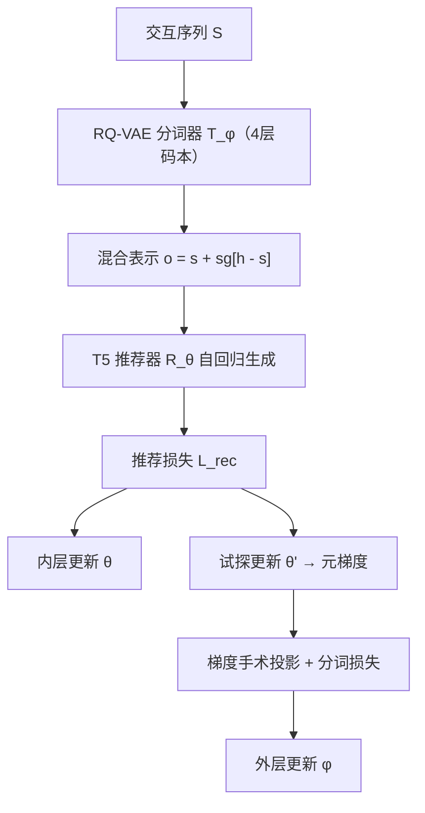
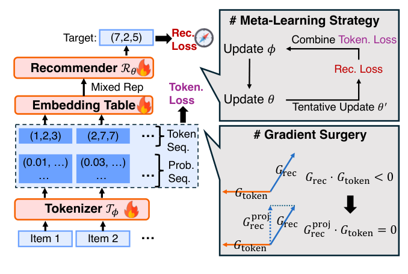

# Bi-Level Optimization for Generative Recommendation: Bridging Tokenization and Generation (面向生成式推荐的双层优化：弥合分词与生成)

- **会议/期刊**: SIGIR 2026
- **作者与机构**: Yimeng Bai, Chang Liu, Yang Zhang, Fuli Feng 等（USTC / 北航 / NUS / Upwork）
- **推荐链路定位**: 端到端生成式（语义 ID 分词 + 自回归生成）
- **研究方向**: 生成式推荐与离散语义 ID / 大语言模型推荐
- **论文原文**: [https://arxiv.org/abs/2510.21242v2](https://arxiv.org/abs/2510.21242v2)
- **开源代码**: [https://github.com/Ten-Mao/BLOGER](https://github.com/Ten-Mao/BLOGER)

## TL;DR (1分钟核心速览)

生成式推荐中，RQ-VAE 分词器与自回归推荐器长期被"顺序训练"或"交替训练"割裂优化，分词器完全看不到推荐目标，导致语义 ID 与协同信号错位（如"奶粉"与"尿布"被分到无关码字）。本文提出 BLOGER，把二者重构为**双层优化**：内层用固定分词器训练推荐器，外层用"分词损失 + 推荐损失"联合优化分词器，并以 MAML 元梯度近似求解、用梯度手术消解两目标冲突。在 Amazon 三数据集、Leave-One-Out + Full-Ranking 协议下，Beauty R@5 达 0.0444（较 LETTER +4.7%），且训练开销仅比 TIGER 高约 12%。

## Background & Motivation (背景与核心矛盾)

- **主流范式**: TIGER/LETTER 采用**顺序优化**——先独立训练 RQ-VAE 得到静态语义 ID，再冻结分词器训练 T5 推荐器；ETEGRec 采用**交替优化**，靠中间层辅助对齐损失间接耦合两者。
- **前人局限**: 其一，分词器训练时**完全无推荐目标梯度**，码本分配只服从重构/文本语义，与协同共现结构脱节；其二，ETEGRec 的辅助损失是手工设计的代理目标，需额外 adapter 层，且并未真正对齐下游推荐损失。
- **核心洞察 (Key Insight)**: 分词器的优劣**本质上由推荐器性能反映**——好的 ID 让推荐更准，好的推荐器又需要好 ID 建模偏好，二者是天然的双层依赖而非并列任务。
- **本文切入点**: 把生成式推荐重写为 bi-level optimization，让推荐损失通过**元梯度**直接回传到分词器参数 $\phi$。

## Method (核心方法设计)

### 1. 整体框架 (Overall Architecture)

输入为用户交互序列 $S$，经 RQ-VAE 分词器$\mathcal{T}_\phi$映射为 4 层残差量化 token 序列$X$；推荐器$\mathcal{R}_\theta$（T5 encoder-decoder）以 token 序列自回归生成目标物品 ID$Y$。训练分两级：内层按式 (14) 用推荐损失更新$\theta$；每$M$步做一次外层更新——先"虚拟"走一步得到试探推荐器$\mathcal{R}_{\theta'}$，再在$\theta'$上计算推荐损失与分词损失的联合梯度更新$\phi$。关键桥梁是**混合表示**：token 嵌入取"硬查表 + 软码本期望"的 stop-gradient 组合，使推荐损失对$\phi$ 可微。

<figure class="paper-figure" markdown="span">
  <figcaption>图2：所提出的BLOGER框架概览，该框架包含编码器-解码器模型架构和定制的学习方案。具体而言，我们基于码本上的分配概率构建混合表示，以确保推荐损失对分词器的可微性。此外，我们采用元学习策略实现高效优化，并应用梯度手术从推荐损失的梯度中提取有益成分。</figcaption>
</figure>

### 2. 关键设计拆解 (Key Designs)

1. **双层优化重构（Bi-Level Reformulation）**：痛点是把分词当预处理、推荐当下游，二者目标不一致。本文写成 $\min_\phi \mathcal{L}_{rec}(\mathcal{T}_\phi,\mathcal{R}_{\theta^*})+\lambda\mathcal{L}_{token}(\mathcal{T}_\phi)$，s.t.$\theta^*=\arg\min_\theta \mathcal{L}_{rec}(\mathcal{T}_\phi,\mathcal{R}_\theta)$。外层目标显式含$\theta^*$，使分词器必须"为推荐而分词"，物理直觉是让 ID 空间沿协同流形而非纯文本流形组织。

2. **混合表示实现可微（Mixed Representation）**：离散 argmax 使 $\nabla_\phi \mathcal{L}_{rec}=0$。本文用码本分配概率$P(k|\boldsymbol{v}_l)$对词表嵌入加权得软表示$\boldsymbol{s}_{tl}$，再与硬嵌入$\boldsymbol{h}_{tl}$组合：$\boldsymbol{o}_{tl}=\boldsymbol{s}_{tl}+\mathrm{sg}[\boldsymbol{h}_{tl}-\boldsymbol{s}_{tl}]$。前向数值等于硬嵌入（保证推理一致），反向梯度只走软分支，从而把推荐信号灌入码本。

3. **元学习 + 梯度手术（Meta-Gradient & Gradient Surgery）**：外层需 $\theta^*$但全训练不可行，故用一步试探$\theta'=\theta-\eta_R\nabla_\theta\mathcal{L}_{rec}$近似（式 15），再以$\nabla_\phi\mathcal{L}_{rec}(\mathcal{T}_\phi,\mathcal{R}_{\theta'})$回传。实测两梯度余弦相似度常为负（冲突模块占比高达 90%），故当$G_{rec}\cdot G_{token}<0$时投影：$G^{proj}_{rec}=G_{rec}-\frac{G_{rec}\cdot G_{token}}{\|G_{token}\|^2}G_{token}$，按参数组分别执行，保留推荐损失中对分词有益的分量、剔除冲突分量。

4. **训练目标与开销**：总损失即式 (16) 的 $\nabla_\phi\mathcal{L}_{rec}+\lambda\nabla_\phi\mathcal{L}_{token}$，$\lambda=0.5$；分词器每 epoch 更新$M'=1\sim4$次。无负采样（seq2seq 全词表 softmax），推理用 Trie 约束解码 + beam=20。复杂度$O(TLKd+T^2d+Td^2)$，与 TIGER 同阶。

## Experimental Setup & Evaluation Protocol (实验设置与评估协议)

- **数据集与预处理**: Amazon Review 三个子集，均做 `5-core` 过滤，序列截断/填充至长度 20。

| 数据集 | #Users | #Items | #Interactions | 稀疏度 | 平均序列长 |
| :--- | :---: | :---: | :---: | :---: | :---: |
| Beauty | 22,363 | 12,101 | 198,502 | 99.93% | 8.87 |
| Instruments | 24,772 | 9,922 | 206,153 | 99.92% | 8.32 |
| Arts | 45,141 | 20,956 | 390,832 | 99.96% | 8.66 |

- **数据划分与防穿越**: `Leave-One-Out`——每用户最后一条为测试、倒数第二条为验证、其余训练。
- **排名评测协议**: 无偏 `Full-Ranking`（全物品集排序），指标 Recall@{5,10}、NDCG@{5,10}；生成时用 Trie 约束解码，beam size = 20。
- **对比基线与超参**: 传统方法 MF/LightGCN/Caser/GRU4Rec/HGN/SASRec；生成式 P5/TIGER/OneRec/LETTER/ETEGRec。统一推荐器配置：4 层 encoder+decoder、$d=128$、6 头×64 维、dropout 0.1；RQ-VAE 4 层码本、每层 256 码字、码字维度 32，k-means 初始化；$\lambda$搜索于$\{1,5e\text{-}1,\dots,1e\text{-}4\}$。

## Key Experimental Results (实验关键数据)

### 1. 主实验对比 (Main Results)

| 数据集 | 指标 | SASRec | TIGER | LETTER | ETEGRec | **BLOGER** | Improv.(vs 最优基线) |
| :--- | :--- | :---: | :---: | :---: | :---: | :---: | :---: |
| Beauty | R@5 | 0.0372 | 0.0384 | 0.0424 | 0.0413 | **0.0444** | +4.7% |
| Beauty | N@5 | 0.0237 | 0.0256 | 0.0264 | 0.0271 | **0.0293** | +8.1% |
| Beauty | R@10 | 0.0602 | 0.0609 | 0.0612 | 0.0632 | **0.0654** | +3.5% |
| Instruments | R@5 | 0.0709 | 0.0865 | 0.0872 | 0.0878 | **0.0882** | +0.5% |
| Instruments | N@10 | 0.0633 | 0.0799 | 0.0814 | 0.0810 | **0.0822** | +1.0% |
| Arts | R@5 | 0.0758 | 0.0807 | 0.0841 | 0.0860 | **0.0879** | +2.2% |
| Arts | N@10 | 0.0693 | 0.0707 | 0.0752 | 0.0759 | **0.0777** | +2.4% |

### 2. 消融实验 (Ablation Study, Beauty)

| 变体 | R@5 | N@5 | R@10 | N@10 |
| :--- | :---: | :---: | :---: | :---: |
| **BLOGER** | 0.0444 | 0.0293 | 0.0654 | 0.0361 |
| w/ LETTER（换更强分词器） | **0.0489** | **0.0322** | **0.0732** | **0.0400** |
| w/o GS（去梯度手术） | 0.0329 | 0.0209 | 0.0530 | 0.0274 |
| Joint（联合优化替代双层） | 0.0418 | 0.0272 | 0.0637 | 0.0342 |
| Joint w/ GS | 0.0412 | 0.0273 | 0.0631 | 0.0343 |
| Fixed（冻结分词器≈TIGER） | 0.0384 | 0.0256 | 0.0609 | 0.0329 |

### 3. 关键实验发现 (Key Findings)

1. **梯度手术是命门**：去掉 GS 后 R@5 从 0.0444 暴跌至 0.0329（-25.9%），甚至低于冻结分词器的 0.0384，说明未消解冲突的推荐梯度对分词器是"有害监督"而非弱监督。
2. **双层结构优于联合优化**：Joint 仅 0.0418，加 GS 也无改善（0.0412），因缺少元梯度信号协调两级；双层 + GS 才把增益兑现，验证"嵌套依赖"不可用单层近似替代。
3. **增益源于码本利用率而非模型容量**：BLOGER 将第一层码本 Density 从 47% 提至 65%、Entropy 从 6.05 提至 7.14（高层码本已饱和无差异），说明推荐损失像"罗盘"纠正了纯文本视角下的码字分配偏置；同时训练仅 26.6s/epoch vs TIGER 23.7s，测试 66.9s vs 66.7s，几乎零推理代价。

## Highlights & Limitations (亮点、对比与审稿批判)

- **与代表作对比**: TIGER/LETTER 是"先分词后推荐"的顺序范式，ID 静态且任务无关；ETEGRec 用中间层辅助损失做交替优化，属代理对齐；BLOGER 首次以元梯度把**真实推荐损失**回传分词器，是任务级而非表征级对齐。
- **可迁移亮点**: ①"混合表示 = 硬值 + stop-gradient 软期望"是让离散量化模块端到端可微的通用技巧，可迁移到 VQ 类召回、扩散离散化；②按参数组做梯度投影的手术策略，可直接用于任何"主任务 + 辅助正则"冲突场景。
- **审稿级局限批判**: ①仅在三个 Amazon 中小规模数据集验证，未触及工业亿级物品与流式更新场景，可扩展性存疑；②外层每 $M$步才更新一次$\phi$，且$\lambda$、$M'$需逐数据集调参（图 3 显示$\lambda$偏离 0.5 即明显掉点），超参敏感度偏高；③元梯度仅用一步试探近似$\theta^*$，理论上与真实双层最优存在偏差，缺少收敛性分析。

## Rating (四维评分)

- **方法创新性 (Novelty)**: ⭐⭐⭐⭐ （首次将生成式推荐重构为双层优化，元梯度+梯度手术的组合有明确问题驱动，但各组件本身均为已有技术迁移）
- **评估协议与实验扎实度 (Protocol & Experiments)**: ⭐⭐⭐⭐ （Full-Ranking 无偏评测、11 个基线、消融与码本可视化完整，但数据集仅限 Amazon 三子集，缺工业规模验证）
- **写作与数学规范度 (Clarity & Rigor)**: ⭐⭐⭐⭐ （双层公式、混合表示与投影公式推导清晰，复杂度分析到位；元梯度近似的误差界未讨论）
- **工业落地与复现价值 (Industrial & Practical Value)**: ⭐⭐⭐⭐⭐ （代码已开源，训练开销仅 +12%、推理零增量，可直接替换 TIGER 训练流程，落地门槛极低）
