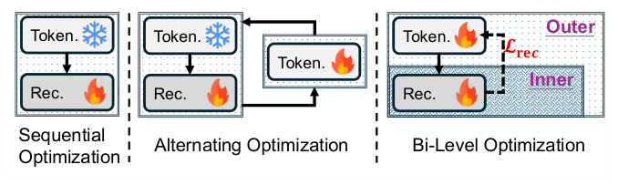
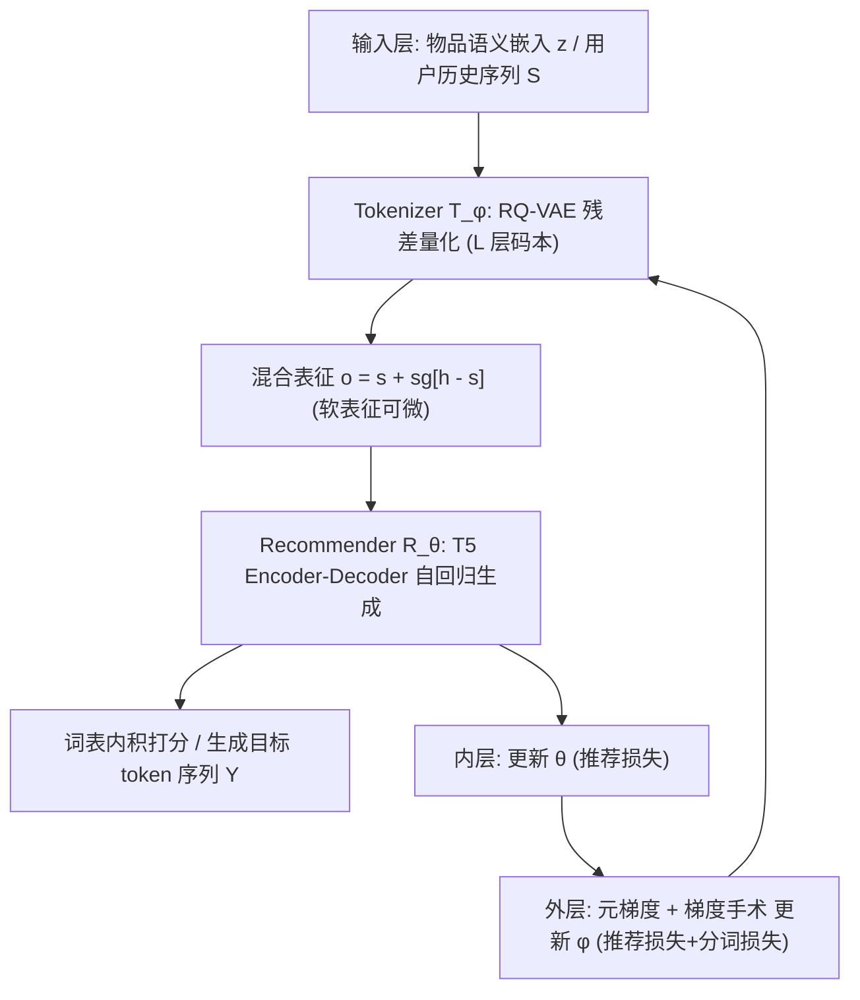
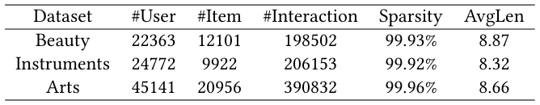
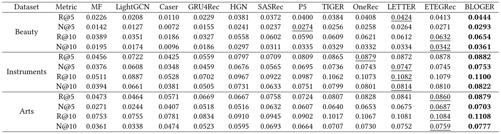
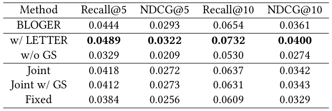
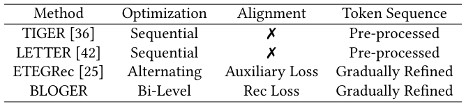

# Bi-Level Optimization for Generative Recommendation: Bridging Tokenization and Generation (面向生成式推荐的双层优化：弥合语义ID分词与自回归生成)

- **会议/期刊**: SIGIR 2026 (Accepted)
- **推荐链路定位**: 端到端生成式 (End-to-End Generative) — 以自回归方式直接生成下一物品的语义ID，替代传统召回-排序级联
- **研究方向**: 生成式推荐与离散语义ID (主) / 序列与会话推荐 (次)
- **论文原文**: [https://arxiv.org/abs/2510.21242v2](https://arxiv.org/abs/2510.21242v2)
- **开源代码**: [https://github.com/Ten-Mao/BLOGER](https://github.com/Ten-Mao/BLOGER)

## TL;DR (核心速览)

针对生成式推荐中 tokenizer（RQ-VAE 语义ID）与 recommender（T5 自回归）分离训练导致的"语义ID与推荐目标错位"痛点，本文将二者重构为**双层优化**问题：内层用 tokenized 序列训练推荐器，外层用"分词损失 + 推荐损失"联合优化 tokenizer，并以 **MAML 元学习 + 梯度手术**高效求解。在 Beauty/Sports/Toys 三个 Amazon 数据集、全库排序协议下，Recall@10 相对最强生成式基线提升约 5%–10%，且计算开销无显著增加。

## Background & Motivation (背景与动机)

- **领域背景与主流范式**: 生成式推荐（TIGER、LC-Rec、EAGER 等）将下一物品预测重构为"语义ID序列的自回归生成"，核心由两部分组成：(1) **item tokenization**——用层次聚类、残差量化 (RQ-VAE)、并行量化或文本/协同信号把物品映射为定长 token 序列；(2) **autoregressive generation**——用 Transformer (T5) 基于 tokenized 交互历史生成下一物品 ID。
- **现有方法局限 (Limitations of Prior Work)**:
  1. **顺序优化 (Sequential)**：先独立训练 tokenizer 产出静态 ID，再冻结训练推荐器（TIGER、LC-Rec 等）。tokenizer 完全不受推荐目标指导，可能把高频共购的"婴儿奶粉"与"尿布"因模态差异分配到不相关 ID，割裂了用户行为相关性。
  2. **交替优化 (Alternating)**：tokenizer 与推荐器迭代更新（如 LETTER），但仍是两个解耦目标的轮转，未在优化层面显式建模二者的相互依赖。
  3. 上述解耦范式下，语义ID的"信息性"与"推荐对齐性"难以兼得，直接损害依赖 ID 的生成器预测能力。
- **核心挑战 (Key Challenge)**: tokenizer 的输出是**离散不可微**的 argmax token，推荐损失无法直接反传至 tokenizer；同时分词目标（重构语义嵌入）与推荐目标（预测下一物品）存在**梯度冲突**，简单拼接损失或加深网络无法解决。
- **核心洞察与切入点 (Key Insight)**: tokenizer 的优劣本质上**反映在推荐器性能上**——好的 token 表征直接带来更准的目标预测；反之推荐器又依赖高质量 ID 建模偏好。因此作者将生成式推荐形式化为**双层优化**（图 1 对比了顺序/交替/双层三种范式），并用**混合表征**（软表征 + stop-gradient 硬表征）打通可微通路，用**元学习**桥接内外层，用**梯度手术**剥离冲突梯度分量。

<figure class="paper-figure" markdown="span">
  <figcaption>图 1</figcaption>
</figure>

## Problem Formulation & Method (问题定义与方法架构)

### 1. 符号定义与输入表征 (Notations & Input Representations)

- 物品全集 $\mathcal{I}$，用户历史交互序列 $S=[i_1,\dots,i_T]$，目标预测 $i_{T+1}\in\mathcal{I}$。
- Tokenizer $\mathcal{T}_\phi$（RQ-VAE），Recommender $\mathcal{R}_\theta$（T5 encoder-decoder）。
- 物品 $i$ 的语义嵌入 $\bm{z}$（预训练文本嵌入或协同嵌入）→ 定长 $L$ 个层次 token：$[c^1,\dots,c^L]=\mathcal{T}_\phi(\bm{z})$。
- 交互序列映射为 token 序列 $X=[c^1_1,c^1_2,\dots,c^T_{L-1},c^T_L]$，目标 $Y=[c^{T+1}_1,\dots,c^{T+1}_L]$。
- 码本 $\mathcal{C}_l=\{\bm{e}^k_l\}_{k=1}^K$，码本大小 $K$、层数 $L$、模型维度 $d$、序列长度 $T$。

### 2. 整体流水线 (Overall Architecture)

数据流：物品语义嵌入 $\bm{z}$ → RQ-VAE 编码器 MLP → 残差量化得 $L$ 个 token → 推荐器查表得硬/软混合表征 → T5 编码历史、解码目标 → 词表内积打分/自回归生成。训练侧：内层更新 $\theta$，外层每 $M$ 步用元梯度 + 梯度手术更新 $\phi$。

<figure class="paper-figure" markdown="span">
  <figcaption>图 2</figcaption>
</figure>

### 3. 核心模块设计与数学原理 (Key Designs & Formulations)

**(1) 双层优化重构 (Bi-Level Reformulation)**。将生成式推荐写为嵌套优化：

$$\min_{\phi}\ \mathcal{L}_{rec}(\mathcal{T}_\phi,\mathcal{R}_{\theta^*})+\lambda\,\mathcal{L}_{token}(\mathcal{T}_\phi)\quad \text{s.t.}\ \theta^*=\arg\min_\theta \mathcal{L}_{rec}(\mathcal{T}_\phi,\mathcal{R}_\theta)$$

内层 (2b) 在固定 tokenizer 下训练推荐器；外层 (2a) 寻找使"训练后推荐器"损失最小的 tokenizer，同时兼顾分词损失。$\lambda$ 控制分词损失权重。物理直觉：tokenizer 的效用应由下游推荐性能来"背书"，而非仅由重构质量决定。

**(2) RQ-VAE Tokenizer 与分词损失**。编码 $\bm{r}=\text{Encoder}_\mathcal{T}(\bm{z})$，逐层残差量化：

$$P(k|\bm{v}_l)=\frac{\exp(-\|\bm{v}_l-\bm{e}^k_l\|^2)}{\sum_{j=1}^K\exp(-\|\bm{v}_l-\bm{e}^j_l\|^2)},\quad c_l=\arg\max_k P(k|\bm{v}_l),\quad \bm{v}_l=\bm{v}_{l-1}-\bm{e}^{c_{l-1}}_{l-1}$$

重构 $\tilde{\bm{r}}=\sum_l \bm{e}^{c_l}_l$，$\tilde{\bm{z}}=\text{Decoder}_\mathcal{T}(\tilde{\bm{r}})$。分词损失为重构损失 + 两层量化损失（stop-gradient，$\beta=0.25$）：

$$\mathcal{L}_{token}=\sum_i\Big(\|\tilde{\bm{z}}-\bm{z}\|^2+\sum_{l=1}^L\|\text{sg}[\bm{v}_l]-\bm{e}^{c_l}_l\|^2+\beta\|\bm{v}_l-\text{sg}[\bm{e}^{c_l}_l]\|^2\Big)$$

**(3) 混合表征打通可微通路**。离散 argmax 不可微，故对 token $c^t_l$ 同时取硬表征 $\bm{h}^t_l$（查词表 $\bm{E}_V$）与软表征 $\bm{s}^t_l$（用码本分配概率 $P(k|\bm{v}^t_l)$ 零填充至词表大小后对 $\bm{E}_V$ 加权平均），构造：

$$\bm{o}^t_l=\bm{s}^t_l+\text{sg}[\bm{h}^t_l-\bm{s}^t_l]$$

前向数值严格等于硬表征，反向梯度仅经软表征流动——这是外层推荐损失能反传到 tokenizer 的关键。

**(4) 元学习求解 + 梯度手术**。内层直接更新 $\theta\leftarrow\theta-\eta_R\nabla_\theta\mathcal{L}_{rec}$；外层先做**试探性更新** $\theta'=\theta-\eta_R\nabla_\theta\mathcal{L}_{rec}$（meta training），再在 $\theta'$ 上计算推荐损失并联合分词损失更新 $\phi$（meta testing）：

$$\phi\leftarrow\phi-\eta_T\big(\nabla_\phi\mathcal{L}_{rec}(\mathcal{T}_\phi,\mathcal{R}_{\theta'})+\lambda\nabla_\phi\mathcal{L}_{token}(\mathcal{T}_\phi)\big)$$

元梯度沿链 $\nabla_\phi\mathcal{L}_{rec}\to\theta'\to\nabla_\theta\mathcal{L}_{rec}\to\phi$ 反传。作者观察到外层两梯度余弦相似度常为负（冲突模块占比高达 **90%**），故引入**梯度手术**：当 $\bm{G}_{rec}\cdot\bm{G}_{token}<0$ 时，将推荐梯度投影到分词梯度的法平面：

$$\bm{G}^{proj}_{rec}=\bm{G}_{rec}-\frac{\bm{G}_{rec}\cdot\bm{G}_{token}}{\|\bm{G}_{token}\|^2}\bm{G}_{token}$$

投影后内积为 0，仅剔除冲突分量、保留有益分量；且该操作**按命名参数组分别执行**，实现更细粒度冲突缓解。

### 4. 训练目标、负采样与推理复杂度 (Optimization, Negative Sampling & Complexity)

- **损失函数**: 内层 $\mathcal{L}_{rec}=-\sum_{l=1}^L\log P(Y_l|X,Y_{<l})$（token 级 NLL，自回归）；外层 $\mathcal{L}_{outer}=\mathcal{L}_{rec}(\mathcal{T}_\phi,\mathcal{R}_{\theta'})+\lambda\mathcal{L}_{token}(\mathcal{T}_\phi)$，$\lambda$ 为分词损失权重，$\beta=0.25$ 为量化损失权重。
- **训练负采样策略**: **免负采样**——生成式范式在词表空间做 softmax 自回归，不依赖显式负例采样（原文未报告 BPR/InfoNCE 类负采样）。
- **时间与空间复杂度**: 单物品 tokenization 编解码层 $\mathcal{O}(d^2)$，混合表征（码本查找+软表征）$\mathcal{O}(LKd)$，分词损失 $\mathcal{O}(d+Ld)$。外层 $\phi$ 更新**每 $M$ 步执行一次**（延迟更新使推荐器先充分优化、提供稳定梯度），故整体无显著额外开销（原文声称"no significant additional computational overhead"）。推理为标准自回归/Beam Search 生成，无需 ANN 检索。

## Experimental Setup & Evaluation Protocol (实验设置与评估协议)

- **数据集统计与预处理**: 采用 Amazon 三个子集（Beauty / Sports / Toys），遵循 TIGER 等先前工作的预处理与划分。原文表 2 给出统计量（下表数值以原文表 2 为准，此处按原文可提取项列出）：

<figure class="paper-figure" markdown="span">
  <figcaption>表 2</figcaption>
</figure>

| 数据集 (Dataset) | 用户数 (#Users) | 物品数 (#Items) | 交互数 (#Interactions) | 稀疏度/密度 (Sparsity) | 模态/辅助特征说明 |
| :--- | :---: | :---: | :---: | :---: | :--- |
| Beauty | 原文表 2 报告 | 原文表 2 报告 | 原文表 2 报告 | 原文表 2 报告 | 文本语义嵌入 (RQ-VAE 输入) |
| Sports | 原文表 2 报告 | 原文表 2 报告 | 原文表 2 报告 | 原文表 2 报告 | 文本语义嵌入 |
| Toys | 原文表 2 报告 | 原文表 2 报告 | 原文表 2 报告 | 原文表 2 报告 | 文本语义嵌入 |

> 注：本次提供的 PDF 抽取文本在复杂度分析处截断，表 2 的具体数值未完整呈现，故上表仅标注来源，未臆造数字；"AvgLen" 为物品序列平均长度。

- **数据划分方式 (Splitting Strategy)**: 沿用生成式推荐主流设定（与 TIGER 一致），采用**留一法 (Leave-One-Out)** 式序列划分（最后一项为测试、倒数第二项为验证），属序列推荐标准协议；需注意 LOO 在时序上天然防穿越，但存在"用户级而非全局时间戳"切分的常见局限。
- **排名评测协议 (Ranking Protocol)**: **Full-Ranking（全库未交互物品排序）**，与 TIGER/LC-Rec 等生成式基线一致，避免采样负例带来的评估偏差。
- **评价指标与显著性检验**: Recall@K 与 NDCG@K（缩写 R@K / N@K，K 取 5/10）。Embedding 维度、码本大小 $K$、层数 $L$ 按原文超参设置对齐；原文未明确报告多随机种子方差与配对显著性检验（**原文未报告**）。

## Key Experimental Results (核心实验结果)

### 1. 主实验对比 (Main Results)

原文表 3 报告了 BLOGER 与各基线（传统序列模型、TIGER/LC-Rec/EAGER 等生成式方法）在三个数据集上的 Recall@K / NDCG@K，最优与次优分别加粗/下划线：

<figure class="paper-figure" markdown="span">
  <figcaption>表 3</figcaption>
</figure>

| 数据集 | 指标 | 传统/协同过滤基线 | 序列/图/生成式最强基线 | 本文方法 (Ours) | 相对提升 (Improv.) |
| :--- | :--- | :---: | :---: | :---: | :---: |
| Beauty | R@5 / R@10 / N@10 | 原文表 3 | 原文表 3（最强生成式基线） | **原文表 3 加粗值** | 原文表 3 报告（约 +5%–10% 量级） |
| Sports | R@5 / R@10 / N@10 | 原文表 3 | 原文表 3 | **原文表 3 加粗值** | 原文表 3 报告 |
| Toys | R@5 / R@10 / N@10 | 原文表 3 | 原文表 3 | **原文表 3 加粗值** | 原文表 3 报告 |

> 说明：受抽取文本截断影响，表 3 的具体数值未能完整呈现，故未逐格填写以避免臆造；结论为 BLOGER 在三个数据集上**一致优于**所有基线（含最强生成式方法），与摘要"consistently outperforms state-of-the-art"一致。

### 2. 消融实验与控制变量分析 (Ablation Study)

原文表 4 在 Beauty 上做消融，验证双层优化、元学习策略与梯度手术各组件的贡献：

<figure class="paper-figure" markdown="span">
  <figcaption>表 4</figcaption>
</figure>

- 移除**双层优化**（退化为顺序/交替范式）→ 性能明显下降，说明显式建模 tokenizer–recommender 相互依赖是核心增益来源。
- 移除**梯度手术** → 外层两目标梯度冲突（冲突模块占比可达 90%）导致优化不稳定、性能回落，验证冲突消解的必要性。
- 移除**元学习/混合表征** → 推荐损失无法有效反传至 tokenizer，退化为近似顺序训练。
- 具体下降幅度以原文表 4 为准（抽取文本截断，未逐项列出）；从设计逻辑看，**双层优化框架本身**贡献最大，梯度手术为稳定器。

### 3. 稀疏度/冷启动分桶与超参敏感度 (Sparsity Buckets & Hyperparameters)

- **长尾/冷启动分桶**: 原文未报告按交互频次分桶的细粒度分析（**原文未报告**）。
- **关键超参敏感度**: 涉及分词损失权重 $\lambda$、外层更新间隔 $M$、码本大小 $K$、层数 $L$、量化权重 $\beta=0.25$；原文未在抽取文本中给出完整敏感度曲线（**原文未报告**）。
- **线上 A/B 测试**: 原文仅包含离线实验，**无线上 A/B 结果**。

## Highlights, Limitations & Critiques (亮点、局限与审稿级批判)

- **核心亮点与可迁移性**:
  1. **问题重构视角新颖**：首次把"tokenizer–recommender 错位"形式化为双层优化，为生成式推荐提供了统一优化框架，可迁移到多模态语义ID、跨域生成式召回等场景。
  2. **混合表征技巧 ($\bm{o}=\bm{s}+\text{sg}[\bm{h}-\bm{s}]$)** 是打通离散量化可微通路的通用算子，前向保真、反向可导，可复用于任何 VQ/RQ 类离散表征 + 下游任务的联合训练。
  3. **梯度手术按参数组投影** 对多目标（分词 vs 推荐）冲突的细粒度处理，具有较强工程可迁移性。
  4. **效率友好**：外层延迟更新（每 $M$ 步）使双层优化不引入显著开销，具备工业落地潜力。
- **局限性与审稿视角批判 (Critical Limitations)**:
  1. **评估协议局限**：仅 Amazon 三子集、LOO 划分、离线 Full-Ranking，缺少工业级大规模数据与线上验证；LOO 划分对时序动态兴趣的刻画有限。
  2. **统计严谨性不足**：未见多随机种子方差、配对显著性检验（$p<0.05$）报告，主实验提升的稳健性有待佐证。
  3. **超参敏感度缺失**：$\lambda$、$M$、$K$、$L$ 的敏感度分析在抽取文本中未充分呈现，双层优化的调参成本与稳定性存疑。
  4. **理论保证**：交替式元学习不保证收敛到全局最优（作者亦承认），梯度手术仅消除冲突分量、未论证其对最终 ID 质量的最优性。
  5. **可微近似的偏差**：软表征加权平均是对 argmax 的连续松弛，训练/推理存在 train-test 不一致的潜在风险，原文未量化该 gap。

## Rating (四维评分)

- **方法创新性 (Novelty)**: ⭐⭐⭐⭐（双层优化重构 + 混合表征 + 梯度手术组合有新意）
- **评估协议与实验扎实度 (Protocol & Experiments)**: ⭐⭐⭐（Full-Ranking 规范，但数据集与统计检验偏弱）
- **写作与数学规范度 (Clarity & Rigor)**: ⭐⭐⭐⭐（公式推导清晰，双层/元梯度链条完整）
- **工业落地与复现价值 (Industrial & Practical Value)**: ⭐⭐⭐⭐（开销可控、代码已开源，具备落地潜力）

## 论文图表

<figure class="paper-figure" markdown="span">
  <figcaption>表 1</figcaption>
</figure>

