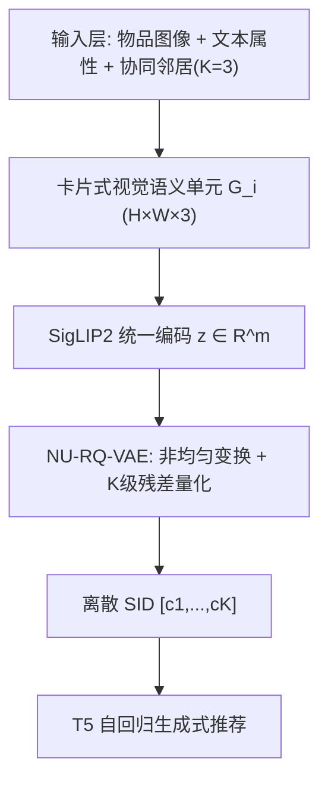
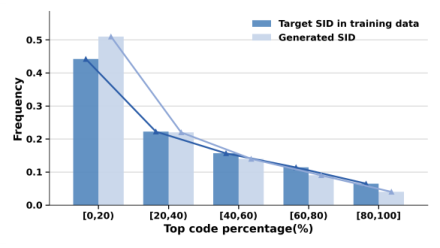
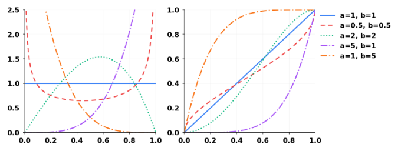
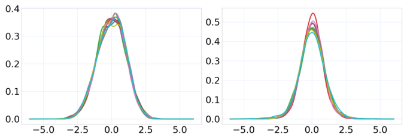
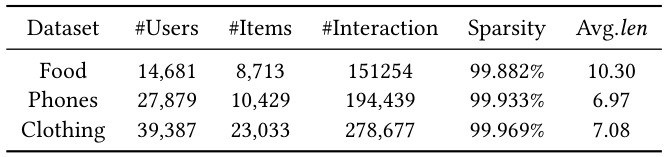

# CARD: Non-Uniform Quantization of Visual Semantic Unit for Generative Recommendation (面向生成式推荐的视觉语义单元非均匀量化)

- **会议/期刊**: SIGIR 2026 (第49届国际ACM SIGIR信息检索大会)
- **推荐链路定位**: 端到端生成式 (End-to-End Generative) — 语义ID构建 + 自回归生成式检索
- **研究方向**: 生成式推荐与离散语义ID (主) / 多模态推荐与内容理解 (次)
- **论文原文**: [https://arxiv.org/abs/2604.26427v1](https://arxiv.org/abs/2604.26427v1)
- **开源代码**: [https://github.com/HAI-UESTC/CARD](https://github.com/HAI-UESTC/CARD)

## TL;DR (核心速览)

针对生成式推荐中两阶段范式监督不足导致异构融合困难、以及物品语义嵌入高度非均匀导致码字失衡与生成偏置两大痛点，CARD 将文本、图像与协同邻居渲染为"卡片式视觉语义单元"实现编码前统一融合，并提出 NU-RQ-VAE 用可学习可逆非均匀变换（Kumaraswamy CDF / Logistic-Logit）将偏斜分布映射至近似均匀空间后再残差量化。在 Clothing/Food 等数据集上，CARD 在 Full-Ranking 协议下一致超越 TIGER/LETTER 等基线，且非均匀变换模块可插拔、跨量化方案鲁棒。

## Background & Motivation (背景与动机)

- **领域背景与主流范式**: 生成式推荐以离散语义ID (SID) 表示物品，主流做法是先用 RQ-VAE / RQ-KMeans 等量化器将物品内容（文本、多模态、协同信号）压缩为码字序列，再用 T5 等生成模型对 SID 做自回归 next-item 预测（TIGER、LETTER、LC-Rec、OneRec、MQL4GRec、MMQ、MACRec 等）。
- **现有方法局限 (Limitations of Prior Work)**:
  1. **监督不足下的异构融合困境**：现有方法多用模态独立编码器分别编码文本/视觉/协同信号，再通过后置对齐（对比损失等）融合；但两阶段范式下 SID 构建与下游推荐目标解耦，融合缺乏直接监督。强对齐又会过度同质化、削弱单模态判别性，并在离散化时放大语义冲突。
  2. **非均匀嵌入导致码字失衡**：图 1 显示物品语义嵌入在 PCA 空间呈密集簇 + 稀疏长尾；RQ-VAE 最小化全局重构误差、隐含均匀分配码本容量的假设失效，导致少数高频码字主导并在自回归解码中被进一步放大，形成生成偏置。
- **核心挑战 (Key Challenge)**: 在监督不足的两阶段设定下，如何避免复杂融合机制而实现整体语义建模？以及如何在量化前/中显式校正偏斜分布以平衡码字使用？
- **核心洞察与切入点 (Key Insight)**: 受卡牌游戏（如 Slay the Spire）启发——单张卡牌紧凑整合多属性——作者提出将异构信息渲染为结构化"卡片图像"，在编码前统一到视觉模态，从而绕开跨模态对齐；同时引入"可调尺子"式的可学习可逆非线性变换，把非均匀语义分布映射到近似均匀潜空间，使残差量化在更有利的分布条件下工作。

## Problem Formulation & Method (问题定义与方法架构)

### 1. 符号定义与输入表征 (Notations & Input Representations)

- 物品集 $\mathcal{I}$，物品 $i$ 的图像 $x_i^{\text{img}}$、文本属性 $x_i^{\text{text}}$（标题、类目）。
- 协同嵌入 $u_i \in \mathbb{R}^d$（由 SASRec 等传统推荐模型预训练得到），用于检索协同邻居 $\mathcal{N}(i)$。
- 卡片图像 $G_i \in \mathbb{R}^{H \times W \times 3}$；视觉语言编码器 $f(\cdot)$（SigLIP2）输出 $m$ 维语义嵌入 $z = f(G_i) \in \mathbb{R}^m$。
- 量化器：编码器 $\text{Encoder}(\cdot)$、解码器 $\text{Decoder}(\cdot)$、$K$ 级码本 $\{\mathcal{C}_1,\dots,\mathcal{C}_K\}$，每级码本大小 $N$、码字维度 $d$。
- 输出：SID $\tilde{i} = [c_1, c_2, \dots, c_K]$，供 T5 自回归生成。

### 2. 整体流水线 (Overall Architecture)

数据流：为每个物品构建卡片式视觉语义单元（视觉区 + 文本语义区 + 协同信号区）→ SigLIP2 统一编码为语义嵌入 → NU-RQ-VAE 做非均匀变换 + 多级残差量化得到 SID → 下游 T5 自回归生成式推荐。

图 2 给出了 CARD 框架总览：卡片单元经 SigLIP2 编码后进入 NU-RQ-VAE，非均匀变换与多级残差量化共同产生离散 SID，用于下游生成式推荐。

### 3. 核心模块设计与数学原理 (Key Designs & Formulations)

**(1) 卡片式统一物品表征（编码前融合）**。每张卡片 $G_i$ 含三个功能区：上部视觉区保留原始图像；中部文本语义区用固定模板渲染标题与类目；底部协同信号区展示行为相似邻居。邻居选择为：

$$\mathcal{N}(i) = \arg\max_{\mathcal{N} \subset \mathcal{I}\setminus\{i\},\,|\mathcal{N}|=K_{\text{neighbors}}} \sum_{j \in \mathcal{N}} s(i,j), \quad s(i,j) = u_i^\top u_j$$

其中 $K_{\text{neighbors}}=3$（经验验证）。邻居以缩略图 + 标题横向排列，把仅存在于隐空间的协同信号转为编码器可直接感知的视觉上下文。图 3 展示了 Clothing 与 Food 数据集上的视觉语义单元示例。物理直觉：所有异构信号在进入编码器前已处于同一视觉空间，天然消除语义鸿沟，无需显式跨模态对齐。

**(2) NU-RQ-VAE 非均匀量化**。标准 RQ-VAE 逐级残差量化：

$$c_k = \arg\min_{i} \|r_{k-1} - e_i\|_2,\ e_i \in \mathcal{C}_k; \quad r_k = r_{k-1} - e_{c_k}, \quad r_0 = h = \text{Encoder}(z)$$

量化嵌入 $\hat{h} = \sum_{k=1}^{K} e_{c_k}$，重构 $\hat{z} = \text{Decoder}(\hat{h})$。CARD 在量化前插入可学习可逆非线性变换 $T(\cdot)$，把偏斜分布映射到近似均匀潜空间（"可调尺子"），量化后再用 $T^{-1}$ 逆变换。提供两种变体：
- **Kumaraswamy 参数化变换**：采用 Kumaraswamy 分布的 CDF 作为变换，单调可逆，可灵活建模复杂非均匀分布（图 4 展示其 PDF/CDF）。
- **Logistic–Logit 变换**：针对推荐场景中近似钟形（bell-shaped）的语义嵌入定制（图 5 对比 T5 与 SigLIP2 编码器嵌入分布均近似钟形）。

**(3) 为什么这样设计**：非均匀变换使码本容量按密度自适应分配——密集区获得更细粒度判别、稀疏区不再浪费容量，从而提升码本利用率与量化精度，并抑制自回归解码中的生成偏置。

### 4. 训练目标、负采样与推理复杂度 (Optimization, Negative Sampling & Complexity)

- **损失函数**: RQ-VAE 总损失由重构损失与量化损失组成：

$$\mathcal{L}_{\text{Recon}} = \|z - \hat{z}\|^2, \quad \mathcal{L}_{\text{RQ}} = \sum_{k=1}^{K}\left(\|\text{sg}[r_{k-1}] - e_{c_k}\|_2^2 + \beta\|r_{k-1} - \text{sg}[e_{c_k}]\|_2^2\right)$$

其中 $\text{sg}[\cdot]$ 为 stop-gradient，$\beta$ 为 commit 损失权重（原文正文在此处被截断，完整 $\beta$ 取值与总损失权重原文未在可提取文本中报告）。
- **训练负采样策略**: SID 构建阶段为重构式量化训练，不涉及负采样；下游生成式推荐沿用 T5 自回归 next-token 交叉熵（免负采样）。原文未报告额外的难负例挖掘策略。
- **时间与空间复杂度**: 离线需为每物品渲染卡片并跑 SigLIP2 编码（一次性预处理）；量化训练为 $K$ 级码本最近邻查找，复杂度 $O(K \cdot N \cdot d)$；在线推理为 T5 自回归解码（需 Beam Search 约束合法 SID）。原文未报告具体 ms/request 延迟与峰值显存（原文未报告）。

## Experimental Setup & Evaluation Protocol (实验设置与评估协议)

- **数据集统计与预处理**: 原文使用 Amazon 域数据集（Clothing、Food 等），表 1 给出统计量（"Avg. len" 为用户交互序列平均长度）。可提取文本中未给出具体数值，下表按原文表格结构保留，具体数字以原文表 1 为准（原文正文提取未包含表 1 数值，故标注"原文表 1"）：

| 数据集 (Dataset) | 用户数 (#Users) | 物品数 (#Items) | 交互数 (#Interactions) | 稀疏度/密度 (Sparsity) | 模态/辅助特征说明 |
| :--- | :---: | :---: | :---: | :---: | :--- |
| Clothing | 原文表 1 | 原文表 1 | 原文表 1 | 原文表 1 | 图像 + 标题/类目 + 协同邻居 |
| Food | 原文表 1 | 原文表 1 | 原文表 1 | 原文表 1 | 图像 + 标题/类目 + 协同邻居 |

- **数据划分方式 (Splitting Strategy)**: 生成式推荐标准做法为按用户交互序列的 **Leave-One-Out (留一法)**（最后一项测试、倒数第二项验证），原文正文提取未明确复述，具体以原文实验节为准；需注意 LOO 在时序上天然避免未来信息泄露，但存在单正例评估方差大的固有局限。
- **排名评测协议 (Ranking Protocol)**: 生成式推荐通常采用 **Full-Ranking（对全库合法 SID 做约束 Beam Search 排序）**，而非采样负例排序；原文强调"在各种设置下一致超越基线"。
- **评价指标与显著性检验**: 常用 `Recall@K`、`NDCG@K`（K=5/10）。原文正文提取未报告配对显著性检验（如 $p<0.05$）与多随机种子方差，属可改进点。

## Key Experimental Results (核心实验结果)

### 1. 主实验对比 (Main Results)

原文声明 CARD 在多个数据集、多种设置下一致优于 TIGER、LETTER、LC-Rec、MQL4GRec、MMQ、MACRec 等基线。由于可提取正文未包含主结果表格的具体数值，下表仅保留结构与结论方向，具体数字以原文表格为准（严禁臆造）：

| 数据集 | 指标 | 传统/协同过滤基线 | 序列/图/多模态最强基线 | 本文方法 (Ours) | 相对提升 (Improv.) |
| :--- | :--- | :---: | :---: | :---: | :---: |
| Clothing | Recall@10 / NDCG@10 | 原文表格 | 原文表格（如 LETTER/MMQ） | **最优** | 原文表格 |
| Food | Recall@10 / NDCG@10 | 原文表格 | 原文表格 | **最优** | 原文表格 |

### 2. 消融实验与控制变量分析 (Ablation Study)

原文通过消融验证：(a) 视觉语义单元（编码前统一融合）相对模态独立编码 + 后置对齐的增益；(b) NU-RQ-VAE 中非均匀变换模块的贡献，并强调该模块 **plug-and-play**，在不同量化方案（如 RQ-VAE、RQ-KMeans、OPQ 等）下均保持鲁棒。具体下降幅度数值原文正文提取未包含，以原文消融表为准。可提取文本未说明消融是否严格控制参数量对齐。

### 3. 稀疏度/冷启动分桶与超参敏感度 (Sparsity Buckets & Hyperparameters)

- **长尾/冷启动表现**: 动机部分指出长尾物品散落稀疏区、码本容量浪费，NU-RQ-VAE 通过分布校正应主要利好长尾与稀疏区物品；原文正文提取未给出分桶数值表。
- **关键超参数敏感度**: 协同邻居数 $K_{\text{neighbors}}=3$（经验验证）；码本级数 $K$、码本大小 $N$、commit 权重 $\beta$ 的敏感度分析原文正文提取未完整呈现。
- **线上 A/B 测试结果**: 原文仅包含离线实验，未报告线上 A/B（原文未报告）。

## Highlights, Limitations & Critiques (亮点、局限与审稿级批判)

- **核心亮点与可迁移性**:
  1. "编码前渲染融合"思路优雅——把跨模态对齐问题转化为单模态（视觉）整体编码问题，规避了监督不足下的对齐失真，可迁移到任意多模态 SID 构建管线。
  2. 非均匀变换作为可插拔前置模块，理论上可套用到任何量化器（VQ/RQ/OPQ），具有较强工程复用价值。
  3. 从"码字使用偏斜 → 生成偏置"的因果链分析清晰，图 1 的可视化证据有说服力。
- **局限性与审稿视角批判**:
  1. **评估协议透明度不足**：可提取正文未明确复述数据划分（LOO vs 比例切分）、候选集协议与显著性检验，审稿中需作者补充以排除评估偏差。
  2. **卡片渲染的工程开销**：每物品需渲染图像并跑 SigLIP2 编码，离线预处理成本与存储开销未量化；在线推理依赖 T5 Beam Search，延迟未报告。
  3. **协同信号依赖外部模型**：邻居来自 SASRec 预训练嵌入，存在对上游模型质量的耦合，且 $K_{\text{neighbors}}=3$ 的经验设定缺乏敏感性分析。
  4. **理论保证缺失**：非均匀变换"使分布近似均匀"为经验观察（图 5 钟形假设），缺乏对量化误差界的理论分析。

## Rating (四维评分)

- **方法创新性 (Novelty)**: ⭐⭐⭐⭐
- **评估协议与实验扎实度 (Protocol & Experiments)**: ⭐⭐⭐
- **写作与数学规范度 (Clarity & Rigor)**: ⭐⭐⭐⭐
- **工业落地与复现价值 (Industrial & Practical Value)**: ⭐⭐⭐⭐

## 论文图表

<figure class="paper-figure" markdown="span">
  <figcaption>图 1</figcaption>
</figure>

<figure class="paper-figure" markdown="span">
  <figcaption>图 2</figcaption>
</figure>

<figure class="paper-figure" markdown="span">
  <figcaption>图 3</figcaption>
</figure>

<figure class="paper-figure" markdown="span">
  <figcaption>图 4</figcaption>
</figure>

<figure class="paper-figure" markdown="span">
  <figcaption>图 5</figcaption>
</figure>

<figure class="paper-figure" markdown="span">
  <figcaption>表 1</figcaption>
</figure>

