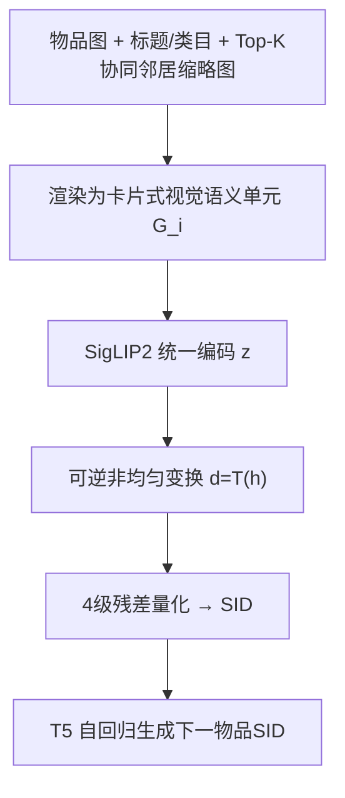
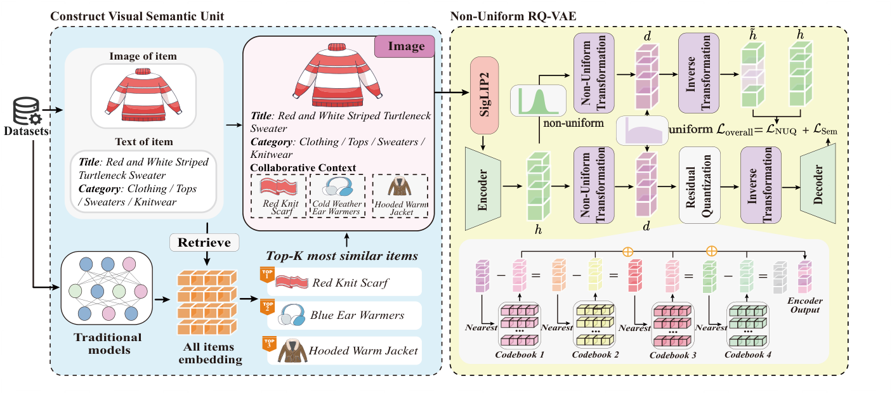

# CARD: Non-Uniform Quantization of Visual Semantic Unit for Generative Recommendation (视觉语义单元的非均匀量化生成式推荐)

- **会议/期刊**: SIGIR 2026
- **作者与机构**: Yibiao Wei, Jie Zou, Pengfei Zhang, Xiao Ao, Weikang Guo, Zeyu Ma, Yang Yang（电子科技大学、西南财经大学）
- **推荐链路定位**: 端到端生成式（SID 构建 + 自回归生成）
- **研究方向**: 生成式推荐与离散语义ID / 多模态推荐
- **论文原文**: [https://arxiv.org/abs/2604.26427v1](https://arxiv.org/abs/2604.26427v1)
- **开源代码**: [https://github.com/HAI-UESTC/CARD](https://github.com/HAI-UESTC/CARD)

## TL;DR (1分钟核心速览)

生成式推荐的两阶段范式（先建 SID 再自回归生成）对异构模态融合监督不足，且物品语义嵌入高度非均匀，导致码字分配失衡与生成偏差。CARD 提出"视觉语义单元"：把标题文本、商品图与协同邻居缩略图渲染成一张结构化卡片图，用 SigLIP2 统一编码，实现编码前融合；再用 NU-RQ-VAE 在量化前插入可学习可逆非均匀变换（Kumaraswamy CDF 或 Scaled Logistic/Logit），把偏斜分布拉回近似均匀空间。在 Amazon 三数据集 Leave-One-Out + Full-Ranking 协议下，Recall@10 相对最强基线 MACRec 提升 9.5%（Food）、3.5%（Phones）、7.1%（Clothing），且非均匀变换对 R-VQ/RQ-VAE 均可插拔增益最高 15.74%。

## Background & Motivation (背景与核心矛盾)

- **主流范式**: TIGER/LETTER/LC-Rec 等用 RQ-VAE 将物品文本量化成层级 SID，再由 T5 自回归生成下一物品的码序列；近期工作（MQL4GRec、MACRec）进一步把多模态与协同信号塞进量化过程。
- **前人局限一**: 各模态用独立编码器 + 事后对齐（对比损失/拼接），而 SID 学习与下游推荐目标解耦、监督信号稀薄，强对齐又会抹平模态差异，离散化时语义冲突被放大。
- **前人局限二**: RQ-VAE 的全局重构损失隐含"嵌入空间近似均匀"假设，但真实物品嵌入呈密集簇 + 长尾稀疏（图1左），少数高频码字主导并在自回归解码中被进一步放大（图1右），形成生成偏差。
- **核心洞察 (Key Insight)**: 若在**编码前**就把异构信号统一到同一视觉模态，可绕开复杂融合机制；若在**量化前**用单调可逆变换把偏斜分布重参数化为近似均匀，则码本容量可按密度自适应分配。
- **本文切入点**: 借鉴卡牌游戏"一张卡承载多重属性"的直觉，构造卡片式视觉语义单元 + 分布感知的非均匀残差量化。

## Method (核心方法设计)

### 1. 整体框架 (Overall Architecture)

对每个物品 $i$，先离线用 SASRec 学协同嵌入，取 Top-$K$相似邻居；再把原图（上区）、标题/类目文本面板（中区）、邻居缩略图与标题（下区）渲染成一张$512\times512$卡片图$G_i$。SigLIP2 编码得$\mathbf{z}=f(G_i)$，经 NU-RQ-VAE 的编码器与可逆非均匀变换后做 4 级残差量化，得到 SID$[c_1,\dots,c_4]$；解码端逆变换回原语义空间重构。下游把用户历史交互序列转成码序列，用 T5 以 token 级负对数似然自回归预测下一物品 SID，推理时 beam search 解码。

<figure class="paper-figure" markdown="span">
  <figcaption>图2：CARD框架概览。CARD通过在图像模态内统一视觉、文本和协同信号，为每个物品构建视觉语义单元。每个单元由SigLIP2编码，并经非均匀残差量化变分自编码器（NU-RQ-VAE）处理，其中非均匀变换和多级残差量化产生离散SID。这些SID用于下游生成式推荐。</figcaption>
</figure>

### 2. 关键设计拆解 (Key Designs)

1. **视觉语义单元（编码前融合）**：痛点是非端到端两阶段下跨模态对齐缺乏下游监督、事后融合易产生语义鸿沟。做法是把三路信号渲染进同一张图，让单一视觉编码器直接建模整体语义，无需显式对齐损失。直觉上，SigLIP2 在大规模图文对上预训练，能从结构化卡片中稳定抽取文本语义（表6 验证 TIGER+Unit-T 与 TIGER+T5 性能相当，说明渲染不引入明显语义损失），从而把"融合"从模型结构问题降级为"输入构造"问题。

2. **NU-RQ-VAE 非均匀量化**：痛点是非均匀嵌入下全局重构损失导致密集区码本不够用、稀疏区码本闲置。做法是在量化前插入单调可逆变换 $\mathbf{d}=T(\mathbf{h})$，量化在近似均匀空间进行，解码前用$T^{-1}$ 还原：
$$\mathbf{d}=T(\mathbf{h}),\quad c_k=\arg\min_{i}\|\mathbf{r}_{k-1}-\mathbf{e}_i\|_2,\quad \hat{\mathbf{h}}=T^{-1}(\hat{\mathbf{d}})$$
提供两个变体：Kumaraswamy CDF $F_{\text{KS}}(x;a,b)=1-(1-x^a)^b$（闭式逆、表达力接近 Beta 但计算更省），以及针对钟形嵌入（图5）的 Scaled Logistic/Logit 逐维变换。直觉是"可调标尺"——按局部密度拉伸/压缩坐标轴，使码字分配与语义密度匹配。

3. **训练目标、负采样与推理效率**：量化阶段损失为
$$\mathcal{L}_{\text{overall}}=\mathcal{L}_{\text{Recon}}+\mathcal{L}_{\text{RQ}}+\lambda_{\text{NUQ}}\left\|T^{-1}(T(\mathbf{h}))-\mathbf{h}\right\|_2^2$$
其中 NUQ 一致性损失保证变换可逆稳定，$\lambda_{\text{NUQ}}\in[0.1,1]$。生成阶段为 token 级 NLL，**无负采样**（全库 softmax 由 SID 词表隐式承担）。推理为 beam search 逐码解码，开销与 TIGER 同阶，额外成本仅在离线 SID 构建时的变换与逆变换。

## Experimental Setup & Evaluation Protocol (实验设置与评估协议)

- **数据集与预处理**: 三个 Amazon 类目，均做 `5-core` 过滤，交互序列截断/填充至长度 20（保留最近交互）。

| 数据集 | #Users | #Items | #Interactions | 稀疏度 | 场景说明 |
| :--- | :---: | :---: | :---: | :---: | :--- |
| Food | 14,681 | 8,713 | 151,254 | 99.882% | 杂货美食，图文信息丰富 |
| Phones | 27,879 | 10,429 | 194,439 | 99.933% | 手机配件，类目集中 |
| Clothing | 39,387 | 23,033 | 278,677 | 99.969% | 服饰鞋包，视觉差异大 |

- **数据划分与防穿越**: `Leave-One-Out`——每用户最近一次交互作测试、倒数第二次作验证、其余训练。
- **排名评测协议**: 无偏 `Full-Ranking`（全物品集排序），指标 Recall@$\{5,10,20\}$与 NDCG@$\{5,10,20\}$。
- **对比基线与超参**: 传统序列模型 GRU4Rec/HGN/BERT4Rec/SASRec，生成式 VQ-Rec/TIGER/LETTER/MQL4GRec/MACRec；NU-RQ-VAE 编解码为 3 层 MLP，$K=4$码本 × 256 码字 × 32 维，T5 编解码各 4 层 6 头（$d=64$），AdamW，学习率 0.001，batch 1024；显著性用配对 t 检验（$p\le 0.01$）。

## Key Experimental Results (实验关键数据)

### 1. 主实验对比 (Main Results)

| 数据集 | 指标 | SASRec | TIGER | LETTER | MQL4GRec | MACRec | CARD$_K$| CARD$_S$ | Improv.% |
| :--- | :--- | :---: | :---: | :---: | :---: | :---: | :---: | :---: | :---: |
| Food | R@10 | 0.0596 | 0.0617 | 0.0683 | 0.0697 | 0.0779 | 0.0819 | **0.0853** | +9.50% |
| Food | N@10 | 0.0286 | 0.0327 | 0.0362 | 0.0369 | 0.0410 | 0.0428 | **0.0462** | +12.68% |
| Phones | R@10 | 0.0762 | 0.0794 | 0.0830 | 0.0838 | 0.0850 | **0.0904** | 0.0880 | +6.35% |
| Phones | N@10 | 0.0405 | 0.0425 | 0.0443 | 0.0441 | 0.0453 | **0.0486** | 0.0474 | +7.28% |
| Clothing | R@10 | 0.0223 | 0.0257 | 0.0263 | 0.0273 | 0.0281 | 0.0297 | **0.0301** | +7.12% |
| Clothing | N@10 | 0.0102 | 0.0113 | 0.0110 | 0.0135 | 0.0133 | **0.0150** | 0.0145 | +11.11% |

（Improv.% 为最优 CARD 变体相对最强基线 MACRec 的相对提升；所有 CARD 结果在 $p\le0.01$ 下显著。）

### 2. 消融实验 (Ablation Study)

| 变体 | Food R@5 | Food R@10 | Phones R@5 | Phones R@10 |
| :--- | :---: | :---: | :---: | :---: |
| CARD$_K$ 完整 | **0.0520** | **0.0819** | **0.0596** | **0.0904** |
| w/o Unit-V（去图像区） | 0.0452 | 0.0711 | 0.0564 | 0.0835 |
| w/o Unit-T（去文本区） | 0.0463 | 0.0732 | 0.0557 | 0.0820 |
| w/o Unit-C（去协同区） | 0.0491 | 0.0768 | 0.0571 | 0.0863 |
| w/o Unit（退化为纯文本） | 0.0432 | 0.0683 | 0.0542 | 0.0809 |
| w/o NUT（退化为标准 RQ-VAE） | 0.0478 | 0.0745 | 0.0560 | 0.0841 |

### 3. 关键实验发现 (Key Findings)

1. **统一视觉单元是主增益来源，且三路信号互补**：去掉整个单元（w/o Unit）使 Food R@10 从 0.0819 跌至 0.0683（-16.6%），跌幅远超单独去掉任一区域（-6.2% ~ -10.6%），说明图像、文本、协同三区并非冗余，而是共同构成量化友好的语义基底。
2. **非均匀变换是正交增益且可插拔**：w/o NUT 使 Food R@10 降 9.0%；把变换移植到 R-VQ 与 RQ-VAE 上分别带来最高 +14.26% 与 +15.74% 的相对提升（表5），证明其与量化器无关，是分布层面的通用修正。
3. **码本利用率与生成偏差同步改善**：有效码字数从 TIGER 的 70、CARD w/o NUT 的 132 提升到 CARD 的 249（图8），生成 SID 的码字频率分布更贴近训练目标分布，直接对应生成偏差的缓解。

## Highlights & Limitations (亮点、对比与审稿批判)

- **与代表作对比 (vs. Prior Work)**: 相比 TIGER（纯文本 RQ-VAE）与 LETTER（协同信号 + 可学习 tokenization），CARD 把融合从"多编码器 + 事后对齐"前移到"输入渲染"；相比 MACRec（跨模态量化 + 多面对齐），CARD 不做显式对齐损失，而是靠统一视觉空间天然消解语义鸿沟，管线更简单。
- **可迁移亮点**: (1) 非均匀变换作为即插即用模块，可直接套到任何 VQ/RQ 类 SID 构建器上；(2) "把异构特征渲染成结构化图像再交给 VLM 编码"这一 trick 可迁移到多模态冷启动与跨域物品表征。
- **审稿级局限批判**: (1) 卡片布局（区域划分、邻居数 $K=3$、$512\times512$ 分辨率）依赖人工先验，论文自认未来需自动化构造，超参敏感度未充分扫描；(2) 离线需为每个物品渲染并过一遍 SigLIP2，物品库大时 SID 构建成本与存储开销显著，论文未给出量化对比；(3) 仅在三个 Amazon 类目上验证，缺少工业级大规模与冷启动分桶实验。

## Rating (四维评分)

- **方法创新性 (Novelty)**: ⭐⭐⭐⭐ （"编码前视觉融合 + 分布感知可逆量化"组合新颖，且有 PCA 分布与码字频率的实证支撑，但单点技术均有先例）
- **评估协议与实验扎实度 (Protocol & Experiments)**: ⭐⭐⭐⭐ （三数据集 Full-Ranking + 配对 t 检验 + 双变体消融 + 插拔性实验完整，缺冷启动与长尾分桶分析）
- **写作与数学规范度 (Clarity & Rigor)**: ⭐⭐⭐⭐ （变换的闭式正逆与一致性损失推导清晰，RQ-VAE 部分复述略多，复杂度分析缺失）
- **工业落地与复现价值 (Industrial & Practical Value)**: ⭐⭐⭐⭐ （代码已开源、变换模块即插即用，但离线渲染 + VLM 编码的构建成本是落地主要门槛）
