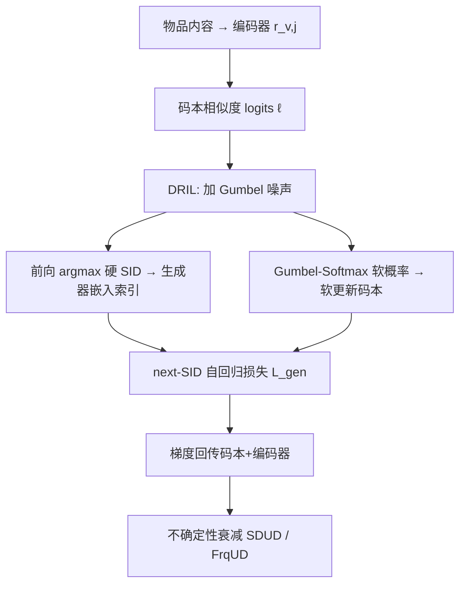

# Differentiable Semantic ID for Generative Recommendation (面向生成式推荐的可微语义ID)

- **会议/期刊**: SIGIR 2026
- **作者与机构**: Junchen Fu, Xuri Ge, Alexandros Karatzoglou, Ioannis Arapakis, Suzan Verberne, Joemon M. Jose, Zhaochun Ren（University of Glasgow / Shandong University / Amazon / Telefónica / Leiden University）
- **推荐链路定位**: 端到端生成式（语义ID 分词器 + 自回归生成器）
- **研究方向**: 生成式推荐与离散语义ID / 自监督与码本利用
- **论文原文**: [https://arxiv.org/abs/2601.19711v3](https://arxiv.org/abs/2601.19711v3)
- **开源代码**: [https://github.com/junchen-fu/DIGER](https://github.com/junchen-fu/DIGER)

## TL;DR (1分钟核心速览)

生成式推荐中 RQ-VAE 语义ID（SID）只按内容重建目标训练后即冻结，推荐损失无法回传，形成索引-推荐目标错配；而直接用 STE 打通梯度又会引发码本坍缩。本文提出 DIGER：以 Gumbel 噪声做前向硬索引、软概率回传梯度（DRIL），再用 SDUD/FrqUD 两种不确定性衰减策略从探索平滑过渡到利用。在 B-Shop/I-Shop/Yelp 三数据集、Leave-One-Out + Full-Ranking 协议下，R@10 相对 TIGER 分别提升 12.0%/7.6%/6.1%，且码本利用率显著更均衡。

## Background & Motivation (背景与核心矛盾)

- **主流范式**: TIGER/LETTER 等两阶段流水线先用 RQ-VAE 以重建损失学离散码本、给物品分配定长 SID，再冻结 SID 训练 Transformer 做 next-SID 自回归预测。
- **前人局限**: 其一，索引损失与推荐损失独立优化，推荐梯度被离散算子阻断，SID 只为"重建得像"而非"排得准"服务；其二，ETEGRec 用交替蒸馏绕开离散性，但仍是间接代理目标，梯度阻断的核心错配未解。
- **核心洞察 (Key Insight)**: 作者从理论上证明两阶段等价于在受限参数子集 $\mathcal{A}$上做$\inf_{\phi\in\mathcal{A}} g(\phi)$（$g(\phi)=\inf_\theta \mathcal{L}_{rec}(\theta,\phi)$），当$\mathcal{A}$不含联合最优时次优间隙可任意大；同时指出 STE 的确定性硬分配对应低熵选择分布，熵越低有效码数$\mathrm{Eff}(q)=\exp(H(q))$ 越小，这正是坍缩的根源。
- **本文切入点**: 用"提高分配熵"作为可微 SID 的正则化原理，以 Gumbel 噪声注入 logits 实现受控探索，再逐步退火回到确定性推理。

## Method (核心方法设计)

### 1. 整体框架 (Overall Architecture)

物品内容经编码器得到连续表示 $\boldsymbol{r}_{v,j}$，与码本$\{\boldsymbol{e}_i\}_{i=1}^{K}$算相似度 logits；DRIL 在 logits 上加 Gumbel 噪声后取 argmax 得硬 SID 供生成器索引嵌入表，同时用 Gumbel-Softmax 软概率加权码本向量完成软更新，使$\mathcal{L}_{gen}$的梯度可穿过离散选择回传到码本与编码器。训练全程联合优化$\mathcal{L}_{gen}+\mathcal{L}_{vq}+\mathcal{L}_{recon}$（去掉 RQ-VAE 解码器，重建项直接在量化表示上算），并由不确定性衰减策略在训练后期压低噪声，使训练期采样 SID 与推理期 argmax SID 趋于一致。

### 2. 关键设计拆解 (Key Designs)

1. **DRIL：Gumbel 噪声驱动的可微硬-软分离**：痛点在于 STE 的硬更新只把梯度送给被选中码，早期过度自信导致坍缩。本文前向取 $\tilde{y}_{v,j,i}=\frac{\exp((\ell_{v,j,i}+g_{v,j,i})/\tau)}{\sum_k \exp((\ell_{v,j,k}+g_{v,j,k})/\tau)}$、$c_{v,j}=\arg\max_i(\ell_{v,j,i}+g_{v,j,i})$得硬 SID，反向用软嵌入$\bar{\boldsymbol{e}}_{v,j}=\sum_{i=1}^{K}\tilde{y}_{v,j,i}\boldsymbol{e}_i$ 让梯度按概率流向全部码本。直觉：Gumbel 分布天然逼近类别采样，高相似码被指数级更可能选中，既保留探索又维持可微。

2. **SDUD：把噪声尺度与任务损失耦合**：痛点在于固定噪声会让训练分布与确定性推理长期错配。作者构造 $\mathcal{L}_\sigma=\frac{\mathcal{L}_{gen}}{2(\sigma+\lambda)^2}+\log(\sigma+\lambda)$，令$\partial\mathcal{L}_\sigma/\partial\sigma=0$得闭式平衡$\sigma^\star=\max\{0,\sqrt{\mathcal{L}_{gen}}-\lambda\}$。直觉：$\mathcal{L}_{gen}$下降时最优噪声自动收缩，$\sqrt{\mathcal{L}_{gen}}\approx\lambda$时$\sigma^\star\to 0$，无需人工调退火日程。

3. **FrqUD：按码频定向加噪**：痛点在于全局退火无法针对性地救"冷码"。用 EMA 估计使用频率 $f_i^{(e)}\leftarrow\beta f_i^{(e-1)}+(1-\beta)\hat{f}_i^{(e)}$，以$\gamma=r\bar{f}=r/K$为热码阈值，仅对$i\in\mathcal{I}_{high}$ 保留 Gumbel 噪声、对冷码用确定性 softmax。直觉：只扰动被过度复用的码，冷码保持与推理一致，天然兼顾均衡与训练-推理一致性。

**训练目标与开销**：总损失 $\mathcal{L}=\mathcal{L}_{gen}+\mathcal{L}_{vq}+\mathcal{L}_{recon}$，预训练 RQ-VAE 初始化后后两项量级较小，更新主要由$\mathcal{L}_{gen}$ 驱动；生成式范式免负采样。推理时确定性 argmax 生成 SID 再映射回物品，额外开销仅为一次码本相似度计算，与 TIGER 同阶。

## Experimental Setup & Evaluation Protocol (实验设置与评估协议)

- **数据集与预处理**: 沿用 LETTER 的 LLaMA-7B 内容生成管线，过滤交互数 $<5$ 的用户与物品（5-core）：

| 数据集 | #Users | #Items | #Interactions | 稀疏度 | 特征/场景说明 |
| :--- | :---: | :---: | :---: | :---: | :--- |
| B-Shop | 22,363 | 12,101 | 198,502 | 0.9993 | 美妆商品评论+商品文本 |
| I-Shop | 24,772 | 9,922 | 206,153 | 0.9992 | 音乐类商品评论+商品文本 |
| Yelp | 30,431 | 20,033 | 304,524 | 0.9995 | 餐厅评论，用店名+品类作内容 |

- **数据划分与防穿越**: `Leave-One-Out`（最后一条交互为测试、倒数第二条为验证），与 TIGER/LETTER/ETEGRec 保持一致。
- **排名评测协议**: 无偏 `Full-Ranking`，预测物品对全物品集排序，指标 Recall@{5,10} 与 NDCG@{5,10}。
- **对比基线与超参设置**: 基线覆盖 MF/LightGCN/Caser/HGN/SASRec/BERT4Rec 等传统方法，BIGRec/P5-SID/P5-CID/TIGER/LETTER/ETEGRec 等生成式方法，外加 Two-Stage 与 STE 两个直接对照；码本 $K=256$、SID 长度$m=3$（+1 冲突码），T5 式 6+6 层、隐层 128，Gumbel 温度$\tau=2.0$，$\beta=0.25$，$\lambda\in\{1.0,\dots,2.0\}$、$r\in\{1.0,\dots,3.0\}$网格搜索；以$p<0.05$ 显著性标注。

## Key Experimental Results (实验关键数据)

### 1. 主实验对比 (Main Results)

| Model | B-Shop R@10 | B-Shop N@10 | I-Shop R@10 | I-Shop N@10 | Yelp R@10 | Yelp N@10 |
| :--- | :---: | :---: | :---: | :---: | :---: | :---: |
| SASRec | 0.0588 | 0.0313 | 0.0947 | 0.0690 | 0.0296 | 0.0152 |
| LightGCN | 0.0511 | 0.0260 | 0.1000 | 0.0728 | 0.0407 | 0.0207 |
| P5-CID | 0.0597 | 0.0347 | 0.0987 | 0.0751 | 0.0347 | 0.0181 |
| TIGER | 0.0610 | 0.0331 | 0.1058 | 0.0797 | 0.0407 | 0.0213 |
| ETEGRec | 0.0615 | 0.0335 | 0.1106 | 0.0810 | 0.0415 | 0.0214 |
| LETTER | 0.0672 | 0.0364 | 0.1122 | 0.0831 | 0.0426 | **0.0231** |
| **DIGER (FrqUD)** | **0.0683\*** | **0.0372\*** | **0.1138\*** | **0.0844\*** | **0.0432** | 0.0227 |
| Improv. vs TIGER | +12.0% | +12.4% | +7.6% | +5.9% | +6.1% | +6.6% |

与直接对照相比：Two-Stage 在 B-Shop 为 R@10 0.0610 / N@10 0.0331，STE 崩至 0.0134 / 0.0067，DIGER 达 0.0683 / 0.0372。

### 2. 消融实验 (Ablation Study)

| 配置 (B-Shop) | R@10 | N@10 | 说明 |
| :--- | :---: | :---: | :--- |
| Two-Stage | 0.0610 | 0.0331 | 冻结 SID 两阶段 |
| Naive E2E (STE) | 0.0134 | 0.0067 | 硬更新坍缩 |
| DIGER w/o UD | 0.0679 | 0.0365 | 有 Gumbel+软更新，无衰减 |
| **DIGER (FrqUD)** | **0.0683** | **0.0372** | 完整模型 |
| w/o Gumbel Noise | 0.0283 | 0.0141 | 退化为近 STE |
| w/o Soft Update | 0.0650 | 0.0354 | 仅硬更新 |
| w/ Gaussian Noise 替代 | 0.0620 | 0.0327 | 对称噪声劣于 Gumbel |
| w/ 温度退火替代 UD | 0.0654 | 0.0348 | 退火不如不确定性衰减 |

### 3. 关键实验发现 (Key Findings)

1. **可微本身不够，探索机制才是关键**：去掉 Gumbel 噪声后 R@10 从 0.0683 跌至 0.0283（−58.6%），几乎回到 STE 的坍缩区间；而仅去掉软更新只降到 0.0650，说明"软回传"提供梯度通路、"Gumbel 探索"决定通路是否被有效利用，二者缺一不可。
2. **噪声分布形状有实质影响**：把 Gumbel 换成对称 Gaussian 噪声，R@10 掉到 0.0620（−9.2%），验证了 Gumbel 对高概率码的指数偏好更契合类别采样；温度退火（0.0654）也不如不确定性衰减，因为 SID 本身是推理期必须输出的离散目标，而非中间压缩表示。
3. **衰减策略同时改善性能与训练-推理一致性**：FrqUD 在训练早期即保持高 train–inference agreement，累计 SID 漂移控制在 40% 以内（w/o UD 仅 <15% 但性能更差），而 STE 增量漂移剧烈且深层码本严重坍缩；$K=256,m=3$为容量-稳定性最优折中（$m=2$ 时 R@10 骤降至 0.0566）。

## Highlights & Limitations (亮点、对比与审稿批判)

- **与代表作对比 (vs. Prior Work)**: 相比 TIGER 的"先冻结再训练"，DIGER 让推荐梯度直达码本；相比 ETEGRec 的交替蒸馏（间接代理、约 2 倍训练时间），DIGER 是单阶段直接联合优化且性能更优；相比朴素 STE，DIGER 用熵增原理系统性地解决了坍缩，而非靠调参硬扛。
- **可迁移亮点**: ①"前向硬索引 + 反向软概率"的 Gumbel 软更新范式可直接迁移到任何含离散码本的生成式检索/多模态量化推荐；②SDUD 用任务损失闭式耦合噪声尺度，为其他需要"探索→收敛"调度的离散隐变量训练提供了免调退火日程的模板。
- **审稿级局限批判**: ①Yelp 上 N@10（0.0227）仍略逊 LETTER（0.0231），作者归因于 LETTER 额外注入 SASRec 协同嵌入，纯文本设定下公平性存疑但绝对优势不完整；②消融与 SID 动态分析仅在 B-Shop 上报告，跨数据集泛化证据偏薄；③未报告训练/推理时延与显存开销的定量对比，联合训练码本与生成器的工程成本（尤其大码本场景）缺乏评估。

## Rating (四维评分)

- **方法创新性 (Novelty)**: ⭐⭐⭐⭐ （首次系统打通生成式推荐的可微 SID，并用熵最大化给出坍缩的理论解释与闭式噪声调度）
- **评估协议与实验扎实度 (Protocol & Experiments)**: ⭐⭐⭐⭐ （三数据集 + Full-Ranking + 显著性检验 + 完整消融，但消融集中于单数据集）
- **写作与数学规范度 (Clarity & Rigor)**: ⭐⭐⭐⭐ （定理-引理-闭式推导链条清晰，附录给出两阶段次优性构造性证明）
- **工业落地与复现价值 (Industrial & Practical Value)**: ⭐⭐⭐⭐ （代码开源、推理开销与 TIGER 同阶，但联合训练稳定性与超参 $r,\lambda$ 的线上鲁棒性仍需验证）
