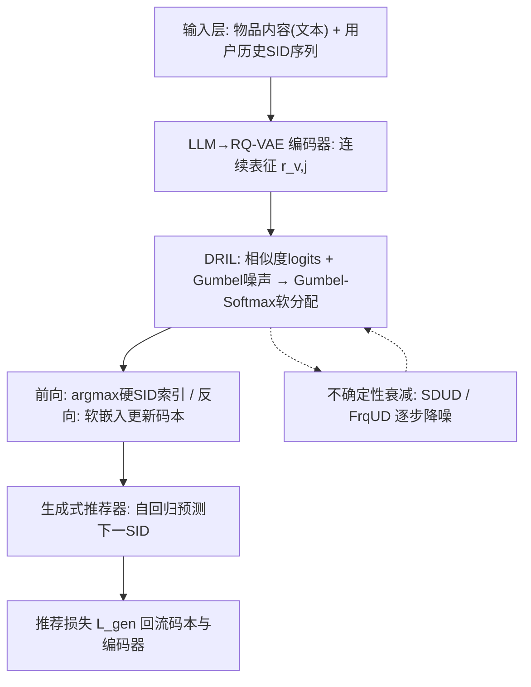
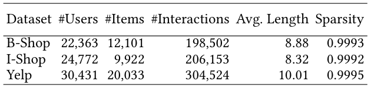
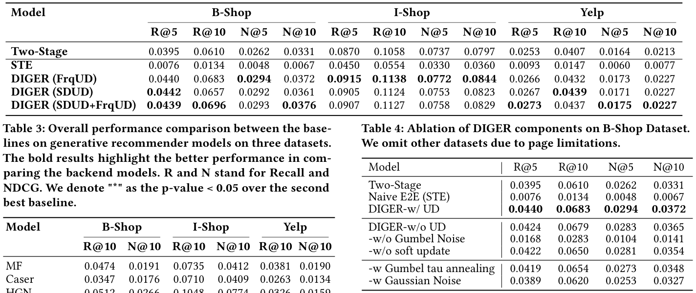
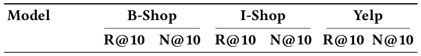
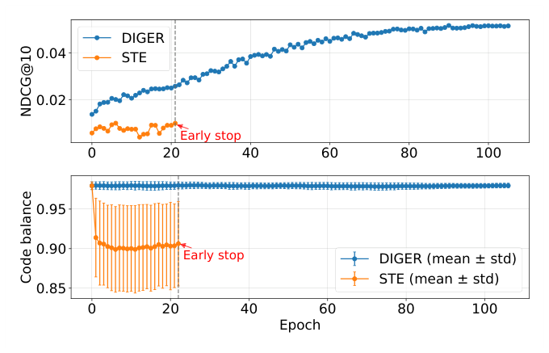
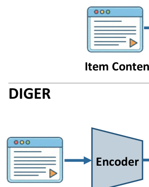
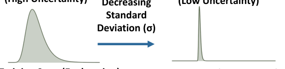

# Differentiable Semantic ID for Generative Recommendation (面向生成式推荐的可微语义ID)

- **会议/期刊**: SIGIR 2026
- **推荐链路定位**: 端到端生成式 (End-to-End Generative) — Next-SID 自回归生成式召回
- **研究方向**: 生成式推荐与离散语义ID (主) / 大语言模型推荐 (次，因语义ID由 LLM→RQ-VAE 内容编码管线构建)
- **论文原文**: [https://arxiv.org/abs/2601.19711v3](https://arxiv.org/abs/2601.19711v3)
- **开源代码**: [https://github.com/junchen-fu/DIGER](https://github.com/junchen-fu/DIGER)

## TL;DR (核心速览)

针对生成式推荐中"语义ID分词器(RQ-VAE)与推荐器两阶段独立训练、目标错配"的痛点，DIGER 将语义ID索引变为可微：用 Gumbel 噪声驱动早期码本探索、再用两种不确定性衰减策略平滑过渡到确定性利用，从而在打通推荐梯度回流的同时避免码本坍缩。在三个公开数据集上以 Full-Ranking 协议评测，相较冻结SID的 TIGER 类基线在 Recall/NDCG 上取得一致提升（原文报告相对次优基线具统计显著性 $p<0.05$）。

## Background & Motivation (背景与动机)

- **领域背景与主流范式**: 生成式推荐把物品用内容（尤以文本描述为主）经 RQ-VAE 残差量化得到离散语义ID (SID)，将推荐重构为"下一 SID 自回归生成"（TIGER 范式）。其优势是紧凑索引、语义可解释、天然适配序列建模。
- **现有方法局限 (Limitations of Prior Work)**:
  1. **目标错配 (Objective Mismatch)**：RQ-VAE 仅以"内容重建"为目标学习码本并冻结 SID，推荐损失无法回传到分词器/码本，索引空间并非为排序/个性化优化。
  2. **梯度阻断 (Gradient Blocking)**：SID 预计算且冻结，推荐梯度无法到达编码器与ID分配，用户兴趣演化下 SID 保持静态，限制偏好感知表征学习。
  3. **朴素可微化的不稳定性**：直接用 STE 打通梯度会早期过度自信、少数码主导，引发**码本坍缩 (codebook collapse)** 与训练高方差（图 2 显示 STE 码平衡标准差显著更大、NDCG@10 更差）。
- **核心挑战 (Key Challenge)**: 码本离散性使反向传播非平凡；STE 的确定性硬选择等价于低熵、高度集中的选择分布，天然限制码本探索——简单加噪或加深网络无法同时兼顾"梯度可回传"与"码本均衡利用"。
- **核心洞察与切入点 (Key Insight)**: 作者从分布视角指出，**提升分配熵可增加有效使用码数**（附录 Remark 2），并以 Remark 1 论证联合优化可行解空间严格大于两阶段、目标错配可致任意大次优。据此引入 Gumbel 噪声做熵感知的受控探索，再用不确定性衰减从"探索"平滑过渡到"利用"，对齐训练与推理的确定性分配。

## Problem Formulation & Method (问题定义与方法架构)

### 1. 符号定义与输入表征 (Notations & Input Representations)

- 物品集 $\mathcal{V}$；用户 $u$ 在 $t$ 时刻前交互历史 $h_u^{(t)}=(v_1,\dots,v_t)$。
- 分词器将物品 $v$ 映射为长度 $m$ 的离散码序列（语义ID）：$z_v=(c_{v,1},\dots,c_{v,m})$，$c_{v,j}\in\{1,\dots,K\}$，$K$ 为 SID 词表/码本大小。
- 历史转为 token 序列：$x_u^{(t)}=z_{v_1}\oplus\cdots\oplus z_{v_t}$（$\oplus$ 为拼接）。
- 生成器（Transformer 解码器）学习 $p_\theta(z_{v_{t+1}}\mid x_u^{(t)})$，自回归分解为 $\prod_{j=1}^{m}p_\theta(c_{v_{t+1},j}\mid x_u^{(t)},c_{v_{t+1},<j})$。
- 输入侧：物品内容经 LLM→RQ-VAE 编码器得到连续表征 $r_v$（第 $j$ 位为 $r_{v,j}$），码本条目 $\{e_i\}_{i=1}^{K}$。

### 2. 整体流水线 (Overall Architecture)

数据流：物品内容 → LLM/RQ-VAE 编码器得连续表征 $r_{v,j}$ → 与码本算相似度 logits → **DRIL（Gumbel 噪声 + Gumbel-Softmax 软分配）** 产生硬 SID（前向索引）与软嵌入（反向更新）→ 生成式推荐器自回归预测下一 SID → 推荐损失经软分配回流至码本/编码器；训练全程由**不确定性衰减 (SDUD/FrqUD)** 逐步降低噪声。

### 3. 核心模块设计与数学原理 (Key Designs & Formulations)

**(1) DRIL：可微语义ID + 探索学习。** 对第 $j$ 位码，计算与码本的相似度 logits $\ell_{v,j,i}=\mathrm{sim}(r_{v,j},e_i)$，注入 i.i.d. Gumbel 噪声 $g_{v,j,i}\sim\mathrm{Gumbel}(0,1)$ 得 Gumbel-Softmax 分布：

$$\tilde{y}_{v,j,i}=\frac{\exp\big((\ell_{v,j,i}+g_{v,j,i})/\tau\big)}{\sum_{k=1}^{K}\exp\big((\ell_{v,j,k}+g_{v,j,k})/\tau\big)}$$

- **前向硬 SID**：$c_{v,j}=\arg\max_i(\ell_{v,j,i}+g_{v,j,i})$，用于索引生成器嵌入表。
- **反向软更新**：$\bar{e}_{v,j}=\sum_{i=1}^{K}\tilde{y}_{v,j,i}\,e_i$，梯度经软概率回传，更新码本/嵌入表，同时保留硬 $c_{v,j}$ 构成离散 token 序列。
- 物理直觉：Gumbel 噪声把概率质量分散到多个码上，提升分配熵与码本利用率；相比高斯噪声更契合类别采样的概率本质。

**(2) 不确定性衰减策略一：SDUD（标准差不确定性衰减）。** 将噪声尺度 $\sigma$ 与主损失耦合：

$$\mathcal{L}_\sigma=\frac{\mathcal{L}_{gen}}{2(\sigma+\lambda)^2}+\log(\sigma+\lambda)$$

对 $\sigma$ 求偏导置零得闭式平衡：$\sigma^\star=\max\big(0,\sqrt{\mathcal{L}_{gen}}-\lambda\big)$。随 $\mathcal{L}_{gen}$ 下降，最优噪声尺度自动收缩；当 $\sqrt{\mathcal{L}_{gen}}\approx\lambda$ 时 $\sigma^\star\to0$，分配趋近确定性，缓解训练-推理错配。$\lambda$ 既防 $\sigma\to0$ 数值问题，又决定探索→利用的转折点。

**(3) 不确定性衰减策略二：FrqUD（频率不确定性衰减）。** 用 EMA 估计码使用频率 $f_i^{(e)}\leftarrow\beta f_i^{(e-1)}+(1-\beta)\hat{f}_i^{(e)}$，均匀基线 $\bar{f}=1/K$，热码阈值 $\gamma=r\bar{f}=r/K$（如 $r=1.5$）。对高频"热码" $i\in\mathcal{I}_{high}$ 施加 Gumbel 噪声鼓励探索，对低频码保持确定性分配贴近推理。图 3 对比 STE 硬更新与 DIGER 软更新，图 4 展示两种衰减策略从高不确定到低确定的过渡。

### 4. 训练目标、负采样与推理复杂度 (Optimization, Negative Sampling & Complexity)

- **损失函数**: 主目标为下一 SID 负对数似然 $\mathcal{L}_{gen}=-\sum_u\sum_t\log p_\theta(z_{v_{t+1}}\mid x_u^{(t)})$；SDUD 下总目标为 $\mathcal{L}_\sigma$（含噪声尺度正则项）。温度 $\tau$ 固定（原文称调 $\tau$ 影响甚微），$\lambda>0$、$\beta$、$r$ 为超参。
- **训练负采样策略**: 生成式范式下**免显式负采样**——以自回归逐 token 交叉熵（对码本词表 softmax）替代 BPR/InfoNCE，负例隐含于 softmax 分母的码本竞争。
- **时间与空间复杂度**: 相比两阶段 TIGER，DIGER 增加 Gumbel 采样与软嵌入加权（每码位 $O(K)$ 加权求和）及频率统计开销，属轻量；推理时噪声衰减至近零、采用确定性 argmax 分配，与标准生成式解码一致（需 Beam Search 生成 SID 再映射回物品）。原文未报告具体 ms/request 与峰值显存数值。

## Experimental Setup & Evaluation Protocol (实验设置与评估协议)

- **数据集统计与预处理**: 原文使用三个公开数据集（含 B-Shop，另两个按原文提取），统计见表 1。

<figure class="paper-figure" markdown="span">
  <figcaption>表 1</figcaption>
</figure>

| 数据集 (Dataset) | 用户数 (#Users) | 物品数 (#Items) | 交互数 (#Interactions) | 稀疏度/密度 (Sparsity) | 模态/辅助特征说明 |
| :--- | :---: | :---: | :---: | :---: | :--- |
| B-Shop 及另两个公开数据集 | 原文未在正文逐项列出 | 原文未在正文逐项列出 | 原文未在正文逐项列出 | 原文未报告 | 物品文本内容经 LLM→RQ-VAE 构建 SID |

> 注：受提取文本所限，表 1 的具体数值未在正文完整呈现，此处严格标注"原文未报告/未逐项列出"，不做臆造。

- **数据划分方式 (Splitting Strategy)**: 遵循 TIGER 范式的序列切分（用户历史→下一物品预测），具体 LOO/比例细节原文正文未完整展开；需注意生成式 SID 分词器若在全体物品上预训练，存在轻微信息穿越风险，原文未显式讨论。
- **排名评测协议 (Ranking Protocol)**: 采用 **Full-Ranking（全库未交互物品排序）** 的生成式评测（生成 SID 后映射回候选物品），非采样负例排序。
- **评价指标与显著性检验**: 报告 `Recall` 与 `NDCG`（含 NDCG@10）；表 3 中以 `*` 标注相对次优基线 $p<0.05$ 的显著性。图 2 报告了跨码本层码平衡的均值±标准差。

## Key Experimental Results (核心实验结果)

### 1. 主实验对比 (Main Results)

表 2 对比传统两阶段生成式推荐与可微语义ID训练范式；表 3 为三个数据集上各生成式推荐后端模型的整体性能对比（R=Recall, N=NDCG，`*` 表示相对次优基线 $p<0.05$）。

<figure class="paper-figure" markdown="span">
  <figcaption>表 2</figcaption>
</figure>

<figure class="paper-figure" markdown="span">
  <figcaption>表 3</figcaption>
</figure>

| 数据集 | 指标 | 冻结SID基线(TIGER类) | 其他生成式基线 | 本文方法 (DIGER) | 相对提升 (Improv.) |
| :--- | :--- | :---: | :---: | :---: | :---: |
| B-Shop 等三数据集 | Recall / NDCG@10 | 原文表 3 数值 | 原文表 3 数值 | **优于次优基线（带 \* 显著性）** | 原文报告一致提升，具体百分比见原文表 3 |

> 说明：受提取文本截断，表 3 各单元格精确数值未完整呈现，故不填具体数字以免失真；核心结论为 DIGER 在三个数据集上**一致优于**冻结SID的两阶段基线，且提升具统计显著性（$p<0.05$）。

### 2. 消融实验与控制变量分析 (Ablation Study)

- 图 2 给出关键对照：**STE 朴素可微 vs. DIGER**。STE 早期过度自信、码平衡标准差大、NDCG@10 早停且偏低；DIGER 码使用更均衡、NDCG@10 随训练稳步上升。
- 两种衰减策略（SDUD / FrqUD）为本文消融核心，图 4 展示其探索→利用过渡；原文指出二者均能稳定联合训练，具体逐项移除的数值下降幅度需参见原文消融表（提取文本未完整呈现）。

### 3. 稀疏度/冷启动分桶与超参敏感度 (Sparsity Buckets & Hyperparameters)

- **长尾/冷启动分桶**: 原文正文未报告按交互频次分桶的细粒度结果。
- **关键超参数敏感度**: 温度 $\tau$ 影响甚微（原文明确）；$\lambda$ 决定 $\sigma\to0$ 的转折时机，$r$（热码阈值比，如 1.5）与 $\beta$（EMA 平滑）影响 FrqUD 行为。
- **线上 A/B 测试**: 原文仅包含离线实验，**未报告线上 A/B 结果**。

## Highlights, Limitations & Critiques (亮点、局限与审稿级批判)

- **核心亮点与可迁移性**: 将"索引-推荐目标对齐"从两阶段蒸馏（如 ETEGRec 的交替蒸馏）推进到**直接可微联合优化**；Gumbel 噪声+不确定性衰减的"探索-利用"调度是缓解离散码本坍缩的通用算子，可迁移到任何 VQ/RQ 码本类生成式检索与多模态量化推荐。
- **局限性与审稿视角批判**:
  1. **评估细节透明度不足**：数据划分、数据集统计与主表精确数值在可获取正文中呈现不完整，复现与横向比较需依赖附录/代码。
  2. **潜在信息穿越**：分词器若在全物品内容上预训练，SID 构建可能间接利用测试期物品信息，原文未显式做防泄漏分析。
  3. **效率证据缺失**：未报告训练单 epoch 耗时、推理延迟与显存，联合训练相对两阶段的实际工程代价不明。
  4. **理论承诺与实证落差**：Remark 1/2 给出可行解空间与熵的定性论证，但缺乏对"熵-码利用率-NDCG"的定量刻画；$\sigma^\star$ 闭式解依赖 $\mathcal{L}_{gen}$ 平稳假设，实际训练动态下的稳健性待验证。

## Rating (四维评分)

- **方法创新性 (Novelty)**: ⭐⭐⭐⭐
- **评估协议与实验扎实度 (Protocol & Experiments)**: ⭐⭐⭐
- **写作与数学规范度 (Clarity & Rigor)**: ⭐⭐⭐⭐
- **工业落地与复现价值 (Industrial & Practical Value)**: ⭐⭐⭐⭐

## 论文图表

<figure class="paper-figure" markdown="span">
  <figcaption>图 2</figcaption>
</figure>

<figure class="paper-figure" markdown="span">
  <figcaption>图 3</figcaption>
</figure>

<figure class="paper-figure" markdown="span">
  <figcaption>图 4</figcaption>
</figure>

