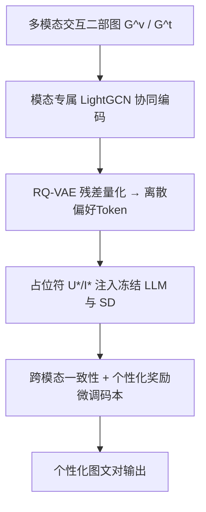
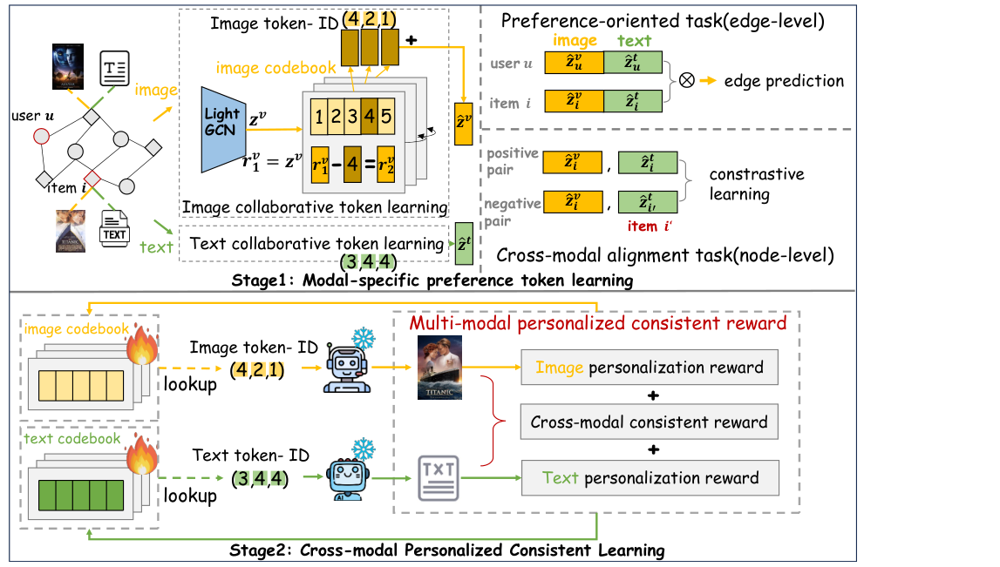

# Discrete Preference Learning for Personalized Multimodal Generation (面向个性化多模态生成的离散偏好学习)

- **会议/期刊**: SIGIR 2026
- **作者与机构**: Yuting Zhang, Ying Sun, Dazhong Shen, Ziwei Xie, Feng Liu, Changwang Zhang, Xiang Liu, Jun Wang, Hui Xiong（HKUST-GZ / 南航 / OPPO研究院）
- **推荐链路定位**: 端到端生成式（个性化内容生成）
- **研究方向**: 生成式推荐与离散语义ID / 多模态推荐
- **论文原文**: [https://arxiv.org/abs/2604.20434v1](https://arxiv.org/abs/2604.20434v1)
- **开源代码**: 暂未开源

## TL;DR (1分钟核心速览)

现有"个性化生成"要么靠检索历史文本/图像做提示（噪声大、无专属偏好建模），要么只生成单模态内容，且连续偏好嵌入与生成器原生离散token输入之间存在鸿沟、图文之间易失配。本文提出 DPPMG：第一阶段用模态专属 LightGCN 学协同偏好并经 RQ-VAE 量化为离散偏好token；第二阶段把token作为可学习占位符注入冻结的 LLaMA3-8B 与 SD v1.5，并用"个性化+跨模态一致性"奖励微调。在 MovieLens 与工业广告两数据集上，个性化 CIS 达 35.64/37.83，CCS 一致性显著优于基线，人类评测 62.3%/68.1% 偏好率胜出。

## Background & Motivation (背景与核心矛盾)

- **主流范式**: 个性化文本生成靠 LaMP 式检索增强（BM25/Contriever）拼接历史文本；个性化图像生成靠 PMG/Pigeon 等用 LLM/MLLM 把历史图像转成关键词或视觉token再条件化扩散模型。
- **前人局限**: ①检索到的历史内容混杂用户"喜欢与不喜欢"的特征，噪声直接污染生成；②这些生成式方法缺乏经典 CF 那样的**专属偏好建模范式**，无法从复杂交互中提炼用户/物品相似性结构；③单模态独立生成忽略跨模态对齐，出现"极简家具图配华丽文案"的语义/风格断裂。
- **核心洞察 (Key Insight)**: 生成器（Transformer/扩散）原生吃**离散token序列**，而 GNN 偏好建模输出**连续嵌入**——这个表示鸿沟正是"偏好无法被生成器直接消费"的根因；同时用户交互本身是多模态驱动的，偏好也应分模态建模。
- **本文切入点**: 用向量量化把 CF 偏好"翻译"成生成器母语的离散token，并以奖励函数同时约束个性化与跨模态一致性。

## Method (核心方法设计)

### 1. 整体框架 (Overall Architecture)

输入是用户多模态交互二部图，按模态拆成 $\mathcal{G}^v,\mathcal{G}^t$。第一阶段：物品文本经下游 LLM 末层注意力加权平均、图像经与扩散模型同源的 CLIP 编码得到初始节点特征，用户节点由物品特征均值/方差采样初始化；随后各模态独立跑 LightGCN 聚合协同信号，再用模态专属 RQ-VAE 把用户/物品表示逐层残差量化成 $L$ 位码字（偏好token）。第二阶段：在提示中插入可学习占位符 $U^*,I^*$，用码本 Lookup 出的码向量替换其嵌入，分别喂入冻结的 LLaMA3-8B 与 SD v1.5；最后用跨模态一致性+个性化奖励只微调码本相关参数。

<figure class="paper-figure" markdown="span">
  <figcaption>图2：DPPMG概览。阶段1通过边级偏好导向和节点级跨模态对齐任务学习模态特定的偏好token。阶段2将token注入下游模型，并通过跨模态个性化一致性奖励进行优化。文本协同token学习遵循与图像分支相同的逻辑。为简洁起见，仅展示token ID，省略生成器指令。</figcaption>
</figure>

### 2. 关键设计拆解 (Key Designs)

1. **模态专属协同偏好量化 (RQ-VAE over LightGCN)**：痛点是连续嵌入无法进入离散生成器。对表示 $z_u$ 逐层量化 $c^l_u=\arg\min_k\|r^l_u-e^l_k\|^2,\ r^{l+1}_u=r^l_u-\text{Lookup}(c^l_u,\mathcal{B}^l)$，得到 $(c^1_u,\dots,c^L_u)$。RQ 的由粗到细层次结构天然对应"高层粗粒度属性、低层细粒度风格"，且共享前缀即隐含 CF 相似性（案例中两位都看过 Spider-Man/Batman 的用户共享前两位token）。
2. **偏好导向 + 跨模态对齐的双任务约束**：仅重构损失不足以让token承载偏好。边级用拼接图文token后的 BPR 损失 $\mathcal{L}_{BPR}=-\ln\sigma(\hat z_u\hat z_i^\top-\hat z_u\hat z_{i'}^\top)$ 保证正交互得分更高；节点级用跨模态对比损失 $\mathcal{L}_{cm}$ 拉近同一物品图文表示、推远负样本，使token同时编码协同与跨模态语义。
3. **跨模态一致个性化奖励与训练效率**：总损失 $\mathcal{L}=\mathcal{L}_{BPR}+\mathcal{L}_{mm\text{-}rqvae}+\beta\mathcal{L}_{cm}$（第一阶段），第二阶段 $\mathcal{L}=\mathcal{L}_t+\mathcal{L}_v$，其中 $\mathcal{L}_v=(R^v_p+\gamma R_{crs})\cdot\mathbb{E}\|\epsilon-\epsilon_\theta\|^2$，$R_{crs}=\text{CLIPSim}(V_g,T_g)$、$R^v_p$ 为生成图与历史图的平均 CLIP 相似度。冻结生成器、仅训码本，可训练参数占比仅 0.154%（图）/0.448%（文），单样本推理约 4 秒；负样本为随机采样（非难负样本）。

## Experimental Setup & Evaluation Protocol (实验设置与评估协议)

- **数据集与预处理**:

| 数据集 | #Users | #Items | #Interactions | 稀疏度/密度 | 特征/场景说明 |
| :--- | :---: | :---: | :---: | :---: | :--- |
| MovieLens | 598 | 6,041 | 45,276 | 密度≈1.25% | 电影简介(均25.58词)+海报，保留评分≥4 |
| Advertisement | 1,921 | 4,229 | 50,010 | 密度≈0.62% | 工业广告文案(均9.21词)+图片 |

- **数据划分与防穿越 (Splitting Strategy)**: 按**时间戳 8:1:1** 划分训练/验证/测试，避免未来交互泄漏。
- **排名评测协议 (Ranking Protocol)**: 非排序式评测，而是生成质量度量——图像用 CIS/DIS（CLIP/DINO 特征余弦）、CS、LPIPS、MS-SSIM、FID 及 F1 型 Overall；文本用 ROUGE-1/2/L、BLEU-1/4；跨模态用 CCS（生成图文 CLIP 余弦）。另设 30 人、50 案例的人类偏好排序评测。
- **对比基线与超参设置**: 图像基线 TI、PMG、Qwen-VL*、LaVIT*、I-AM-G、Pigeon；文本基线 LLaMA*/LLaMA(LoRA)、Qwen-VL*/Qwen-VL。LightGCN 2 层，RQ-VAE $L=4$、$K=96$，$\beta=0.1,\gamma=0.5$，第一阶段 lr=1e-3/bs=1024，第二阶段 lr=1e-5/bs=8，Adam 优化。

## Key Experimental Results (实验关键数据)

### 1. 主实验对比 (Main Results)

个性化图像生成（节选核心指标，P-CIS 为个性化、A-CS 为语义对齐、CCS 为跨模态一致性）：

| 数据集 | 方法 | Overall↑ | P-CIS↑ | P-DIS↑ | A-CS↑ | FID↓ | CCS↑ |
| :--- | :--- | :---: | :---: | :---: | :---: | :---: | :---: |
| MovieLens | TI | 28.05 | 12.18 | 33.98 | 22.12 | 96.74 | — |
| MovieLens | PMG | 25.47 | 10.17 | 28.61 | 22.33 | 99.98 | — |
| MovieLens | I-AM-G | 27.58 | 13.98 | 32.95 | 22.21 | 67.20 | — |
| MovieLens | Pigeon | 28.16 | 13.94 | 34.21 | 22.10 | 59.51 | — |
| MovieLens | **DPPMG** | **29.49** | **14.90** | **35.64** | **23.33** | **57.38** | — |
| Advertisement | Pigeon | 29.44 | 22.67 | 36.55 | 22.32 | 83.42 | — |
| Advertisement | **DPPMG** | **30.48** | **23.08** | **37.83** | **23.12** | **79.83** | — |

个性化文本生成（MovieLens，P-ROUGE-L / A-ROUGE-L / P-BLEU-4）：

| 方法 | P-ROUGE-1↑ | P-ROUGE-L↑ | P-BLEU-4↑ | A-ROUGE-L↑ |
| :--- | :---: | :---: | :---: | :---: |
| LLaMA* | 14.80 | 10.95 | 0.1542 | 10.23 |
| Qwen-VL | 14.53 | 10.45 | 0.1960 | 11.10 |
| **DPPMG** | **16.10** | **11.86** | **0.2061** | **11.40** |

### 2. 消融实验 (Ablation Study)

MovieLens 上逐组件拆解（P-CIS / A-CS / P-ROUGE-L / A-ROUGE-L / CCS）：

| 配置 | P-CIS | A-CS | P-ROUGE-L | A-ROUGE-L | CCS |
| :--- | :---: | :---: | :---: | :---: | :---: |
| Base（无token） | 32.07 | 21.47 | 10.95 | 10.23 | 19.13 |
| +Preference token | 33.89 | 22.13 | 11.41 | 10.40 | 19.15 |
| +Token+单模态奖励 | **35.71** | **23.42** | **12.02** | 11.34 | 19.01 |
| +Token+跨模态奖励 | 33.98 | 21.50 | 11.24 | 11.06 | **22.43** |
| 完整模型 | 35.64 | 23.33 | 11.86 | **11.40** | 21.32 |

### 3. 关键实验发现 (Key Findings)

1. **离散token是主要增益来源**：仅加偏好token即把 P-CIS 从 32.07 提到 33.89、P-ROUGE-L 从 10.95 提到 11.41，说明 RQ-VAE 量化后的协同信号确实能被冻结生成器"读懂"；而单模态奖励把个性化推到峰值 35.71/12.02，却让 CCS 掉到 19.01，跨模态奖励则把 CCS 拉到 22.43 但个性化回落——完整模型在两者间取得 35.64/21.32 的折中，验证了奖励设计的必要性。
2. **多模态联合建模优于单模态**：拆成 image-only / text-only 后个性化指标双双下滑（图4），印证用户交互由多模态共同驱动，单模态token无法覆盖完整偏好。
3. **码本容量存在甜点**：$L$ 从 1→5、$K$ 从 24→192 均呈先升后降，图像最优 $L=4$、文本最优 $L=3$（图像特征更复杂需更深残差），$K=96$ 时两任务同时最优，过大则因 EMA 训练不稳而退化；此外 token 学习可即插即用地提升 BM25/RSPG 与 SDXL/Qwen-VL 主干（图3），人类评测中 62.3% 偏好生成图、68.1% 认为跨模态更一致。

## Highlights, Limitations & Rating (亮点、对比与审稿评价)

- **与代表作对比 (vs. Prior Work)**: 相比 PMG/Pigeon 把历史图像"翻译成文本关键词"再条件化（丢失视觉细节、无CF结构），DPPMG 首次引入**专属协同偏好模型 + 向量量化**，让偏好以生成器原生离散形式注入；相比 TI/DreamBooth 只对齐显式指令，本文从隐式交互中推断偏好；相比单模态个性化生成，本文显式优化跨模态一致性奖励。
- **可迁移亮点**: ①"GNN 连续表示 → RQ-VAE 离散token → 冻结生成器占位符注入"是通用的偏好-生成器桥接范式，可直接迁移到生成式推荐的语义ID构建；②用 CLIP 相似度构造"个性化+一致性"双奖励、只训码本，是低成本对齐生成模型与用户偏好的实用技巧。
- **审稿级局限批判**: ①评测以 CLIP/DINO 相似度与 BLEU/ROUGE 为主，缺乏真实点击/转化等在线业务指标，且数据集规模较小（598/1921 用户），泛化性存疑；②两阶段分离训练、奖励权重 $\gamma$ 与码本超参敏感，且推理需同时跑 LLM+扩散模型（约 4s/样本），工业级高并发场景的延迟与成本未讨论。
- **四维评分**: 创新性 ⭐⭐⭐⭐ | 实验扎实度 ⭐⭐⭐⭐ | 方法清晰度 ⭐⭐⭐⭐ | 落地价值 ⭐⭐⭐⭐

