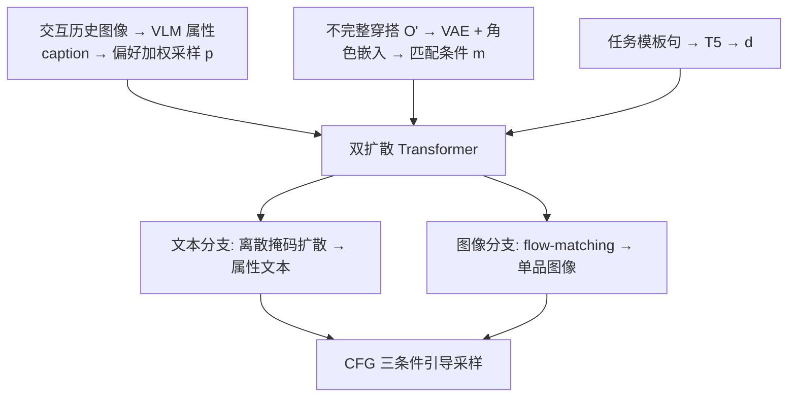

# Dual-Diffusional Generative Fashion Recommendation (双扩散生成式时尚推荐)

- **会议/期刊**: SIGIR 2026
- **作者与机构**: Mingzhe Yu, Qianru Sun, Yunshan Ma (Singapore Management University); Lei Wu (Shandong University)
- **推荐链路定位**: 端到端生成式（直接生成单品图像 + 文本，而非从候选库检索）
- **研究方向**: 生成式推荐与离散语义ID / 多模态推荐
- **论文原文**: [https://arxiv.org/abs/2605.17357v1](https://arxiv.org/abs/2605.17357v1)
- **开源代码**: [https://github.com/LinkMingzhe/DualFashion](https://github.com/LinkMingzhe/DualFashion)

## TL;DR (1分钟核心速览)

现有图像生成式时尚推荐（DiFashion、FashionDPO）以**隐式视觉嵌入**建模用户，交互稀疏时视觉冗余细节淹没真实偏好，且只输出图像、缺乏解释性。本文提出 DualFashion：一个**双扩散 Transformer**，图像分支走连续 flow-matching、文本分支走离散掩码扩散，以「属性级结构化 caption 加权采样得到的用户偏好 $\boldsymbol{p}$+ 穿搭匹配条件$\boldsymbol{m}$+ 任务模板$\boldsymbol{d}$」为条件，**同时生成单品图像与属性文本**。在 iFashion / Polyvore-U 的 PFITB 与 GOR 两任务上，个性化指标 Per. 相对 DiFashion 提升约 16.7%（55.86→65.17），训练耗时较 FashionDPO 快约 7 倍。

## Background & Motivation (背景与核心矛盾)

- **主流范式**: 图像生成式推荐把推荐视为「以用户历史为条件的反向去噪」，用 SD/GAN 直接合成用户可能喜欢的单品图像（DiFashion 并行扩散、FashionDPO 用 DPO 微调、PMG 用 LLM 建模偏好）。
- **前人局限一（行为建模不足）**: 用户建模完全依赖交互图像的**单模态隐式嵌入**；交互本身稀疏，且图像含大量与偏好无关的视觉细节（用户可能只因款式点击、并不喜欢其颜色），偏好提取不可靠。
- **前人局限二（不可解释）**: 输出只有图像，无法说明「为什么这件单品能搭配这套不完整穿搭、为什么符合该用户」；解耦建模、文本辅助等补丁式方案只是挂在图像中心骨干上的外挂，未触及根因。
- **核心洞察 (Key Insight)**: 两个缺陷同源于**图像中心的架构设计**——文本模态天然能抽象掉低层视觉噪声、编码高层语义意图，而图像模态负责视觉兼容性，二者应当**原生并列**而非主辅。
- **本文切入点**: 换成「多模态输入 + 多模态输出」的双扩散架构，让文本分支承载用户偏好、图像分支承载穿搭匹配，两模态在训练中互相蒸馏知识。

## Method (核心方法设计)

### 1. 整体框架 (Overall Architecture)

模型以预训练 Dual-Diffusion Transformer 为骨干，图像/文本两分支在每一层 attention 上互相 cross-attend。输入侧：用 VLM 对每件单品抽取四属性结构化 caption（Color / Material / Design features / Style），再按历史频次做**偏好加权采样**得到用户偏好文本 $\boldsymbol{p}$；不完整穿搭经共享 VAE 编码并加角色嵌入得到匹配条件$\boldsymbol{m}$；任务模板句经 T5 编码为$\boldsymbol{d}$。训练分三阶段：① warm-up 做时尚域适配与图文对齐；② 匹配感知的个性化多模态联合训练（图像 flow-matching 损失 + 文本掩码扩散损失）；③ 用 LLM 增强 caption 做纯文本损失微调。推理时文本分支先解码出属性文本，图像分支在 CFG 三条件引导下从高斯噪声去噪出单品图像；GOR 任务视为$n$ 轮采样，前轮生成结果作为后轮匹配条件。

<figure class="paper-figure" markdown="span">
  <figcaption>图2：DualFashion的多阶段训练包括预热、匹配感知的个性化多模态训练和文本增强微调。为清晰起见，省略推理阶段。</figcaption>
</figure>

### 2. 关键设计拆解 (Key Designs)

1. **偏好加权采样 (Preference Weighted Sampling)**：痛点是用频率阈值截断会丢掉稀疏偏好、阈值不达标则偏好信息全失。改为对每个属性 $a$独立按归一化频次做温度采样$P(v)=\frac{\exp(f(v)/T)}{\sum_{v'\in V_a}\exp(f(v')/T)}$，每属性采样$N=10$次去重。$T<1$偏利用已知偏好、$T>1$ 偏探索，从而在稀疏交互下仍能构造出**属性级、可解释**的偏好文本，而非把整张图丢进编码器。

2. **角色嵌入与匹配条件注入 (Role Embedding + Latent Mixing)**：目标单品与穿搭上下文来自同一 VAE、共享隐空间，边际统计相近导致模型难以区分二者。给两者分别加可学习角色嵌入 $\boldsymbol{e}_0,\boldsymbol{e}_c$：$\tilde{\boldsymbol{z}}_0=\boldsymbol{z}_0+\boldsymbol{e}_0,\ \tilde{\boldsymbol{z}}_c=\frac{1}{n}\sum_k \boldsymbol{z}_c^{(k)}+\boldsymbol{e}_c$，即使$\boldsymbol{\mu}_0\approx\boldsymbol{\mu}_c$仍有均值偏移$\Delta\boldsymbol{\mu}\approx\boldsymbol{e}_0-\boldsymbol{e}_c\neq 0$，使角色线性可分。图像分支再以固定权重混合匹配信息：$\boldsymbol{z}'_t=(1-\lambda_m)\boldsymbol{z}_t+\lambda_m\boldsymbol{m}$（$\lambda_m=0.1$）。

3. **训练目标、负采样与推理效率**：总损失 $\mathcal{L}=\mathcal{L}_{img}+\lambda_{text}\mathcal{L}_{text}$（$\lambda_{text}=0.2$），其中$\mathcal{L}_{img}=\mathbb{E}\|\boldsymbol{v}_\theta(\boldsymbol{z}'_t,t,\boldsymbol{p},\boldsymbol{d})-(\boldsymbol{\epsilon}-\boldsymbol{z}_0)\|_2^2$，$\mathcal{L}_{text}=-\sum_j m_j\log p_\theta(\boldsymbol{y}_{0,j}\mid \boldsymbol{y}_t,\boldsymbol{p},\boldsymbol{m},\boldsymbol{d})$。**无负采样**（生成式范式，不做对比学习）。训练时对匹配条件做 50% 随机丢弃以从 PFITB 泛化到 GOR；第三阶段仅用文本损失微调，避开昂贵的图像扩散采样，是效率优势的主要来源。

## Experimental Setup & Evaluation Protocol (实验设置与评估协议)

- **数据集与预处理**: iFashion 含 50 个预定义品类、每套穿搭 4 件互配单品，共抽取 344,186 条结构化 caption；Polyvore-U 用 iFashion 上微调的 Inception-V3 做品类识别后同流程抽取。

| 数据集 | #Users | #Items | #Interactions | 稀疏度/密度 | 特征/场景说明 |
| :--- | :---: | :---: | :---: | :---: | :--- |
| iFashion | 多用户 | 344,186 条 caption 覆盖单品 | 用户-单品交互 + outfit 组成 | 稀疏 | 50 品类，每 outfit 4 件 |
| Polyvore-U | 多用户 | 同上流程 | 同上 | 稀疏 | 跨数据集泛化验证 |

- **数据划分与防穿越 (Splitting Strategy)**: 沿用 DiFashion/FashionDPO 的任务式划分（PFITB 留出目标单品、GOR 留出整套 outfit），非时间戳切分；评测在留出目标上做生成，不存在候选库穿越问题。
- **排名评测协议 (Ranking Protocol)**: **非 ranking 协议**，而是生成质量评测——图像侧用 IS、IS-acc（品类语义正确性）、Comp.（OutfitGAN 判别器算兼容度）、Per.（CLIP 余弦相似度对齐交互历史）、Div.（LPIPS 成对距离）；文本侧用 Align（CLIP score）、Comp.（Gemini 打分）、Per.（与采样偏好的 CLIP 相似度）、Div.（语义距离 + 属性熵）。
- **对比基线与超参设置**: 基线含 SD-v1.5/v2（预训练与微调两版）、SD-naive、ControlNet、DiFashion、FashionDPO。骨干为预训练 Dual-Diffusion；warm-up 20k 步，lr $3\times10^{-5}$，weight decay$1\times10^{-2}$；推理 CFG 系数$s_d=8,s_m=7,s_p=8$；L40s 48GB。

## Key Experimental Results (实验关键数据)

### 1. 主实验对比 (Main Results)

iFashion / PFITB 与 GOR 核心指标（节选，加粗为最优）：

| 方法 | IS | IS-acc | Comp. | Per. | Div. |
| :--- | :---: | :---: | :---: | :---: | :---: |
| SD-v1.5 (finetuned) | 26.76 | 0.83 | 0.46 | 53.16 | 0.50 |
| ControlNet | 27.76 | 0.81 | 0.16 | 49.90 | 0.41 |
| DiFashion | 29.99 | 0.90 | 0.58 | 55.86 | 0.33 |
| FashionDPO | **33.80** | **0.91** | **0.74** | 60.39 | 0.36 |
| **DualFashion** | 31.08 | 0.88 | 0.69 | **65.17** | 0.38 |
| Improv. (Per. vs DiFashion) | — | — | — | **+16.7%** | — |

Polyvore-U / PFITB：DualFashion Per. **67.40** vs DiFashion 61.44（+9.7%）、FashionDPO 64.67；IS 25.30 略低于 FashionDPO 24.14 之上但低于其 33.80 档位。GOR 任务趋势一致（iFashion Per. 64.05 vs DiFashion 55.54）。

### 2. 消融实验 (Ablation Study)

iFashion 图像生成消融：

| 变体 | IS | IS-acc | Comp. | Per. | Div. |
| :--- | :---: | :---: | :---: | :---: | :---: |
| w/o warm-up | 28.77 | 0.80 | 0.62 | 62.68 | 0.31 |
| w/o learnable embeddings | 30.23 | 0.85 | 0.64 | 62.93 | 0.31 |
| only image loss | 30.29 | **0.93** | **0.71** | 63.41 | 0.36 |
| only text loss | 26.57 | 0.84 | 0.65 | **65.86** | 0.33 |
| image + text loss | 30.61 | 0.87 | 0.69 | 64.48 | 0.34 |
| **+ text-augmented FT (Ours)** | **31.08** | 0.88 | **0.71** | 65.17 | **0.38** |

文本生成消融（Ave.）：w/o warm-up Comp. 0.54 / Per. 0.58；only image loss Comp. 0.49 / Per. 0.51；only text loss Comp. 0.66 / Per. 0.69；完整模型 Comp. **0.72** / Per. 0.68 / Div. **4.25**。

### 3. 关键实验发现 (Key Findings)

1. **文本损失是偏好建模的主引擎**：only text loss 的 Per. 达 65.86，高于 only image loss 的 63.41 与联合损失的 64.48，说明高层语义监督比像素级重建更能刻画用户意图；而 only image loss 的 IS-acc 最高（0.93）却文本 Comp. 崩到 0.49，证明单模态监督无法兼顾兼容性与个性化，必须双损失平衡。
2. **角色嵌入解决同源隐空间混淆**：去掉可学习嵌入后 Comp. 从 0.71 掉到 0.64、Per. 从 65.17 掉到 62.93，验证了 $\Delta\boldsymbol{\mu}\approx\boldsymbol{e}_0-\boldsymbol{e}_c$ 的均值偏移确实让模型区分「目标单品」与「穿搭上下文」。
3. **文本增强微调同时提升兼容与多样性**：第三阶段把文本 Comp. 从 0.68 提到 0.72、Div. 从 3.64 提到 4.25，且训练仅 3.0h，较 FashionDPO 的 20.0h 快约 7 倍——纯文本层微调避开了图像扩散采样，是效率与效果的双赢点。

## Highlights & Limitations (亮点、对比与审稿批判)

- **与代表作对比 (vs. Prior Work)**: DiFashion 用 SD-v2 并行扩散、只出图；FashionDPO 用 DPO 在多专家反馈上微调、IS/Comp. 更高但训练 20h；本文以 Transformer 双扩散替代 U-Net、以文本分支原生承载偏好，牺牲少量 IS/Comp. 换取 Per. 大幅领先与 7× 训练加速。
- **可迁移亮点**: ①「属性级 caption + 温度加权采样」构造可解释偏好文本，可直接迁移到任何有结构化属性的多模态推荐；②「角色嵌入制造均值偏移」是解决同源编码器隐空间不可分的通用小技巧；③ 文本层微调替代图像层 RL 微调，是生成式推荐降本的可复用范式。
- **审稿级局限批判**: ① 评测全为生成式代理指标（IS/CLIP/Gemini 打分），无真实用户在线 A/B 或人工偏好标注，Per. 用 CLIP 余弦衡量偏好存在模态鸿沟；② 推理需文本+图像两阶段扩散与三条件 CFG，单次生成延迟未报告，GOR 需 $n$ 轮串行采样，工业实时性存疑；③ 依赖 Gemini 做 caption 增强与兼容性打分，评测与训练均引入闭源 LLM 偏置，复现成本与可审计性受限。

## Rating (四维评分)

- **方法创新性 (Novelty)**: ⭐⭐⭐⭐ （首个双扩散 Transformer 联合优化图文扩散用于时尚推荐，架构层面而非补丁层面破局，角色嵌入的均值偏移分析有理论支撑）
- **评估协议与实验扎实度 (Protocol & Experiments)**: ⭐⭐⭐ （双数据集双任务 + 图像/文本/对齐三视角消融较完整，但全为代理指标、无在线验证与显著性检验）
- **写作与数学规范度 (Clarity & Rigor)**: ⭐⭐⭐⭐ （三阶段训练与条件注入公式清晰，flow-matching 与离散扩散表述规范，推理 CFG 公式完整）
- **工业落地与复现价值 (Industrial & Practical Value)**: ⭐⭐⭐⭐ （代码与 checkpoint 开源，训练较 FashionDPO 快 7×，但双阶段扩散推理延迟与 LLM 依赖是落地门槛）
