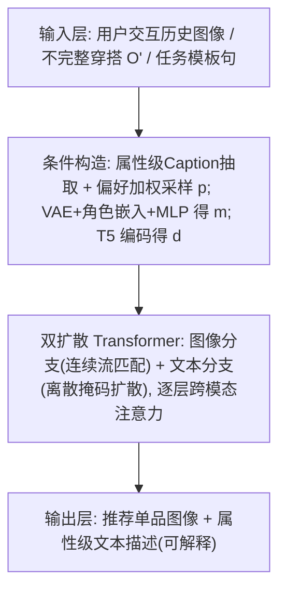
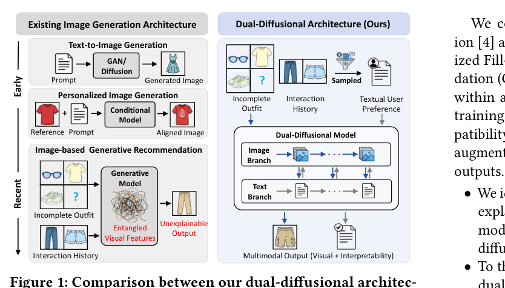
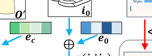
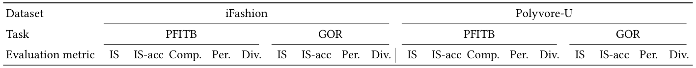
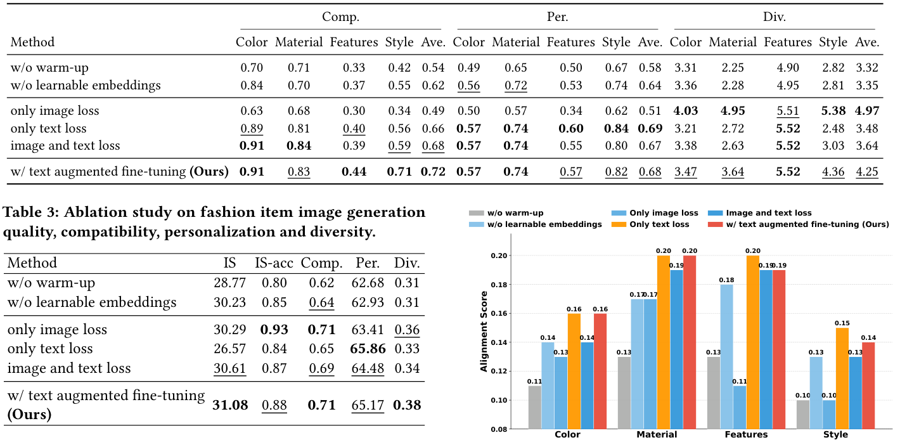
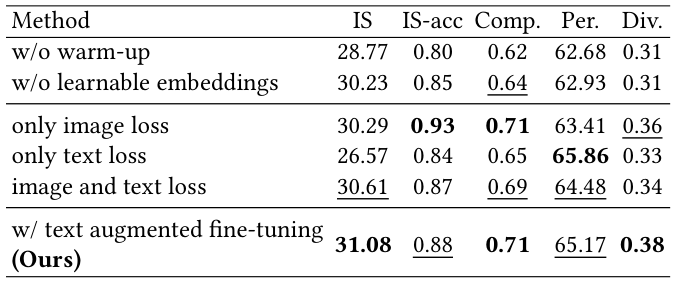

# Dual-Diffusional Generative Fashion Recommendation (双扩散生成式时尚推荐)

- **会议/期刊**: SIGIR 2026
- **推荐链路定位**: 端到端生成式 (End-to-End Generative)
- **研究方向**: 生成式推荐与离散语义ID / 多模态推荐与内容理解
- **论文原文**: [https://arxiv.org/abs/2605.17357v1](https://arxiv.org/abs/2605.17357v1)
- **开源代码**: [https://github.com/LinkMingzhe/DualFashion](https://github.com/LinkMingzhe/DualFashion)

## TL;DR (核心速览)

针对现有图像生成式时尚推荐"仅依赖隐式视觉嵌入导致行为建模不足、且只输出图像缺乏可解释性"两大痛点，本文提出 DualFashion——一个图像分支（连续流匹配扩散）+ 文本分支（离散掩码扩散）的双扩散 Transformer 架构，以属性级结构化 caption 与穿搭视觉上下文为联合条件，同时生成推荐单品图像与文本描述。在 iFashion 与 Polyvore-U 上，PFITB 与 GOR 两任务的兼容性、个性化、多样性指标均超越 DiFashion 等 SOTA，并提供显式语义解释。

## Background & Motivation (背景与动机)

- **领域背景与主流范式**: 时尚推荐正从"排序检索式"（从固定商品库召回）转向"生成式"（直接合成商品内容）。图像生成式推荐经历了 GAN（OutfitGAN、DVBPR）→ 扩散模型（DiFashion、FashionDPO）→ 多模态大模型（Pigeon）的演进，核心是把用户-物品交互视为偏好条件，生成用户可能感兴趣的单品图像。
- **现有方法局限 (Limitations of Prior Work)**:
  1. **行为建模不足**：现有生成式方法（DiFashion、FashionDPO）以交互单品图像作为单模态输入，而用户-物品交互本身稀疏，视觉数据又含大量与偏好无关的冗余细节（如用户只因设计而交互、忽略颜色），难以可靠抽取偏好。
  2. **可解释性缺失**：从 GAN 到扩散再到大模型，均把图像生成当作唯一输出，无法显式说明"为何该单品能补全穿搭并契合用户偏好"。
  3. **补丁式改造**：已有解耦行为建模或文本辅助方案只是图像中心骨干上的附加模块，增加复杂度却未触及根因。
- **核心挑战 (Key Challenge)**: 作者论断——行为建模不足与可解释性缺失**共享同一根因：图像中心的架构设计**。因此简单拼接文本特征或加深网络无法解决，需要范式转向原生支持图文输入、并联合生成图文输出的多模态架构。
- **核心洞察与切入点 (Key Insight)**: 文本模态能抽象掉低层视觉噪声、编码高层语义意图（传统推荐早已利用），因此用文本分支承载"用户偏好"，用图像分支承载"穿搭匹配信息"，二者解耦又通过双扩散 Transformer 的跨模态注意力互相增强，输出端同时给出图像与属性级文本解释。

## Problem Formulation & Method (问题定义与方法架构)

### 1. 符号定义与输入表征 (Notations & Input Representations)

- 用户信息 $\boldsymbol{u}$、物品信息 $\boldsymbol{i}$；完整穿搭 $\boldsymbol{O}=\{\boldsymbol{i}_k\}_{k=1}^{n}$，$n$ 为穿搭单品数。
- **PFITB (Personalized Fill-in-the-Blank)**：给定不完整穿搭 $\boldsymbol{O}'=\boldsymbol{O}\setminus\{\boldsymbol{i}_0\}$ 与用户交互历史，生成补全单品 $\boldsymbol{i}_0$。
- **GOR (Generative Outfit Recommendation)**：无 $\boldsymbol{O}'$，直接为用户生成完整穿搭 $\boldsymbol{O}$（$n$ 件）。
- 图像潜变量 $\boldsymbol{z}_0=E(\boldsymbol{i}_0)\in\mathbb{R}^{C\times H\times W}$（Stable Diffusion 3 VAE 编码）；文本序列 $\boldsymbol{y}_0=(y_0^{(1)},\dots,y_0^{(L)})\in\{1,\dots,V\}^L$，$V$ 为词表大小、$L$ 为最大序列长度。
- 条件信号：用户偏好 $\boldsymbol{p}$、匹配条件 $\boldsymbol{m}$、任务定义 $\boldsymbol{d}$。

### 2. 整体流水线 (Overall Architecture)

数据流：时尚单品图像经 VLM 抽取属性级结构化 caption（Color / Material / Design features / Clothing Fashion Style 四类 key）→ 用户历史按属性做偏好加权采样得到 $\boldsymbol{p}$ → 不完整穿搭经 VAE 编码 + 角色嵌入 + MLP 投影得到 $\boldsymbol{m}$ → 模板句经 T5 编码得到 $\boldsymbol{d}$ → 双扩散 Transformer 的图像分支与文本分支在每层注意力交互 → 输出推荐单品图像与结构化文本描述。

图 1 对比了本文双扩散架构与既有图像生成架构（Text-to-Image、Personalized Image Generation、Image-based Generative Rec）的差异：既有方法输出单一图像且视觉特征纠缠、不可解释，而 DualFashion 以多模态输入驱动多模态输出。

<figure class="paper-figure" markdown="span">
  <figcaption>图 1</figcaption>
</figure>

### 3. 核心模块设计与数学原理 (Key Designs & Formulations)

**(1) 图像分支——连续流匹配扩散 (Continuous Flow-Matching Diffusion)**

前向过程 $\boldsymbol{z}_t=\alpha(t)\boldsymbol{z}_0+\sigma(t)\boldsymbol{\epsilon},\ t\in[0,1],\ \boldsymbol{\epsilon}\sim\mathcal{N}(0,\mathbf{I})$，其中 $\alpha(0)=1,\sigma(0)=0,\sigma(1)\approx1$。基于确定性概率流 ODE 定义最优速度场 $\mathrm{d}\boldsymbol{z}_t/\mathrm{d}t=\mathrm{v}(\boldsymbol{z}_t,t)=\dot{\alpha}(t)\boldsymbol{z}_0+\dot{\sigma}(t)\boldsymbol{\epsilon}$，用神经网络 $\mathrm{v}_\theta(\boldsymbol{z}_t,t,\boldsymbol{c})$ 参数化，条件 $\boldsymbol{c}=\{\boldsymbol{p},\boldsymbol{m},\boldsymbol{d}\}$。物理直觉：以速度场回归替代噪声预测，训练更稳定、采样步数更少。

**(2) 文本分支——离散掩码扩散 (Discrete Masked Diffusion)**

在离散状态空间 $\mathcal{S}=\{1,\dots,V\}\cup\{\texttt{<extra\_id0>}\}$ 上构建连续时间马尔可夫链，$t$ 增大时各位置以递增概率被 mask，$t=1$ 时全序列被 mask。掩码语言建模目标：
$$\mathcal{L}_{\text{text}}=\mathbb{E}\Big[-\frac{1}{K}\sum_{i=1}^{K}\log\big[\boldsymbol{y}_\theta(\boldsymbol{y}_{t_i},\boldsymbol{c})\cdot\boldsymbol{y}_0\big]/t_i\Big],$$
$K$ 为 antithetic sampling 的均匀时间步数，用于降低损失估计方差。

**(3) 角色嵌入与均值偏移 (Role Embeddings)**

目标单品 $\boldsymbol{i}_0$ 与穿搭上下文 $\boldsymbol{O}'$ 共享同一 VAE 编码器，潜空间统计相近、难以区分。作者引入可学习角色嵌入 $\boldsymbol{e}_0,\boldsymbol{e}_c\in\mathbb{R}^{C\times1\times1}$：
$$\tilde{\boldsymbol{z}}_0=\boldsymbol{z}_0+\boldsymbol{e}_0,\quad \tilde{\boldsymbol{z}}_c=\frac{1}{n}\sum_{k=1}^{n}\boldsymbol{z}_c^{(k)}+\boldsymbol{e}_c,$$
即使 $\boldsymbol{\mu}_0\approx\boldsymbol{\mu}_c$，均值差 $\Delta\boldsymbol{\mu}=(\boldsymbol{\mu}_0-\boldsymbol{\mu}_c)+(\boldsymbol{e}_0-\boldsymbol{e}_c)\approx(\boldsymbol{e}_0-\boldsymbol{e}_c)\neq0$，使角色线性可分。这是本文一个精巧的表示解耦设计。

**(4) 偏好加权采样 (Preference Weighted Sampling)**

对每个属性 $a\in A$，元素 $v$ 的采样概率 $P(v)=\exp(f(v)/T)\big/\sum_{v'\in V_a}\exp(f(v')/T)$，$f(v)$ 为历史频次，温度 $T<1$ 偏向利用已知偏好、$T>1$ 偏向探索。每属性独立采样 $N=10$ 次去重得到 $\boldsymbol{p}$。相比硬阈值，可避免稀疏偏好被丢弃。

**(5) 条件注入与联合损失**

文本分支输入拼接 $[\boldsymbol{y}_t;\boldsymbol{p};\boldsymbol{d}]$，在每层注意力中 attend 图像分支的 $\boldsymbol{m}$；图像分支以固定混合权重 $\lambda_m$ 注入匹配条件 $\boldsymbol{z}'_t=(1-\lambda_m)\boldsymbol{z}_t+\lambda_m\boldsymbol{m}$，并以 $[\boldsymbol{p},\boldsymbol{d}]$ 为文本条件。两分支联合优化使图文互相增强。

### 4. 训练目标、负采样与推理复杂度 (Optimization, Negative Sampling & Complexity)

- **损失函数**: 总目标 $\mathcal{L}=\mathcal{L}_{\text{img}}+\lambda_{\text{text}}\mathcal{L}_{\text{text}}$（式 11），$\lambda_{\text{text}}$ 为超参。Stage 2 中文本损失为 $\mathcal{L}'_{\text{text}}=-\sum_j m_j\log p_\theta(\boldsymbol{y}_{0,j}|\boldsymbol{y}_t,\boldsymbol{p},\boldsymbol{m},\boldsymbol{d})$，图像损失为流匹配重建 $\mathcal{L}'_{\text{img}}=\mathbb{E}\|\mathrm{v}_\theta(\boldsymbol{z}'_t,t,\boldsymbol{p},\boldsymbol{d})-(\boldsymbol{\epsilon}-\boldsymbol{z}_0)\|_2^2$。
- **训练负采样策略**: 本文为**生成式范式，无传统负采样**（不涉及 BPR/InfoNCE）。文本分支采用掩码扩散（随机 mask 值 token），图像分支采用随机时间步加噪，属"免负采样"的自监督扩散训练。
- **三阶段训练**（图 2）：Stage 1 Warm-up 用时尚图文对做跨模态对齐，并**只对 value token 加 mask、保留 key**，强制模型学习结构化属性依赖；Stage 2 匹配感知个性化多模态训练，注入 $\boldsymbol{p},\boldsymbol{m},\boldsymbol{d}$；Stage 3 文本增强微调，用满足匹配与个性化要求的增强 caption 提升多样性并实现跨模态知识迁移，且不引入重计算开销。
- **复杂度**: 原文未报告具体训练/推理耗时、显存与采样步数；推理需扩散采样（图像分支多步去噪 + 文本分支迭代去掩码），属生成式端到端，不支持 ANN 检索。作者声称 text-augmented fine-tuning "without incurring heavy computational costs"，但未给出量化对比。

<figure class="paper-figure" markdown="span">
  <figcaption>图 2</figcaption>
</figure>

## Experimental Setup & Evaluation Protocol (实验设置与评估协议)

- **数据集统计与预处理**: 原文使用 iFashion 与 Polyvore-U 两个时尚数据集，并对**全部单品**用视觉语言模型抽取四类属性级结构化 caption。**原文正文未给出 #Users / #Items / #Interactions 的具体统计表**，故下表仅列数据集名称，数值标注"原文未报告"。

| 数据集 (Dataset) | 用户数 (#Users) | 物品数 (#Items) | 交互数 (#Interactions) | 稀疏度/密度 (Sparsity) | 模态/辅助特征说明 |
| :--- | :---: | :---: | :---: | :---: | :--- |
| iFashion | 原文未报告 | 原文未报告 | 原文未报告 | 原文未报告 | 图像 + VLM 抽取的四属性结构化 caption |
| Polyvore-U | 原文未报告 | 原文未报告 | 原文未报告 | 原文未报告 | 图像 + 结构化 caption |

- **数据划分方式 (Splitting Strategy)**: 原文正文未明确说明 PFITB/GOR 的训练/测试划分细节（如是否按用户留出穿搭），**存在需在附录确认的空白**；从任务定义看属"穿搭补全/生成"设定，非传统 LOO 或比例切分。
- **排名评测协议 (Ranking Protocol)**: 本文为**生成式任务，非检索排序**，不适用 Full-Ranking / Sampled Ranking。评估围绕生成质量：兼容性 (Compatibility)、个性化 (Personalization)、多样性 (Diversity) 三类指标（表 1 列名 "Comp./Per./Div."），具体指标定义原文正文未逐一展开。
- **评价指标与显著性检验**: 表 1 报告 Comp./Per./Div. 三组指标，粗体为最优、下划线为次优。**原文未报告配对显著性检验（t-test/Wilcoxon）与多随机种子方差**。

## Key Experimental Results (核心实验结果)

### 1. 主实验对比 (Main Results)

表 1 在 iFashion 与 Polyvore-U 上对比本文与多类基线（含 GAN 类、扩散类 DiFashion、FashionDPO、多模态 Pigeon 等），覆盖 PFITB 与 GOR 两任务，指标为兼容性/个性化/多样性。**由于提供的正文片段未包含表 1 的具体数值单元格，以下仅给出结构性结论，具体数字需以原文表 1 为准，避免臆造。**

| 数据集 | 指标 | 传统/生成基线 | 最强基线 (如 DiFashion/FashionDPO) | 本文方法 (Ours) | 相对提升 (Improv.) |
| :--- | :--- | :---: | :---: | :---: | :---: |
| iFashion (PFITB) | Comp./Per./Div. | 原文表 1 | 原文表 1（下划线） | **最优（粗体）** | 原文未在正文给出百分比 |
| iFashion (GOR) | Comp./Per./Div. | 原文表 1 | 原文表 1（下划线） | **最优（粗体）** | 原文未在正文给出百分比 |
| Polyvore-U (PFITB) | Comp./Per./Div. | 原文表 1 | 原文表 1（下划线） | **最优（粗体）** | 原文未在正文给出百分比 |
| Polyvore-U (GOR) | Comp./Per./Div. | 原文表 1 | 原文表 1（下划线） | **最优（粗体）** | 原文未在正文给出百分比 |

<figure class="paper-figure" markdown="span">
  <figcaption>表 1</figcaption>
</figure>

### 2. 消融实验与控制变量分析 (Ablation Study)

表 2 针对**时尚单品文本生成**做消融，考察 warm-up、可学习嵌入 (learnable embeddings)、损失设计、text-augmented fine-tuning 四项的影响；表 3 针对**图像生成质量/兼容性/个性化/多样性**做消融。图 3 进一步分析图像与文本生成之间的对齐关系。**正文片段未给出各消融行的具体数值**，故此处仅指出消融维度与结论方向（各模块均有正向贡献，text-augmented fine-tuning 提升多样性），具体降幅需查原文表格。消融是否严格控制参数量对齐，原文正文未说明。

<figure class="paper-figure" markdown="span">
  <figcaption>表 2</figcaption>
</figure>

<figure class="paper-figure" markdown="span">
  <figcaption>表 3</figcaption>
</figure>

<figure class="paper-figure" markdown="span">
  <figcaption>图 3</figcaption>
</figure>

### 3. 稀疏度/冷启动分桶与超参敏感度 (Sparsity Buckets & Hyperparameters)

- **长尾/冷启动分桶**: 原文正文未报告按交互频次分桶的冷启动或长尾分析。
- **关键超参数敏感度**: 偏好采样温度 $T$（$T<1$ 利用、$T>1$ 探索）、采样次数 $N=10$、文本损失权重 $\lambda_{\text{text}}$、图像条件混合权重 $\lambda_m$ 为关键超参；正文未给出系统的敏感度曲线。
- **线上 A/B 测试**: 原文仅包含离线实验，**无线上 A/B 测试**。

## Highlights, Limitations & Critiques (亮点、局限与审稿级批判)

- **核心亮点与可迁移性**:
  1. **双扩散解耦范式**：文本分支承载高层语义偏好、图像分支承载视觉匹配，逐层跨模态注意力互相增强，可迁移到家居、美妆等图文并存的生成式推荐场景。
  2. **角色嵌入的均值偏移分析**（式 14）为"同源潜空间难以区分角色"提供了简洁可解释的解法，具普适性。
  3. **偏好加权采样**用温度控制的 soft 采样替代硬阈值，优雅处理稀疏偏好，可迁移到任何属性级用户画像构建。
  4. **文本增强微调**在不增重计算的前提下提升多样性并实现跨模态知识迁移，工程友好。
- **局限性与审稿视角批判**:
  1. **评估协议透明度不足**：正文未给出数据集统计量、划分细节与指标定义，复现与公平比较存疑；缺乏显著性检验与多随机种子方差。
  2. **生成式评估的客观性**：Comp./Per./Div. 多依赖预训练模型打分，存在评估器偏置，缺少人工评测细节（正文片段未见）。
  3. **效率论证薄弱**：声称"低成本"但未报告训练/推理延迟、采样步数与显存，扩散多步采样在工业实时场景的可行性未验证。
  4. **可解释性未量化**：文本输出作为解释，但未评估解释的忠实度/有用性（如人工或自动 faithfulness 指标）。
  5. **基线公平性**：与 DiFashion/FashionDPO 等对比时是否参数量对齐、是否共享同等预训练骨干，正文未充分说明。

## Rating (四维评分)

- **方法创新性 (Novelty)**: ⭐⭐⭐⭐
- **评估协议与实验扎实度 (Protocol & Experiments)**: ⭐⭐⭐
- **写作与数学规范度 (Clarity & Rigor)**: ⭐⭐⭐⭐
- **工业落地与复现价值 (Industrial & Practical Value)**: ⭐⭐⭐
