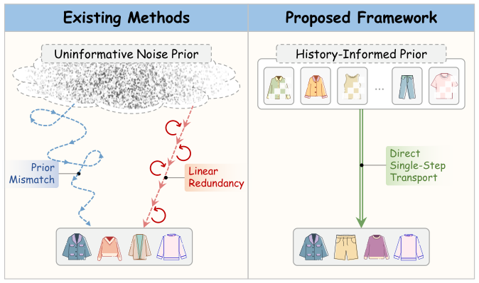
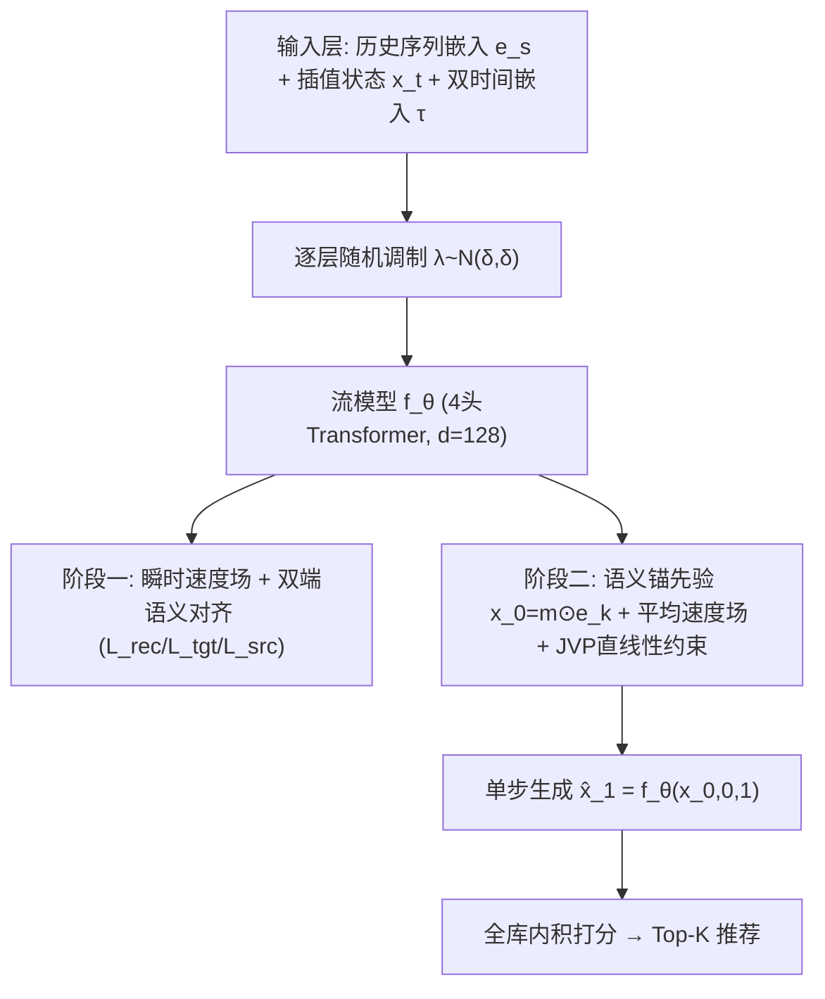
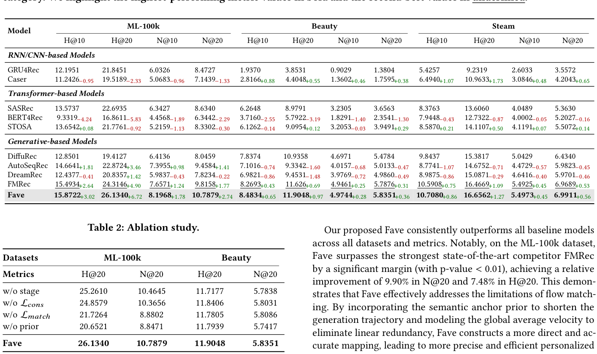
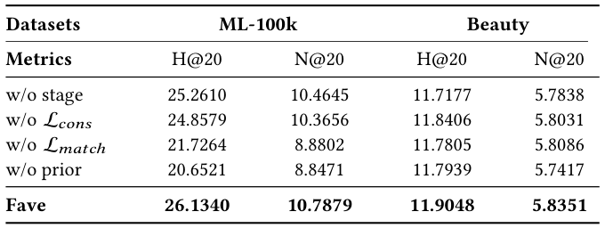
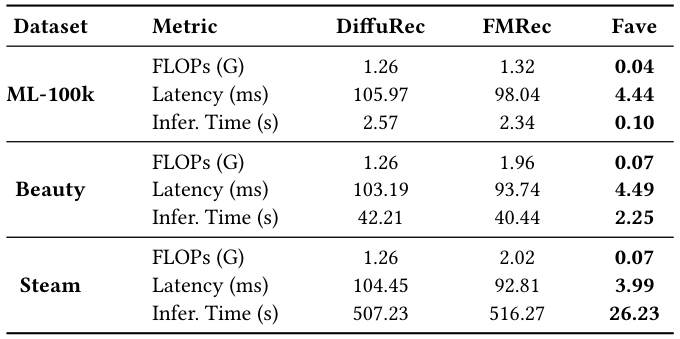
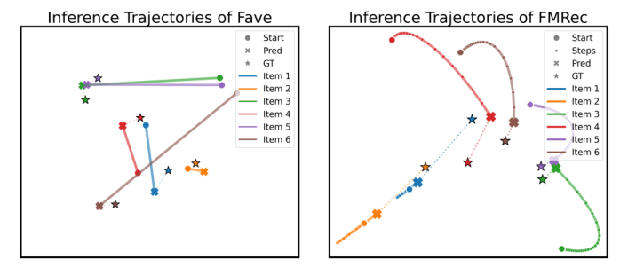
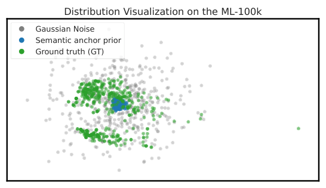
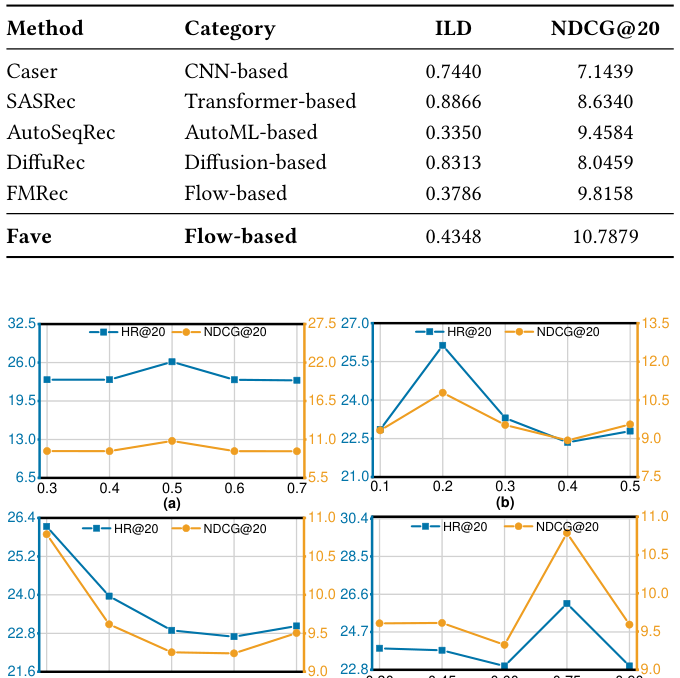

# FAVE: Flow-based Average Velocity Establishment for Sequential Recommendation (基于平均速度建立的流匹配序列推荐)

- **会议/期刊**: SIGIR 2026 (Melbourne, Australia)
- **推荐链路定位**: 端到端生成式 (End-to-End Generative) — 单步生成目标物品嵌入并做全库内积打分
- **研究方向**: 生成式推荐与离散语义ID (主) / 序列与会话推荐 (次)
- **论文原文**: [https://arxiv.org/abs/2604.04427v1](https://arxiv.org/abs/2604.04427v1)
- **开源代码**: [https://github.com/Blue130/Fave](https://github.com/Blue130/Fave)

## TL;DR (核心速览)

针对流匹配生成式序列推荐中"噪声到数据"范式的两大低效——先验不匹配（从无信息高斯噪声出发导致轨迹过长）与线性冗余（ODE 迭代求解器在固定方向上重复计算），Fave 提出两阶段训练：阶段一用双端语义对齐构建稳定偏好流形；阶段二以用户历史掩码嵌入作为语义锚先验，并学习全局平均速度场配合 JVP 直线性约束，将多步轨迹压缩为单步位移。在 ML-100k/Beauty/Steam 三数据集全库排序协议下取得 SOTA，ML-100k 上 N@20 相对 FMRec 提升 9.90%，推理延迟降低 20 倍以上。

## Background & Motivation (背景与动机)

- **领域背景与主流范式**: 序列推荐 (SR) 的主流范式正从判别式（GRU4Rec、Caser、SASRec、BERT4Rec、STOSA）转向生成式。扩散模型（DiffuRec、DreamRec）以非自回归方式建模用户偏好分布，保真度高；流匹配（FlowRec、FMRec）则以 ODE 定义确定性概率路径，理论上轨迹更平滑、误差累积更少。
- **现有方法局限 (Limitations of Prior Work)**:
  1. **先验不匹配 (Prior Mismatch)**: 现有流匹配方法（如 FMRec）仍从无信息高斯噪声 $\mathcal{N}(0,I)$ 初始化，而推荐任务的起点本应是用户兴趣的良定义表征，迫使模型在推理时穿越过长轨迹。
  2. **线性冗余 (Linear Redundancy)**: 推荐中流匹配收敛到固定目标分布，ODE 求解器一旦确定更新方向，后续迭代步只是重复相同的确定性变换，产生无意义计算。
  3. 扩散类方法需大量去噪步，推理延迟无法满足实时推荐要求。
- **核心挑战 (Key Challenge)**: 单纯加速数值求解器（增大步长 $\Delta t$）仍受离散化误差约束，无法从根本上消除"从噪声重建用户画像"这一冗余过程；而直接减少步数又会牺牲生成质量与多样性。
- **核心洞察与切入点 (Key Insight)**: 作者从轨迹层面重新审视流公式：将 ODE 在区间 $[t,r]$ 上直接积分可得 $\bm{x}_r-\bm{x}_t=(r-t)\bar{v}_\theta$，其中括号项即**平均速度**。这一精确代数关系消除了对 $\Delta t$ 的依赖——只要轨迹足够直（加速度趋零），单步位移即可精确到达目标。配合"用户兴趣连续演化"的先验，用历史掩码嵌入替代噪声作为起点，可同时缩短轨迹并保证信息量。

<figure class="paper-figure" markdown="span">
  <figcaption>图1：生成式推荐范式的比较。（左）现有的“噪声到数据”生成方法存在先验不匹配和线性冗余问题。（右）我们提出的Fave采用从语义锚先验出发的直接轨迹传输。</figcaption>
</figure>

## Problem Formulation & Method (问题定义与方法架构)

### 1. 符号定义与输入表征 (Notations & Input Representations)

- 用户集 $\mathcal{U}=\{u_1,\dots,u_{|\mathcal{U}|}\}$，物品集 $\mathcal{I}=\{i_1,\dots,i_{|\mathcal{I}|}\}$，二值交互矩阵 $\mathbf{A}\in\{0,1\}^{|\mathcal{U}|\times|\mathcal{I}|}$。
- 用户 $u$ 的历史序列 $s_u=[i_1,\dots,i_l]$，目标为预测下一交互 $i_{l+1}$。
- 生成式范式：学习参数化非线性映射 $f_\theta$，将可解先验 $p_{\text{prior}}$ 直接变换为目标分布 $p_{\text{data}}=f_\theta(p_{\text{prior}})$。
- 目标物品嵌入 $\bm{x}_1\triangleq\bm{e}_{l+1}=\text{Embedding}(i_{l+1})$；起点 $\bm{x}_0$ 在阶段一为高斯噪声、阶段二为语义锚先验。
- 骨干网络：4 头自注意力 Transformer，隐藏维度 $d=128$；解码器为 3 层 MLP（tanh 激活）；最大序列长度 $L=50$；batch size 512。

### 2. 整体流水线 (Overall Architecture)

数据流：历史交互序列嵌入 $\bm{e}_s$ + 插值状态 $\bm{x}_t$ + 双时间嵌入 $\bm{\tau}$ → 逐层随机调制 $\bm{\lambda}$ → 流模型 $f_\theta$ 预测目标状态 $\hat{\bm{x}}_1$ → 阶段二单步前向得 $\hat{\bm{x}}_1=f_\theta(\bm{x}_0,0,1)$ → 与全库物品嵌入内积排序取 Top-K。

<figure class="paper-figure" markdown="span">
  <figcaption>图2：Fave的整体框架，采用两阶段训练策略。首先通过从高斯噪声中学习瞬时速度场来构建基础流形。第二阶段引入语义锚先验和平均速度建模，以解决先验不匹配和线性冗余问题。</figcaption>
</figure>

### 3. 核心模块设计与数学原理 (Key Designs & Formulations)

**(1) 阶段一：双时间流建模与双端语义对齐（基础流形构建）**

- **双时间参数化 $(t,r)$**: 单一时间变量无法区分速度方向（不同用户轨迹可能共享相似插值状态却奔向不同目标）。构造混合特征 $\bm{\tau}=\text{TimeEmb}(t)+\text{TimeEmb}(r-t)$，其中 $r=1$ 为轨迹终点时间锚。网络输入 $\bm{E}=\bm{e}_s+\bm{\lambda}\odot(\bm{x}_t+\bm{\tau})$，$\bm{\lambda}\sim\mathcal{N}(\delta,\delta)$ 逐层采样做随机调制以防过拟合。
- **重参数化恢复损失**: 不直接回归速度，而令网络估计目标状态 $\hat{\bm{x}}_1$，瞬时速度定义为 $v_\theta(\bm{x}_t,t,r)\triangleq f_\theta(\bm{x}_t,t,r)-\bm{x}_0$。代入 CFM 目标后消去对 $\bm{x}_0$ 的依赖，得到 $\mathcal{L}_{rec}=\mathbb{E}\|f_\theta(\bm{x}_t,t,1)-\bm{x}_1\|^2$，转化为直接去噪回归。
- **双端语义对齐**: 仅用 $\mathcal{L}_{rec}$ 会导致可学习物品嵌入塌缩（不同嵌入合并以最小化重建距离）。目标端引入交叉熵 $\mathcal{L}_{tgt}=-\log\frac{\exp(f_\theta(\bm{x}_t,t,r)\cdot\bm{e}_{l+1})}{\sum_{j\in\mathcal{I}}\exp(f_\theta(\bm{x}_t,t,r)\cdot\bm{e}_j)}$ 区分物品；源端引入历史重建 $\mathcal{L}_{src}=\|\mathcal{D}(\bm{E}_n)-\mathbf{A}_u\|^2$ 稳定起点语义。

**(2) 阶段二：语义锚先验（Informative Prior Construction）**

冻结嵌入层以保留阶段一语义空间。以伯努利掩码扰动历史物品嵌入作为起点：
$$\bm{x}_0=\bm{m}\odot\bm{e}_k,\quad k\sim\text{Uniform}(s_u),\ \bm{m}\sim\text{Bernoulli}(\rho)$$
掩码迫使模型从部分行为线索重建精确偏好表征，避免学习"历史到历史"的平凡恒等映射。物理直觉：将生成任务从"从零创造"转为"从上下文演化"，大幅缩短语义轨迹距离。

**(3) 阶段二：平均速度场与 JVP 直线性约束（Single-Step Consolidation）**

对 ODE 在 $[t,r]$ 上积分：
$$\bm{x}_r-\bm{x}_t=\int_t^r v_\theta(\bm{x}_\eta,\eta)d\eta=(r-t)\underbrace{\left[\frac{1}{r-t}\int_t^r v_\theta(\bm{x}_\eta,\eta)d\eta\right]}_{\bar{v}_\theta(\bm{x}_t,t,r)}$$
得到精确代数关系 $\bm{x}_1=\bm{x}_0+\bar{v}_\theta(\bm{x}_0,0,1)$，平均速度即全局位移向量。将 $\bar{v}_\theta$ 代入 CFM 目标并展开，总误差分解为**条件流匹配项**与**曲率惩罚项**（含 $\frac{d\bm{x}_t}{dt}\cdot\frac{\partial}{\partial\bm{x}_t}\bar{v}_\theta+\frac{\partial}{\partial t}\bar{v}_\theta$）。由三角不等式，分别优化两项即可最小化上界：匹配项保精度，曲率项保低延迟。

- **匹配损失**: 采样 $t\sim\text{Uniform}(0,1)$，$r\sim p_{end}\cdot\delta_1+(1-p_{end})\cdot\text{Uniform}(t,1)$，$\mathcal{L}_{match}=\|f_\theta(\bm{x}_t,t,r)-\bm{x}_1\|^2$，强制模型在任意子区间泛化以显式约束轨迹线性。
- **一致性正则**: 在重参数化下最小化流加速度 $\frac{d}{dt}\bar{v}_\theta$ 等价于最小化 $\frac{d}{dt}f_\theta$。链式法则展开为雅可比矩阵沿轨迹切向量的投影，用 JVP 算子单次前向高效计算：$\mathcal{L}_{cons}=\|[\bar{v}_\theta,1,0]\cdot\nabla f_\theta(\bm{x}_t,t,r)\|^2$，无需显式实例化高维雅可比。

### 4. 训练目标、负采样与推理复杂度 (Optimization, Negative Sampling & Complexity)

- **总损失（阶段二）**: $\mathcal{L}=\mathcal{L}_{match}+\gamma\mathcal{L}_{cons}+\alpha\mathcal{L}_{tgt}+\beta\mathcal{L}_{src}$，最优超参 $\alpha=0.5$、$\beta=0.2$、$\gamma=0.1$、掩码保留率 $\rho=0.75$。
- **训练负采样策略**: 目标端交叉熵 $\mathcal{L}_{tgt}$ 对全物品集 $\mathcal{I}$ 做 softmax（隐式全库负样本），未采用显式负采样或难负例挖掘；流匹配本身免负采样。
- **推理**: 单次前向 $\hat{\bm{x}}_1=\bm{x}_0+\bar{v}_\theta(\bm{x}_0,0,1)\equiv f_\theta(\bm{x}_0,0,1)$，$\Delta t=1$，无需 ODE 迭代或 Beam Search；随后与全库物品嵌入内积排序。相比 DiffuRec/FMRec 的多步迭代，FLOPs 与延迟均降一个数量级（表3）。

## Experimental Setup & Evaluation Protocol (实验设置与评估协议)

- **数据集统计与预处理**: 采用 ML-100k、Amazon-Beauty、Steam 三个基准，预处理沿用 ICLRec 与 DuoRec 的方法（原文未在正文列出具体 #Users/#Items/#Interactions 统计表，仅说明覆盖从稠密 ML-100k 到大规模稀疏 Beauty/Steam 的多样设置）。

| 数据集 (Dataset) | 用户数 (#Users) | 物品数 (#Items) | 交互数 (#Interactions) | 稀疏度/密度 (Sparsity) | 模态/辅助特征说明 |
| :--- | :---: | :---: | :---: | :---: | :--- |
| ML-100k | 原文未报告 | 原文未报告 | 原文未报告 | 稠密 | 仅 ID 嵌入 |
| Amazon-Beauty | 原文未报告 | 原文未报告 | 原文未报告 | 稀疏 | 仅 ID 嵌入 |
| Steam | 原文未报告 | 原文未报告 | 原文未报告 | 稀疏 | 仅 ID 嵌入 |

- **数据划分方式 (Splitting Strategy)**: 沿用 ICLRec/DuoRec 的序列推荐标准划分（通常为留一法 LOO：最后一项测试、倒数第二项验证），原文正文未逐字复述划分细节，需以代码仓库为准。
- **排名评测协议 (Ranking Protocol)**: **Full-Ranking（全库排序）**——对每个用户对所有未交互物品打分排序，遵循 [10] 的 all-ranking 协议，$K\in\{10,20\}$。
- **评价指标与显著性检验**: Hit Rate H@10/H@20、NDCG N@10/N@20；ML-100k 上相对 FMRec 的提升报告 $p$-value $<0.01$（配对显著性）；嵌入维度 $d=128$ 对齐。

## Key Experimental Results (核心实验结果)

### 1. 主实验对比 (Main Results)

<figure class="paper-figure" markdown="span">
  <figcaption>表1：整体性能比较。下标表示与各类别基线模型的性能差距。我们用粗体突出最高性能指标值，用下划线标出次优值。</figcaption>
</figure>

| 数据集 | 指标 | 传统/序列最强基线 (SASRec/STOSA) | 生成式最强基线 (FMRec) | 本文方法 (Fave) | 相对提升 (vs FMRec) |
| :--- | :--- | :---: | :---: | :---: | :---: |
| ML-100k | H@20 | 22.6935 (SASRec) | 24.3146 | **26.1340** | +7.48% |
| ML-100k | N@20 | 8.6340 (SASRec) | 9.8158 | **10.7879** | +9.90% |
| ML-100k | H@10 | 13.6542 (STOSA) | 15.4934 | **15.8722** | +2.44% |
| Beauty | H@20 | 9.0954 (STOSA) | 11.6260 | **11.9048** | +2.40% |
| Beauty | N@20 | 3.9491 (STOSA) | 5.7876 | **5.8351** | +0.82% |
| Steam | H@20 | 14.1107 (STOSA) | 16.4669 | **16.6562** | +1.15% |
| Steam | N@20 | 5.5072 (STOSA) | 6.9689 | **6.9911** | +0.32% |

结论：流匹配方法（FMRec、Fave）一致优于矩阵重建类（AutoSeqRec）与随机扩散类（DiffuRec）；Fave 在所有数据集与指标上全面领先，稠密数据集 ML-100k 上增益最显著。

### 2. 消融实验与控制变量分析 (Ablation Study)

<figure class="paper-figure" markdown="span">
  <figcaption>表2：消融研究。</figcaption>
</figure>

| 变体 | ML-100k H@20 | ML-100k N@20 | Beauty H@20 | Beauty N@20 |
| :--- | :---: | :---: | :---: | :---: |
| w/o stage 2 | 25.2610 | 10.4645 | 11.7177 | 5.7838 |
| w/o $\mathcal{L}_{cons}$ | 24.8579 | 10.3656 | 11.8406 | 5.8031 |
| w/o $\mathcal{L}_{match}$ | 21.7264 | 8.8802 | 11.7805 | 5.8086 |
| w/o prior | 20.6521 | 8.8471 | 11.7939 | 5.7417 |
| **Fave** | **26.1340** | **10.7879** | **11.9048** | **5.8351** |

- $\mathcal{L}_{match}$ 与语义锚先验是最核心模块，移除后 ML-100k H@20 分别骤降 4.41 与 5.48；$\mathcal{L}_{cons}$ 与阶段二整体移除的下降较温和（约 0.87/1.28），因其仅正则化偏好演化动力学而非重建基础语义。
- 稠密数据集上消融效应更明显，稀疏数据集（Beauty）上细粒度轨迹约束收益受限——弱交互信号下核心组件比高级精修更重要。
- 原文未报告参数量对齐或图度数匹配等控制变量消融。

### 3. 稀疏度/冷启动分桶与超参敏感度 (Sparsity Buckets & Hyperparameters)

- **效率对比**: <figure class="paper-figure" markdown="span">
  <figcaption>表3：推理效率比较。FLOPs和Latency指标按每样本报告。</figcaption>
</figure>
- **轨迹可视化**: <figure class="paper-figure" markdown="span">
  <figcaption>图3：Fave（左）和FMRec（右）在ML-100k上的推理轨迹比较。轨迹点首先进行ℓ2归一化，然后使用t-SNE可视化。</figcaption>
</figure>
- **先验分布可视化**: <figure class="paper-figure" markdown="span">
  <figcaption>图4：在ML-100k上高斯噪声、提出的语义锚先验和真实物品嵌入的嵌入分布可视化，表明语义锚先验初始化更接近目标分布。</figcaption>
</figure>
- **多样性**: <figure class="paper-figure" markdown="span">
  <figcaption>表4：在ML-100k数据集上的推荐多样性性能。</figcaption>
</figure>
- **超参敏感度**: $\alpha=0.5$（过大导致用户间预测分布趋同、多样性下降）、$\beta=0.2$（过小对噪声敏感、过大限制下一项适配）、$\gamma=0.1$（过小轨迹偏离线性、过大过度约束）、$\rho=0.75$（过低语义不足、过高退化为恒等映射）。
- **线上 A/B 测试**: 原文仅包含离线实验，未报告线上 A/B 结果。

## Highlights, Limitations & Critiques (亮点、局限与审稿级批判)

- **核心亮点与可迁移性**:
  1. 将 ODE 积分重写为精确代数关系并解耦为"匹配 + 曲率"两项，是流匹配加速的优雅理论工具，可迁移到任意基于 FM 的生成式推荐/检索任务。
  2. 语义锚先验（历史掩码嵌入）思想通用，可推广到扩散式推荐、生成式检索的初始化设计。
  3. JVP 单次前向计算方向导数，避免高维雅可比实例化，工程实现友好；单步推理对延迟敏感场景极具落地价值。
- **局限性与审稿视角批判**:
  1. **数据集统计缺失**: 正文未给出三数据集的 #Users/#Items/#Interactions 与过滤规则（如 5-core），削弱可复现性；划分策略仅引用 ICLRec/DuoRec 而未明示，存在审稿追问空间。
  2. **稀疏场景增益有限**: Beauty/Steam 上相对 FMRec 提升仅 0.3%–2.4%，SOTA 优势在稀疏数据上不稳健，作者亦承认细粒度轨迹约束在弱信号下收益受限。
  3. **两阶段训练复杂度**: 阶段二冻结嵌入层、依赖阶段一收敛质量，训练流程比单阶段 FMRec 更繁琐，超参（$\alpha,\beta,\gamma,\rho$）敏感度较高。
  4. **多样性度量单一**: 仅用 ILD 衡量多样性，未报告覆盖率/长尾等指标；且单步生成的理论多样性上限仍值得进一步讨论。
  5. **无线上验证**: 声称"适用于延迟敏感场景"但仅有离线延迟测量，缺乏真实工业流量 A/B 佐证。

## Rating (四维评分)

- **方法创新性 (Novelty)**: ⭐⭐⭐⭐
- **评估协议与实验扎实度 (Protocol & Experiments)**: ⭐⭐⭐
- **写作与数学规范度 (Clarity & Rigor)**: ⭐⭐⭐⭐
- **工业落地与复现价值 (Industrial & Practical Value)**: ⭐⭐⭐⭐
