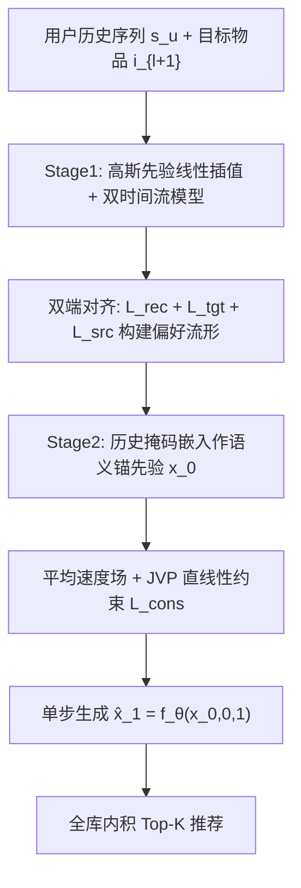
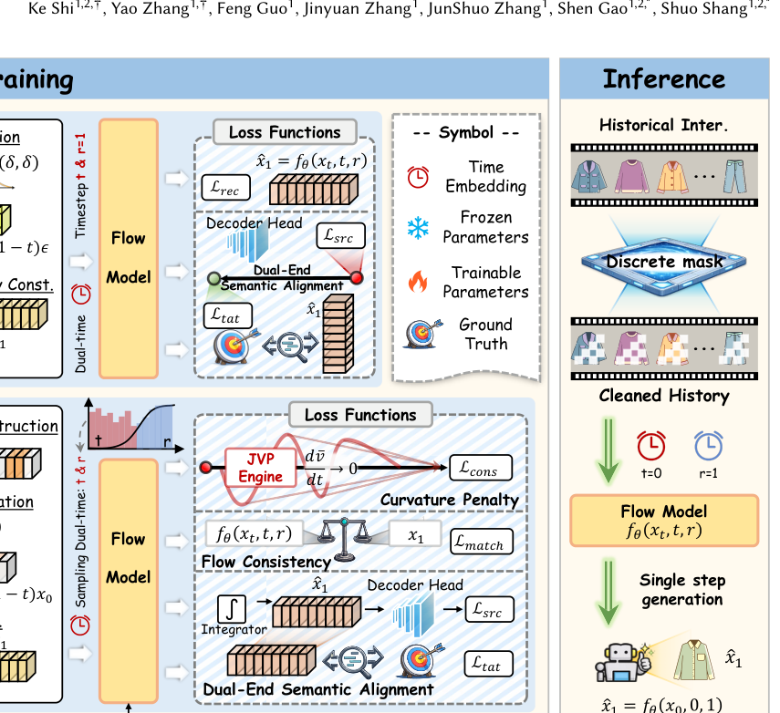

# FAVE: Flow-based Average Velocity Establishment for Sequential Recommendation (基于平均速度场建立的单步流匹配序列推荐)

- **会议/期刊**: SIGIR 2026
- **作者与机构**: Ke Shi, Yao Zhang, Feng Guo, Jinyuan Zhang, JunShuo Zhang, Shen Gao, Shuo Shang（电子科技大学 / 网络空间安全研究院）
- **推荐链路定位**: 端到端生成式（Next-Item 生成式召回/排序）
- **研究方向**: 生成式推荐与离散语义ID / 序列推荐
- **论文原文**: [https://arxiv.org/abs/2604.04427v1](https://arxiv.org/abs/2604.04427v1)
- **开源代码**: [https://github.com/Blue130/Fave](https://github.com/Blue130/Fave)

## TL;DR (1分钟核心速览)

现有基于流匹配（Flow Matching）的生成式序列推荐仍沿用“噪声到数据”范式，存在**先验不匹配**（从无信息高斯噪声出发，轨迹过长）与**线性冗余**（ODE 求解器沿固定方向重复迭代）两大效率瓶颈。Fave 提出两阶段训练：Stage 1 用双端语义对齐构建稳定偏好流形；Stage 2 以用户历史掩码嵌入作为**语义锚先验**，并学习**全局平均速度场**配合 JVP 直线性约束，实现单步生成。在 ML-100k / Beauty / Steam 三数据集全库排序（all-ranking）协议下，ML-100k 上 N@20 相对最强基线 FMRec 提升 **9.90%**，推理延迟降至 4.44ms（约 20 倍加速）。

## Background & Motivation (背景与核心矛盾)

- **主流范式**: 生成式序列推荐用扩散/流匹配建模用户偏好分布；流匹配以确定性 ODE 轨迹替代扩散的随机去噪，理论上轨迹更直、步数更少（FMRec 为代表）。
- **前人局限**: ① **先验不匹配**——生成起点是无信息高斯噪声，而推荐任务的起点本应是用户兴趣表征，被迫走超长轨迹“从零重建”用户画像；② **线性冗余**——一旦 ODE 求解器确定更新方向，后续迭代步只是重复同一确定性变换，Δ𝑡→0 的精度要求直接转化为推理延迟。
- **核心洞察 (Key Insight)**: 用户兴趣是连续演化的，下一物品与历史行为在语义空间高度邻近；因此生成任务应从“从零创造”转为“从上下文演化”，且轨迹在数学上可积分为一个全局位移向量。
- **本文切入点**: 用历史掩码嵌入做先验缩短轨迹距离，用平均速度场把多步积分坍缩为单步代数关系 $\hat{x}_1 = x_0 + \bar{v}_\theta(x_0,0,1)$。

## Method (核心方法设计)

### 1. 整体框架 (Overall Architecture)

Fave 采用渐进式两阶段训练，全程由双端语义对齐约束语义空间稳定。Stage 1（基础流形构建）：目标物品嵌入作为终点 $x_1$，高斯噪声为起点 $x_0$，线性插值得 $x_t$，网络以“双时间”参数化 $(t,r)$ 预测瞬时速度场，并用恢复损失 + 目标端交叉熵 + 源端历史重建稳定流形。Stage 2（单步整合）：冻结嵌入层，将起点替换为历史物品的 Bernoulli 掩码嵌入（语义锚先验），把瞬时速度重铸为区间平均速度，用匹配损失 + JVP 曲率惩罚强制轨迹笔直，推理时单次前向即得 $\hat{x}_1$，与全库物品内积排序。

<figure class="paper-figure" markdown="span">
  <figcaption>图2：Fave的整体框架，采用两阶段训练策略。首先通过从高斯噪声中学习瞬时速度场来构建基本流形。第二阶段引入语义锚先验和平均速度建模，以解决先验不匹配和线性冗余问题。</figcaption>
</figure>

### 2. 关键设计拆解 (Key Designs)

1. **语义锚先验（Informative Prior Construction）**：痛点是无信息噪声起点导致轨迹冗长。改为从用户历史中均匀采样物品嵌入并施加 Bernoulli 掩码作为起点：
$$x_0 = m \odot e_k,\quad k \sim \text{Uniform}(s_u),\ m \sim \text{Bernoulli}(\rho)$$
掩码既把起点锚定在目标附近（图4 显示其与真实物品簇重叠），又避免“历史→历史”的平凡恒等映射，迫使模型从部分行为线索重建完整偏好。

2. **平均速度场 + JVP 直线性约束（Average Velocity & Flow Consistency）**：痛点是对 ODE 在 $[t,r]$ 上积分后，误差可分解为“条件流匹配项 + 曲率惩罚项”：
$$\mathcal{L}_{CFM} = \Big\| \underbrace{\bar{v}_\theta - (x_1-x_0)}_{\text{flow matching}} - (r-t)\underbrace{\big[\tfrac{dx_t}{dt}\cdot\tfrac{\partial \bar{v}_\theta}{\partial x_t} + \tfrac{\partial \bar{v}_\theta}{\partial t}\big]}_{\text{curvature penalty}} \Big\|^2$$
由三角不等式可解耦为两项分别优化：匹配损失 $\mathcal{L}_{match}=\|f_\theta(x_t,t,r)-x_1\|^2$ 保证终点正确，一致性损失用 JVP 高效计算方向导数而无需显式实例化高维 Jacobian：
$$\mathcal{L}_{cons} = \big\| [\bar{v}_\theta, 1, 0] \cdot \nabla f_\theta(x_t,t,r) \big\|^2$$
最小化流加速度即“拉直”轨迹，使单步位移即可精确落点，同时防止模式坍缩（多样性分析佐证）。

3. **训练目标、负采样与推理效率**：Stage 2 总损失 $\mathcal{L}=\mathcal{L}_{match}+\gamma\mathcal{L}_{cons}+\alpha\mathcal{L}_{tgt}+\beta\mathcal{L}_{src}$（最优 $\alpha=0.5,\beta=0.2,\gamma=0.1,\rho=0.75$）。训练采用全库 softmax 交叉熵（$\mathcal{L}_{tgt}$ 分母遍历全部物品），**无需显式负采样**；推理为单次前向 + 全库内积，FLOPs 仅 0.04G、延迟 4.44ms。

## Experimental Setup & Evaluation Protocol (实验设置与评估协议)

- **数据集与预处理**（沿用 ICLRec / DuoRec 的 5-core 过滤）：

| 数据集 | #Users | #Items | #Interactions | 稀疏度/密度 | 特征/场景说明 |
| :--- | :---: | :---: | :---: | :---: | :--- |
| ML-100k | 943 | 1,682 | 100,000 | 6.30% | 稠密电影评分，序列推荐标准基准 |
| Amazon-Beauty | 22,363 | 12,101 | 198,502 | 0.07% | 稀疏美妆电商评论序列 |
| Steam | 25,261 | 8,892 | 287,238 | 0.13% | 稀疏游戏平台行为序列 |

- **数据划分与防穿越**: 采用 `Leave-One-Out` 划分（最后一交互为测试、倒数第二为验证），与 ICLRec/DuoRec 协议一致。
- **排名评测协议**: 无偏 `Full-Ranking`（对每个用户全部未交互物品排序），报告 H@10/20 与 N@20/10，K∈{10,20}。
- **对比基线与超参设置**: 基线覆盖 RNN/CNN（GRU4Rec、Caser）、Transformer（SASRec、BERT4Rec、STOSA）、生成式（DiffuRec、AutoSeqRec、DreamRec、FMRec）；主干为 4 头自注意力、隐维 128、batch 512、最大序列长 50，显著性 $p<0.01$。

## Key Experimental Results (实验关键数据)

### 1. 主实验对比 (Main Results)

| Model | ML-100k H@20 | ML-100k N@20 | Beauty H@20 | Beauty N@20 | Steam H@20 | Steam N@20 |
| :--- | :---: | :---: | :---: | :---: | :---: | :---: |
| SASRec | 22.6935 | 8.6340 | 8.9791 | 3.6563 | 13.6060 | 5.3630 |
| STOSA | 21.7761 | 8.3302 | 9.0954 | 3.9491 | 14.1107 | 5.5072 |
| DiffuRec | 19.4127 | 8.0459 | 10.9358 | 5.4784 | 15.3817 | 6.4340 |
| AutoSeqRec | 22.8724 | 9.4584 | 9.3342 | 5.0133 | 14.6752 | 5.9823 |
| DreamRec | 20.8357 | 7.8234 | 9.4531 | 4.9860 | 15.0871 | 5.9701 |
| FMRec | 24.3146 | 9.8158 | 11.6260 | 5.7876 | 16.4669 | 6.9689 |
| **Fave** | **26.1340** | **10.7879** | **11.9048** | **5.8351** | **16.6562** | **6.9911** |
| Improv.% (vs FMRec) | +7.48% | +9.90% | +2.40% | +0.82% | +1.15% | +0.32% |

### 2. 消融实验 (Ablation Study)

| 变体 | ML-100k H@20 | ML-100k N@20 | Beauty H@20 | Beauty N@20 |
| :--- | :---: | :---: | :---: | :---: |
| w/o stage 2 | 25.2610 | 10.4645 | 11.7177 | 5.7838 |
| w/o $\mathcal{L}_{cons}$ | 24.8579 | 10.3656 | 11.8406 | 5.8031 |
| w/o $\mathcal{L}_{match}$ | 21.7264 | 8.8802 | 11.7805 | 5.8086 |
| w/o prior（换回高斯噪声） | 20.6521 | 8.8471 | 11.7939 | 5.7417 |
| **Fave** | **26.1340** | **10.7879** | **11.9048** | **5.8351** |

### 3. 关键实验发现 (Key Findings)

1. **先验与匹配损失是命脉**：去掉语义锚先验（换回高斯噪声）ML-100k N@20 从 10.79 暴跌至 8.85（−18.0%），去掉 $\mathcal{L}_{match}$ 跌至 8.88，二者降幅远大于去掉 $\mathcal{L}_{cons}$（10.37）或整个 Stage 2（10.46），说明“起点语义化 + 终点对齐”贡献了主要收益，曲率约束是锦上添花的效率保障。
2. **稠密数据吃精细约束、稀疏数据吃核心映射**：ML-100k 上各消融变体差异显著（H@20 跨度 5.48），而 Beauty 上变体间差距仅约 0.19，印证极稀疏场景弱交互信号限制了轨迹级正则的收益，核心组件比精细优化更关键。
3. **单步不牺牲多样性**：Fave 的 ILD=0.4348 高于多步 FMRec 的 0.3786 与 AutoSeqRec 的 0.3350，同时 N@20 最高（10.79），说明平均速度场对任意先验采样点都引导至目标分布的不同区域，避免了单步生成退化为确定性点估计的模式坍缩。

## Highlights, Limitations & Rating (亮点、对比与审稿评价)

- **与代表作对比 (vs. Prior Work)**: 相比 FMRec（流匹配 + 直线轨迹但仍需多步从噪声积分），Fave 把“起点”和“步数”两个维度同时改造——语义锚先验解决起点、平均速度场解决步数；相比 DiffuRec（随机扩散、高多样性低精度），Fave 以确定性单步同时取得更高精度与更高 ILD；相比 AutoSeqRec（自编码重建），Fave 在连续流形上建模偏好演化而非矩阵重构。
- **可迁移亮点**: ① “掩码历史嵌入作先验 + 保留率 $\rho$ 调参”可迁移到任何生成式召回的先验设计；② 用 JVP 计算方向导数替代显式 Jacobian 的曲率正则，可低成本嵌入其他 ODE/扩散推荐模型的直线化训练。
- **审稿级局限批判**: ① 效率对比仅在单卡 L40、batch 级统计，未报告工业级全库 ANN 检索下的端到端 QPS 与冷启动用户（历史为空时锚先验失效）表现；② 三数据集规模偏小（最大 Steam 仅 28 万交互），且 Stage 2 需冻结嵌入层，两阶段超参（$\alpha,\beta,\gamma,\rho$）共 4 个，调参成本与跨域鲁棒性存疑。
- **四维评分**: 创新性 ⭐⭐⭐⭐ | 实验扎实度 ⭐⭐⭐⭐ | 方法清晰度 ⭐⭐⭐⭐⭐ | 落地价值 ⭐⭐⭐⭐

