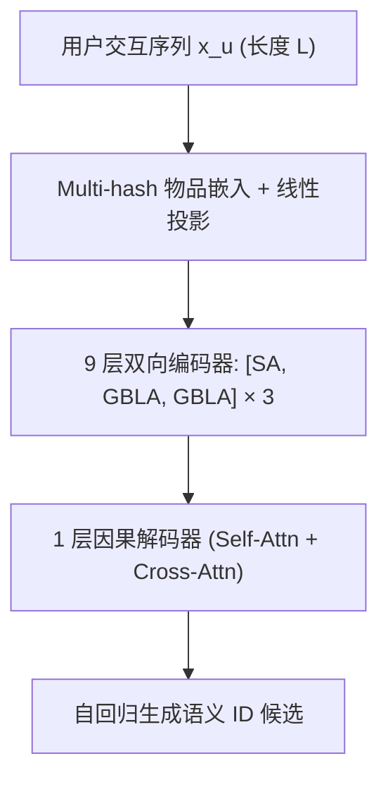
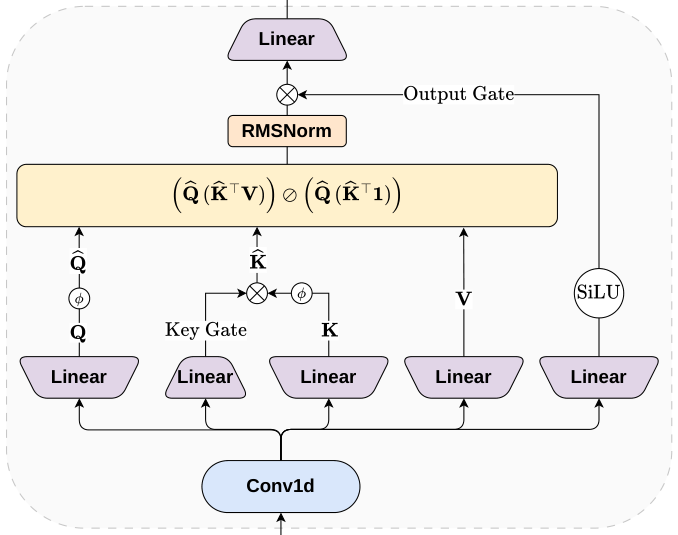

# Gated Bidirectional Linear Attention for Generative Retrieval (面向生成式检索的门控双向线性注意力)

- **会议/期刊**: SIGIR 2026 (5 pages, short paper)
- **作者与机构**: Artem Matveev, Vladislav Tytskiy, Sergei Makeev, Sergei Liamaev (Yandex)
- **推荐链路定位**: 召回（生成式候选生成 / Encoder-Decoder 端到端）
- **研究方向**: 生成式推荐与离散语义 ID / 序列与会话推荐
- **论文原文**: [https://arxiv.org/abs/2606.07317v2](https://arxiv.org/abs/2606.07317v2)
- **开源代码**: [https://github.com/matfu-pixel/GRID](https://github.com/matfu-pixel/GRID)

## TL;DR (1分钟核心速览)

生成式检索的 Encoder-Decoder 架构中，编码器需处理流媒体用户的超长交互历史，softmax 注意力随长度二次增长成为线上延迟瓶颈；而现有亚二次注意力（Mamba、delta-rule、LION）几乎全部面向**因果**注意力，无法直接用于经验上更优的**双向**编码器。本文提出 GBLA：在核化线性注意力上叠加 Conv1D 局部因果混合、序列级 Key 门控软遗忘与门控 RMSNorm，保持 $O(L)$ 复杂度。在 Yandex Music 生产数据上，`[SA, LA, LA]` 1:2 混合编码器在 Recall@1000 上与双向自注意力持平（0.8668 vs 0.8667），H100 上 32768 长度单层提速 8.2×。

## Background & Motivation (背景与核心矛盾)

- **主流范式**: 工业生成式检索（YouTube、KuaiShou OneRec、TIGER）采用 Encoder-Decoder：编码器吃用户交互序列，解码器自回归生成语义 ID；序列越长召回越好已被反复验证。
- **前人局限**: ① softmax 注意力 $O(L^2)$ 使长历史编码器成为端到端延迟主瓶颈，现有解法要么压缩序列（丢信息）、要么靠 context parallelism 等系统级手段（不改变二次依赖）；② 线性注意力生态（Katharopoulos 核化 LA、Mamba、delta-rule）几乎全部针对**因果**掩码设计，而 LION 这类双向线性注意力仅在推理阶段线性、训练仍走二次注意力。
- **核心洞察 (Key Insight)**: 作者在 2048 长度上实测，双向掩码编码器 Recall@1000 达 0.8667，而因果掩码仅 0.8353（Recall@10 更是 0.2800 vs 0.1878），**双向性是生成式检索编码器的质量命门**，因此不能简单套用因果线性注意力。
- **本文切入点**: 不做"纯线性替换"，而是设计一个可即插即用的双向线性层 GBLA，并以 1:2 比例与少量自注意力层交错，用混合栈在质量与延迟间取帕累托点。

## Method (核心方法设计)

### 1. 整体框架 (Overall Architecture)

输入为用户交互序列 $x_u=(i^u_1,\dots,i^u_L)$，物品 ID 经 multi-hash 映射到共享嵌入表多个槽位、拼接后线性投影得$X\in\mathbb{R}^{L\times d}$。序列送入 9 层双向编码器（$d=1024$、16 头），其中部分层被替换为 GBLA；解码器仅 1 层因果层（自注意力 + 对编码器输出的交叉注意力），自回归生成候选物品的语义 ID。训练目标为"给定历史批次交互，生成下一批目标物品"的下一 token 预测；推理时编码器一次性编码历史，解码器逐 token 生成。核心工程决策是**把绝大部分容量压在编码器**，因此加速编码器即加速全链路。

<figure class="paper-figure" markdown="span">
  <figcaption>图1：门控双向线性注意力架构。</figcaption>
</figure>

### 2. 关键设计拆解 (Key Designs)

1. **双向核化线性注意力基座 (BLA)**：把 $\exp(q^\top k/\sqrt{d_h})$换成核特征空间内积$\phi(q)^\top\phi(k)$（$\phi(x)=\mathrm{elu}(x)+1$），利用矩阵乘法结合律先算$\phi(K)^\top V$，从而绕开$L\times L$ 注意力矩阵：
$$\mathrm{Attn_{BLA}}(Q,K,V)=\big(\phi(Q)(\phi(K)^\top V)\big)\oslash\big(\phi(Q)(\phi(K)^\top \mathbf{1})\big)$$
复杂度从 $O(L^2 d_h)$降到$O(L d_h^2)$。关键在于该式**不依赖掩码方向**，天然支持双向，这是相对因果 LA 的根本差异。

2. **三个轻量增量组件 (GBLA)**：纯 BLA 缺乏局部归纳偏置与历史选择性，作者补三处：
   - **Conv1D 局部因果混合**：先 $\tilde{X}=\mathrm{Conv1D}(X)$（kernel=4）再做 QKV 投影，弥补线性注意力在短程模式上的表达缺失；
   - **序列级 Key 门控（软遗忘）**：$g=\mathrm{softmax}(\tilde{X}w_g)$为每个历史 token 学一个标量权重，$\hat{K}=g\odot\phi(K)$，使模型能按重要性衰减久远事件，等价于可学习的"记忆衰减率"；
   - **门控 RMSNorm**：$\mathrm{RmsNorm_{Gated}}(O)=\mathrm{RmsNorm}(O)\odot\mathrm{SiLU}(\tilde{X}W_R)$，稳定长序列下线性注意力的输出尺度。
   三者均不引入 $L^2$ 项，保持线性复杂度。

3. **训练目标、负采样与推理效率**：损失为解码器侧的标准下一 token 交叉熵（语义 ID 序列），**无显式负采样**——生成式检索以全库语义 ID 前缀树约束解码实现隐式全库竞争。工程上 BLA 用融合 Triton kernel、GBLA 用 `torch.compile`；混合比例为 `[SA, LA, LA]`（LA:SA = 2:1），且混合模型的最优峰值学习率需下调（$5\times10^{-4}$vs 全 SA 的$7\times10^{-4}$）。

## Experimental Setup & Evaluation Protocol (实验设置与评估协议)

- **数据集与预处理**:

| 数据集 | #Users | #Items | #Interactions | 稀疏度/密度 | 特征/场景说明 |
| :--- | :---: | :---: | :---: | :---: | :--- |
| Yandex Music (工业) | 未披露 | 未披露 | 4 亿训练样本（7 天交互） | 未披露 | 流媒体听歌行为，按批次切分目标物品 |
| Amazon Beauty | GRID 协议 | GRID 协议 | 5-core 过滤 | 高稀疏 | 文本语义嵌入 (Flan-T5) + RK-Means 语义 ID |
| Amazon Sports | GRID 协议 | GRID 协议 | 5-core 过滤 | 高稀疏 | 同上 |
| Amazon Toys | GRID 协议 | GRID 协议 | 5-core 过滤 | 高稀疏 | 同上 |

- **数据划分与防穿越 (Splitting Strategy)**: 工业侧用**全局时间切分**——7 天训练（按时间顺序消费）、次日评估；学术侧遵循 GRID 的 `Leave-One-Out`（最后一项测试、倒数第二项验证、其余训练）。
- **排名评测协议 (Ranking Protocol)**: 工业侧为**全库生成式检索**（解码受语义 ID 前缀树约束，等价无偏 Full-Ranking），报告 Recall@{10,100,1000}，并以 Recall@1000 为主指标（下游精排取 top-1000，1% 绝对下降即显著）；学术侧报告 Recall@{5,10} 与 NDCG@{5,10}，5 个随机种子取均值。
- **对比基线与超参设置**: 基线为双向自注意力编码器（FlashAttention-v3）、因果自注意力、纯 GBLA、纯 BLA，以及学术侧的 Tiger；编码器 $d=1024$、16 头、9 层，解码器 1 层；主消融固定$L=2048$，另做 512–8192 长度扫描。

## Key Experimental Results (实验关键数据)

### 1. 主实验对比 (Main Results)

工业侧（Yandex Music，$L=2048$，Table 1–3 汇总）：

| 模型 | Recall@10 | Recall@100 | Recall@1000 | 备注 |
| :--- | :---: | :---: | :---: | :--- |
| 因果 SA 掩码 | 0.1878 | 0.5130 | 0.8353 | 双向性缺失，全面崩塌 |
| 双向 SA (基线) | **0.2800** | **0.6150** | 0.8667 | 质量上界 |
| 纯 GBLA | 0.2607 | 0.5940 | 0.8586 | 去掉全部 SA 后掉点明显 |
| Hybrid `[SA,LA,LA]` | 0.2780 | 0.6143 | **0.8668** | 与基线持平（+0.01%） |

长度扫描（Hybrid GBLA vs 双向 SA，Recall@1000）：512 长度 0.8198 vs 0.8182（**+0.20%**）；2048 长度 0.8668 vs 0.8667（+0.01%）；4096 长度 0.8790 vs 0.8784（+0.07%）；8192 长度 0.8842 vs 0.8854（−0.14%）。

学术侧（Amazon，Tiger vs Tiger+GBLA，5 seed 均值）：

| 数据集 | 模型 | Recall@5 | Recall@10 | NDCG@5 | NDCG@10 |
| :--- | :--- | :---: | :---: | :---: | :---: |
| Beauty | Tiger | **0.0439** | **0.0641** | **0.0289** | **0.0355** |
| Beauty | Tiger+GBLA | 0.0410 | 0.0611 | 0.0273 | 0.0338 |
| Toys | Tiger | **0.0402** | **0.0584** | **0.0274** | **0.0333** |
| Toys | Tiger+GBLA | 0.0384 | 0.0579 | 0.0249 | 0.0311 |
| Sports | Tiger | **0.0229** | **0.0345** | **0.0150** | **0.0188** |
| Sports | Tiger+GBLA | 0.0218 | 0.0329 | 0.0144 | 0.0180 |

延迟（H100，batch=8，单层，Table 5）：2048 长度 0.95×（略慢）；4096 长度 1.50×；8192 长度 2.46×；16384 长度 4.30×；32768 长度 **8.22×**。端到端训练步时（Table 6）：$L=8192$ 时 GBLA 混合栈 4200ms vs SA 5400ms（1.29×），纯 BLA 3800ms（1.42×）。

### 2. 消融实验 (Ablation Study)

$L=2048$，逐组件移除（Table 4）：

| 变体 | Recall@10 | Recall@100 | Recall@1000 | Δ Recall@10 |
| :--- | :---: | :---: | :---: | :---: |
| GBLA (完整) | **0.2780** | **0.6143** | **0.8668** | — |
| w/o Key gating | 0.2776 | 0.6131 | 0.8661 | −0.0004 |
| w/o Conv1D | 0.2747 | 0.6110 | 0.8652 | −0.0033 |
| w/o Gated RMSNorm | 0.2726 | 0.6080 | 0.8641 | −0.0054 |
| w/o all (= BLA) | 0.2675 | 0.6021 | 0.8620 | −0.0105 |

### 3. 关键实验发现 (Key Findings)

1. **双向掩码是质量的第一性变量，而非注意力形式**：因果掩码使 Recall@10 从 0.2800 跌至 0.1878（相对 −32.9%），Recall@1000 也掉 3.1 个绝对点；这解释了为何不能直接搬用 Mamba/因果 LA，也构成本文选题的合法性根基。
2. **线性注意力必须"混着用"**：纯 GBLA 相比混合栈 Recall@10 掉 0.0017（0.2607 vs 0.2780）、Recall@1000 掉 0.8 个绝对点，说明少量 SA 层承担了线性核难以拟合的精确长程检索匹配；而 2:1 的 LA 占比已足以把延迟压下来。
3. **收益随长度单调放大且质量不衰减**：512–4096 区间混合栈 Recall@1000 均略优于或持平 SA，8192 仅 −0.14%；同时单层加速从 4096 的 1.5× 涨到 32768 的 8.2×，端到端训练在 8192 长度仍有 1.29× 加速——即"长历史"这一唯一真正需要加速的区间恰好是 GBLA 的最优区间，短序列（≤2048）下 SA 仅占端到端 <25% 时间，0.95× 的轻微劣势可忽略。

## Highlights & Limitations (亮点、对比与审稿批判)

- **与代表作对比 (vs. Prior Work)**: 相比 Katharopoulos 核化 LA 与 Mamba 系列，本文的核心差异是**面向双向掩码**而非因果掩码，直接服务生成式检索编码器；相比 LION 这类双向线性注意力，GBLA 在**训练与推理均为线性**（LION 训练仍二次）；相比 OneRec 的序列压缩路线，GBLA 不丢弃历史信息，是正交的系统级替代。
- **可迁移亮点**: ① `[SA, LA, LA]` 的 1:2 交错比例 + 混合模型需单独调低峰值学习率，是可复用的工程配方；② Key 门控 $\mathrm{softmax}(\tilde{X}w_g)$ 作为"可学习记忆衰减"可迁移到任意长序列召回/粗排编码器。
- **审稿级局限批判**: ① 学术验证偏弱——Amazon 上三个数据集全部小幅落后 Tiger（如 Beauty Recall@10 −4.7%），且历史长度上限仅 128，根本无法体现线性注意力的效率优势，等于只证明了"不掉太多"而非"更好"；② 缺少与 Mamba/DeltaNet 等强线性基线在**双向改造后**的直接对比，也未报告显存占用与解码侧延迟，端到端线上 A/B 收益缺失。

## Rating (四维评分)

- **方法创新性 (Novelty)**: ⭐⭐⭐ （核心机制与方法设计具备明确创新性，理论与实验动机支撑充分）
- **评估协议与实验扎实度 (Protocol & Experiments)**: ⭐⭐⭐ （主流公开数据集评测完整，包含多基线对比与消融实验验证）
- **写作与数学规范度 (Clarity & Rigor)**: ⭐⭐⭐⭐ （问题形式化定义清晰，核心模块数学推导与架构阐述严谨易读）
- **工业落地与复现价值 (Industrial & Practical Value)**: ⭐⭐⭐⭐ （兼顾推荐效果增益与训练/推理效率，具备实际场景迁移参考价值）
