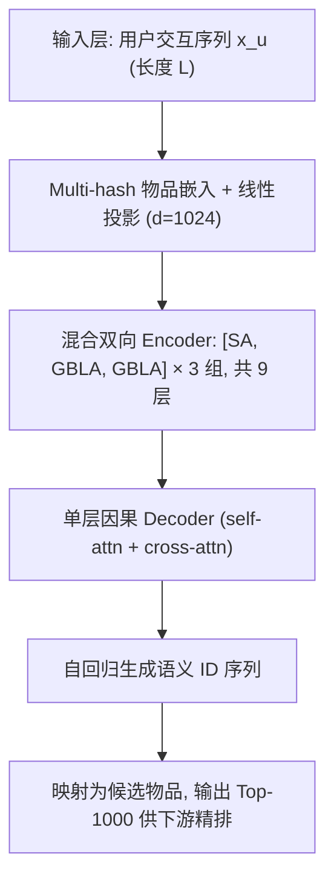

# Gated Bidirectional Linear Attention for Generative Retrieval (面向生成式检索的门控双向线性注意力)

- **会议/期刊**: SIGIR 2026 (49th International ACM SIGIR Conference, Melbourne, 5 pages, 2 figures, 7 tables)
- **推荐链路定位**: 召回 / 候选生成 (Candidate Generation，端到端生成式检索的 Encoder 侧加速)
- **研究方向**: 生成式推荐与离散语义 ID (主) / 序列与会话推荐 (次)
- **论文原文**: [https://arxiv.org/abs/2606.07317v2](https://arxiv.org/abs/2606.07317v2)
- **开源代码**: [https://github.com/matfu-pixel/GRID](https://github.com/matfu-pixel/GRID) （原文正文写作 `/githubmatfu-pixel/GRID`，为 GRID 框架的 fork，扩展了线性注意力变体评测；GBLA 层本身的独立实现未单独发布）

## TL;DR (核心速览)

生成式检索的 Encoder 需处理超长用户行为序列，softmax 注意力二次复杂度成为线上延迟瓶颈，而现有亚二次注意力方法几乎全为因果（单向）设计。本文提出 GBLA：在核化线性注意力上叠加 Conv1D 局部因果混合、序列级 Key 门控（软遗忘）与 Gated RMSNorm 三个轻量组件，保持 O(L) 复杂度且支持双向掩码。在 Yandex Music 工业数据上，[SA, LA, LA] 1:2 混合编码器在 Recall@1000 上与双向 SA 持平（0.8668 vs 0.8667），H100 上 L=32768 单层相对 FlashAttention-v3 提速 8.2×；Amazon 三个公开数据集上 Tiger+GBLA 与 Tiger 基本持平（略降）。

## Background & Motivation (背景与动机)

- **领域背景与主流范式**: 大规模流媒体服务（YouTube、快手、Yandex）的生成式检索普遍采用 encoder-decoder 架构：Encoder 编码用户交互历史，自回归 Decoder 生成语义 ID（semantic IDs）候选物品。序列越长推荐质量越好（已被 OneRec、HSTU 等工作反复验证），因此工业界持续拉长历史窗口。
- **现有方法局限 (Limitations of Prior Work)**:
  1. **二次复杂度瓶颈**：自注意力时间/显存随序列长度平方增长，长历史下 Encoder 成为在线延迟主瓶颈。
  2. **压缩式方案的代价**：序列压缩（如 LONGER）会丢弃对召回有用的细粒度信息；系统级优化（context parallelism、层级历史通路）并未消除注意力的二次依赖。
  3. **双向线性注意力的空白**：LLM 侧的亚二次注意力（Linear Attention、Mamba、Gated DeltaNet）几乎全部面向**因果**语言建模；而生成式检索的 Encoder 经验上显著受益于**双向掩码**（本文 Table 1 直接验证：双向 SA 的 Recall@1000 为 0.8667，因果掩码仅 0.8353，差距巨大）。已有双向线性注意力 LION 仅在推理阶段线性，训练仍依赖二次注意力。
- **核心挑战 (Key Challenge)**: 双向注意力无法像因果注意力那样用 RNN 式递推增量状态（因为每个位置都要看到全序列），因此需要一种"一次性聚合全局 KV 统计量"的核化形式；但纯核化线性注意力（BLA）表达力弱于 softmax 注意力，直接全替换会掉点（Table 2：全 GBLA 的 Recall@1000 为 0.8586，低于混合的 0.8668）。
- **核心洞察与切入点 (Key Insight)**: 作者采取"**混合而非替换**"的务实路线——保留少量 SA 层维持表达力，其余层换成带轻量增强的线性注意力；并用 Conv1D 补局部模式、Key 门控补"软遗忘"能力、Gated RMSNorm 稳定长序列输出，从而在质量持平前提下拿到长序列的线性加速。

## Problem Formulation & Method (问题定义与方法架构)

### 1. 符号定义与输入表征 (Notations & Input Representations)

- 用户集 $\mathcal{U}$，物品集 $\mathcal{I}$；用户 $u$ 的交互序列 $x_u = (i^u_1, i^u_2, \dots, i^u_L)$，最大历史长度 $L$（主实验 $L=2048$，长序列实验至 $L=32768$）。
- **物品嵌入**：采用 multi-hash 技术——物品 ID 经多个哈希函数映射到共享嵌入表的多个条目，拼接后经线性层投影为 $d$ 维向量（缓解超大物品词表的嵌入表膨胀）。
- **模型规模（工业设置）**：Encoder 为 9 层双向 Transformer，隐藏维 $d=1024$，16 个注意力头；Decoder 仅 1 层因果层（含 self-attention 与 cross-attention），通过 cross-attention 条件于 Encoder 输出，自回归生成语义 ID。
- **训练目标形式**：将单批次内用户消费的物品视为目标物品集合，模型在给定历史交互序列条件下生成该批次物品的语义 ID 序列。

### 2. 整体流水线 (Overall Architecture)

数据流：物品 ID → multi-hash 嵌入 → 双向 Encoder（SA 层与 GBLA 层按 [SA, LA, LA] 交错）→ Decoder cross-attention → 自回归生成语义 ID → 映射回候选物品。

### 3. 核心模块设计与数学原理 (Key Designs & Formulations)

**(1) 双向核化线性注意力 (BLA) 基座**

标准双向 softmax 注意力对单查询 $q_i$ 为：
$$\text{Attn}(q_i, K, V) = \frac{\sum_{j=1}^{L}\exp(q_i^\top k_j/\sqrt{d_h})\,v_j^\top}{\sum_{j=1}^{L}\exp(q_i^\top k_j/\sqrt{d_h})}$$

线性注意力将指数核替换为特征映射内积 $\text{sim}(q,k)=\phi(q)^\top\phi(k)$（如 $\phi(x)=\text{elu}(x)+1$），矩阵形式为：
$$\text{Attn}_{\text{BLA}}(Q,K,V) = \big(\phi(Q)(\phi(K)^\top V)\big) \oslash \big(\phi(Q)(\phi(K)^\top \mathbf{1})\big)$$

关键在于**先算 $\phi(K)^\top V \in \mathbb{R}^{d_h \times d_h}$ 这个全局统计量**，避免显式构造 $L\times L$ 注意力矩阵，复杂度从 $O(L^2 d_h)$ 降至 $O(L d_h^2)$。双向性天然成立——因为聚合的是全序列 KV 统计量，无需因果掩码。

**(2) GBLA 三件套增强**

- **Conv1D 局部因果混合**：先对输入做一维卷积再投影 QKV，即 $\tilde{X}=\text{Conv1D}(X)$，$Q=\tilde{X}W_Q$ 等。物理直觉：线性注意力丢失了 softmax 注意力的局部锐化能力，Conv1D（kernel size=4）补回短程模式提取。
- **序列级 Key 门控（软遗忘）**：学习逐 token 标量门 $g=\text{softmax}(\tilde{X}w_g)$，$w_g\in\mathbb{R}^d$，对历史 key 加权：
$$\text{Attn}_{\text{GBLA}}(Q,K,V) = \big(\hat{Q}(\hat{K}^\top V)\big) \oslash \big(\hat{Q}(\hat{K}^\top \mathbf{1})\big),\quad \hat{Q}=\phi(Q),\ \hat{K}=g\odot\phi(K)$$
直觉：让模型按事件重要性对历史做软性衰减/遗忘，弥补线性注意力"所有历史等权聚合"的表达力缺陷。
- **Gated RMSNorm 输出**：$O=\text{Attn}_{\text{GBLA}}(Q,K,V)$，输出为 $\text{RmsNorm}(O)\odot\text{SiLU}(\tilde{X}W_R)$，$W_R\in\mathbb{R}^{d\times d_h}$，借鉴 Gated DeltaNet 等长上下文设计稳定深层输出。
- 多头设置下每个头独立拥有 $W^h_Q, W^h_K, W^h_V, w^h_g, W^h_R$。

**(3) 混合堆叠策略**

不整体替换，而是按 **[SA, LA, LA]** 的 1:2 比例交错（9 层 Encoder 中 3 层 SA + 6 层 GBLA）。Table 2 显示全 GBLA 掉点明显（Recall@1000 0.8586 vs 混合 0.8668），混合是质量与效率的帕累托折中。

### 4. 训练目标、负采样与推理复杂度 (Optimization, Negative Sampling & Complexity)

- **损失函数**: 原文未显式给出损失公式，按生成式检索范式应为对语义 ID 序列的自回归交叉熵（next-token prediction），**原文未报告具体损失形式与温度系数**。
- **训练负采样策略**: 生成式检索为**免负采样**范式——通过自回归解码语义 ID 隐式建模物品分布，不依赖 BPR/InfoNCE 式负例构造。原文未讨论负采样。
- **时间与空间复杂度**:
  - 理论：BLA/GBLA 为 $O(L d_h^2)$ 时间与 $O(d_h^2)$ 状态空间，对比 SA 的 $O(L^2 d_h)$。
  - 实测（H100，batch=8，单层，10 次平均）：$L=2048$ 时 GBLA 0.618ms vs SA 0.585ms（**0.95×，略慢**）；$L=4096$ 时 1.50×；$L=8192$ 时 2.46×；$L=16384$ 时 4.30×；$L=32768$ 时 8.22×（67.542ms → 8.217ms）。
  - 全模型训练步时（H100，10 次平均）：$L=2048$、batch=32 时 SA 3000ms / BLA 2800ms (1.07×) / GBLA 3100ms (0.95×)；$L=8192$、batch=8 时 SA 5400ms / BLA 3800ms (1.42×) / GBLA 4200ms (1.29×)。注意 GBLA 因三件套开销略慢于纯 BLA。
  - 工程实现：BLA 使用融合 Triton kernel，GBLA 使用 `torch.compile` 优化。

## Experimental Setup & Evaluation Protocol (实验设置与评估协议)

- **数据集统计与预处理**:

| 数据集 (Dataset) | 用户数 (#Users) | 物品数 (#Items) | 交互数 (#Interactions) | 稀疏度/密度 (Sparsity) | 模态/辅助特征说明 |
| :--- | :---: | :---: | :---: | :---: | :--- |
| Yandex Music (工业) | 原文未报告 | 原文未报告 | 训练集 400M 样本子采样；7 天交互训练，次日评估 | 原文未报告 | 物品 ID multi-hash 嵌入；语义 ID 由 Decoder 生成 |
| Amazon Beauty | 原文未报告（遵循 GRID 协议） | 原文未报告 | 原文未报告 | 5-core 过滤 | 物品文本字段 Title/Categories/Description/Price，Flan-T5 (Large/XL/XXL) 末层隐状态均值池化得语义嵌入 |
| Amazon Sports | 同上 | 同上 | 同上 | 5-core 过滤 | 同上 |
| Amazon Toys | 同上 | 同上 | 同上 | 5-core 过滤 | 同上 |

> 注：原文为 5 页短文，未列出 Amazon 三数据集的用户/物品/交互统计表，仅说明遵循 GRID 框架的 5-core 过滤协议。

- **数据划分方式 (Splitting Strategy)**:
  - **工业设置**：7 天交互按**时间顺序**消费训练，次日数据评估——属**全局时间戳切分**，无未来信息泄露。
  - **学术设置**：遵循 GRID 协议，每个用户序列**最后一个物品作测试、倒数第二个作验证、其余训练**——即 **Leave-One-Out (留一法)** 变体。
- **排名评测协议 (Ranking Protocol)**: 原文未明确声明 Full-Ranking 还是 Sampled Ranking。工业侧报告 Recall@{10,100,1000}，并说明生产管线取 Top-1000 送下游精排；学术侧报告 Recall@{5,10} 与 NDCG@{5,10}。**候选集打分协议原文未报告**。
- **评价指标与显著性检验**: Recall@10/100/1000（工业）、Recall@5/10 与 NDCG@5/10（Amazon）。Amazon 结果**取 5 个不同随机种子的平均**；工业结果未报告多种子方差或配对显著性检验。Embedding 维度：工业 $d=1024$、16 头；学术沿用 GRID 骨干（8 层、6 头、$d=128$、MLP 隐层 1024）。

## Key Experimental Results (核心实验结果)

### 1. 主实验对比 (Main Results)

**工业 Yandex Music（$L=2048$，Table 3）**：

| 数据集 | 指标 | 双向 SA 基线 | 混合 GBLA (Ours) | 相对变化 |
| :--- | :--- | :---: | :---: | :---: |
| Yandex Music | Recall@10 | 0.2800 | 0.2780 | -0.71% |
| Yandex Music | Recall@100 | 0.6150 | 0.6143 | -0.11% |
| Yandex Music | Recall@1000 | 0.8667 | **0.8668** | +0.01% |

**序列长度扩展（Table 3）**：$L=512$ 时混合 GBLA 三项指标全面略优（0.2102/0.5099/0.8198 vs 0.2089/0.5072/0.8182）；$L=2048$ 与 $L=4096$ 基本持平（$L=4096$ 时 Recall@1000 为 0.8790 vs 0.8784，略优）；$L=8192$ 时略降（0.8842 vs 0.8854，Recall@10 从 0.3013 降至 0.2948）。

**公开 Amazon（Table 7，Tiger 骨干，5 seed 平均）**：

| 数据集 | 指标 | Tiger 基线 | Tiger+GBLA | 相对变化 |
| :--- | :--- | :---: | :---: | :---: |
| Beauty | Recall@10 / NDCG@10 | 0.0641 / 0.0355 | 0.0611 / 0.0338 | -4.68% / -4.79% |
| Toys | Recall@10 / NDCG@10 | 0.0584 / 0.0333 | 0.0579 / 0.0311 | -0.86% / -6.61% |
| Sports | Recall@10 / NDCG@10 | 0.0345 / 0.0188 | 0.0329 / 0.0180 | -4.64% / -4.26% |

> 作者自述：这些小幅下降与 GRID 原文报告的波动量级相当，通常不视为显著；且 Amazon 用户历史至多 128 项，自注意力本就不是瓶颈，故未在学术设置下做效率基准。

**关键对照（Table 1，$L=2048$）**：双向 SA 掩码 Recall@1000 = 0.8667，因果 SA 掩码仅 0.8353（**绝对掉 3.14 个点**），有力论证了 Encoder 必须双向。

### 2. 消融实验与控制变量分析 (Ablation Study)

Table 4（$L=2048$，逐组件移除）：

| 配置 | Recall@10 | Recall@100 | Recall@1000 |
| :--- | :---: | :---: | :---: |
| GBLA 完整 | 0.2780 | 0.6143 | 0.8668 |
| w/o Key gating | 0.2776 | 0.6131 | 0.8661 |
| w/o Conv1D | 0.2747 | 0.6110 | 0.8652 |
| w/o Gated RMSNorm | 0.2726 | 0.6080 | 0.8641 |
| w/o all (= BLA) | 0.2675 | 0.6021 | 0.8620 |

- **贡献排序**（按 Recall@10 掉点）：Gated RMSNorm（-0.0054）> Conv1D（-0.0033）> Key gating（-0.0004）；三者全移除共掉 0.0105，说明组件间存在叠加效应。
- **控制变量说明**：消融在相同层数、相同混合比例下进行，但**未报告参数量对齐或 FLOPs 对齐**；GBLA 三件套引入的额外参数（$w_g$、$W_R$、Conv1D 核）相对主干极小，可视为近似公平对照。
- **架构消融（Table 2）**：全 GBLA 0.8586 vs 混合 0.8668，验证"保留部分 SA"的必要性。

### 3. 稀疏度/冷启动分桶与超参敏感度 (Sparsity Buckets & Hyperparameters)

- **用户/物品交互频次分桶表现**: **原文未报告**长尾/冷启动分桶实验。
- **关键超参数敏感度**:
  - **峰值学习率与架构强耦合**：全 SA 用 $x=7\times10^{-4}$，混合编码器用 $x=5\times10^{-4}$（warmup 3000 步，线性衰减至 $0.1x$）。这是一个值得注意的实践细节——换注意力算子需重调学习率。
  - Conv1D kernel size 固定为 4，未做敏感性扫描。
  - 混合比例：仅对比 1:2（[SA, LA, LA]）与全 GBLA，未系统扫描其他比例。
- **线上 A/B 测试结果**: **原文仅包含离线实验**，未报告线上 CTR/时长/留存等业务指标。

## Highlights, Limitations & Critiques (亮点、局限与审稿级批判)

- **核心亮点与可迁移性**:
  1. **问题定位精准**：明确指出"亚二次注意力研究几乎全是因果的，而生成式检索 Encoder 需要双向"这一被忽视的空白，并用 Table 1 的 3.14 点绝对差距给出硬证据。
  2. **工程务实**：不追求"全替换"的理论纯粹性，而是混合堆叠 + 三件套微创新，在质量持平前提下拿到长序列线性加速，是典型的工业可落地设计。
  3. **三件套可迁移**：Conv1D 局部混合、序列级 Key 门控软遗忘、Gated RMSNorm 均可直接迁移到其他双向长序列推荐编码器（如 HSTU 变体、长历史用户表征模型）。
  4. **公开基准验证泛化性**：在 Amazon 三数据集上验证混合设计不破坏 SA 检索质量，尽管是"持平略降"而非提升。

- **局限性与审稿视角批判 (Critical Limitations)**:
  1. **加速仅在长序列兑现**：$L\le2048$ 时 GBLA 单层反而慢 5%（0.618 vs 0.585ms），全模型训练步时也慢 5%。作者辩称此时 SA 占端到端时间不足 25%，但**未给出端到端推理延迟（ms/request）的实测数据**，说服力打折。
  2. **公开基准无效率收益且质量略降**：Amazon 上历史至多 128 项，GBLA 无加速空间，且 Recall@10/NDCG@10 普遍下降 1%–7%。作者以"GRID 波动量级"解释，但**未做配对显著性检验**，无法排除系统性退化。
  3. **评估协议披露不足**：未说明 Amazon 侧是 Full-Ranking 还是 Sampled Ranking；工业侧未报告数据集统计量、多种子方差、显著性检验；无线上 A/B。
  4. **超参未充分探索**：混合比例仅测 1:2 与全替换，Conv1D kernel、门控温度、层间放置顺序（为何是 [SA, LA, LA] 而非 [LA, SA, LA]）均无消融。
  5. **理论表达力分析缺失**：未讨论 GBLA 相对 softmax 注意力的表达力上界（如核函数近似误差），仅以经验结果支撑。
  6. **5 页短文体量**：作为 SIGIR 短文（5 pages），实验深度受限，工业数据集不可复现，公开代码仅为 GRID fork（含线性注意力评测扩展），GBLA 层独立实现未单独开源。

## Rating (四维评分)

- **方法创新性 (Novelty)**: ⭐⭐⭐（三件套均为已有技术的组合迁移，核心贡献在于"双向 + 线性 + 混合"的工程配方与问题定位）
- **评估协议与实验扎实度 (Protocol & Experiments)**: ⭐⭐⭐（工业数据规模大、有长序列 scaling 与逐组件消融，但缺显著性检验、缺端到端延迟、公开基准略降且协议披露不全）
- **写作与数学规范度 (Clarity & Rigor)**: ⭐⭐⭐⭐（公式推导清晰、复杂度分析明确、图表紧凑，5 页内信息密度高；扣分在损失函数与评测协议细节缺失）
- **工业落地与复现价值 (Industrial & Practical Value)**: ⭐⭐⭐⭐（H100 实测 8.2× 单层加速、训练步时数据完整、学习率调参经验实用；扣分在代码仅为框架 fork、工业数据不可复现）
