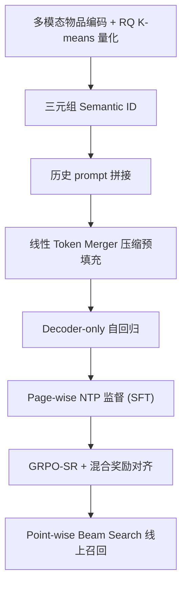
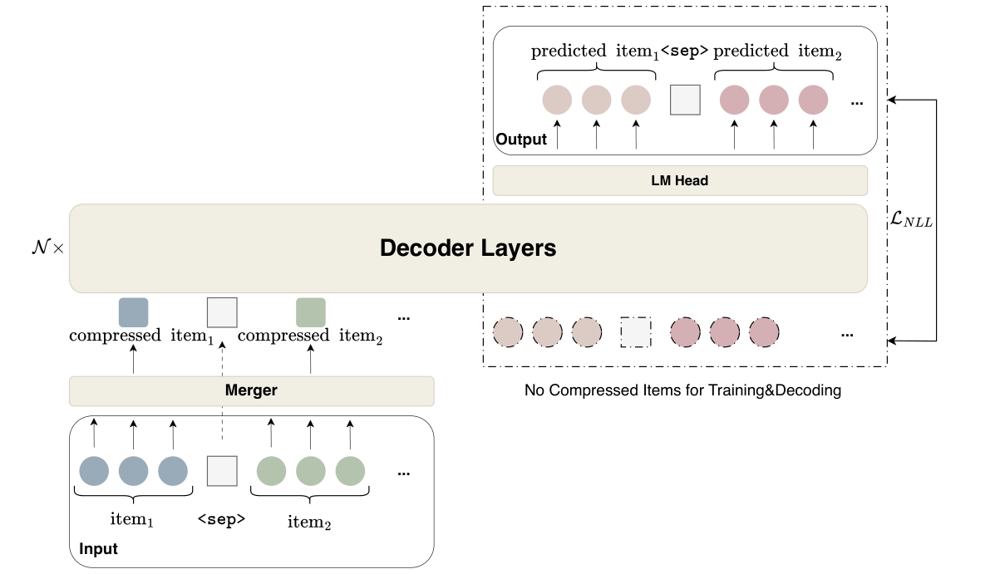

# GenRec: A Preference-Oriented Generative Framework for Large-Scale Recommendation (面向偏好的大规模生成式推荐框架)

- **会议/期刊**: SIGIR 2026 (Camera-Ready)
- **作者与机构**: Yanyan Zou, Junbo Qi, Lunsong Huang, Yu Li, Kewei Xu, Jiahao Gao 等（京东 / 早稻田大学）
- **推荐链路定位**: 召回（生成式端到端检索，替代多级 retrieve-and-rank 流水线）
- **研究方向**: 生成式推荐与离散语义 ID / 大语言模型推荐
- **论文原文**: [https://arxiv.org/abs/2604.14878v1](https://arxiv.org/abs/2604.14878v1)
- **开源代码**: 暂未开源

## TL;DR (1分钟核心速览)

工业级生成式召回在分页请求机制下存在"同一输入对应多个正样本"的一对多标签歧义、多 token 语义 ID 使长行为序列预填充开销翻倍、以及朴素偏好对齐易触发 reward hacking 三大痛点。GenRec 在单一 decoder-only 架构内提出 Page-wise NTP（整页监督）、非对称线性 Token Merger（预填充压缩约 2×、解码保持全分辨率）与 GRPO-SR（组相对策略优化 + NLL 正则 + 稠密奖励与相关性门控的混合奖励）。在京东 5.6 亿序列工业数据上，HR@10 达 0.4456（较 LC-Rec 相对提升约 21%），线上一个月 A/B 点击 +9.5%、成交 +8.7%。

## Background & Motivation (背景与核心矛盾)

- **主流范式**: 以 TIGER、LC-Rec、OneRec 为代表的生成式检索将召回重构为"用户历史 → 语义 ID 序列"的自回归 next-token prediction，用 RQ-VAE / RQ K-means 把物品量化成层级 SID。
- **前人局限一（标签歧义）**: 工业系统采用分页请求，同一历史 $H$ 在一次请求内可能对应 $K$ 个正反馈物品，vanilla point-wise NTP 被迫在相同前缀上最大化 $\sum_k \log P_\theta(v^{(k)}|H)$，等价于拟合一个均匀混合分布，抬高梯度方差、稀释单项概率质量，直接损伤 top-$K$ 精度。
- **前人局限二（预填充开销）**: 三 token SID 使 prompt 中物品部分长度变为 3 倍，长行为序列在严格推理预算下不可承受。
- **前人局限三（对齐脆弱）**: 直接用稀疏点击信号做 RL 对齐，策略易生成"语法合法但语义无关"的 SID 组合骗取奖励模型高分（reward hacking）。
- **核心洞察**: 训练与推理的监督粒度本可以解耦——训练用整页列表提供稠密梯度，推理仍走 point-wise beam search 以兼容线上管线；同时 SID 三元组源自同一物品，其嵌入可无损线性压缩。
- **本文切入点**: 用"训练列表化、推理点式化、表示非对称化、对齐门控化"四招在同一 decoder 内一次性解决上述矛盾。

## Method (核心方法设计)

### 1. 整体框架 (Overall Architecture)

物品先经 Qwen2.5-VL 多模态编码 + 协同对微调，再用 RQ K-means 离散为三元组 SID $\{s^1_i,s^2_i,s^3_i\}$。用户历史拼成复合 prompt $S_u=[\mathrm{SID}(v):v\in H]\succ$，预填充阶段每个物品的三个 SID 嵌入经线性 Token Merger 压成单一隐向量 $h_{v_i}$，特殊符 `<sep>` 不压缩；解码阶段仍按原始 SID token 逐位生成，保证细粒度检索。SFT 阶段以整页交互列表 $Y_{\text{page}}=[\mathrm{SID}(v):v\in O\cup C\cup E]\succ$ 为监督目标；随后进入 GRPO-SR 强化学习阶段，按 point-wise beam search 协议 rollout 单条候选，用混合奖励与 NLL 正则对齐用户满意度。

<figure class="paper-figure" markdown="span">
  <figcaption>图 1：GenRec 的模型架构。高维物品被量化为 Semantic ID。为提高效率，在预填充侧，Linear token Merger 将物品各 SID 的拼接嵌入投影为统一的潜在向量。其他 token（如 &lt;sep&gt;）保持不压缩。</figcaption>
</figure>

### 2. 关键设计拆解 (Key Designs)

1. **Page-wise NTP（整页监督，解一对多歧义）**：痛点是一次请求内多个正样本被拆成孤立 input-label 对，丢失会话内结构。改为对整页有序列表做标准自回归损失
$$\mathcal{L}_{\text{SFT}}=-\sum_{t=1}^{|Y_{\text{page}}|}\log P_\theta(y_t\mid S_u,y_{<t})$$
每次前向传播提供更稠密的梯度信号，并把"多个合法续写"的均匀混合转化为"按交互强度排序的单一序列"，物理直觉上等价于把 one-to-many 歧义显式编码进标签顺序。训练列表化、推理点式化的非对称设计则保证与线上 beam search 管线兼容。

2. **非对称线性 Token Merger（预填充压缩 2×）**：三 token SID 使 prompt 物品部分长度三倍化。由于三元组同源，直接拼接投影：
$$h_{v_i}=\mathrm{Linear}\big(\mathrm{Concat}(e(s^1_i),e(s^2_i),e(s^3_i))\big)$$
仅作用于预填充侧，解码侧保持未合并的原始 SID 序列，从而在不牺牲生成分辨率的前提下把输入长度压到约一半。

3. **GRPO-SR 与混合奖励（稳定偏好对齐）**：以 SIM 模型给出稠密偏好分 $r^{\text{pref}}_i\in[0,1]$，用相关性门控 $G_i=\mathbb{I}(s_i>\tau)$ 过滤语义无关的合法 SID 组合，得 $r_i=G_i\cdot r^{\text{pref}}_i$；再在 rollout 组内把真实正反馈物品 $D^+=O\cup C$ 的奖励锚定到组内最大值 $r_{\max}$ 以校正奖励模型低估。总目标为
$$\mathcal{L}_{\text{GRPO-SR}}=-\mathbb{E}\Big[\tfrac{1}{G}\sum_i\tfrac{1}{|o_i|}\sum_t\tfrac{\pi_\theta}{\mathrm{sg}(\pi_\theta)}\hat{A}_{i,t}\Big]-\alpha\,\mathbb{E}_{v\sim D^+}\Big[\sum_t\log\pi_\theta(v_t\mid S_u,v_{<t})\Big]$$
第二项 NLL 正则替代标准 KL 惩罚，把策略显式锚定在真实用户行为上，抑制过度优化。训练无需额外负采样，rollout 组内相对优势即隐式负信号。

## Experimental Setup & Evaluation Protocol (实验设置与评估协议)

- **数据集与预处理**: 京东推荐平台一个月内约 5.6 亿条用户交互序列；最后一天作测试、其余训练（全局时间戳切分，天然防穿越）。

| 数据集 | #Users | #Items | #Interactions | 稀疏度/密度 | 特征/场景说明 |
| :--- | :---: | :---: | :---: | :---: | :--- |
| JD 工业数据 | 未披露 | 未披露 | ~560M 序列 | 未披露 | 多模态图文 + 分页请求首页 feed |

- **数据划分与防穿越**: 全局时间戳切分（最后一天测试）。
- **排名评测协议**: 离线采用 HR@K / NDCG@K 与幻觉率 HaR（生成非法 SID 占比）；RL 阶段用生成 K 项中最高 SIM 分 R@K。原文未明确 Full-Ranking 与采样负例比，属评估披露不足。
- **对比基线与超参**: 传统 BERT4Rec、SASRec；生成式 TIGER、LC-Rec（同 Qwen2.5 复现，均用 vanilla point-wise NTP）。骨干为 Qwen2.5 1.5B/3B/7B，主实验用 3B；8×H100，AdamW + 1% 线性 warmup + cosine 衰减。

## Key Experimental Results (实验关键数据)

### 1. 主实验对比 (Main Results)

| Model | HR@1 | HR@10 | N@10 | HR@50 | N@50 | HaR↓ |
| :--- | :---: | :---: | :---: | :---: | :---: | :---: |
| BERT4Rec | 0.0315 | 0.0968 | 0.0412 | 0.1832 | 0.0689 | - |
| SASRec | 0.0383 | 0.1048 | 0.0492 | 0.1976 | 0.0776 | - |
| TIGER | 0.0518 | 0.1660 | 0.0803 | 0.3556 | 0.1409 | 15.46% |
| LC-Rec | 0.0947 | 0.3669 | 0.2146 | 0.6226 | 0.2717 | 7.80% |
| **GenRec** | **0.1189** | **0.4456** | **0.2635** | **0.7192** | **0.3247** | **4.96%** |
| w/o TM | 0.1193 | 0.4467 | 0.2653 | 0.7201 | 0.3276 | 4.89% |
| Improv. vs LC-Rec | +25.6% | +21.5% | +22.8% | +15.5% | +19.5% | -36.4% |

### 2. 消融实验 (Ablation Study)

| 变体 | HR@50 | R@1 | R@10 | R@50 | HaR↓ |
| :--- | :---: | :---: | :---: | :---: | :---: |
| Base SFT | 0.7192 | 0.1027 | 0.1519 | 0.1776 | 4.96% |
| GRPO | 0.7248 | 0.1177 | 0.1650 | 0.1861 | 6.03% |
| **GRPO-SR** | **0.7438** | **0.1212** | **0.1679** | **0.1892** | **2.68%** |
| GRPO w/o G | 0.6975 | 0.1045 | 0.1608 | 0.1797 | 1.75% |
| GRPO-SR w/o G | 0.7016 | 0.1067 | 0.1598 | 0.1813 | 1.96% |

### 3. 关键实验发现 (Key Findings)

1. **Page-wise NTP 是主增益来源**：与同为 vanilla NTP 的 LC-Rec 相比，HR@10 从 0.3669 升至 0.4456（+21.5%），且幻觉率从 7.80% 降至 4.96%（降幅超 50%），说明联合预测整页不仅提供稠密梯度，还促使生成更连贯的物品序列；图 2(a) 显示 PW-NTP 收敛显著快于 NTP。
2. **Token Merger 近乎无损**：w/o TM 与完整模型各项指标差距在 0.001–0.003 量级（HR@50 0.7201 vs 0.7192），却换来约 2× 输入长度压缩，证明 SID 三元组信息可被线性投影无损承载，是纯效率收益。
3. **门控 G 是防 reward hacking 的关键**：去掉 G 后 R@1 反而从 0.1212 跌至 0.1067、HR@50 从 0.7438 跌至 0.7016，而 HaR 表面更低（1.96%），正是策略钻"合法但无关 SID"空子的典型信号；GRPO-SR 的 NLL 正则同时把 HaR 从 GRPO 的 6.03% 压到 2.68%。
4. **规模收益在 3B 处饱和**：1.5B→3B 提升明显（HR@10 0.4103→0.4456），3B→7B 仅 0.4456→0.4483，作者归因于 3B 更深（36 层/2048 维）比 7B 更宽（28 层/3584 维）更适合建模复杂用户-物品交互，呼应"容量密度"假说。
5. **线上与长尾双赢**：一个月 A/B 中 SFT 版点击 +8.5%、成交 +7.3%，叠加 GRPO-SR 后达 +9.5% / +8.7%（$p<0.05$）；长尾物品曝光率 +10%、点击 +16%、成交 +13%，说明生成式范式对长尾扶持显著优于原多级管线。

## Highlights, Limitations & Rating (亮点、对比与审稿评价)

- **与代表作对比**: 相较 TIGER（RQ-VAE + point-wise NTP）与 LC-Rec（同骨干 vanilla NTP），本文本质差异在于把监督粒度从"单物品"提升到"整页列表"并显式处理分页机制带来的标签歧义；相较 OneRec 的迭代 RQ K-means 工程化路线，本文额外引入 RL 偏好对齐与预填充压缩，是"训练-推理非对称"的系统性设计。
- **可迁移亮点**: ①"训练列表化 / 推理点式化"的解耦思路可迁移到任何受分页或批量曝光机制影响的生成式召回；②用 NLL 正则替代 KL 惩罚做策略锚定，在稀疏反馈场景下比 KL 更贴合真实行为分布。
- **审稿级局限批判**: ①评估披露不足——未说明是 Full-Ranking 还是采样排序、负例比与物品库规模，跨论文可比性存疑；②RL 阶段依赖 SIM 奖励模型与门控阈值 $\tau$，对奖励模型偏差与超参敏感，且 7B 相对 3B 几乎无增益，规模律结论仅基于单一数据域，泛化性待验证。
- **四维评分**: 创新性 ⭐⭐⭐⭐ | 实验扎实度 ⭐⭐⭐⭐ | 方法清晰度 ⭐⭐⭐⭐⭐ | 落地价值 ⭐⭐⭐⭐⭐

