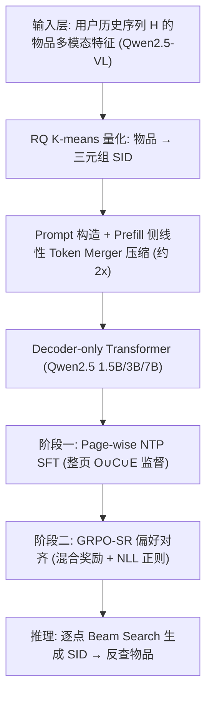
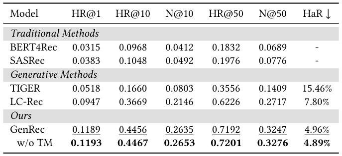
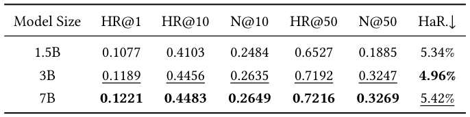
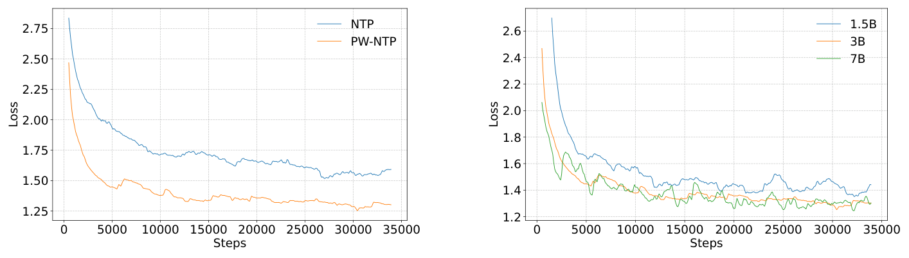
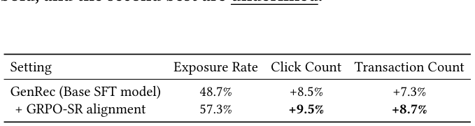

# GenRec: A Preference-Oriented Generative Framework for Large-Scale Recommendation (GenRec：面向偏好的大规模推荐生成式框架)

- **会议/期刊**: SIGIR 2026 (Camera-Ready, 6 页短文)
- **推荐链路定位**: 召回 (Retrieval) — 端到端生成式召回（单 decoder-only 架构统一意图理解与物品生成）
- **研究方向**: 生成式推荐与离散语义 ID (primary) / 大语言模型推荐 (secondary)
- **论文原文**: [https://arxiv.org/abs/2604.14878v1](https://arxiv.org/abs/2604.14878v1)
- **开源代码**: 暂未开源（原文与预提取均未发现代码链接）

## TL;DR (核心速览)

针对工业级生成式召回在分页请求下的三大痛点——同输入多正例的标签歧义、多 token 语义 ID 导致的长 prompt 开销、生成策略与用户偏好错位——GenRec 在单一 decoder-only 架构中提出 **Page-wise NTP**（整页监督替代逐物品监督）、**非对称线性 Token Merger**（prefill 侧压缩 SID 序列约 2×、decode 侧保持全分辨率）与 **GRPO-SR**（GRPO + NLL 正则 + 门控混合奖励）。在京东 5.6 亿交互序列上，HR@10 达 0.4456（较 LC-Rec 提升约 21%），线上 A/B 点击 +9.5%、成交 +8.7%。

## Background & Motivation (背景与动机)

- **领域背景与主流范式**: 推荐系统正从"召回-排序"判别式多阶段流水线转向以 Semantic ID (SID) 为物品 token 的生成式检索 (Generative Retrieval, GR)。TIGER 用 RQ-VAE 量化物品、LC-Rec 用 LLM 做协同语义对齐、OneRec 用迭代 RQ K-means 构建层级 ID，均以 **next-token prediction (NTP)** 为训练范式。
- **现有方法局限 (Limitations of Prior Work)**:
  1. **分页请求下的标签歧义**：工业系统按页返回结果，同一用户历史 $H$ 在一页内可能对应 $K$ 个正交互物品 $\{v^{(k)}\}_{k=1}^K$。vanilla 逐点 NTP 需在相同前缀上同时最大化 $\sum_k \log P_\theta(v^{(k)}|H)$，等价于拟合一个均匀混合分布，既抬高梯度方差又稀释单个物品的概率质量，损害 top-$K$ 精度。
  2. **多 token SID 的 prefill 开销**：每个物品被编码为三元组 $\{s^1_i,s^2_i,s^3_i\}$，使物品部分输入长度膨胀 3 倍，长行为序列下在线推理延迟不可接受。
  3. **偏好对齐中的 reward hacking**：直接用个性化目标做 RL 对齐时，策略会生成"语法合法但语义无关"的 SID 组合骗取奖励模型高分，导致整体质量下降。
- **核心挑战 (Key Challenge)**: 上述三点并非简单加网络深度或加对比学习可解——它们分别属于**训练目标与推理协议不匹配**、**表征压缩与检索粒度冲突**、**奖励信号稀疏与可被利用**三个正交层面，需要在同一架构内协同设计。
- **核心洞察与切入点 (Key Insight)**: 作者的关键观察是"**训练与推理可以解耦**"：训练时用整页列表监督获得更密梯度，推理时仍用逐点 beam search 以兼容线上流水线；同理，prefill 侧可压缩 SID 而 decode 侧必须保持原始 token 序列。这一"非对称"思想贯穿全文三个模块。

## Problem Formulation & Method (问题定义与方法架构)

### 1. 符号定义与输入表征 (Notations & Input Representations)

- 用户历史行为序列 $H=\{v_1,\dots,v_n\}$（按时间排序，$v_n$ 为最近交互），目标为预测后续物品 $Y$。
- 物品 $v_i$ 经多模态编码器 **Qwen2.5-VL** 联合编码视觉与文本描述，再用领域协同对微调 embedding，最后经 **RQ K-means** 迭代残差聚类离散化为三元组 SID：$\text{SID}(v_i)=\{s^1_i,s^2_i,s^3_i\}$（式 1）。
- 输入 prompt 为 SID 序列拼接：$S_u=[\text{SID}(v):v\in H]\succ$（式 2），其中 $\succ$ 为结构分隔符。
- 输出为自回归生成的 SID token 序列，解码后映射回物品 ID。

### 2. 整体流水线 (Overall Architecture)

数据流：多模态物品编码 → RQ K-means 量化得 SID → prompt 构造（prefill 侧经 Token Merger 压缩）→ decoder-only Transformer（Qwen2.5 1.5B/3B/7B）→ LM Head 输出 SID token → 反查物品。训练分两阶段：Page-wise NTP SFT → GRPO-SR 偏好对齐。

<figure class="paper-figure" markdown="span">
  <figcaption>图 1：GenRec 的模型架构。高维物品被量化为 Semantic IDs。为提升效率，在预填充侧，Linear token Merger 将物品各 SID 的拼接嵌入投影为统一的潜在向量。其他 token（如 &lt;sep&gt;）保持不压缩。</figcaption>
</figure>

### 3. 核心模块设计与数学原理 (Key Designs & Formulations)

**(1) Page-wise NTP 监督（训练目标层）**
将监督目标从单物品改为整页列表，按交互强度排序：$Y_{\text{page}}=[\text{SID}(v):v\in O\cup C\cup E]\succ$（式 3，$O$ 下单、$C$ 点击、$E$ 曝光）。SFT 损失为对整条响应序列的标准自回归损失：

$$\mathcal{L}_{\text{SFT}}=-\sum_{t=1}^{|Y_{\text{page}}|}\log P_\theta(y_t\mid S_u,y_{<t}) \quad\text{(式 4)}$$

物理直觉：一次前向传播覆盖整页多个目标，梯度信号更密；同时把"一对多"歧义转化为"一对多序列"的显式建模，避免均匀混合分布。**训练用列表、推理用逐点 beam search** 的非对称设计是本文的核心工程取舍。

**(2) 非对称线性 Token Merger（表征效率层）**
由于三元组 SID 源自同一物品 $v_i$，将其 embedding 拼接后经线性层投影为统一向量：

$$h_{v_i}=\text{Linear}\big(\text{Concat}(e(s^1_i),e(s^2_i),e(s^3_i))\big) \quad\text{(式 5)}$$

该压缩**仅作用于 prefill 阶段**，特殊 token（如 `<sep>`）不合并以保留结构分隔语义；decode 阶段与生成目标仍使用原始 SID token 序列，保证检索粒度不损失。效果：prompt 长度降低约 2×，精度损失可忽略（表 1 中 w/o TM 与完整版几乎持平）。

**(3) GRPO-SR 偏好对齐（策略优化层）**
- **混合奖励**：用 SIM-based 模型估计连续偏好分 $r^{\text{pref}}_i\in[0,1]$，并加相关性门控 $G_i=\mathbb{I}(s_i>\tau)$ 抑制 reward hacking：$r_i=G_i\cdot r^{\text{pref}}_i$（式 6）。
- **正例锚定校准**：对真实正例集 $D^+=O\cup C$ 内的候选，将其奖励锚定到组内最大值 $r_{\max}$，防止奖励模型低估真实偏好：$\tilde r_i=(1-\mathbb{I}(o_i\in D^+))\cdot r_i+\mathbb{I}(o_i\in D^+)\cdot r_{\max}$（式 7）。
- **复合目标**：GRPO 组相对优势项 + NLL 正则项（权重 $\alpha$），后者显式锚定真实用户行为轨迹，替代标准 KL 惩罚以缓解过优化：

$$\mathcal{L}_{\text{GRPO-SR}}(\theta)=-\mathbb{E}\Big[\tfrac{1}{G}\sum_{i=1}^{G}\tfrac{1}{|o_i|}\sum_{t}\tfrac{\pi_\theta(o_{i,t}|S_u,o_{i,<t})}{\text{sg}(\pi_\theta(\cdot))}\hat A_{i,t}\Big]-\alpha\cdot\mathbb{E}_{v\sim D^+}\Big[\sum_t \log\pi_\theta(v_t|S_u,v_{<t})\Big] \quad\text{(式 8)}$$

注意 RL 阶段与推理协议一致：每次 rollout 只生成单个物品序列（逐点），确保训练-服务一致性。

### 4. 训练目标、负采样与推理复杂度 (Optimization, Negative Sampling & Complexity)

- **损失函数**: SFT 阶段为式 4 的自回归交叉熵；RL 阶段为式 8 的 GRPO-SR 复合损失（含 NLL 正则权重 $\alpha$，原文未报告具体取值）。
- **训练负采样策略**: **免负采样**——生成式范式下每个物品 token 的 softmax 天然对全词表归一化，无需显式负例构造；RL 阶段通过组内 $G$ 个 rollout 的相对优势实现隐式对比。
- **时间与空间复杂度**: 原文未给出理论复杂度公式与单次推理延迟 (ms/request) 数值。可确认的工程事实：Token Merger 使 prefill 输入长度降低约 2×；训练在 **8×NVIDIA H100** 上分布式完成，优化器 AdamW，前 1% 步数线性 warm-up 后余弦衰减；推理采用 beam search（beam width 原文未报告）。

## Experimental Setup & Evaluation Protocol (实验设置与评估协议)

- **数据集统计与预处理**: 来自京东推荐平台，覆盖约 **5.6 亿**用户交互序列、时间跨度一个月。原文未报告用户数/物品数/稀疏度等明细，亦未说明 5-core 等过滤规则。

| 数据集 (Dataset) | 用户数 (#Users) | 物品数 (#Items) | 交互数 (#Interactions) | 稀疏度/密度 (Sparsity) | 模态/辅助特征说明 |
| :--- | :---: | :---: | :---: | :---: | :--- |
| JD 工业数据集 | 原文未报告 | 原文未报告 | 约 5.6 亿条交互序列 | 原文未报告 | Qwen2.5-VL 视觉+文本多模态编码 |

- **数据划分方式 (Splitting Strategy)**: **全局时间戳切分**——最后一天作测试集，其余作训练集。该切分天然防未来信息泄露，但原文未说明验证集构造方式。
- **排名评测协议 (Ranking Protocol)**: 原文未明确声明是 Full-Ranking 还是 Sampled Ranking。从指标定义（HR@K、NDCG@K、HaR）与 beam search 推理方式推断，评测基于模型生成的 top-$K$ 候选，**并非对全库未交互物品做全排序**，属于生成式候选评估协议。
- **评价指标与显著性检验**: SFT 阶段用 **HR@1/10/50、NDCG@10/50、Hallucination Rate (HaR，生成无效 SID 的百分比)**；RL 阶段用 **Reward Metrics R@1/10/50**（生成 K 个物品中最高 SIM 分）。线上 A/B 采用双侧检验 $p<0.05$。离线实验未报告多随机种子方差或配对显著性检验。Embedding 维度 $d$ 与 SID 码本大小原文未报告。

## Key Experimental Results (核心实验结果)

### 1. 主实验对比 (Main Results)

以 Qwen2.5 3B 为主干，与同规模复现的 LC-Rec 公平对比（表 1）：

| 数据集 | 指标 | SASRec (序列基线) | LC-Rec (生成式最强基线) | 本文 GenRec | 相对提升 (Improv.) |
| :--- | :--- | :---: | :---: | :---: | :---: |
| JD 工业集 | HR@1 | 0.0383 | 0.0947 | **0.1189** | +25.6% |
| JD 工业集 | HR@10 | 0.1048 | 0.3669 | **0.4456** | +21.5% |
| JD 工业集 | NDCG@10 | 0.0492 | 0.2146 | **0.2635** | +22.8% |
| JD 工业集 | HR@50 | 0.1976 | 0.6226 | **0.7192** | +15.5% |
| JD 工业集 | NDCG@50 | 0.0776 | 0.2717 | **0.3247** | +19.5% |
| JD 工业集 | HaR↓ | - | 7.80% | **4.96%** | 幻觉率降低 36.4% |

<figure class="paper-figure" markdown="span">
  <figcaption>表 1：下一物品预测与下一序列预测的性能对比。“TM”表示 Token Merger。最佳结果以粗体显示，</figcaption>
</figure>

**模型规模扩展（表 2）**：1.5B → 3B 提升显著（HR@10 0.4103 → 0.4456），3B → 7B 收益边际（HR@10 仅 0.4483），且 7B 的 HaR 反升至 5.42%。作者归因于 3B 更深更窄（36 层 / 2048 隐维）vs 7B 更浅更宽（28 层 / 3584 隐维），"深度优于宽度"的容量密度假设在生成式推荐中成立。

<figure class="paper-figure" markdown="span">
  <figcaption>表 2：模型扩展性能。最佳结果以粗体显示，次佳结果以下划线显示。</figcaption>
</figure>

<figure class="paper-figure" markdown="span">
  <figcaption>图 2：SFT 损失曲线。(a) Page-wise NTP 比 NTP 收敛更快。(b) 更大的模型可获得更低的损失，但超过 3B 后收益递减。</figcaption>
</figure>

### 2. 消融实验与控制变量分析 (Ablation Study)

- **Token Merger 消融**：w/o TM 版本（HR@10 0.4467、HaR 4.89%）与完整版（0.4456、4.96%）几乎持平，证明压缩未损失决定性信息，却换来约 2× 的输入长度缩减——这是"效率几乎免费"的关键证据。
- **PW-NTP vs vanilla NTP**：GenRec 全面优于同主干、同数据、vanilla NTP 训练的 LC-Rec，且收敛损失更低（图 2a），幻觉率降低超 50%。作者归因于两点：消除一对多歧义降低梯度方差；整页聚合提供更密监督信号。
- **RL 消融（表 3）**：完整 GRPO-SR 在 HR@50 达 0.7438、R@1 达 0.1212（较 SFT 基线相对 +18.01%）、HaR 降至 2.68%。移除门控 $G$ 后（GRPO w/o G / GRPO-SR w/o G），奖励指标仅有边际提升甚至下降，但 HR@50 跌至 0.6975/0.7016、HaR 表现异常——这是 reward hacking 的清晰信号，验证门控机制的必要性。

<figure class="paper-figure" markdown="span">
  <figcaption>表 3：RL 性能。我们分析了不同方法以及门控机制（G）的影响。最佳结果以粗体显示，次佳结果以下划线显示。</figcaption>
</figure>

### 3. 稀疏度/冷启动分桶与超参敏感度 (Sparsity Buckets & Hyperparameters)

- **长尾物品表现**：线上 A/B 中，长尾物品曝光率 +10%、点击 +16%、成交 +13%，提升幅度高于整体（+9.5% / +8.7%），说明生成式范式对长尾供给有额外增益。原文未做离线用户/物品交互频次分桶实验。
- **关键超参数敏感度**：原文未系统报告温度系数 $\tau$、NLL 正则权重 $\alpha$、beam width 等超参的敏感度曲线。
- **线上 A/B 测试结果**：京东首页 feed 推荐场景，SFT 与 RL 对齐两版本各占 10% 流量、持续一个月，双侧检验 $p<0.05$：

| 设置 | 曝光率 | 点击量 | 成交量 |
| :--- | :---: | :---: | :---: |
| GenRec (Base SFT) | 48.7% | +8.5% | +7.3% |
| + GRPO-SR 对齐 | **57.3%** | **+9.5%** | **+8.7%** |

RL 对齐版本已全量部署于生产环境。

## Highlights, Limitations & Critiques (亮点、局限与审稿级批判)

- **核心亮点与可迁移性**:
  1. **"训练-推理非对称"设计哲学**极具迁移价值：列表级训练 + 逐点推理、prefill 压缩 + decode 全分辨率，这一思路可推广到任何受限于线上 serving 协议的生成式系统。
  2. **Page-wise NTP** 对分页机制下的标签歧义给出了干净的形式化（均匀混合分布问题）与低成本解法，适用于所有存在"一请求多正例"的工业场景。
  3. **GRPO-SR 的正例锚定校准**（式 7）是抑制奖励模型系统性低估真实正例的实用技巧，可迁移至其他 RLHF/RLVR 推荐对齐任务。
- **局限性与审稿视角批判 (Critical Limitations)**:
  1. **评估协议披露不足**：未声明 Full-Ranking 还是 Sampled Ranking，未报告候选集规模与 beam width，HR/NDCG 的可比性存疑；离线实验无多随机种子方差与配对显著性检验，仅线上 A/B 报告了 $p<0.05$。
  2. **数据集统计与超参严重缺失**：用户数、物品数、SID 码本层数/大小、embedding 维度、$\tau$ 与 $\alpha$ 取值、推理延迟 (ms/request) 与峰值显存均未报告，复现难度高。
  3. **规模扩展结论的样本量薄弱**：仅 3 个规模点（1.5B/3B/7B）即得出"深度优于宽度"的容量密度结论，且 7B 的 HaR 反升未被充分解释，该论断更接近观察性假设而非受控实验。
  4. **RL 消融的异常现象未深挖**：移除门控后 HaR 反而"变好"（1.75%/1.96% vs 2.68%）但 HR@50 大幅下降，作者仅以 reward hacking 一笔带过，缺乏对奖励分布与生成多样性的定量分析。
  5. **单平台单场景验证**：全部实验来自京东首页 feed，跨业务（搜索、广告）与跨平台的泛化性未知。

## Rating (四维评分)

- **方法创新性 (Novelty)**: ⭐⭐⭐⭐ — Page-wise NTP、非对称 Token Merger、GRPO-SR 三个模块各自不算全新，但"训练-推理非对称"的统一设计视角与工业落地闭环具有整合性贡献。
- **评估协议与实验扎实度 (Protocol & Experiments)**: ⭐⭐⭐ — 线上 A/B 数据有说服力，但离线评估协议披露不完整、缺显著性检验与数据集统计，作为 SIGIR 短文可接受，作为长文则不足。
- **写作与数学规范度 (Clarity & Rigor)**: ⭐⭐⭐⭐ — 问题形式化（均匀混合分布、reward hacking）清晰，公式完整；扣分点在于关键超参与复杂度分析缺失。
- **工业落地与复现价值 (Industrial & Practical Value)**: ⭐⭐⭐⭐⭐ — 5.6 亿序列、月级线上 A/B、全量部署，工业价值极高；但未开源使复现价值打折。
