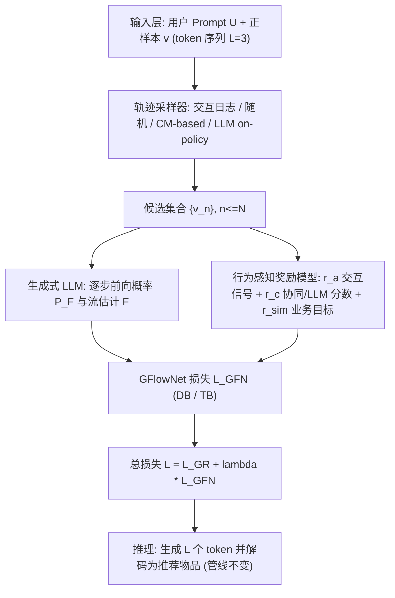
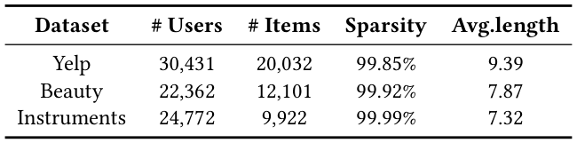
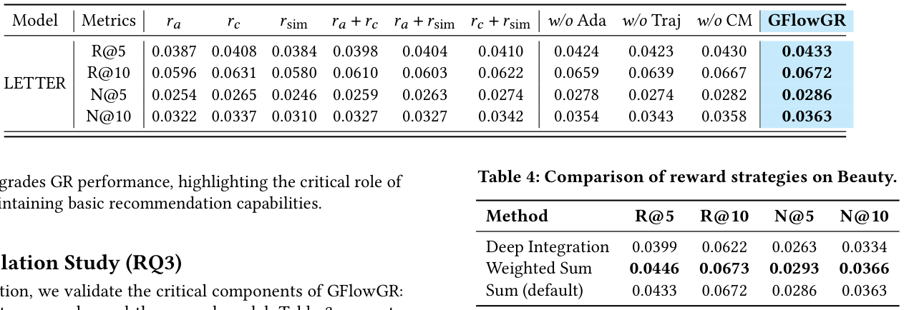
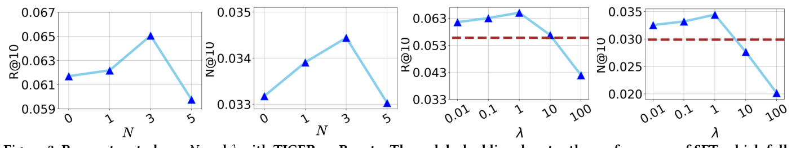
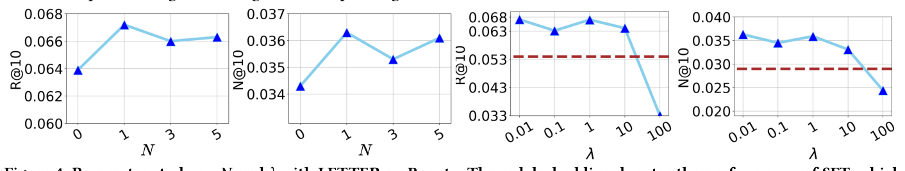
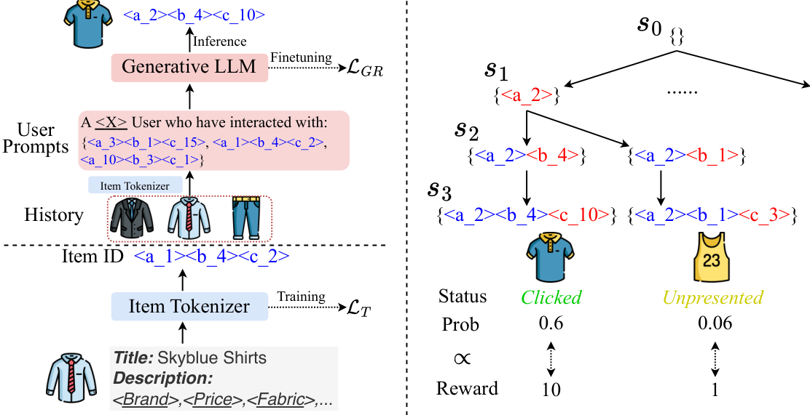

# GFlowGR: Fine-tuning Generative Recommendation Frameworks with Generative Flow Networks (基于生成流网络的生成式推荐框架微调)

- **会议/期刊**: SIGIR 2026 (Melbourne, VIC, Australia)
- **推荐链路定位**: 端到端生成式 (End-to-End Generative) / 召回 (Candidate Generation)
- **研究方向**: 生成式推荐与离散语义 ID / 大语言模型推荐 (LLM4Rec)
- **论文原文**: [https://arxiv.org/abs/2506.16114v3](https://arxiv.org/abs/2506.16114v3)
- **开源代码**: [https://github.com/Applied-Machine-Learning-Lab/SIGIR26_GFlowGR](https://github.com/Applied-Machine-Learning-Lab/SIGIR26_GFlowGR)

## TL;DR (核心速览)

针对生成式推荐 (GR) 微调阶段的两大痛点——SFT 只对单一 ground-truth 物品做逐点优化、且把所有交互视为等价值，导致**曝光偏差 (Exposure Bias)** 与**集合级生成能力缺失**——本文把 GR 重构为**多步集合生成任务**，提出 GFlowNet 微调框架 GFlowGR：由**轨迹采样器**构造候选集合轨迹、**行为感知奖励模型**量化物品效用、**GFlowNet 目标**提供 token 级监督。在 3 个真实数据集 × 2 个 LLM 骨干上一致显著超越 SFT/DPO/GRPO 类基线，并落地淘宝搜索广告带来年化收入 0.4% 相对提升（十亿级）。

## Background & Motivation (背景与动机)

- **领域背景与主流范式**: 当前 GR 框架由三部分组成（图 1(a)）：**物品分词器**（RQ-VAE 类，将物品映射为离散 token 序列，如 `<a_1><b_4><c_2>`，长度 $L=3$）、**用户 prompt**（历史交互 + 画像）、**生成式 LLM**（自回归产出下一物品的 token 序列）。研究热点集中在分词器改进（多样性损失、协同约束损失）与 LLM 解码策略，而**微调阶段**长期被忽视。
- **现有方法局限 (Limitations of Prior Work)**:
  1. **逐点 vs. 集合级失配**：SFT 的 next-token prediction 损失（式 1）只优化单个正样本，而线上部署需要生成**多样化、高价值的候选集合**，离线训练与在线服务之间存在结构性 gap。
  2. **交互价值同质化**：SFT 把曝光 (impression)、点击 (click)、购买 (purchase) 视为同等信息量，忽略业务效用差异——购买应比曝光获得更高的生成概率。
  3. **奖励微调的 token 级监督缺失**：DPO 类方法（Chen et al.）从交互历史构造偏好对，OneRec-V2 将 GRPO 扩展到全交互集合，但**奖励只在物品级赋值**，而 GR 中物品是多 token 序列，缺乏对底层 token 生成过程的细粒度反馈，限制优化精度与生成质量。
- **核心挑战 (Key Challenge)**: 如何同时满足 (i) 从**价值分化的物品集合**中学习、(ii) 提供**直接的 token 级监督**？简单的 SFT 加负采样无法解决，因为负样本的奖励被粗暴置零会加剧曝光偏差；DPO/GRPO 虽引入奖励，但奖励无法沿 token 序列反向分解。
- **核心洞察与切入点 (Key Insight)**: GFlowNets 天然契合——它把生成建模为离散轨迹上的随机策略，以终端奖励定义流，并**强制 $P(\tau) \propto R(s_L)$**，从而将物品级奖励**分解为流一致的 token 级目标**。且 GR 的 token 拼接是确定性的，故反向概率 $P_B(s_l|s_{l+1})=1$，前向概率直接对应 LLM 的 token 生成概率 $P_{GR}(t_{l+1}|U,s_l)$，适配成本极低。图 1(b) 展示了点击/曝光/未曝光三类交互在流结构中的差异化奖励分配。

## Problem Formulation & Method (问题定义与方法架构)

### 1. 符号定义与输入表征 (Notations & Input Representations)

- 用户集 $\mathcal{U}$、物品集 $\mathcal{I}$；输入对 $(U, v)$，$U$ 为用户 prompt（历史交互 token 序列 + 画像 $<X>$），$v$ 为带正反馈的物品。
- 物品 $v$ 经分词器编码为 token 序列 $\{t_l\}_{l<L}$，$L$ 为标识符长度（本文 $L=3$）。
- 轨迹 $\tau = (s_0 \to s_1 \to \cdots \to s_L)$，$s_0=\{\emptyset\}$，$s_l=\{t_1,\dots,t_l\}$，$s_L$ 解码为具体物品。
- 候选集合 $\{v_n\}_{n\le N}$，其中 $v_1=v$（正样本），其余 $N-1$ 个为增广样本；$N$ 与损失权重 $\lambda$ 为关键超参。

### 2. 整体流水线 (Overall Architecture)

GFlowGR **仅修改 LLM 微调阶段，推理管线完全不变**。流程：给定 $(U,v)$ → 轨迹采样器选出 $N-1$ 个增广样本扩展为集合 → LLM 计算各轨迹的逐步前向概率 $P_F$ 与流估计 $F$ → 奖励模型为每条轨迹赋 $R$ → 计算 GFlowNet 损失 $\mathcal{L}_{GFN}$ 并与 SFT 损失相加 → 更新 LLM。可选地接入预训练协同模型 (CM) 同时为采样器与奖励模型提供协同分数。

### 3. 核心模块设计与数学原理 (Key Designs & Formulations)

**(1) 轨迹采样器 (Trajectory Sampler)** — 解决"从哪些轨迹学"。四种构造方式：
- **交互日志 (Interaction log)**：直接截取工业系统日志中该 session 的 $N-1$ 个样本，最贴近线上分布。
- **随机采样 (Random sampling)**：从物品集随机抽 $N-1$ 个互异负例。缺点是随机性带来训练不稳定，早期有效的"明显无关负例"在后期变得无信息量。
- **CM-based 采样（本文主推）**：用预训练协同模型打分 $\hat{y}^{v_n}_{CM} = \text{CM}(v_n, U)$，对 $2N-1$ 个候选打分；**早期优先取协同分最低的 $N-1$ 个（easy negatives）**，随训练推进逐步纳入协同分更高的**难负例**（与用户偏好接近但历史未观测的物品），形成 curriculum 式自适应采样。
- **LLM-based 采样 (on-policy)**：用当前 LLM 以 beam search 生成 top-$(N-1)$ 负例。

**(2) 行为感知奖励模型 (Behavior-aware Reward Model)** — 解决"奖励怎么给"。对未观测样本赋零奖励会忽略潜在相关性、加剧曝光偏差，故设计多信号可组合奖励：
- **交互信号 $r_a$**：liked 物品轨迹 $r_a=10$，clicked 轨迹 $r_a=1$，增广/未曝光轨迹 $r'_a=0$。
- **估计分数 $r_c$**：协同模型分 $\hat{y}^v_{CM}$ 或 LLM 前向概率分。
- **业务目标**：以格式奖励 $r_{sim}$ 为例，度量与正样本共享 token 数 $r'_{sim}=\sum_{l=1}^{L}\mathbb{I}(t_l=t'_l)$，正样本 $r_{sim}=L$；可视化例子中 $r'_{sim}=1$（共享一个 token）。

**(3) GFlowNet 目标** — 解决"token 级监督怎么给"。流匹配原理（式 2）：$F(s_l)P_F(s_{l+1}|s_l)=F(s_{l+1})P_B(s_l|s_{l+1})$。两种可优化变体：
- **Detailed Balance (DB)**：$\mathcal{L}_{DB}(\tau)=\sum_{l=0}^{L-1}\left(\log\frac{F(s_l)P_F(s_{l+1}|s_l)}{F(s_{l+1})P_B(s_l|s_{l+1})}\right)^2$（式 3），逐步流平衡。
- **Trajectory Balance (TB)**：$\mathcal{L}_{TB}(\tau)=\left(\log\frac{Z\prod_{l=0}^{L-1}P_F(s_{l+1}|s_l)}{R(s_L)\prod_{l=0}^{L-1}P_B(s_l|s_{l+1})}\right)^2$（式 4），全轨迹级平衡，$Z$ 为近似 $F(s_0)$ 的全局标量。

**物理直觉**：由于 $P_B=1$ 且 $P_F$ 即 LLM 的 token 概率，GFlowNet 损失实际上是在**逐 token 地**把"生成该物品序列的概率"往"该物品的效用奖励"上拉，从而把物品级奖励无损地分解到每个 token 决策上——这正是 DPO/GRPO 缺失的细粒度监督。

### 4. 训练目标、负采样与推理复杂度 (Optimization, Negative Sampling & Complexity)

- **总损失**：$\mathcal{L}=\mathcal{L}_{GR}+\lambda\cdot\mathcal{L}_{GFN}$（式 7），其中 $\mathcal{L}_{GR}$ 为式 (1) 的 next-token prediction SFT 损失，$\mathcal{L}_{GFN}$ 取式 (5) DB 或式 (6) TB，$\lambda$ 为 GFlowNet 损失权重（关键超参，见参数研究）。
- **负采样策略**：非传统 in-batch/uniform 负采样，而是**集合级轨迹采样**——交互日志截取、随机负采样、CM-based curriculum 难负例、LLM on-policy beam search 四选一；CM-based 为默认推荐方案。
- **复杂度**：训练阶段每条样本需对 $N$ 条轨迹各做 $L$ 步前向（$N$ 与 $\lambda$ 的权衡见图 3/图 4 参数研究）；推理阶段与标准 GR **完全一致**，仅需自回归生成 $L$ 个 token 并解码，无额外 beam 开销（除非业务需要多候选）。原文未报告具体 ms/request 延迟与峰值显存数值。

## Experimental Setup & Evaluation Protocol (实验设置与评估协议)

- **数据集统计与预处理**: 原文使用 **3 个真实数据集**（摘要与引言均称 three real-world datasets；正文实验节在提供的抽取文本中被截断，具体统计见 表 1）。表 1 为预处理后数据集统计：

<figure class="paper-figure" markdown="span">
  <figcaption>表 1</figcaption>
</figure>

> 注：受抽取文本截断影响，表 1 的具体数值（#Users / #Items / #Interactions / 稀疏度）在可见正文中未完整呈现，此处不做臆造；请以原文 表 1 为准。

- **数据划分方式 (Splitting Strategy)**: 原文可见文本未明确给出划分细节（LOO / Ratio / Global Temporal），需以原文实验节为准；从 GR 领域惯例与"session"表述推测为按 session/时间组织，但**本文不做无据断言**。
- **排名评测协议 (Ranking Protocol)**: 原文可见文本未明确标注 Full-Ranking 还是 Sampled Ranking，需以原文为准。
- **评价指标与显著性检验**: 原文可见文本未列出具体指标（Recall@K / NDCG@K 等）与显著性检验细节；摘要仅声明"consistent and significant improvements"。**原文未在可见部分报告**配对检验的 $p$ 值。
- **骨干与基线**: 两个代表性 LLM-based GR 骨干（正文参数研究涉及 **TIGER** 与 **LETTER**，见图 3/图 4）；基线涵盖 SFT、DPO 类、GRPO 类（OneRec-V2 风格）等强基线。

## Key Experimental Results (核心实验结果)

### 1. 主实验对比 (Main Results)

原文声明在 3 数据集 × 2 骨干上"consistent and significant improvements over strong baselines"。受抽取文本截断影响，主实验表格的具体数值未在可见正文中呈现，故此处不填造数值。可确认的定性结论：

| 维度 | 结论 |
| :--- | :--- |
| 数据集数 | 3 个真实数据集 |
| GR 骨干 | 2 个（TIGER、LETTER） |
| 对比基线 | SFT、DPO 类、GRPO 类 |
| 总体结论 | 一致且显著的提升（原文声明） |

### 2. 消融实验与控制变量分析 (Ablation Study)

表 3 为在 Beauty 数据集上以 LETTER 为骨干的消融实验：

<figure class="paper-figure" markdown="span">
  <figcaption>表 3</figcaption>
</figure>

> 注：表 3 具体数值在抽取文本中未完整呈现。从方法设计可推断消融维度包括：移除 GFlowNet 损失（退化为纯 SFT）、替换轨迹采样策略（随机 vs. CM-based vs. on-policy）、简化奖励模型（仅 $r_a$ vs. 多信号组合）。原文未在可见文本中报告各模块的精确下降幅度与参数量对齐控制细节。

### 3. 稀疏度/冷启动分桶与超参敏感度 (Sparsity Buckets & Hyperparameters)

- **关键超参数敏感度**：图 3（TIGER on Beauty）与图 4（LETTER on Beauty）分别研究了候选集合大小 $N$ 与 GFlowNet 损失权重 $\lambda$ 的影响。图中红色虚线为 SFT 性能，且**在对应 $N$ 的子图中 SFT 性能落在绘图范围之外**——说明 GFlowGR 在合理 $N,\lambda$ 区间内显著优于 SFT。趋势上，$N$ 过小则集合信息不足、$N$ 过大则引入过多低质轨迹；$\lambda$ 需在 SFT 监督与 GFlowNet 监督间取得平衡。

<figure class="paper-figure" markdown="span">
  <figcaption>图 3</figcaption>
</figure>

<figure class="paper-figure" markdown="span">
  <figcaption>图 4</figcaption>
</figure>

- **长尾/冷启动分桶**：原文可见文本未报告按交互频次分桶的细粒度分析。
- **线上 A/B 测试结果**: **有**。GFlowGR 已集成进**淘宝搜索广告业务**，自 2025 年中上线，服务数亿日活用户，带来**年化收入 0.4% 的相对提升**，对应**十亿级货币收益**。原文未在可见文本中披露实验周期、流量占比及 CTR/CVR 等细分指标。

## Highlights, Limitations & Critiques (亮点、局限与审稿级批判)

- **核心亮点与可迁移性**:
  1. **范式贡献**：首次将 GFlowNets 系统性地引入 GR 微调，把"物品级奖励 → token 级监督"的分解做得干净（利用 $P_B=1$ 的确定性拼接性质），这一思路可迁移到任何"多 token 标识符 + 集合级目标"的生成式检索/推荐系统。
  2. **模块化设计**：轨迹采样器、奖励模型、GFN 损失三者解耦，可插拔替换（CM-based / on-policy / 日志），工程友好，且**推理管线零改动**，是真正的 drop-in 增强。
  3. **工业验证**：淘宝搜索广告十亿级收益的落地证据，在 GR 微调这类偏训练侧的工作中较为罕见，显著增强说服力。
  4. **奖励模型的多信号组合**（交互层级 $r_a$ + 协同分 $r_c$ + 业务格式奖励 $r_{sim}$）为"如何把业务价值注入生成式推荐"提供了可复用的模板。

- **局限性与审稿视角批判 (Critical Limitations)**:
  1. **评估协议透明度不足**：可见文本未明确数据划分（LOO / Ratio / Temporal）、候选集打分协议（Full-Ranking vs. Sampled）与显著性检验，这对 SIGIR 级别的实验严谨性是硬伤，审稿中应要求补充。
  2. **训练开销未量化**：每条样本需对 $N$ 条轨迹做 $L$ 步前向，训练成本随 $N$ 线性增长；原文未报告单 epoch 耗时、峰值显存与相对 SFT 的训练加速比，工业可复现性打折。
  3. **奖励模型的手工性**：$r_a$ 的 10/1/0 赋值、$r_{sim}$ 的 token 共享计数均带较强人工先验，缺乏对奖励尺度敏感性的系统分析（如 $r_a$ 量级变化对 $P\propto R$ 对齐的影响）。
  4. **CM 依赖**：CM-based 采样与 $r_c$ 奖励均依赖一个预训练协同模型，在冷启动或协同信号稀疏场景下该模块可能失效，原文未讨论此退化情形。
  5. **理论保证的边界**：$P(\tau)\propto R(s_L)$ 的流匹配在有限步 $L=3$ 的短序列上成立性较好，但若未来 GR 采用更长标识符（$L$ 增大），TB 中 $Z$ 的估计方差与 DB 的逐步累积误差可能放大，原文未做 $L$ 的敏感性分析。

## Rating (四维评分)

- **方法创新性 (Novelty)**: ⭐⭐⭐⭐ （首次将 GFlowNets 用于 GR 微调，token 级奖励分解思路新颖，但 GFlowNets 本身非新工具）
- **评估协议与实验扎实度 (Protocol & Experiments)**: ⭐⭐⭐ （3 数据集 × 2 骨干 + 工业落地是加分项，但划分协议、排名协议与显著性检验在可见文本中缺失，透明度不足）
- **写作与数学规范度 (Clarity & Rigor)**: ⭐⭐⭐⭐ （DB/TB 公式推导清晰，$P_B=1$ 的适配论证简洁有力，符号体系完整）
- **工业落地与复现价值 (Industrial & Practical Value)**: ⭐⭐⭐⭐⭐ （推理零改动 + 淘宝十亿级收益 + 已开源代码，落地与复现价值极高）

## 论文图表

<figure class="paper-figure" markdown="span">
  <figcaption>图 1</figcaption>
</figure>

<figure class="paper-figure" markdown="span">
  <figcaption>图 2</figcaption>
</figure>

