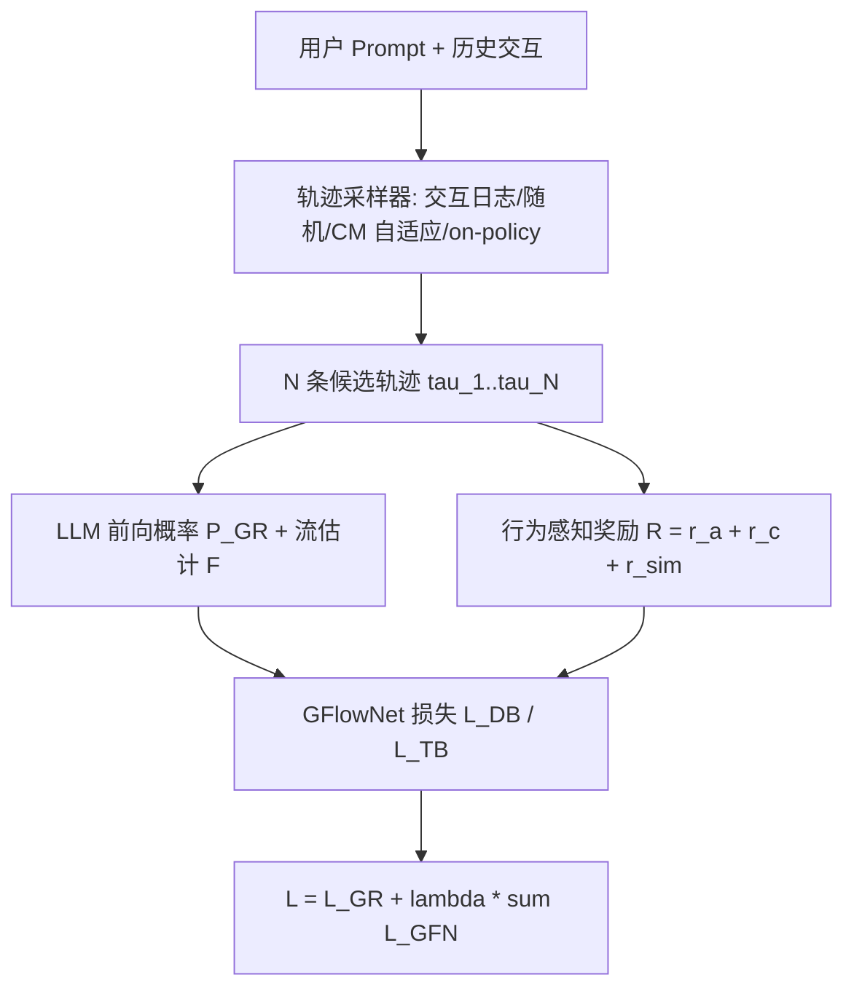
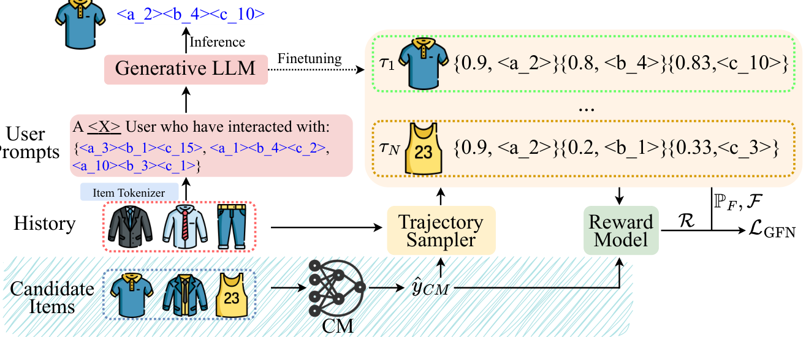

# GFlowGR: Fine-tuning Generative Recommendation Frameworks with Generative Flow Networks (用生成流网络微调生成式推荐框架)

- **会议/期刊**: SIGIR 2026
- **作者与机构**: Yejing Wang, Shengyu Zhou, Jinyu Lu, Qidong Liu, Xinhang Li, Wenlin Zhang, Feng Li, Pengjie Wang, Chuan Yu, Jian Xu, Bo Zheng, Xiangyu Zhao（香港城市大学 & 阿里巴巴）
- **推荐链路定位**: 召回 / 端到端生成式（候选生成）
- **研究方向**: 生成式推荐 / 强化学习与动态探索推荐
- **论文原文**: [https://arxiv.org/abs/2506.16114v3](https://arxiv.org/abs/2506.16114v3)
- **开源代码**: [https://github.com/Applied-Machine-Learning-Lab/SIGIR26_GFlowGR](https://github.com/Applied-Machine-Learning-Lab/SIGIR26_GFlowGR)

## TL;DR (1分钟核心速览)

生成式推荐（GR）的微调阶段长期被忽视：SFT 只对单个 ground-truth 物品做逐 token 极大似然，DPO/GRPO 类方法只在物品级给奖励，二者都忽略"未曝光但可能正相关"的样本（曝光偏差），且缺乏 token 级监督。本文把 GR 重构为**多步集合生成**任务，提出 GFlowGR：用轨迹采样器从候选集合构造训练轨迹、用行为感知奖励模型量化物品效用、用 GFlowNet 目标（DB/TB）把物品级奖励分解为 token 级流匹配信号。在 Beauty/Instruments/Yelp 三数据集、TIGER 与 LETTER 两个骨干上，Leave-One-Out + Full-Ranking 协议下 R@10 相对 SFT 最高提升约 24%（LETTER/Beauty：0.0540→0.0672），淘宝搜索广告线上年收入相对 +0.4%。

## Background & Motivation (背景与核心矛盾)

- **主流范式**: GR = 物品分词器（RQ-VAE 类，物品→$L$个离散 token）+ 用户 prompt + 自回归 LLM，训练以逐 token 下一词预测损失$\mathcal{L}_{GR}=-\sum_{l}\log P_{GR}(t_l\mid U,\{t_i\}_{i<l})$ 为主；近期出现 DPO/S-DPO/SPRec/IPA 等偏好或奖励微调。
- **前人局限**: ① SFT 每个样本只优化**单个**正例，与线上"生成一整个高价值候选集合"的集合级服务需求错位；② SFT 把所有交互（曝光、点击、购买）视为等价值，忽略效用差异；③ DPO/GRPO 类方法只在**物品级**给奖励，而物品是多 token 序列，缺失 token 级细粒度监督，优化精度受限。
- **核心洞察 (Key Insight)**: GFlowNet 的 $\mathrm{P}(\tau)\propto R(s_L)$ 性质天然把"终端物品奖励"分解为"流一致的 token 级目标"，且其训练对象是**轨迹集合**而非单点——恰好同时补上"集合级学习"与"token 级监督"两块短板。
- **本文切入点**: 把 GR 的 $L$步 token 拼接视为 GFlowNet 轨迹$\tau=(s_0\to\cdots\to s_L)$，前向转移概率直接取 LLM 的$P_{GR}$，反向概率因确定性拼接恒为 1，于是设计难点只剩"如何造轨迹"与"如何定奖励"。

## Method (核心方法设计)

### 1. 整体框架 (Overall Architecture)

对每个训练对 $(U,v)$：轨迹采样器把单正例扩展为$N$条候选轨迹$\{\tau_n\}_{n\le N}$（$\tau_1$为真值）；LLM 对每条轨迹输出逐步前向概率$P_{GR}(t_{l+1}\mid U,s_l)$，流估计器输出$F(s_l)$；奖励模型对终端状态$s_L$打出行为感知奖励$R(s_L)$；最后由 GFlowNet 损失$\mathcal{L}_{GFN}$ 与 SFT 损失加权求和更新 LLM。**推理管线完全不变**，GFlowGR 只是"即插即用"的微调替换。

<figure class="paper-figure" markdown="span">
  <figcaption>图2：GFlowGR框架。可视化示例展示了在𝑁个物品集合上的学习过程，以集合中两个物品为例，包括一个正样本（蓝色Polo衫）和一个未曝光样本（黄色打底衫）。两条轨迹的前向概率（P𝐹）均已展示（例如𝜏1的0.9、0.8、0.83），而估计的流值（F）为简洁起见被省略。蓝色阴影区域展示了结合协同模型（CM）的示例。</figcaption>
</figure>

### 2. 关键设计拆解 (Key Designs)

1. **轨迹平衡目标（TB）替代逐点 SFT**：痛点在于 GR 的中间状态（如 $\{$\<a_2\>\}$）并不唯一确定物品，逐状态详细平衡（DB）会引入歧义；TB 在整条轨迹层面做平衡，利用"轨迹↔物品"一一对应。代入$P_F=P_{GR}$、$P_B=1$ 后：
$$\mathcal{L}_{TB}(\tau)=\Big(\log\frac{Z\prod_{l=0}^{L-1}P_{GR}(t_{l+1}\mid U,s_l)}{R(s_L)}\Big)^2$$
直觉：最小化该式即迫使"整条轨迹的生成概率×配分 $Z$"逼近终端奖励，从而$\mathrm{P}(\tau)\propto R(s_L)$，高价值物品获得更高生成概率而非被强行归一化到单一正例上。

2. **行为感知奖励模型（多信号融合）**：未曝光样本若一律给 0 奖励会加剧曝光偏差。本文定义三类信号并求和 $R(\tau)=r_a+r_c+r_{sim}$：交互层级$r_a$（购买 10 / 点击 1 / 未曝光 0）、协同模型打分$r_c=\hat{y}^{CM}_{v}$、格式奖励$r_{sim}=\sum_{l}\mathbb{I}(t_l=t'_l)$（与正例共享 token 数，提供部分正确性的稠密信号）。直觉：$r_{sim}$ 把物品级奖励"打散"到 token 级，缓解稀疏奖励。

3. **自适应课程式轨迹采样 + 训练目标**：随机负采样在训练后期失效（模型已能轻易区分）。CM-based 采样先按 $\hat{y}^{CM}_{v_n}$从$2N-1$ 个候选中优先取低分"易负例"，随训练推进逐步混入高分"难负例"；亦可用 LLM beam search 做 on-policy 采样。总损失：
$$\mathcal{L}=\mathcal{L}_{GR}(U,v)+\lambda\sum_{n=1}^{N}\mathcal{L}_{GFN}(\tau_n)$$
负采样为"CM 打分课程 + 随机/on-policy"混合，**无需人工难负例挖掘**；推理零额外开销（流估计器与奖励模型仅训练期使用）。

## Experimental Setup & Evaluation Protocol (实验设置与评估协议)

- **数据集与预处理**: 沿用 LETTER 的预处理，物品分词基于标题+描述（Yelp 另加品牌与类目）。

| 数据集 | #Users | #Items | 稀疏度 | 平均序列长 | 场景说明 |
| :--- | :---: | :---: | :---: | :---: | :--- |
| Yelp | 30,431 | 20,032 | 99.85% | 9.39 | 商户签到与评论 |
| Beauty | 22,362 | 12,101 | 99.92% | 7.87 | Amazon 美妆 |
| Instruments | 24,772 | 9,922 | 99.99% | 7.32 | Amazon 乐器 |

- **数据划分与防穿越**: `Leave-One-Out`——每用户最后一件交互为测试、倒数第二件为验证、其余为训练，每个交互点作为其前序序列的目标。
- **排名评测协议**: `Full-Ranking`（对全库未交互物品排序），指标 R@5/R@10/N@5/N@10；三随机种子 {42,43,44} 取均值，单侧 t 检验 $p<0.05$。
- **对比基线与超参**: 三类微调基线——SFT；on-policy GRPO；off-policy DPO / S-DPO / SPRec / IPA。骨干为 TIGER 与 LETTER；默认 CM-based 采样 + 三奖励求和；$\lambda$与$N$网格搜索（$\lambda\in\{0.01,0.1,1,10,100\}$，$N\in\{0,1,3,5\}$）。

## Key Experimental Results (实验关键数据)

### 1. 主实验对比 (Main Results)

| 骨干 / 方法 | Beauty R@5 | Beauty R@10 | Beauty N@10 | Instruments R@10 | Yelp R@10 | Yelp N@10 |
| :--- | :---: | :---: | :---: | :---: | :---: | :---: |
| TIGER + SFT | 0.0354 | 0.0558 | 0.0299 | 0.1071 | 0.0334 | 0.0174 |
| TIGER + GRPO | 0.0347 | 0.0543 | 0.0291 | 0.0988 | 0.0328 | 0.0169 |
| TIGER + DPO | 0.0308 | 0.0483 | 0.0256 | 0.0977 | 0.0182 | 0.0087 |
| TIGER + S-DPO | 0.0314 | 0.0492 | 0.0265 | 0.0930 | 0.0333 | 0.0176 |
| TIGER + IPA | 0.0306 | 0.0481 | 0.0245 | 0.0899 | 0.0179 | 0.0093 |
| TIGER + GFlowGR-TB | **0.0407*** | **0.0651*** | **0.0344*** | **0.1093*** | **0.0404*** | **0.0213*** |
| LETTER + SFT | 0.0344 | 0.0540 | 0.0290 | 0.1049 | 0.0341 | 0.0175 |
| LETTER + S-DPO | 0.0390 | 0.0607 | 0.0336 | 0.0914 | 0.0389 | 0.0206 |
| LETTER + GFlowGR-TB | **0.0433*** | **0.0672*** | **0.0363*** | **0.1100*** | **0.0413*** | **0.0222*** |
| Improv. (LETTER, R@10) | +25.9% | +24.4% | +25.2% | +4.9% | +21.1% | +26.9% |

### 2. 消融实验 (Ablation Study)

LETTER / Beauty：

| 变体 | R@5 | R@10 | N@5 | N@10 |
| :--- | :---: | :---: | :---: | :---: |
| 仅 $r_a$ | 0.0387 | 0.0596 | 0.0254 | 0.0322 |
| 仅 $r_c$ | 0.0408 | 0.0631 | 0.0265 | 0.0337 |
| 仅 $r_{sim}$ | 0.0384 | 0.0580 | 0.0246 | 0.0310 |
| $r_a+r_c+r_{sim}$（默认） | **0.0433** | **0.0672** | **0.0286** | **0.0363** |
| w/o Ada（随机采样） | 0.0424 | 0.0659 | 0.0278 | 0.0354 |
| w/o Traj（$N=1$） | 0.0423 | 0.0639 | 0.0274 | 0.0343 |
| w/o CM（去协同信号） | 0.0430 | 0.0667 | 0.0282 | 0.0358 |

### 3. 关键实验发现 (Key Findings)

1. **TB 优于 DB，且优势在稀疏数据上放大**：TIGER/Yelp 上 TB 的 R@10 为 0.0404，DB 仅 0.0345（+17%），印证"中间状态不唯一确定物品"时整轨迹平衡更稳健；DB 在 Instruments 上甚至与 SFT 持平（0.1074 vs 0.1071）。
2. **奖励信号互补、$r_a$最关键**：去掉任一信号均掉点，仅$r_a$时 R@10=0.0596，三信号融合升至 0.0672；而$r_c$单独使用（0.0631）优于$r_{sim}$（0.0580），说明协同先验比 token 重叠更有效，但 CM 精度低于 GR 故增益边际。
3. **集合级学习是主要收益来源**：$N=1$（w/o Traj）时 R@10 从 0.0672 跌至 0.0639，退化幅度超过随机采样（0.0659）与去 CM（0.0667），证明"从集合而非单点学习"是核心；线上 80× 样本预算下 GFlowGR 仅需 SFT 的 2.1× 训练成本（GRPO 计算不可行），H@20 0.444 vs SFT 0.358、GRPO 0.427。

## Highlights & Limitations (亮点、对比与审稿批判)

- **与代表作对比 (vs. Prior Work)**: 与 SFT 的本质区别是"单点极大似然 → 集合级奖励比例对齐"；与 S-DPO/IPA 的区别是后者只在物品级构造偏好对/奖励，本文借 GFlowNet 把奖励分解到 token 级；与 OneRec-V2 的 GRPO 相比，GFlowNet 不强制候选集合概率和为 1，对增广集合更鲁棒（GRPO 在 Beauty 上甚至低于 SFT）。
- **可迁移亮点**: ① 用 $r_{sim}$（与正例共享 token 数）把稀疏物品级奖励稠密化，可迁移到任何多 token 语义 ID 生成任务；② CM 打分驱动的"易→难"课程式负采样，可直接复用于 DPO 类推荐的 rejected 样本选择。
- **审稿级局限批判**: ① 训练开销约为 SFT 的 2.1×，且需额外维护流估计器与协同模型，冷启动场景下 CM 不可用会削弱 $r_c$；② 奖励权重默认等权求和，虽 Weighted Sum 在 R@5 略优（0.0446 vs 0.0433）但未系统调优，奖励尺度（$r_a$ 取 10/1/0）带较强人工先验；③ 仅报告 R/NDCG，未给出覆盖率/新颖性的离线系统指标，多样性结论主要依赖 KL 散度与小样本 case study。

## Rating (四维评分)

- **方法创新性 (Novelty)**: ⭐⭐⭐⭐ （首次将 GFlowNet 引入 GR 微调，把曝光偏差问题转化为"生成概率∝效用"的流匹配问题，视角新颖且有理论支撑）
- **评估协议与实验扎实度 (Protocol & Experiments)**: ⭐⭐⭐⭐ （三数据集×两骨干×六基线，Full-Ranking + 显著性检验 + 完整消融 + 线上 A/B，唯缺采样排序协议对照）
- **写作与数学规范度 (Clarity & Rigor)**: ⭐⭐⭐⭐ （DB/TB 推导与 $P_B=1$的化简交代清楚，算法伪码完整；奖励尺度与$\lambda$ 的敏感性分析略简）
- **工业落地与复现价值 (Industrial & Practical Value)**: ⭐⭐⭐⭐⭐ （淘宝搜索广告全量部署、年收入相对 +0.4%、新上架物品 +4.0%、长尾 query +1.8%，代码开源，推理零改动）
