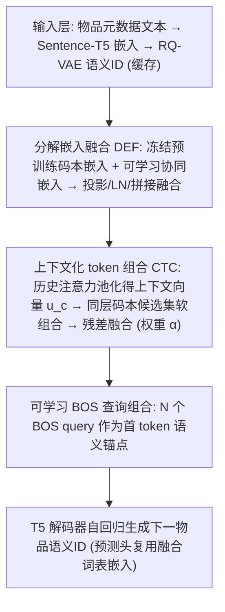
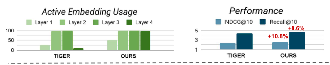
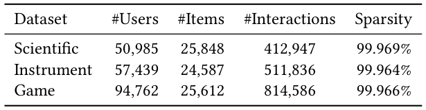
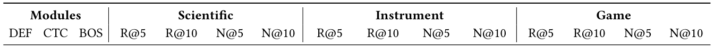
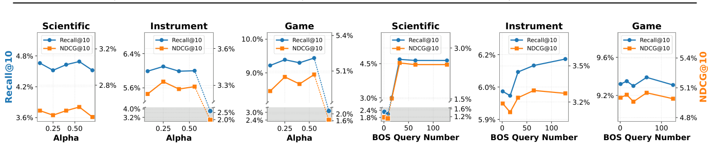
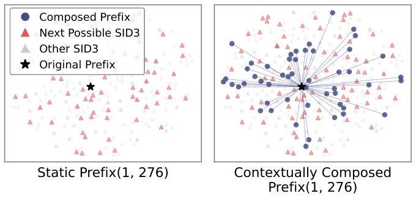
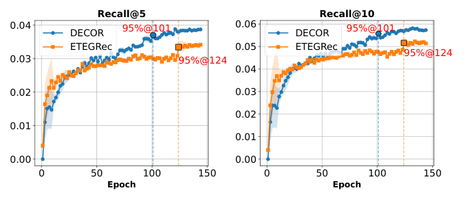

# Learning Decomposed Contextual Token Representations from Pretrained and Collaborative Signals for Generative Recommendation (从预训练与协同信号中学习分解式上下文化 Token 表征的生成式推荐)

- **会议/期刊**: SIGIR 2026 (第 49 届 ACM SIGIR, Melbourne, VIC, Australia)
- **推荐链路定位**: 端到端生成式 (End-to-End Generative) — 语义 ID 自回归生成式召回
- **研究方向**: 生成式推荐与离散语义 ID (主) / 序列与会话推荐 (次)
- **论文原文**: [https://arxiv.org/abs/2509.10468v2](https://arxiv.org/abs/2509.10468v2)
- **开源代码**: [https://github.com/yliuaa/DECOR.git](https://github.com/yliuaa/DECOR.git)

## TL;DR (核心速览)

针对两阶段生成式推荐中"分词器预训练目标（语义重建）与推荐器训练目标（交互建模）错位"导致的两大痛点——静态分词次优（前缀歧义）与预训练语义被覆盖——DECOR 提出分解嵌入融合（冻结 RQ-VAE 码本 + 可学习协同嵌入）与上下文化 token 组合（基于历史注意力池化动态重构 token 嵌入，含可学习 BOS 查询）。在 Amazon 三子集、5-core 过滤、留一法、全库排序协议下，NDCG@10 相对最强基线提升约 3%–14%，推理仅增约 0.85 ms/样本。

## Background & Motivation (背景与动机)

- **领域背景与主流范式**: 生成式推荐（TIGER 范式）采用两阶段流水线：先用 RQ-VAE 将物品文本嵌入量化为离散语义 ID（semantic ID），再训练 T5 类 LLM 以自回归方式生成下一物品的 token 序列。该范式天然契合 LLM 的长程依赖建模能力，并借预训练语义先验缓解冷启动。
- **现有方法局限 (Limitations of Prior Work)**:
  1. **静态分词次优 (C1)**: 语义 ID 由"重建语义嵌入"目标训练的分词器产生，而非为推荐优化。作者指出行为上差异巨大的物品在 75% 的生成步上共享相同前缀 token（如 `[a_3,b_4,c_5]`），形成**前缀歧义 (prefix ambiguity)**——办公/健身/睡眠三类降噪耳机被分配相同前缀（图 1），注意力机制无法从结构相同的输入中解析用户意图。
  2. **预训练语义被丢弃 (C2)**: 语义 ID 的 token 嵌入在推荐器训练阶段随机初始化、仅由交互数据训练，预训练模型（如 LLM 嵌入）承载的世界知识被覆盖。例如 token `a_54` 预训练时同时表示"苹果（水果）"与"苹果（科技品牌）"，若训练中多出现于电子类上下文，则嵌入仅保留科技含义，对稀疏物品造成错配推荐。
- **核心挑战 (Key Challenge)**: 现有补救方案各有短板——ETEGRec 端到端联合优化分词器与推荐器，需反复重分词，引入训练不稳定与额外开销（图 5 显示其在 epoch 75–110 出现学习停滞）；LETTER、CoST 仅在预训练阶段增强语义保持，推荐器训练阶段仍丢弃细粒度预训练语义。简单的加深网络或常规对比学习无法同时解决"分词静态性"与"语义流失"这对耦合矛盾。
- **核心洞察与切入点 (Key Insight)**: 作者的关键观察是——**无需改动分词器、无需重分词**，只需在推荐器前向过程中对 token 嵌入做两件事：(i) 把冻结的预训练码本嵌入与可学习协同嵌入**分解融合**以保留语义；(ii) 依据用户历史上下文对 token 嵌入做**软组合**以动态消歧。这样既避免 ETEGRec 的重分词不稳定，又保留预训练知识。

## Problem Formulation & Method (问题定义与方法架构)

### 1. 符号定义与输入表征 (Notations & Input Representations)

- 物品集 $\mathcal{I}$，用户交互序列 $S_u=[i_1,i_2,\dots,i_{t-1}]\in\mathcal{I}$，目标为预测下一物品 $i_t$。
- 物品分词：$c_i=[c_{i,1},\dots,c_{i,L}]\in\mathcal{C}$，其中 $L$ 为语义 ID 长度；交互序列转为 token 序列 $X_u=[\mathbf{c}_{i_1},\dots,\mathbf{c}_{i_{t-1}}]$。
- 语义 ID 长度 $M_s=M+1$：$M$ 为 RQ-VAE 量化层数，额外 1 个 token 用于冲突消解（collision handling）。本文 $M=3$、码本大小 $K=256$，故语义 ID 为 4-token。
- 嵌入维度 $d$：分词器码本与推荐器隐藏维度对齐（同 hidden size $d$）；文本编码器为 Sentence-T5-base，生成式推荐器为 T5。
- 历史序列最大长度 $L=20$（物品序列截断）。

### 2. 整体流水线 (Overall Architecture)

数据流：物品元数据 → Sentence-T5 文本嵌入 → RQ-VAE 量化得语义 ID（缓存）→ 推荐器训练阶段：每个 token 经**分解嵌入融合**得 $e_{\text{fused}}$ → 历史 token 经注意力池化得上下文向量 $u_c$ → **上下文化 token 组合**得 $\tilde e_c$，与静态嵌入残差融合 → 送入 T5 解码器自回归生成下一物品语义 ID；预测头复用融合后的词表嵌入。

### 3. 核心模块设计与数学原理 (Key Designs & Formulations)

**(1) 分解嵌入融合 (Decomposed Embedding Fusion, DEF)** — 解决 C2。

预训练语义空间 $E_{\text{pre}}=\{\mathcal{C}_i\}_{i=1}^{M}\in\mathbb{R}^{K\cdot M\times d}$，每个 $\mathcal{C}_i\in\mathbb{R}^{K\times d}$ 为第 $i$ 层冻结码本；协同嵌入空间 $E_{\text{collab}}\in\mathbb{R}^{K\cdot M\times d}$ 为从零训练的可学习矩阵。二者同维（$K\times d$）以便对齐。融合过程：

$$\hat e_{\text{pre}}=\mathrm{LN}(W_{\text{pre}}e_{\text{pre}}),\quad \hat e_{\text{collab}}=\mathrm{LN}(W_{\text{collab}}e_{\text{collab}})$$

$$e_{\text{fused}}=W_{\text{fuse}}[\hat e_{\text{pre}}\,\|\,\hat e_{\text{collab}}]\in\mathbb{R}^{d}$$

其中 $W_{\text{pre}},W_{\text{collab}}\in\mathbb{R}^{d'\times d}$，$W_{\text{fuse}}\in\mathbb{R}^{d\times 2d'}$。物理直觉：将"重建语义"与"交互协同"视为两条互补信息通道，模态感知融合使模型自适应整合冻结的世界知识与序列共现/偏好动态。

**(2) 上下文化 token 组合 (Contextualized Token Composition, CTC)** — 解决 C1。

上下文向量由历史融合嵌入 $h_\ell$ 的注意力池化得到：

$$u_c=\mathrm{AttnPool}(h_c)=\mathrm{MLP}_{\text{ctx}}\Big(\sum_{\ell=1}^{L}\alpha_\ell h_\ell\Big),\quad \alpha_\ell=\frac{\exp(s_\ell)}{\sum_m\exp(s_m)},\ s_\ell=w^\top\tanh(Wh_\ell+b)$$

候选集 $\mathcal{N}(c)$ 取**同一 RQ-VAE 码本层**的全部 token（大小 $K$），注意力软组合：

$$\alpha_{c'}=\frac{\exp(\langle W_q u_c, W_k e_{c'}\rangle)}{\sum_{c''\in\mathcal{N}(c)}\exp(\langle W_q u_c, W_k e_{c''}\rangle)},\quad \tilde e_c=\sum_{c'\in\mathcal{N}(c)}\alpha_{c'}e_{c'}$$

残差融合：$e_{\text{final}}=\alpha\cdot\tilde e_c+(1-\alpha)\cdot e_c^{\text{static}}$，$\alpha\in[0,1]$ 为固定超参。设计直觉：候选集覆盖同层全部码本条目，使组合可"借用"预训练中未被充分利用的码本容量，提升表征多样性并缓解前缀歧义。

**(3) 可学习 BOS 查询组合 (Learnable BOS Embedding Composition)** — 强化首 token 语义锚点。

RQ-VAE 首 token 承载粗粒度类别语义，其误判会沿自回归链传播。引入 $N$ 个可学习 BOS 查询 $Q_{\text{BOS}}\in\mathbb{R}^{N\times d}$，$\hat e_{\text{BOS}}=\Phi(e_{\text{BOS}},u_c,Q_{\text{BOS}})$（$e_{\text{BOS}}$ 为零向量，故由 BOS 查询组合而成），替代原始 BOS token 作为生成前缀，使首 token 生成即对齐用户上下文。

### 4. 训练目标、负采样与推理复杂度 (Optimization, Negative Sampling & Complexity)

- **分词器预训练损失**: $\mathcal{L}_{\text{RQVAE}}=\mathcal{L}_{\text{RECON}}+\mathcal{L}_{\text{RQ}}$，其中 $\mathcal{L}_{\text{RECON}}=\|x-\tilde x\|_2^2$，$\mathcal{L}_{\text{RQ}}=\sum_{m=1}^{M}\big(\|\mathrm{sg}[z_{m-1}]-e_{c_m}^m\|_2^2+\beta\|z_{m-1}-\mathrm{sg}[e_{c_m}^m]\|_2^2\big)$，$\beta=0.25$，$\mathrm{sg}[\cdot]$ 为 stop-gradient。
- **推荐器训练损失**: 采用标准自回归下一 token 交叉熵（teacher forcing），逐 token 分解 $p(c_{i_t}|X_u)=\prod_{l=1}^{L}p(c_{i_t,l}|X_u,c_{i_t,1},\dots,c_{i_t,l-1})$；DEF 与 CTC 由推荐损失端到端驱动。**负采样策略：免负采样**（自回归逐 token 分类，全词表 softmax），原文未使用 BPR/InfoNCE 类对比损失。
- **复杂度**: DEF 每物品常数开销 $O(d^2)$；CTC 上下文池化 $O(L\cdot d^2)$，每 token 组合 $O(K\cdot d^2)$（$d,K$ 为常数），整体随上下文长度 $L$ 线性增长，远低于骨干 Transformer 自注意力的 $O(L^2\cdot d)$。实测（beam width=50，batch=128）：TIGER 3.85 ms/样本 → DECOR 4.70 ms/样本，**恒定增加约 0.85 ms**，吞吐保留约 82%（>210 samples/s）。

## Experimental Setup & Evaluation Protocol (实验设置与评估协议)

- **数据集统计与预处理**: 采用最新版 Amazon Review 数据集三个子集（Scientific / Instrument / Game），**5-core 过滤**（剔除交互少于 5 次的用户与物品），按时间对齐构造交互序列，最大序列长度 20。

| 数据集 (Dataset) | 用户数 (#Users) | 物品数 (#Items) | 交互数 (#Interactions) | 稀疏度 (Sparsity) | 模态/辅助特征说明 |
| :--- | :---: | :---: | :---: | :---: | :--- |
| Scientific | 50,985 | 25,848 | 412,947 | 99.969% | 物品文本元数据 → Sentence-T5 嵌入 |
| Instrument | 57,439 | 24,587 | 511,836 | 99.964% | 同上（专业术语多，文本先验弱） |
| Game | 94,762 | 25,612 | 814,586 | 99.966% | 同上 |

- **数据划分方式 (Splitting Strategy)**: **Leave-One-Out (留一法)**——每用户最后一条交互作测试、倒数第二条作验证、其余训练。按用户序列时间顺序切分，未见全局时间戳穿越描述；原文未报告显式防泄露机制，但 LOO 逐用户切分是序列推荐标准做法。
- **排名评测协议 (Ranking Protocol)**: **Full-Ranking（全库未交互物品排序，无负采样）**，对全部候选物品集打分。
- **评价指标与显著性检验**: Recall@5/10、NDCG@5/10；随机种子 2025 报告测试性能，并在种子 {2021,2022,2023,2024,2025} 五次独立运行上做**配对 t 检验**（$p<0.05$，表中上标 ∗ 标注显著性）；每轮按验证集 NDCG@10 选最优模型。码本大小 256、量化层数 3（4-token 语义 ID）。单卡 NVIDIA Tesla A40。

## Key Experimental Results (核心实验结果)

### 1. 主实验对比 (Main Results)

表 2 显示 DECOR 在所有数据集、所有指标上全面领先（含传统序列模型与生成式模型）。下表摘取 NDCG@10 与 Recall@10 关键对比（最强基线取 ETEGRec）：

| 数据集 | 指标 | 传统最强基线 (FDSA/S3Rec) | 生成式最强基线 (ETEGRec) | 本文方法 (DECOR) | 相对提升 (Improv.) |
| :--- | :--- | :---: | :---: | :---: | :---: |
| Scientific | NDCG@10 | 0.0218 (S3Rec) | 0.0225 | **0.0257*** | +14.2% |
| Scientific | Recall@10 | 0.0410 (S3Rec) | 0.0433 | **0.0469*** | +8.3% |
| Instrument | NDCG@10 | 0.0295 (FDSA) | 0.0323 | **0.0339*** | +5.0% |
| Instrument | Recall@10 | 0.0557 (FDSA) | 0.0609 | **0.0617*** | +1.3% |
| Game | NDCG@10 | 0.0453 (FDSA) | 0.0492 | **0.0507*** | +3.0% |
| Game | Recall@10 | 0.0857 (FDSA) | 0.0925 | **0.0944*** | +2.1% |

作者强调 Instrument 域因依赖专业术语（型号、调音规格）而非自然语言描述，TIGER 类静态文本先验基线遇瓶颈，DECOR 通过分解融合协同信号补偿语义判别力不足，NDCG@10 相对最强基线提升 5.0%。

### 2. 消融实验与控制变量分析 (Ablation Study)

表 3 逐步添加 DEF、CTC、BOS 三模块（基线为 TIGER）：

- **单独加 CTC**（✗✓✗）：Scientific NDCG@10 0.0231→0.0247，Instrument 0.0308→0.0321，Game 0.0471→0.0502，提升显著。
- **单独加 DEF**（✓✗✗）：Scientific 0.0231→0.0246，Instrument 0.0308→0.0323，Game 0.0471→0.0501，与 CTC 单独使用提升幅度相近，印证"保留预训练语义"与"上下文化 token 精炼"各自有效。
- **DEF+CTC**（✓✓✗）：进一步提升（Scientific 0.0250、Instrument 0.0324、Game 0.0500）。
- **全模块**（✓✓✓）：最优（Scientific 0.0256、Instrument 0.0339*、Game 0.0507）。BOS 在与 DEF 联合时带来增益（如 Instrument NDCG@10 相对 ✓✓✗ 提升约 2.43% 量级），作者解释 BOS 查询作为高层语义锚点强化预训练语义与组合 token 的对齐；CTC 在 step 0 无前序 token 可精炼，BOS 提供参数化上下文前缀。
- 消融未显式做参数量对齐或图度数匹配控制（生成式框架下无图拓扑），但各变体共享同一骨干 T5，属同参数量对照。

### 3. 稀疏度/冷启动分桶与超参敏感度 (Sparsity Buckets & Hyperparameters)

- **码本活跃度分析（表 4）**: TIGER 第一量化层活跃嵌入利用率仅 25.67%–27.97%，DECOR 通过将未激活 token 纳入组合计算，将覆盖率提升至 Instrument/Game 的 100%、Scientific 的 51.06%（过滤低于均匀组合注意力权重的 token）。Scientific 交互数少 20%–50%，故激活较少额外 token 以适配较弱上下文多样性——体现"高效表征利用"。
- **超参敏感度（图 3）**: 组合权重 $\alpha$ 在 0.4–0.55 时各数据集最优；$\alpha=0.1$ 仍优于消融基线；$\alpha=0.7$ 时性能急剧下降（过度依赖组合信号致单 token 嵌入欠训练，Instrument/Game 交互空间大、需 token 嵌入早稳定，崩溃尤明显）。BOS 查询数从 0 增至 32 持续增益（Scientific NDCG@10 1.17%→2.56%），超过 32（Game 为 64）后增益饱和，128 无额外收益。
- **收敛性（图 5）**: Scientific 上 DECOR 在 epoch 101 达峰值 95%，ETEGRec 需 124 epoch；ETEGRec 在 epoch 75–110 出现学习停滞，DECOR 稳定提升，验证免重分词方案的稳定性与样本效率。
- **前缀歧义案例（图 4）**: t-SNE 显示静态分词对前缀 (1,276) 仅产生单一固定嵌入，与有效下一 token 候选（红三角）语义不连贯；DECOR 组合后的前缀嵌入分散且与候选对齐更一致。
- **线上 A/B 测试**: 原文仅包含离线实验，未报告线上 A/B 结果。

## Highlights, Limitations & Critiques (亮点、局限与审稿级批判)

- **核心亮点与可迁移性**:
  1. **"冻结码本 + 可学习协同嵌入"的分解融合**是通用算子，可迁移到任何"预训练语义 + 交互微调"的两阶段范式（如多模态语义 ID、跨域生成式召回），避免预训练知识在微调中被覆盖。
  2. **同层码本候选集软组合**巧妙地把"未激活码本容量"转化为表征多样性来源，同时天然缓解码本坍缩（codebook collapse），对 VQ/RQ-VAE 类离散表征学习有普适价值。
  3. **免重分词**设计在保持训练稳定的同时获得动态 token 语义，工程上比 ETEGRec 更易落地（仅 +0.85 ms/样本）。
- **局限性与审稿视角批判 (Critical Limitations)**:
  1. **评估协议**: 仅三个 Amazon 子集、LOO + Full-Ranking 单一协议，缺少 Yelp/Gowalla 等异构域与时间切分（Global Temporal Split）验证；LOO 单样本测试的方差较大，虽有 5 种子配对 t 检验，但未报告置信区间。
  2. **候选集规模与开销**: CTC 候选集取同层全部 $K=256$ 个 token，若码本规模扩大（如 4096/8192），$O(K\cdot d^2)$ 组合开销与显存将显著上升，原文未讨论大码本下的扩展性；且 $\alpha$ 固定不随训练调整，$\alpha=0.7$ 崩溃说明对超参较敏感。
  3. **BOS 增益有限且不一致**: 表 3 中 BOS 在部分指标（如 Game NDCG@10 0.0502→0.0500、Scientific NDCG@10 0.0247→0.0248）几乎无提升甚至微降，作者对 BOS 必要性的论证偏弱。
  4. **基线公平性**: 部分基线（如 P5-SID/P5-CID）为适配设置重跑，未报告其调参预算是否与 DECOR 对齐；ETEGRec 的收敛对比排除了其分词器优化 epoch，可能低估其样本效率。
  5. **理论深度**: 对"为何软组合能消解前缀歧义"仅有 t-SNE 定性证据，缺乏对组合后嵌入判别性（如类内/类间距离）的定量分析。

## Rating (四维评分)

- **方法创新性 (Novelty)**: ⭐⭐⭐⭐ （分解融合 + 同层码本软组合 + 可学习 BOS 的组合设计新颖，直击两阶段目标错位，但各组件单独看均属已有思想的巧妙重组）
- **评估协议与实验扎实度 (Protocol & Experiments)**: ⭐⭐⭐⭐ （Full-Ranking + 5 种子配对 t 检验规范，消融与码本活跃度分析充分；但数据集域覆盖窄、缺时间切分与线上验证）
- **写作与数学规范度 (Clarity & Rigor)**: ⭐⭐⭐⭐ （公式与维度标注清晰，复杂度分析完整；BOS 增益论证与部分符号（如 $d'$ 未明确定义）稍欠严谨）
- **工业落地与复现价值 (Industrial & Practical Value)**: ⭐⭐⭐⭐⭐ （免重分词、+0.85 ms 延迟、代码开源、吞吐保留 82%，工程落地友好度高）

## 论文图表

<figure class="paper-figure" markdown="span">
  <figcaption>图 1：次优的静态分词将相同的前缀 token 分配给语义不同的物品（例如用于办公、健身或睡眠的降噪耳机），导致表示模糊，无法反映多样的用户交互上下文。</figcaption>
</figure>

<figure class="paper-figure" markdown="span">
  <figcaption>图 2：DECOR 通过两个组件增强生成式推荐：分解嵌入融合整合冻结的预训练嵌入与新学习的协同嵌入，而上下文化 token 组合在自回归生成过程中动态细化 token 表示。</figcaption>
</figure>

<figure class="paper-figure" markdown="span">
  <figcaption>表 1：数据集统计</figcaption>
</figure>

<figure class="paper-figure" markdown="span">
  <figcaption>表 2：在三个数据集 Instrument、Scientific 和 Game 上的性能比较。指标包括 Recall@K（R@K）和 NDCG@K（N@K）。粗体表示每列最佳结果。上标 ∗ 表示在 𝑝&lt; 0.05 下具有统计显著性。</figcaption>
</figure>

<figure class="paper-figure" markdown="span">
  <figcaption>表 3：DECOR 在三个数据集上的消融结果。每个变体逐步添加组件：分解嵌入融合（DEF）、上下文化 token 组合（CTC）和可学习 BOS 查询（BOS）。✓ 表示使用该模块，✗ 表示不使用。指标包括 Recall@K（R@K）和 NDCG@K（N@K）。粗体表示每列最佳结果。</figcaption>
</figure>

<figure class="paper-figure" markdown="span">
  <figcaption>图 3：DECOR 在所有数据集上对上下文化 token 组合权重 𝛼 和 BOS 查询数量的参数分析。阴影区域显示极端设置下的性能崩溃。我们在以下范围内搜索超参数：𝛼∈{0.1, 0.25, 0.4, 0.55, 0.7} 且 BOS 查询数量 ∈{8, 16, 32, 64, 128}</figcaption>
</figure>

<figure class="paper-figure" markdown="span">
  <figcaption>图 4：Scientific 数据集上前缀歧义的案例研究。与静态分词（左）相比，DECOR（右）生成的前缀嵌入具有上下文适应性，增强了消歧的表达能力。</figcaption>
</figure>

<figure class="paper-figure" markdown="span">
  <figcaption>图 5：DECOR 与 ETEGRec 在 Recall@5（左）和 Recall@10（右）上的收敛比较。DECOR 不仅实现了更高的召回率，而且显著更早达到其峰值性能的 95%（101 对 124 个 epoch），表明收敛更快、更稳定。</figcaption>
</figure>

