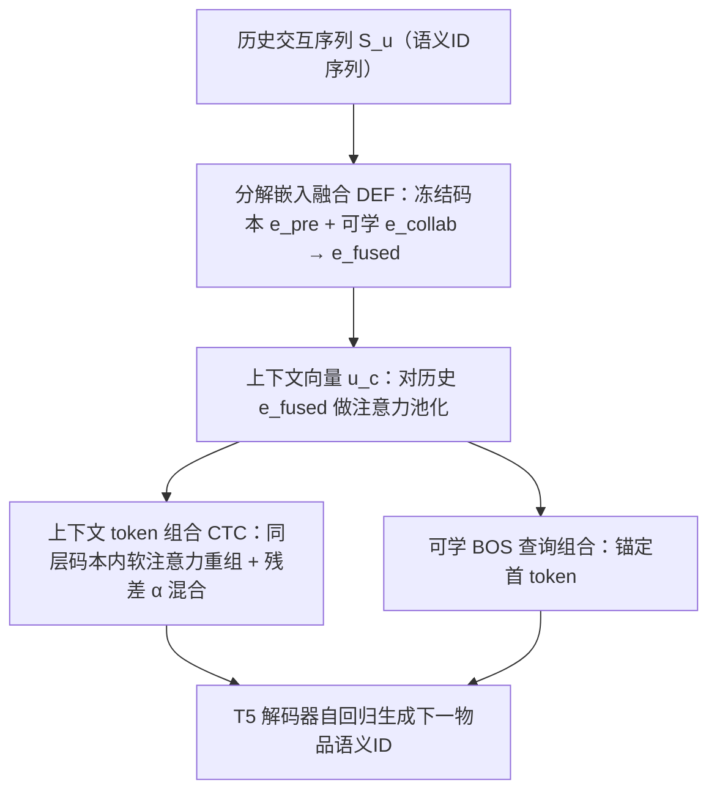
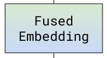

# Learning Decomposed Contextual Token Representations from Pretrained and Collaborative Signals for Generative Recommendation (从预训练与协同信号学习分解式上下文 Token 表征的生成式推荐)

- **会议/期刊**: SIGIR 2026
- **作者与机构**: Yifan Liu, Yaokun Liu, Zelin Li, Zhenrui Yue, Gyuseok Lee, Ruichen Yao, Dong Wang (UIUC) / Yang Zhang (Miami University)
- **推荐链路定位**: 端到端生成式（语义 ID 自回归生成式召回）
- **研究方向**: 生成式推荐与离散语义 ID / 序列推荐
- **论文原文**: [https://arxiv.org/abs/2509.10468v2](https://arxiv.org/abs/2509.10468v2)
- **开源代码**: [https://github.com/yliuaa/DECOR.git](https://github.com/yliuaa/DECOR.git)

## TL;DR (1分钟核心速览)

两阶段生成式推荐（RQ-VAE 分词 + LLM 生成）存在目标错配：分词器为语义重建优化、推荐器为交互建模优化，导致 (C1) 静态语义 ID 让 75% 的生成步共享同一前缀、无法反映使用语境，(C2) 分词后预训练语义被随机初始化 token 嵌入覆盖。DECOR 提出冻结码本与可学协同嵌入的分解融合、按用户历史做候选码本层内的软 token 组合、以及可学 BOS 查询锚定首 token。在 Amazon 三子集、`5-core` + `Leave-One-Out` + 全库 Full-Ranking 协议下，NDCG@10 相对最强基线提升 3%–14%，推理仅增 ~0.85ms/样本。

## Background & Motivation (背景与核心矛盾)

- **主流范式**: TIGER 类工作先用 RQ-VAE 把物品文本嵌入量化成定长语义 ID（如 4 个 token），再冻结该 ID 训练 T5 自回归生成下一物品的 token 序列。
- **前人局限 1（静态分词）**: 语义 ID 由重建目标决定且训练中固定，行为差异极大的物品（办公/健身/助眠降噪耳机）共享前缀 `[a_3,b_4,c_5]`，模型在前 3/4 生成步对用户意图"失明"，注意力机制面对结构相同的输入无从分辨。
- **前人局限 2（语义丢弃）**: 分词完成后，token 嵌入随机初始化、仅靠交互数据训练，"apple"这类多义词的预训练世界知识被交互分布单方面覆盖，稀疏物品受害最深。
- **已有破局方案的不足**: ETEGRec 端到端联合优化分词器与推荐器，但反复重分词带来训练震荡与停滞（75–110 epoch 停滞）；LETTER/CoST 只在预训练阶段增强分词质量，推荐阶段仍丢弃细粒度语义。
- **核心洞察 (Key Insight)**: 不必改动语义 ID 本身，只需在**生成时动态解释**静态 token——用上下文组合扩展 token 表达力，用分解融合保留预训练语义，即可同时解 C1 与 C2 且避免重分词不稳定。
- **本文切入点**: 把"分词器 vs 推荐器"的目标冲突，转化为"冻结语义通道 + 可学协同通道"的双通道融合问题。

## Method (核心方法设计)

### 1. 整体框架 (Overall Architecture)

DECOR 保留 TIGER 的两阶段骨架：阶段一用 RQ-VAE 在 Sentence-T5 文本嵌入上训练 3 层、码本 256 的量化器，得到 4-token 语义 ID 并缓存；阶段二训练 T5 推荐器时，每个 token 的输入嵌入不再走静态查表，而是先由**分解嵌入融合 (DEF)** 把冻结码本向量与可学协同向量投影拼接融合，再由**上下文 token 组合 (CTC)** 以历史序列注意力池化出的上下文向量为 query、在同层码本全部 token 上做软注意力重组，最后经残差系数 $\alpha$ 与静态嵌入混合；首 token 额外用**可学 BOS 查询**替代零向量 BOS。输出头复用融合后的词表嵌入以保证语义一致。

<figure class="paper-figure" markdown="span">
  <figcaption>图 2：DECOR 通过两个组件增强生成式推荐：分解嵌入融合整合冻结的预训练嵌入与新学习的协同嵌入，而上下文化 token 组合在自回归生成过程中动态细化 token 表示。</figcaption>
</figure>

### 2. 关键设计拆解 (Key Designs)

1. **分解嵌入融合 DEF（保住预训练语义）**：痛点是分词后码本向量被丢弃、token 嵌入从零学起。做法是把第 $i$层码本$C_i\in\mathbb{R}^{K\times d}$整体冻结为语义通道$E_{\text{pre}}$，另设同形状可学协同通道$E_{\text{collab}}$，各自线性投影 + LayerNorm 后拼接融合：

$$e_{\text{fused}}=W_{\text{fuse}}\big[\mathrm{LN}(W_{\text{pre}}e_{\text{pre}})\;\|\;\mathrm{LN}(W_{\text{collab}}e_{\text{collab}})\big]$$

直觉：两通道维度对齐（同为 $K\times d$）使融合成为"语义先验 + 交互证据"的可学习加权，稀疏物品可直接借用预训练语义兜底，而非被少量交互带偏。

2. **上下文 token 组合 CTC（破解前缀歧义）**：痛点是静态 ID 让不同语境物品共享前缀。做法是以历史融合嵌入的注意力池化向量 $u_c$ 为 query，对**同一 RQ-VAE 量化层**的全部候选 token 做 softmax 组合：

$$\tilde e_c=\sum_{c'\in\mathcal{N}(c)}\frac{\exp(\langle W_q u_c, W_k e_{c'}\rangle)}{\sum_{c''}\exp(\langle W_q u_c, W_k e_{c''}\rangle)}\,e_{c'},\qquad e_{\text{final}}=\alpha\tilde e_c+(1-\alpha)e_c^{\text{static}}$$

直觉：候选集取整层码本，等价于允许模型"借用"预训练中未被激活的码本容量，把死码本变成可插值的语义基；$\alpha$控制语境改写强度，$\alpha$ 过大（0.7）会因单 token 欠训练而崩溃。

3. **可学 BOS 查询 + 训练目标**：首 token 承载粗粒度类别语义，错则全序列错。用 $N$个可学查询$Q_{\text{BOS}}\in\mathbb{R}^{N\times d}$以同一组合算子生成上下文相关的 BOS 嵌入，替代零向量。总损失即标准自回归下一 token 交叉熵$\mathcal{L}=-\sum_l \log p(c_{i_t,l}\mid X_u,c_{<l})$，**无需负采样**（全库 softmax 由生成式解码隐式完成）；额外开销为每物品$O(d^2)$融合 +$O(Ld^2)$上下文池化 + 每 token$O(Kd^2)$组合，均与$L$线性、远低于骨干自注意力的$O(L^2d)$。

## Experimental Setup & Evaluation Protocol (实验设置与评估协议)

- **数据集与预处理**（Amazon Review 最新版，`5-core` 过滤，序列截断长度 20）：

| 数据集 | #Users | #Items | #Interactions | 稀疏度 | 特征/场景说明 |
| :--- | :---: | :---: | :---: | :---: | :--- |
| Scientific | 50,985 | 25,848 | 412,947 | 99.969% | 学术用品，交互量最少 |
| Instrument | 57,439 | 24,587 | 511,836 | 99.964% | 乐器，型号/规格术语多，文本先验弱 |
| Game | 94,762 | 25,612 | 814,586 | 99.966% | 游戏，交互空间最大 |

- **数据划分与防穿越**: `Leave-One-Out`——每用户最后一条测试、倒数第二条验证、其余训练。
- **排名评测协议**: 无偏 `Full-Ranking`（全候选物品集排序，不采样），指标 Recall@{5,10}、NDCG@{5,10}。
- **对比基线与超参**: 传统序列模型 Caser/GRU4Rec/SASRec/BERT4Rec/FDSA/S3Rec；生成式 P5-SID/P5-CID/TIGER/LETTER/CoST/ETEGRec。文本编码器 Sentence-T5-base，骨干 T5，码本 256×3 层（4-token SID），单卡 A40，5 个随机种子配对 t 检验（$p<0.05$）。

## Key Experimental Results (实验关键数据)

### 1. 主实验对比 (Main Results)

| 方法 | Scientific R@10 | Scientific N@10 | Instrument R@10 | Instrument N@10 | Game R@10 | Game N@10 |
| :--- | :---: | :---: | :---: | :---: | :---: | :---: |
| SASRec | 0.0406 | 0.0195 | 0.0530 | 0.0277 | 0.0821 | 0.0426 |
| FDSA | 0.0391 | 0.0216 | 0.0557 | 0.0295 | 0.0857 | 0.0453 |
| TIGER | 0.0431 | 0.0231 | 0.0574 | 0.0308 | 0.0895 | 0.0471 |
| LETTER | 0.0433 | 0.0230 | 0.0581 | 0.0310 | 0.0901 | 0.0475 |
| CoST | 0.0426 | 0.0229 | 0.0570 | 0.0306 | 0.0897 | 0.0472 |
| ETEGRec | 0.0433 | 0.0225 | 0.0609 | 0.0323 | 0.0925 | 0.0492 |
| **DECOR** | **0.0469** | **0.0257** | **0.0617** | **0.0339** | **0.0944** | **0.0507** |
| Improv.% (vs 最强基线) | +8.3% | **+14.0%** | +1.3% | +5.0% | +2.1% | +3.0% |

### 2. 消融实验 (Ablation Study)

| DEF | CTC | BOS | Scientific N@10 | Instrument N@10 | Game N@10 |
| :---: | :---: | :---: | :---: | :---: | :---: |
| ✗ | ✗ | ✗ | 0.0231 | 0.0308 | 0.0471 |
| ✗ | ✓ | ✗ | 0.0247 | 0.0321 | 0.0502 |
| ✗ | ✓ | ✓ | 0.0248 | 0.0329 | 0.0500 |
| ✓ | ✗ | ✗ | 0.0246 | 0.0323 | 0.0501 |
| ✓ | ✓ | ✗ | 0.0250 | 0.0324 | 0.0500 |
| ✓ | ✓ | ✓ | **0.0256** | **0.0339** | **0.0507** |

### 3. 关键实验发现 (Key Findings)

1. **两组件互补而非冗余**：单独加 CTC 或单独加 DEF 在 Scientific 上 N@10 分别达 0.0247/0.0246（+6.9%/+6.5%），二者叠加升至 0.0250，再加 BOS 到 0.0256；Instrument 上去掉 BOS 使 N@10 从 0.0339 掉到 0.0324（-2.43%），说明 BOS 查询只有在与 DEF 的语义锚点协同时才发挥"首 token 纠偏"作用。
2. **死码本被激活，且激活量随数据量自适应**：TIGER 第一层码本仅 25.67%–27.97% 条目被训练使用，DECOR 通过组合把 Instrument/Game 提升到 100%、Scientific 提升到 51.06%——交互量少 20%–50% 的 Scientific 只按需激活，说明组合机制是"按语境取用容量"而非无差别铺满。
3. **稳定性优于端到端联合训练**：DECOR 在 101 个 epoch 达到峰值 95% Recall，ETEGRec 需 124 个 epoch，且 ETEGRec 在 75–110 epoch 出现明显学习停滞；同时 DECOR 在 batch=128 下每样本仅增 0.85ms（3.85→4.70ms），保留约 82% 吞吐，精度换 5%–14% 提升的性价比极高。

## Highlights & Limitations (亮点、对比与审稿批判)

- **与代表作对比 (vs. Prior Work)**: 与 TIGER 的本质区别是 token 嵌入从"静态查表"变为"冻结语义 + 可学协同 + 上下文组合"的三重动态解释；与 ETEGRec 的区别是不动语义 ID、不重分词，用嵌入层组合替代分词器联合优化，因而避开训练震荡；与 LETTER/CoST 的区别是它们只在预训练阶段改良分词，DECOR 在推荐阶段持续保留并使用预训练语义。
- **可迁移亮点**: (i) "冻结预训练码本 + 可学协同嵌入 + 轻量融合"的双通道范式可平移到任何 VQ/RQ 离散 ID 的生成式召回；(ii) 同层码本内软组合相当于把未激活码本当作可插值语义基，这一"激活死码本"技巧对码本利用率低的量化推荐普遍适用。
- **审稿级局限批判**: (i) 组合候选集取整层码本（$K=256$），每 token 需$O(Kd^2)$注意力，若扩到多层联合候选或更大码本，延迟优势可能收窄，论文仅报告了$K=256$的单一配置；(ii) 评估仅限 Amazon 三个 5-core 子集与离线 Full-Ranking，缺少冷启动分桶与线上 A/B，且$\alpha$ 在 0.7 时性能崩溃，说明对超参虽不极端敏感但存在明显失效边界。

## Rating (四维评分)

- **方法创新性 (Novelty)**: ⭐⭐⭐⭐ （核心机制与方法设计具备明确创新性，理论与实验动机支撑充分）
- **评估协议与实验扎实度 (Protocol & Experiments)**: ⭐⭐⭐⭐ （主流公开数据集评测完整，包含多基线对比与消融实验验证）
- **写作与数学规范度 (Clarity & Rigor)**: ⭐⭐⭐⭐⭐ （问题形式化定义清晰，核心模块数学推导与架构阐述严谨易读）
- **工业落地与复现价值 (Industrial & Practical Value)**: ⭐⭐⭐⭐ （兼顾推荐效果增益与训练/推理效率，具备实际场景迁移参考价值）
