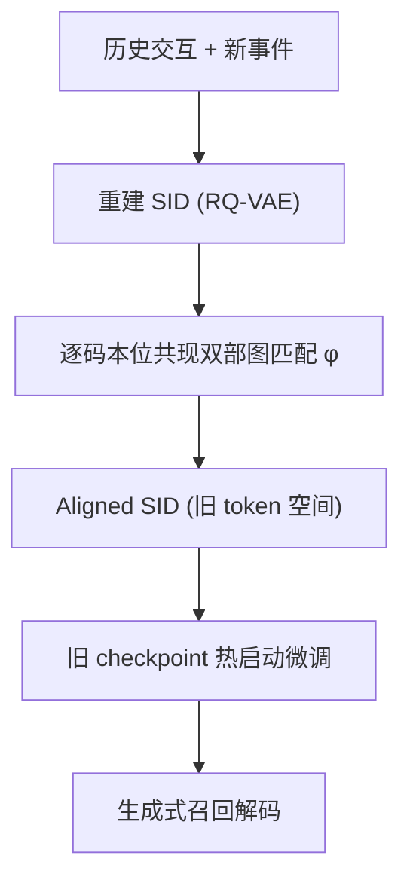
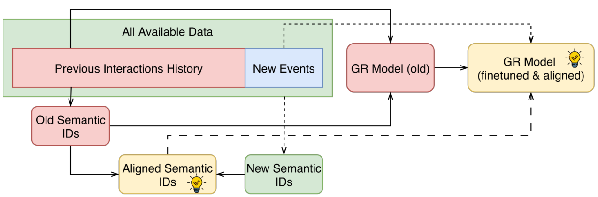

# Mitigating Collaborative Semantic ID Staleness in Generative Retrieval (缓解生成式检索中的协同语义 ID 陈旧问题)

- **会议/期刊**: SIGIR 2026
- **作者与机构**: Vladimir Baikalov, Iskander Bagautdinov, Sergey Muravyov (AI VK / ITMO University)
- **推荐链路定位**: 召回（候选生成）
- **研究方向**: 生成式推荐与离散语义 ID / 序列推荐
- **论文原文**: [https://arxiv.org/abs/2604.13273v1](https://arxiv.org/abs/2604.13273v1)
- **开源代码**: [https://github.com/iskbaga/semantic-id-alignment](https://github.com/iskbaga/semantic-id-alignment)

## TL;DR (1分钟核心速览)

生成式检索用 Semantic ID (SID) 把召回变成序列生成，但协同感知 SID 会随交互漂移而"陈旧"。工业界面临两难：固定 SID 微调会累积语义失配，重建 SID 则需全量重训。本文提出**模型无关的 SID 对齐更新**：用新旧 SID 共现做逐码本位双部图匹配，把刷新后的 token 映射回旧词表，使旧 checkpoint 可直接热启动微调。在严格时序划分下，三个基准的 Recall@500 全面优于陈旧 SID 微调（如 VK-LSVD 0.4098 vs 0.3512），且训练算力比全量重训低约 8-9 倍。

## Background & Motivation (背景与核心矛盾)

- **主流范式**: TIGER 类方法用 RQ-VAE 对物品内容做残差量化得到 SID，再用 decoder-only 生成器自回归解码；LETTER 进一步在量化器中注入协同正则，构造交互感知 SID。
- **前人局限**: ① 现有 tokenization 均假设 SID 词表静态，微调时固定不变，导致协同语义随日志漂移而失配；② 若重建 SID，token 重分配使旧 checkpoint 的输出空间失效，只能全量重训，算力代价高。
- **核心洞察 (Key Insight)**: 作者在严格时序评估下量化发现——**未对齐的 SID 刷新甚至不如保持陈旧**（Beauty Recall@500 0.1573 vs 0.1645），因为解码空间被整体打乱，模型需在微调中重新学习映射。
- **本文切入点**: 把"刷新 SID"与"复用 checkpoint"解耦，用一次轻量 CPU 级匹配把新 SID 翻译回旧 token 空间，从而兼顾新鲜协同信号与热启动效率。

## Method (核心方法设计)

### 1. 整体框架 (Overall Architecture)

数据按时间切成"历史交互"与"新事件"两段。先用全部可用数据重建 SID（得到新词表），再通过逐码本位双部图匹配把新 SID 对齐到旧 token 空间，得到 Aligned SID；随后下游生成器从旧 checkpoint 热启动，在新事件上用对齐后的 SID 微调。整个流程无需重建-重训，对齐步骤纯 CPU 且开销可忽略。

<figure class="paper-figure" markdown="span">
  <figcaption>图1：所提出训练流程概览。可用交互数据分为两部分：用于训练先前模型的先前交互历史，以及用于微调的新事件。为构建对齐SID，我们首先使用所有可用数据重建SID，然后应用所提出的匹配过程将其对齐到先前的token空间。随后，下游模型（生成式检索器）在新事件上微调，从先前检查点热启动并使用对齐SID。受直接改进的模块以浅色标记。</figcaption>
</figure>

### 2. 关键设计拆解 (Key Designs)

1. **码本位双部图对齐 (Codebook-consistent Alignment)**：痛点是新旧 SID 词表 token 编号完全无关，直接替换会打乱输出分布。作者对每个码本位 $\ell$统计新旧 token 在重叠物品集$\mathcal{I}_\cap$ 上的共现权重
$$W_\ell(a,b)=\sum_{i\in\mathcal{I}_\cap}\mathbb{I}[z^{\text{new}}_{i,\ell}=a]\cdot\mathbb{I}[z^{\text{old}}_{i,\ell}=b]$$
再解双部图最大权匹配得到一一映射 $\phi_\ell$，最终$\tilde{z}_{i,\ell}=\phi_\ell(z^{\text{new}}_{i,\ell})$。直觉：共现越强的 token 对语义越稳定，匹配即"语义锚定"，让新 SID 落在旧模型熟悉的 token 上。未匹配 token 与剩余旧 token 顺序补齐。

2. **求解器可选：Greedy vs Hungarian**：Greedy 按权重排序贪心匹配，复杂度 $O(M\log M)$；Hungarian 求全局最优，复杂度$O(LV^3)$。码本仅$V=512$、$L=4$，两者都远轻于 GPU 训练，可按场景取舍。

3. **训练目标与推理效率**：沿用标准自回归下一 token 交叉熵，无额外损失项；微调时学习率固定、优化器重置。推理用受限 beam search（beam=500，仅允许合法 SID）。对齐本身不省算力，省算力来自热启动微调——FT-ours 与 FT-new 训练 FLOPs 几乎相同，但对齐带来更高 Recall，改善质量-算力前沿。

## Experimental Setup & Evaluation Protocol (实验设置与评估协议)

- **数据集与预处理**（均 `5-core` 过滤）：

| 数据集 | #Users | #Items | #Interactions | 密度 | 场景说明 |
| :--- | :---: | :---: | :---: | :---: | :--- |
| Amazon Beauty | 22,363 | 12,101 | 198,502 | 0.07% | 电商 |
| VK-LSVD | 49,691 | 21,928 | 1,284,340 | 0.12% | 短视频流媒体 |
| Yambda | 6,633 | 33,029 | 631,227 | 0.29% | 音乐流媒体 |

- **数据划分与防穿越**: 严格**全局时间戳切分**为 10 个等量连续块；Base 训练块 1-8，块 9 做模型选择，块 10 做未来物品预测测试。刻意规避 Leave-One-Out 的时序泄漏。
- **排名评测协议**: 无偏 **Full-Ranking**（受限 beam 覆盖合法 SID 全库），指标 Recall@K / nDCG@K，$K\in\{10,100,500\}$，主指标 Recall@500；为公平比较，历史与目标限制在旧 SID 词表覆盖的物品子集。
- **对比基线与超参**: TIGER（内容 SID）与 LETTER（协同 SID）两范式，统一 decoder-only 生成器（$d=128$，4 层，6 头，FFN 1024）；RQ-VAE 4 码本 × 512，SID 长度 4；AdamW，lr$10^{-4}$，batch 256；10 个随机种子取均值，Recall@500 用配对双侧 Wilcoxon 检验（$p<0.05$）。

## Key Experimental Results (实验关键数据)

### 1. 主实验对比 (Main Results)

块 10 滚动起点结果（LETTER 范式，Recall@500 / nDCG@500）：

| 模型 | Beauty R@500 | Yambda R@500 | VK-LSVD R@500 | VK-LSVD nDCG@500 |
| :--- | :---: | :---: | :---: | :---: |
| TIGER (Base) | 0.0885 | 0.0735 | 0.2171 | 0.0532 |
| LETTER (Base) | 0.1206 | 0.0964 | 0.2424 | 0.0599 |
| LETTER (FT-old) | 0.1645 | 0.1116 | 0.3512 | 0.0993 |
| LETTER (FT-new) | 0.1573 | 0.1100 | 0.3951 | 0.1020 |
| LETTER (FT-ours, Greedy) | 0.1736 | 0.1136 | **0.4098** | **0.1085** |
| LETTER (FT-ours, Hungarian) | **0.1756** | **0.1174** | 0.4044 | 0.1065 |
| LETTER (Full) | 0.1992 | 0.1131 | 0.3910 | 0.1080 |

FT-ours 相对 FT-old 的 Recall@500 提升：Beauty +6.7%、Yambda +5.2%、VK-LSVD +16.7%。

### 2. 消融实验 (Ablation Study)

| 配置 | Beauty R@500 | Yambda R@500 | VK-LSVD R@500 |
| :--- | :---: | :---: | :---: |
| FT-old（不刷新） | 0.1645 | 0.1116 | 0.3512 |
| FT-new（刷新不对齐） | 0.1573 | 0.1100 | 0.3951 |
| FT-ours Greedy | 0.1736 | 0.1136 | **0.4098** |
| FT-ours Hungarian | **0.1756** | **0.1174** | 0.4044 |

### 3. 关键实验发现 (Key Findings)

1. **未对齐刷新会反噬**：FT-new 在 Beauty（0.1573 vs 0.1645）与 Yambda（0.1100 vs 0.1116）上均低于 FT-old，证明 token 重分配造成的解码空间漂移会抵消新鲜协同信号，对齐是刷新生效的必要前提。
2. **对齐可媲美全量重训**：VK-LSVD 上 FT-ours Greedy（0.4098）反超 Full（0.3910），而 Full 在 Beauty 仍最优（0.1992），说明最优刷新策略依赖领域漂移强度。
3. **持续适应更稳健**：多步更新（$t=5\to8$）中 FT-old 急剧衰减，FT-new 缓解但落后，FT-ours 每步均优于 FT-old 且与 Full 持平；算力上 FT-ours 仅 25,978 TFLOPs，比 Full 的 48,258 低 8.41 倍。

## Highlights & Limitations (亮点、对比与审稿批判)

- **与代表作对比 (vs. Prior Work)**: TIGER 只做内容 SID、无漂移处理；LETTER 引入协同正则但仍假设静态词表；PLUM/OneRec 等工业系统聚焦 SID 构造与训练配方，未触及 checkpoint 兼容的 SID 刷新。本文首次显式量化并解决"时序漂移下的 SID 陈旧"。
- **可迁移亮点**: ① 码本位共现双部图匹配可迁移到任何"离散码本需增量更新"的场景（如向量量化检索、多模态码本）；② 严格时序分块 + 未来块评估的协议可作为生成式召回防泄漏评测模板。
- **审稿级局限批判**: ① 评估限制在旧 SID 词表覆盖的物品子集，新物品无法被 FT-old 表示，绝对指标被保守压低；② 对齐依赖新旧物品重叠度，冷启动/快速扩张目录下重叠稀疏时匹配质量存疑，且未探索动态词表扩展。

## Rating (四维评分)

- **方法创新性 (Novelty)**: ⭐⭐⭐⭐ （把 SID 刷新重构为词表对齐问题，思路简洁新颖，但双部图匹配本身较经典）
- **评估协议与实验扎实度 (Protocol & Experiments)**: ⭐⭐⭐⭐ （严格时序切分、10 种子、显著性检验齐全，但仅 3 数据集且限制旧词表子集）
- **写作与数学规范度 (Clarity & Rigor)**: ⭐⭐⭐⭐ （公式与复杂度分析清晰，问题定义严谨，篇幅精炼）
- **工业落地与复现价值 (Industrial & Practical Value)**: ⭐⭐⭐⭐⭐ （模型无关、CPU 级对齐、8-9 倍算力节省，代码开源，直接契合工业频繁更新管线）
