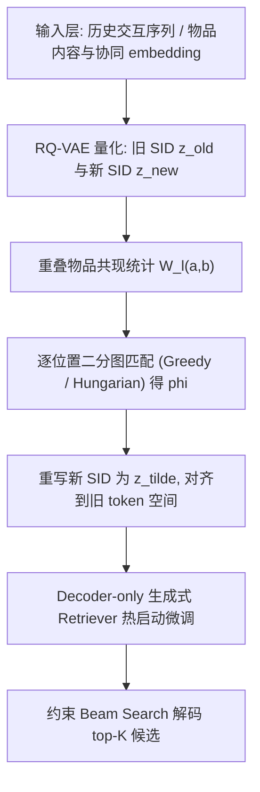
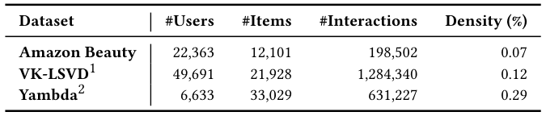
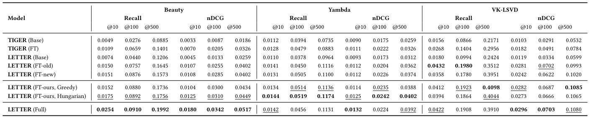
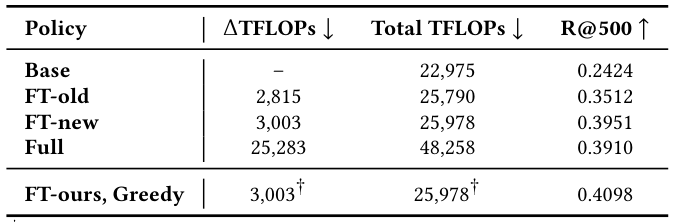
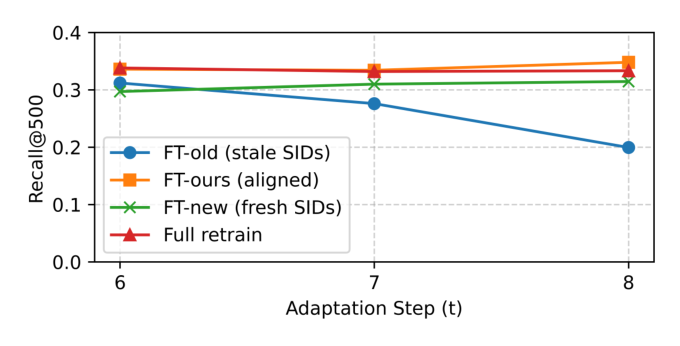

# Mitigating Collaborative Semantic ID Staleness in Generative Retrieval (缓解生成式检索中协同语义 ID 的陈旧性)

- **会议/期刊**: SIGIR 2026
- **推荐链路定位**: 召回 (Retrieval / Candidate Generation)
- **研究方向**: 生成式推荐与离散语义 ID / 序列推荐
- **论文原文**: [https://arxiv.org/abs/2604.13273v1](https://arxiv.org/abs/2604.13273v1)
- **开源代码**: [https://github.com/iskbaga/semantic-id-alignment](https://github.com/iskbaga/semantic-id-alignment)

## TL;DR (核心速览)

针对生成式检索中"交互感知语义 ID (SID) 随时间漂移而陈旧"这一被忽视的问题，本文在严格时序评估下量化了 SID 陈旧性带来的性能退化，并提出一种模型无关的轻量 SID 对齐更新：用新旧 SID 在重叠物品上的共现统计构建二分图匹配（Greedy / Hungarian），把新日志重建的 SID 映射回旧词表，使既有 retriever checkpoint 可直接热启动微调。在 Amazon Beauty、Yambda、VK-LSVD 三个基准上，Recall@500 相对陈旧 SID 微调一致提升（如 VK-LSVD 0.4098 vs. 0.3512），且 retriever 训练算力相比全量重训降低约 8-9 倍。

## Background & Motivation (背景与动机)

- **领域背景与主流范式**: 生成式检索将物品映射为短离散 token 序列（Semantic ID），把召回从向量近邻搜索转化为序列生成问题。SID 构造分两派：内容型 SID（TIGER 式，基于 RQ-VAE 对内容 embedding 量化）稳定但忽略行为结构；交互感知 SID（LETTER 式，在量化目标中加入协同正则）能注入协同信号、提升检索质量。
- **现有方法局限 (Limitations of Prior Work)**:
  1. 协同模式非平稳（用户兴趣、物品热度、日志策略随时间演化），交互感知 SID 会"陈旧"，其协同语义与最新日志不再匹配；
  2. 工业实践面临两难：保持 SID 固定并在新日志上微调 → SID-行为失配持续累积；重建 SID 并从头重训 → 算力代价高昂；
  3. 既有工作（PLUM、OneRec、Spotify 等）多聚焦 SID 构造与训练/服务配方，**对时序漂移下 SID 陈旧性缺乏显式量化与系统分析**，也少有"checkpoint 兼容的 SID 刷新"方案。
- **核心挑战 (Key Challenge)**: retriever 通过 token embedding 与各码本上的输出分布与 SID 空间强绑定；重建 SID 会重新分配 token，使旧 checkpoint 的输出空间失配，热启动微调不稳定，因此实践中往往被迫全量重训。简单地在固定 SID 上微调无法注入新协同结构，而直接换新 SID 又破坏兼容性。
- **核心洞察与切入点 (Key Insight)**: 新旧两次 SID 分配覆盖的物品空间高度重叠，可利用重叠物品上新旧 token 的共现统计建立"码本内、逐位置"的一一映射，把新 SID 重写为旧 token 空间中的等价标识——既保留旧模型期望的 token 空间，又反映新日志捕获的协同结构，从而支持标准热启动微调而无需 rebuild-and-retrain。

## Problem Formulation & Method (问题定义与方法架构)

### 1. 符号定义与输入表征 (Notations & Input Representations)

- 用户集 $\mathcal{U}$、物品集 $\mathcal{I}$；用户 $u$ 的时序交互序列 $S_u=(i_{u,1},\dots,i_{u,|S_u|})$。
- 每个物品 $i$ 的 SID 为长度 $L$ 的 token 序列 $z_i=(z_{i,1},\dots,z_{i,L})$，$z_{i,\ell}\in\mathcal{V}_\ell$，$\mathcal{V}_\ell$ 为第 $\ell$ 个码本词表（本文 $L=4$，$|\mathcal{V}_\ell|=512$）。
- 输入：用户历史上下文（最近 $N$ 条交互）；输出：自回归生成的 SID token 序列，经 SID-to-item 映射得到 top-$K$ 候选集。
- 关键对象：旧分配 $z^{\text{old}}_i$ 与新分配 $z^{\text{new}}_i$（由更新日志重建），以及重叠物品集 $\mathcal{I}_\cap$。

### 2. 整体流水线 (Overall Architecture)

数据流：历史交互训练 Base 模型（固定 SID 词表）→ 用全部可用数据重建新 SID → 在重叠物品上统计新旧 token 共现 → 逐码本位置求解二分图匹配得到对齐函数 $\phi$ → 用 $\phi$ 重写新 SID 为 $\tilde{z}$ → 在新事件上从旧 checkpoint 热启动微调。

<figure class="paper-figure" markdown="span">
  <figcaption>图 1</figcaption>
</figure>

### 3. 核心模块设计与数学原理 (Key Designs & Formulations)

**(1) 码本一致的对齐函数构造**。目标是构造双射 $\phi$，使 $\tilde{z}_{i,\ell}=\phi_\ell(z^{\text{new}}_{i,\ell})$，且每个 $\phi_\ell$ 是同一码本位置内的一一映射（codebook-consistent）。对每个位置 $\ell$，在重叠物品集 $\mathcal{I}_\cap$ 上统计新 token $a$ 与旧 token $b$ 的共现权重：

$$W_\ell(a,b)=\sum_{i\in\mathcal{I}_\cap}\mathbb{I}\left[z^{\text{new}}_{i,\ell}=a\right]\cdot\mathbb{I}\left[z^{\text{old}}_{i,\ell}=b\right]$$

物理直觉：$W_\ell(a,b)$ 越大，说明新 token $a$ 与旧 token $b$ 在重叠物品上对应越稳定，应优先匹配。

**(2) 二分图匹配求解**。在位置 $\ell$ 的活跃新旧 token 间求解一一分配问题，可用轻量 Greedy（按权重降序贪心）或 Hungarian 算法（全局最优）。匹配后，对因重叠不足或稀疏使用而未映射的新 token，与剩余未分配的旧 token 在 $\mathcal{V}_\ell$ 内补齐配对，保证新分配用到的所有 token 均有映射。最终按式 $\tilde{z}_{i,\ell}=\phi_\ell(z^{\text{new}}_{i,\ell})$ 重写全部新 SID，直接供既有 checkpoint 消费。

**(3) 与 retriever 的兼容性设计**。由于对齐保持 token 空间不变，retriever 的 token embedding 与各码本输出分布无需改动，微调仅需在新事件上以固定学习率热启动并重置优化器状态，避免全量重训。

### 4. 训练目标、负采样与推理复杂度 (Optimization, Negative Sampling & Complexity)

- **损失函数**: 原文未显式给出生成式检索的逐 token 交叉熵公式细节（属标准自回归训练），仅说明 tokenizer 与 retriever 均用 AdamW、学习率 $10^{-4}$、batch size 256。
- **训练负采样策略**: 生成式检索为免负采样范式，通过约束 Beam Search 在合法 SID 集合内解码；原文未使用显式负采样。推理时**不过滤**已交互物品（过滤通常在生产中置于召回之后）。
- **时间与空间复杂度**: 设码本大小 $V$、SID 长度 $L$、每位置观测共现对 $M$（$M<V^2$）。Greedy 对齐排序 $O(M\log M)$；Hungarian 每位置 $O(V^3)$、整体 $O(LV^3)$。实际 $V=512$、$L=4$，对齐为 CPU-only、相对 GPU 训练开销可忽略（未计入 FLOPs）。VK-LSVD 上 FT-old 增量 2,815 TFLOPs、FT-new/FT-ours 约 3,003 TFLOPs，而 Full 需 25,283 TFLOPs。

## Experimental Setup & Evaluation Protocol (实验设置与评估协议)

- **数据集统计与预处理**: 三个公开基准，均采用 **5-core 过滤**；VK-LSVD 使用发布子采样 `ur0.01_ir0.01`（1% 随机用户与物品），Yambda 使用 500M-like 子采样。

<figure class="paper-figure" markdown="span">
  <figcaption>表 1</figcaption>
</figure>

| 数据集 (Dataset) | 用户数 (#Users) | 物品数 (#Items) | 交互数 (#Interactions) | 稀疏度/密度 (Density) | 模态/辅助特征说明 |
| :--- | :---: | :---: | :---: | :---: | :--- |
| Amazon Beauty | 22,363 | 12,101 | 198,502 | 0.07% | 内容 embedding 按 LETTER 同款编码器与预处理生成 |
| VK-LSVD | 49,691 | 21,928 | 1,284,340 | 0.12% | 数据集自带内容 embedding（短视频流） |
| Yambda | 6,633 | 33,029 | 631,227 | 0.29% | 数据集自带内容 embedding（音乐流） |

- **数据划分方式 (Splitting Strategy)**: **严格全局时间戳切分**。按时间排序后切成 10 个等交互量连续块；Base 在块 1-8 训练，块 9 用于模型选择（早停/epoch 预算）；Full 在块 1-9 从头训练；所有 FT-* 从 Base checkpoint 热启动，微调预算经独立 pilot（块 1-7 训练、块 8 微调、块 9 选择）确定并在各策略/数据集间固定。评估在块 10 做未来物品预测，推理上下文仅用块 1-9 中最近 $N$ 条交互。作者明确指出**规避留一法 (LOO) 的时序泄露风险**，该协议无未来信息泄露。
- **排名评测协议 (Ranking Protocol)**: 生成式检索天然为**全库候选生成**（约束 Beam Search，beam width 500，限制在合法既有 SID 内），非采样负例排序。为受控比较，历史与评估目标均限制在旧 SID 词表覆盖的物品子集（含 FT-old 无法表示新物品）；作者称放松该约束后相对排名一致。
- **评价指标与显著性检验**: Recall@K 与 nDCG@K，$K\in\{10,100,500\}$，**Recall@500 为主指标**；报告 10 个随机种子的均值，Recall@500 上做**配对双侧 Wilcoxon 检验（$p<0.05$）**。Retriever 为 decoder-only Transformer：embedding 维度 128、4 层、6 头、FFN 1024、ReLU、dropout 0.1；RQ-VAE 为 4 码本 × 512，SID 长度 4；最大输入长度 Beauty 为 20、Yambda/VK-LSVD 为 100。

## Key Experimental Results (核心实验结果)

### 1. 主实验对比 (Main Results)

滚动起点（rolling-origin）在块 10 上的结果，FT-old/FT-new/FT-ours 仅在 SID 更新策略上不同：

<figure class="paper-figure" markdown="span">
  <figcaption>表 2</figcaption>
</figure>

| 数据集 | 指标 | LETTER (FT-old, 陈旧 SID) | LETTER (FT-new, 未对齐重建) | 本文方法 (FT-ours, Hungarian) | 相对提升 (vs. FT-old) |
| :--- | :--- | :---: | :---: | :---: | :---: |
| Amazon Beauty | Recall@500 | 0.1645 | 0.1573 | **0.1756** | +6.75% |
| Amazon Beauty | nDCG@500 | 0.0402 | 0.0402 | **0.0449** | +11.69% |
| Yambda | Recall@500 | 0.1116 | 0.1100 | **0.1174** | +5.20% |
| Yambda | nDCG@500 | 0.0362 | 0.0374 | **0.0402** | +11.05% |
| VK-LSVD | Recall@500 | 0.3512 | 0.3951 | **0.4098** (Greedy) | +16.69% |
| VK-LSVD | nDCG@500 | 0.0993 | 0.1020 | **0.1085** (Greedy) | +9.27% |

关键结论：(i) LETTER 变体整体优于 TIGER，验证交互感知 SID 的价值；(ii) **未对齐重建 (FT-new) 并不稳定优于陈旧 SID**——Beauty 上 Recall@500 反而下降（0.1573 vs. 0.1645），Yambda 亦略降（0.1100 vs. 0.1116），说明 token 重分配迫使模型在微调中重学映射；(iii) FT-ours 在所有数据集的高截断指标上一致优于 FT-old；(iv) FT-ours 在高截断可与 Full 重训匹敌甚至超越（VK-LSVD Recall@500 0.4098 vs. 0.3910），但 Beauty 上 Full 仍最优（0.1992），提示最优刷新策略可能依赖领域漂移动态；(v) Hungarian 在 Beauty/Yambda 更强，Greedy 在 VK-LSVD 胜出，是低成本替代。

### 2. 消融实验与控制变量分析 (Ablation Study)

本文消融以**对齐求解器**（Greedy vs. Hungarian）与**SID 更新策略**（FT-old / FT-new / FT-ours / Full）为对照，所有方法共享同一 retriever 架构与训练配方，仅 SID 分配不同，属严格控制变量的比较。核心发现：对齐模块（$\phi$ 构造）是性能增益的关键来源——去掉对齐（FT-new）在 Beauty/Yambda 上甚至劣于不刷新（FT-old）；求解器选择影响中等（Hungarian 在 Beauty Recall@500 0.1756 vs. Greedy 0.1736；VK-LSVD 上 Greedy 0.4098 vs. Hungarian 0.4044）。原文未报告参数量对齐或图度数匹配类消融（生成式检索不涉及图拓扑）。

### 3. 稀疏度/冷启动分桶与超参敏感度 (Sparsity Buckets & Hyperparameters)

- **多步持续适应 (RQ2)**: 在 VK-LSVD 上从 $t=5$ 起（块 1-5 训练 LETTER SID），对 $t\in\{6,7,8\}$ 逐步适应并在块 $t+1$ 评估。FT-old 随更新次数性能陡降；FT-new 缓解退化并在末次更新显著高于 FT-old；FT-ours 每一步均优于 FT-old，且维持与 Full 相当的高召回水平，验证对齐支持稳健持续适应。
- **质量-算力权衡 (RQ3)**: 见下表，热启动适应仅需约 2.8-3.0k TFLOPs，相比 Full 降低 8.97×（FT-old）与 8.41×（FT-new/FT-ours）；对齐步骤 CPU-only、开销可忽略。FT-ours 与 FT-new 训练算力相同但 Recall@500 更高（0.4098 vs. 0.3951），改善质量-算力前沿。

<figure class="paper-figure" markdown="span">
  <figcaption>表 3</figcaption>
</figure>

| 策略 | ΔTFLOPs↓ | Total TFLOPs↓ | Recall@500↑ |
| :--- | :---: | :---: | :---: |
| Base | – | 22,975 | 0.2424 |
| FT-old | 2,815 | 25,790 | 0.3512 |
| FT-new | 3,003 | 25,978 | 0.3951 |
| Full | 25,283 | 48,258 | 0.3910 |
| FT-ours (Greedy) | 3,003† | 25,978† | **0.4098** |

† 对齐步骤为 CPU-only，FLOPs 相对完整 retriever 训练可忽略，未计入。

<figure class="paper-figure" markdown="span">
  <figcaption>图 2</figcaption>
</figure>

- **关键超参数敏感度**: 原文未系统报告温度系数、损失权重或码本大小等超参敏感度曲线；码本固定 $V=512$、$L=4$，输入长度按数据集设为 20/100。
- **线上 A/B 测试结果**: 原文仅包含离线实验，未报告线上 A/B 测试。

## Highlights, Limitations & Critiques (亮点、局限与审稿级批判)

- **核心亮点与可迁移性**: (1) 首次在严格时序评估下显式量化交互感知 SID 的陈旧性退化，并揭示"未对齐刷新可能劣于不刷新"这一反直觉但重要的工程结论；(2) 对齐算子模型无关、CPU-only、可直接嵌入任何 SID-based 生成式检索的持续学习流水线，具有强迁移性（可推广到多模态 SID、跨域 SID 复用等场景）；(3) 质量-算力前沿分析（FLOPs 口径）为工业刷新策略选型提供依据。
- **局限性与审稿视角批判 (Critical Limitations)**:
  1. **评估范围偏窄**：仅三个公开数据集，且 VK-LSVD/Yambda 均为子采样版本，规模与真实工业目录差距较大；缺少线上 A/B 或大规模生产验证。
  2. **受控比较的保守性**：为公平比较将历史与目标限制在旧 SID 词表覆盖物品子集，虽作者称放松后排名一致，但该约束可能低估刷新带来的绝对收益，也使"新物品冷启动"这一 SID 刷新的核心动机未被直接评估。
  3. **对齐的理论保证缺失**：共现匹配是启发式（Greedy/Hungarian），未给出对齐误差与下游召回退化的理论界；对重叠稀疏或新 token 大量涌现的场景，补齐配对策略的鲁棒性缺乏分析（作者仅以"Greedy 随新块交互增多可能追平 Hungarian"作推测）。
  4. **短horizon设定**：微调预算固定且针对短时漂移设计，长周期、剧烈分布漂移下的表现未验证；多步实验仅限 VK-LSVD 单一数据集与 Greedy 求解器。
  5. **基线实现差异**：采用 decoder-only retriever 替代 TIGER 原始 encoder-decoder，LETTER 用纯协同 SASRec embedding，虽为控制变量，但与原系统数值不可直接横向对比。

## Rating (四维评分)

- **方法创新性 (Novelty)**: ⭐⭐⭐⭐ （问题切入新颖、算子简洁优雅，但二分图匹配本身属成熟工具的组合应用）
- **评估协议与实验扎实度 (Protocol & Experiments)**: ⭐⭐⭐⭐ （严格时序切分、10 种子、Wilcoxon 检验、FLOPs 口径规范；数据集规模与线上验证不足）
- **写作与数学规范度 (Clarity & Rigor)**: ⭐⭐⭐⭐ （问题定义与对齐公式清晰，复杂度分析到位；生成式训练损失细节略简）
- **工业落地与复现价值 (Industrial & Practical Value)**: ⭐⭐⭐⭐⭐ （模型无关、CPU-only、8-9× 算力节省，直接契合工业持续刷新流水线，且已开源）
