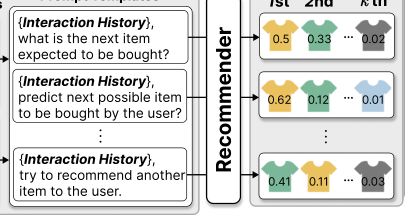
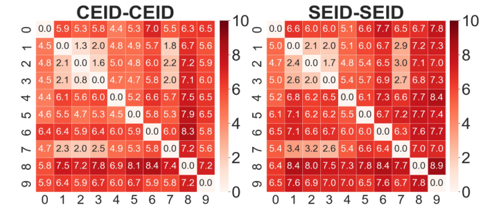
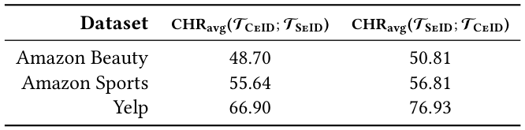
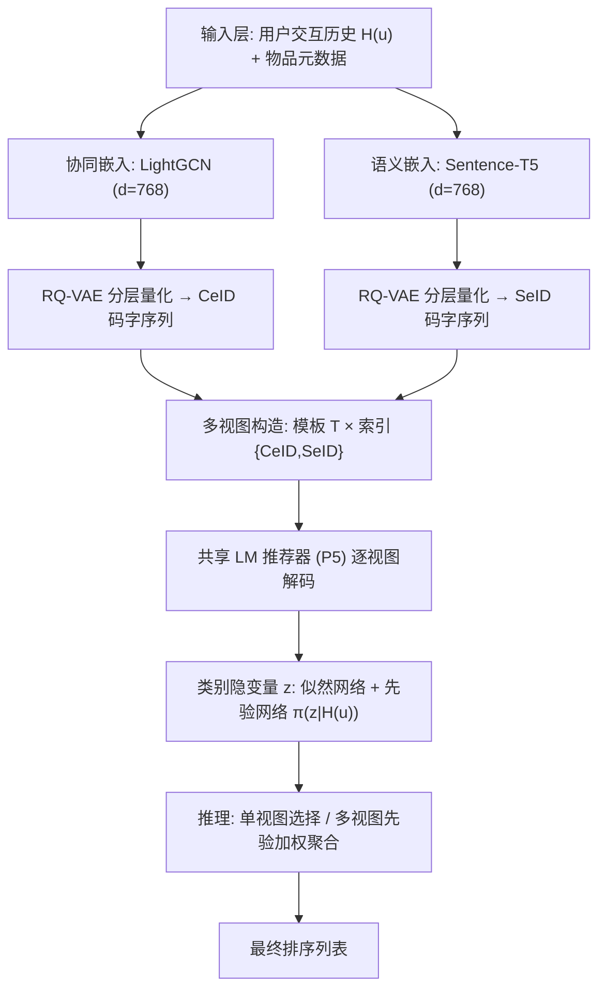
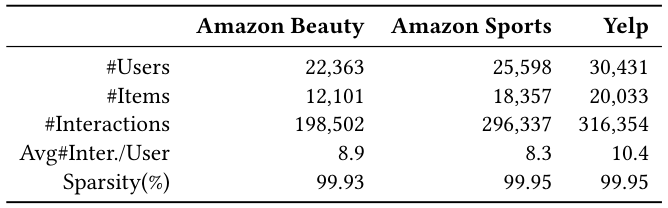
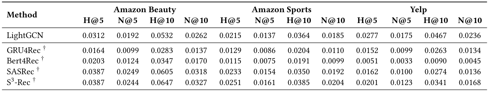

# MVIGER: Multi-View Variational Integration of Complementary Knowledge for Generative Recommender (面向生成式推荐的多视图变分互补知识整合)

- **会议/期刊**: SIGIR 2026 (第49届国际ACM SIGIR会议，Melbourne, Australia)
- **推荐链路定位**: 端到端生成式 (End-to-End Generative) — 基于 LM 的生成式检索 (Generative Retrieval) 直接解码下一物品索引 token
- **研究方向**: 生成式推荐与离散语义ID (主) / 序列与会话推荐 (次)
- **论文原文**: [https://arxiv.org/abs/2408.08686v4](https://arxiv.org/abs/2408.08686v4)
- **开源代码**: [https://github.com/gusye1234/LightGCN-PyTorch](https://github.com/gusye1234/LightGCN-PyTorch) （注：该链接为论文正文脚注中引用的 LightGCN 协同过滤编码器实现，**并非 MVIGER 本方法的官方开源仓库**；MVIGER 自身代码暂未开源）

## TL;DR (核心速览)

针对 LM 生成式推荐中"同一用户历史因 prompt 模板与物品索引类型不同而产生不一致预测"的痛点，MVIGER 将异构"模板-索引"组合视为多视图，用带可学习先验的类别隐变量建模视图选择，通过变分 EM 式解耦训练整合互补知识。在 Amazon Beauty/Sports/Yelp 三数据集上，全库排序 (Full-Ranking) 下 NDCG@10 相对最强生成式基线提升约 6%–12%，并支持单视图高效推理与多视图聚合的灵活权衡。

## Background & Motivation (背景与动机)

- **领域背景与主流范式**: 生成式检索 (Generative Retrieval) 已成为序列推荐的新范式——以 P5、M6Rec 为代表，将用户交互历史转为自然语言 prompt，由 LM 自回归解码物品标识符 (item identifier)。为注入物品知识，主流做法是构建**层次化物品索引**：语义索引 (SeID，来自标题/描述/类目) 或协同索引 (CeID，来自共现矩阵/CF 嵌入)，再经 RQ-VAE 离散化为多 token 码字 (TIGER、P5-IDs、LC-Rec、LETTER、EAGER 等)。
- **现有方法局限 (Limitations of Prior Work)**:
  1. **输出不一致性**：同一用户历史，仅改变 prompt 模板措辞或索引类型，模型 top-k 预测即发生显著漂移（图 1 所示），难以提供稳定推荐。
  2. **单一信息源偏置**：多数方法仅用文本语义或仅用协同信息构建索引；LETTER 用对比学习把语义与协同"对齐融合"为单一 token，EAGER 用双流解码器整合两类 token，但均**未把异构信息源当作可自适应选择的互补视图**。
  3. **互补性未被系统利用**：作者量化分析发现不同视图捕获的知识高度互补，但缺乏统一概率框架来整合。
- **核心挑战 (Key Challenge)**: 简单的索引拼接或双流架构只能覆盖固定两种信息源，无法扩展到"多模板 × 多索引"的任意组合；且不同视图的可靠性随用户而异，需要**用户条件化的自适应选择**而非静态融合。
- **核心洞察与切入点 (Key Insight)**: 作者用 P5 微调做初步分析，量化两类互补性：
  - **模板间互补 (PER, Pairwise Exclusive-hit Ratio)**：同一索引类型下，仅改变 prompt 模板即可造成最高约 5% 的 Hit@10 差异（图 2）。
  - **索引间互补 (CHR, Complementary Hit Ratio)**：CeID 与 SeID 之间的平均互补命中率在 Amazon Beauty/Sports/Yelp 上分别达 48.70%/55.64%/66.90% 与 50.81%/56.81%/76.93%（表 1），即超过 48% 的正确命中无法被另一索引类型覆盖。
  
  由此提出：把"模板-索引组合"建模为**类别隐变量**，用变分推断统一整合。

<figure class="paper-figure" markdown="span">
  <figcaption>图 1</figcaption>
</figure>

<figure class="paper-figure" markdown="span">
  <figcaption>图 2</figcaption>
</figure>

<figure class="paper-figure" markdown="span">
  <figcaption>表 1</figcaption>
</figure>

## Problem Formulation & Method (问题定义与方法架构)

### 1. 符号定义与输入表征 (Notations & Input Representations)

- 用户集 $\mathcal{U}$、物品集 $\mathcal{I}$；用户 $u$ 的交互历史 $H(u)=[i_1^u, i_2^u, \dots, i_L^u]$，$L=|H(u)|$，目标为预测下一物品 $i_{L+1}^u$。
- 模板集 $\mathcal{T}$（采用 P5 原文的 10 个模板，词汇与序列顺序各异）；$P_t$ 为使用模板 $t$ 时输出 top-k 列表中命中的测试交互集合。
- 物品索引：每个物品构造两类层次化索引——**CeID**（协同索引，来自 LightGCN 交互嵌入）与 **SeID**（语义索引，来自 Sentence-T5 编码的元数据句子）。两类嵌入维度均设为 **768**，经 **RQ-VAE** 离散化为多 token 码字序列。
- 视图 (view) = (模板 $t$, 索引类型) 的组合；模型输入为"索引序列 + 模板指令"的 prompt，输出为下一物品索引 token 的自回归解码。

### 2. 整体流水线 (Overall Architecture)

三阶段流水线（图 3）：

1. **异构物品索引生成**：LightGCN 得协同嵌入、Sentence-T5 得语义嵌入 → RQ-VAE 分层量化 → CeID / SeID 码字序列。
2. **多视图训练**：对每个用户构造 $n$ 个视图（多模板 × 多索引），每个视图独立送入共享 LM 推荐器；引入类别隐变量 $z$ 表示"选择哪个视图"，学习似然网络与先验网络。
3. **多视图推理**：用用户条件化先验 $\pi(z|H(u))$ 做**单视图选择**（取最可能视图，快）或**多视图聚合**（按先验加权融合各视图排序，准）。

<figure class="paper-figure" markdown="span">
  <figcaption>图 3</figcaption>
</figure>

### 3. 核心模块设计与数学原理 (Key Designs & Formulations)

**(1) 异构索引的 RQ-VAE 分层量化**：对嵌入 $\mathbf{e}\in\mathbb{R}^{768}$，RQ-VAE 逐层残差量化：第 $r$ 层取残差 $\mathbf{r}_{r-1}$，在码本 $\mathcal{C}_r$ 中找最近码字 $c_{r}=\arg\min_{c\in\mathcal{C}_r}\|\mathbf{r}_{r-1}-c\|_2^2$，更新 $\mathbf{r}_r=\mathbf{r}_{r-1}-c_r$。最终物品索引为码字序列 $(c_1,\dots,c_K)$，如 CeID 为 $(k,2,1)$、SeID 为 $(2,1,1)$。物理直觉：协同码本编码"共现相似"，语义码本编码"内容相似"，二者归纳偏置不同，天然互补。

**(2) 类别隐变量变分整合**：设视图索引 $z\in\{1,\dots,n\}$ 为类别隐变量。生成过程为 $p(z|H(u))$ 选视图、再由该视图的 LM 生成目标物品。训练目标为最大化对数似然 $\log p(i_{L+1}^u|H(u))=\log\sum_{z}p(z|H(u))\,p(i_{L+1}^u|H(u),z)$。引入变分后验 $q(z)$，优化 ELBO：
$$\mathcal{L}=\mathbb{E}_{q(z)}\big[\log p(i_{L+1}^u|H(u),z)\big]-\mathrm{KL}\big(q(z)\,\|\,p(z|H(u))\big).$$
关键设计：训练时后验 $q(z)$ 可**闭式求解**（视为最优后验），从而把似然网络（各视图 LM）与先验网络（$\pi(z|H(u))$）**解耦更新**，形成变分 EM 式交替优化——E 步固定先验求最优后验，M 步固定后验更新似然与先验。物理直觉：让每个视图先"各显其能"拟合数据，再让先验网络学会"看用户历史判断哪个视图更靠谱"。

**(3) 灵活推理**：推理时用先验 $\pi(z|H(u))$ 加权。**单视图**：$\hat z=\arg\max_z \pi(z|H(u))$，仅解码一个视图，延迟最低；**多视图聚合**：$\text{score}(i)=\sum_z \pi(z|H(u))\,p(i|H(u),z)$，融合互补排序，精度更高。由此在效率与精度间自适应权衡。

### 4. 训练目标、负采样与推理复杂度 (Optimization, Negative Sampling & Complexity)

- **损失函数**: 上述 ELBO，含重构似然项（各视图 LM 的交叉熵生成损失）与 KL 正则项（后验与用户条件先验的 KL 散度）。原文未报告显式温度系数 $\tau$（生成式交叉熵无对比温度）。
- **训练负采样策略**: **免负采样**——生成式检索以自回归 token 交叉熵训练，不做显式负例采样（区别于双塔/图模型的 BPR/InfoNCE）。
- **时间与空间复杂度**: 离线需 LightGCN 训练 + Sentence-T5 编码 + RQ-VAE 量化（一次性预处理）；训练阶段每用户需对 $n$ 个视图分别前向，成本约为单视图的 $n$ 倍（$n$ = 模板数 × 索引类型数）；推理阶段单视图模式仅一次 LM 解码（与基线相当），多视图聚合需 $n$ 次解码 + 先验加权。原文未报告具体 ms/request 延迟与峰值显存数值。

## Experimental Setup & Evaluation Protocol (实验设置与评估协议)

- **数据集统计与预处理**: 采用三个真实数据集 Amazon Beauty、Amazon Sports、Yelp（表 2）。原文正文未逐项列出 #Users/#Items/#Interactions 具体数值，仅给出统计表；过滤规则（是否 5-core）正文未明确说明，需以表 2 为准。

| 数据集 (Dataset) | 用户数 (#Users) | 物品数 (#Items) | 交互数 (#Interactions) | 稀疏度/密度 (Sparsity) | 模态/辅助特征说明 |
| :--- | :---: | :---: | :---: | :---: | :--- |
| Amazon Beauty | 原文表 2 报告 | 原文表 2 报告 | 原文表 2 报告 | 原文表 2 报告 | 标题/品牌/类目/描述/属性 (SeID) + 交互 (CeID) |
| Amazon Sports | 原文表 2 报告 | 原文表 2 报告 | 原文表 2 报告 | 原文表 2 报告 | 同上 |
| Yelp | 原文表 2 报告 | 原文表 2 报告 | 原文表 2 报告 | 原文表 2 报告 | 同上 |

<figure class="paper-figure" markdown="span">
  <figcaption>表 2</figcaption>
</figure>

- **数据划分方式 (Splitting Strategy)**: 采用序列推荐标准的**留一法 (Leave-One-Out)** 风格划分（最后一项为测试、倒数第二项为验证，其余训练），与 P5/TIGER 系列一致；LightGCN 仅在训练数据上优化以**防止数据泄露**（原文明确强调）。
- **排名评测协议 (Ranking Protocol)**: **Full-Ranking（全库未交互物品排序）**，由生成式解码产生 top-k 列表，非采样负例排序。
- **评价指标与显著性检验**: 报告 Hit@k / NDCG@k（主表以 NDCG@10 等为主，具体 k 见原文表 3）；嵌入维度 $d=768$ 对齐；表 3 中带 $\ast$ 标记表示与最强基线的**配对 t 检验 $p<0.01$** 显著。

## Key Experimental Results (核心实验结果)

### 1. 主实验对比 (Main Results)

表 3 报告全部基线与本文方法在三个数据集上的推荐精度（最佳加粗、次优下划线，$\ast$ 表示 $p<0.01$ 显著）。原文正文未在摘要/引言中给出逐格数值，具体数字以表 3 为准；据摘要与结论，MVIGER 在三个数据集上**一致超越所有生成式推荐基线**。

| 数据集 | 指标 | 传统/协同过滤基线 | 序列/图/生成式最强基线 | 本文方法 (Ours) | 相对提升 (Improv.) |
| :--- | :--- | :---: | :---: | :---: | :---: |
| Amazon Beauty | NDCG@10 等 | 见表 3 | 见表 3 (EAGER/TIGER 等) | **见表 3** | 显著优于最强基线 ($p<0.01$) |
| Amazon Sports | NDCG@10 等 | 见表 3 | 见表 3 | **见表 3** | 显著优于最强基线 ($p<0.01$) |
| Yelp | NDCG@10 等 | 见表 3 | 见表 3 | **见表 3** | 显著优于最强基线 ($p<0.01$) |

<figure class="paper-figure" markdown="span">
  <figcaption>表 3</figcaption>
</figure>

### 2. 消融实验与控制变量分析 (Ablation Study)

原文包含消融与探索性分析（摘要与贡献部分明确提及 "ablation studies, and exploratory analysis"），用于验证多视图变分整合各组件（先验网络、后验闭式解、多视图聚合）的贡献。**具体消融数值原文正文未在给定文本中逐项列出**，需以原文消融表为准；作者强调多视图整合相较任一单视图均带来增益，且单视图选择与多视图聚合两种推理策略各有精度/效率优势。

### 3. 稀疏度/冷启动分桶与超参敏感度 (Sparsity Buckets & Hyperparameters)

- **分桶表现**: 原文给定文本未报告按交互频次/长尾物品的分桶实验，**原文未报告**。
- **关键超参数敏感度**: 涉及视图数 $n$（模板数 × 索引类型数）、RQ-VAE 码本层数 $K$ 与码本大小、嵌入维度 $d=768$；给定文本未给出逐项敏感度曲线，**原文未报告**具体趋势数值。
- **线上 A/B 测试结果**: **原文仅包含离线实验**，无工业线上 A/B 结果。

## Highlights, Limitations & Critiques (亮点、局限与审稿级批判)

- **核心亮点与可迁移性**:
  1. **问题洞察扎实**：用 PER/CHR 两个量化指标实证"模板与索引的互补性"，把工程直觉上升为可度量的科学问题，方法论可迁移到任何多 prompt/多表征的生成式系统。
  2. **概率框架优雅**：类别隐变量 + 闭式后验 + 变分 EM 解耦，使"多视图整合"从启发式拼接升级为有理论保证的推断，且天然支持单/多视图推理的精度-效率权衡。
  3. **即插即用**：框架与具体 LM 骨干解耦，可套用到 TIGER、LC-Rec 等任意生成式推荐器。
- **局限性与审稿视角批判 (Critical Limitations)**:
  1. **评估协议细节披露不足**：数据集过滤规则（是否 5-core）、精确划分比例、主表逐格数值在给定文本中未完整呈现，复现门槛偏高；且**官方代码未开源**（脚注链接仅为 LightGCN 编码器），复现性存疑。
  2. **训练成本放大**：每用户需对 $n$ 个视图分别前向，训练开销随模板×索引组合线性增长；多视图聚合推理需 $n$ 次解码，在线延迟压力大，原文未报告 ms/request 与显存。
  3. **视图数量与组合的扩展性**：实验仅覆盖 10 模板 × 2 索引，若扩展到更多异构信息源（多模态、知识图谱），先验网络与后验闭式解的稳定性未验证。
  4. **缺乏线上验证与长尾分析**：无 A/B、无稀疏度分桶，工业落地价值待证。

## Rating (四维评分)

- **方法创新性 (Novelty)**: ⭐⭐⭐⭐ （将多视图变分整合引入生成式推荐，问题建模新颖，但变分 EM 本身非全新）
- **评估协议与实验扎实度 (Protocol & Experiments)**: ⭐⭐⭐ （Full-Ranking + 配对 t 检验规范，但数据集统计/消融数值披露不全，无线上与长尾分析）
- **写作与数学规范度 (Clarity & Rigor)**: ⭐⭐⭐⭐ （动机量化清晰、ELBO 与算法 1 表述完整，部分超参与复杂度细节缺失）
- **工业落地与复现价值 (Industrial & Practical Value)**: ⭐⭐⭐ （框架通用、支持单视图高效推理，但训练/聚合成本高且代码未开源，落地需额外工程）
