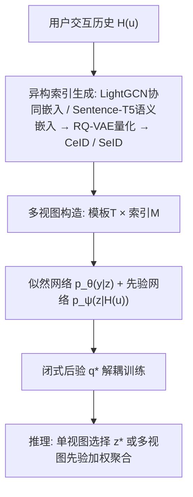
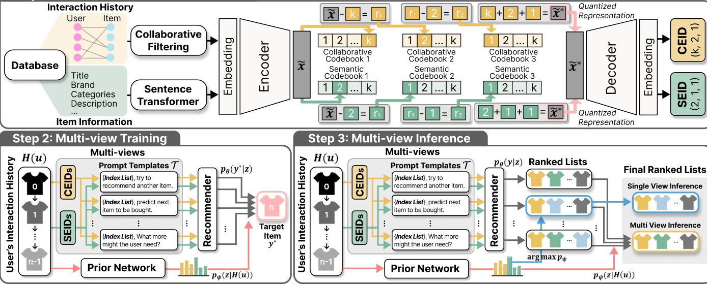

# MVIGER: Multi-View Variational Integration of Complementary Knowledge for Generative Recommender (面向生成式推荐器的互补知识多视图变分集成)

- **会议/期刊**: SIGIR 2026 (Proceedings of the 49th International ACM SIGIR Conference)
- **作者与机构**: Tongyoung Kim, Soojin Yoon, SeongKu Kang, Jinyoung Yeo, Dongha Lee（延世大学、高丽大学）
- **推荐链路定位**: 端到端生成式（生成式检索 / Next-Item 预测）
- **研究方向**: 生成式推荐与离散语义 ID / 序列推荐
- **论文原文**: [https://arxiv.org/abs/2408.08686v4](https://arxiv.org/abs/2408.08686v4)
- **开源代码**: 暂未开源（文中仅引用 LightGCN 官方实现）

## TL;DR (1分钟核心速览)

生成式推荐器对同一用户历史，仅因**提示模板**或**物品索引类型**（协同 CeID / 语义 SeID）变化就会给出不一致的 Top-k 预测，而作者量化发现这些差异中蕴含大量互补知识（跨索引 CHR 平均 48.7%–76.9%）。MVIGER 把"模板-索引组合"建模为类别隐变量视图，用可学习先验 $p_\psi(z|H(u))$ 做变分集成，推理时既可单视图选择也可多视图聚合。在 Beauty/Sports/Yelp 三数据集、5-core + Leave-One-Out + **Full-Ranking** 协议下，H@10 相对最强基线 EAGER 提升约 5.0%（Beauty 0.0836→0.0878）、相对 EAGER-LLM 提升约 4.0%（Sports 0.0569→0.0592），Yelp 上 H@10 达 0.0591（EAGER 仅 0.0453）。

## Background & Motivation (背景与核心矛盾)

- **主流范式**: TIGER/P5-IDs/EAGER 等生成式检索把物品离散化为层级索引 token（RQ-VAE 语义 ID 或协同 ID），用 LM 自回归解码目标物品索引。
- **前人局限**: ① 单一索引只编码一种信息源（文本语义或协同共现），单视图偏好建模不完整；② 简单拼接索引（P5 的 CID+SemID）会因连续生成层级 token 破坏解码上下文，性能甚至崩塌（Beauty H@5 仅 0.0355）；③ EAGER 双解码器虽分离两流，但仅支持两种固定信息源，且无法刻画"哪个视图对该用户更重要"。
- **核心洞察 (Key Insight)**: 作者用 PER/CHR 量化发现——同一索引下不同模板的独占命中差异可达 5%，跨索引类型的互补命中率 CHR 平均超 48%（Yelp 达 76.9%），说明模板与索引诱导的是**互补而非冗余**的偏好知识。
- **本文切入点**: 把每个"模板 × 索引"组合视为一个用户条件视图，用类别隐变量 + 可学习先验统一建模视图选择与聚合。

## Method (核心方法设计)

### 1. 整体框架 (Overall Architecture)

MVIGER 分三步闭环：先由 LightGCN 协同嵌入与 Sentence-T5 语义嵌入分别经 RQ-VAE 量化，生成两套层级索引 CeID/SeID（含碰撞消解）；再对每个用户构造视图集 $Z(u)=\{(t,m,H(u))\}$，用 T5 似然网络对每个视图算$p_\theta(y^*|z)$、用单层线性先验网络算$p_\psi(z|H(u))$，以闭式最优后验做变分 EM 式解耦训练；推理时目标未知，改用先验做单视图 argmax 选择或多视图加权聚合。

<figure class="paper-figure" markdown="span">
  <figcaption>图3：MVIGER框架概览。对于每个用户，首先基于用户的交互历史构建异构物品索引（例如CeID和SeID），从而得到带有模板的多个潜在视图。然后，MVIGER通过在这些潜在视图上的变分先验分布联合训练序列推荐器，捕捉它们对每个用户的相对重要性，并指导来自不同提示模板和索引组合的信息整合。在推理时，学习到的先验自适应地从候选视图中选择或聚合信息，整合</figcaption>
</figure>

### 2. 关键设计拆解 (Key Designs)

1. **异构索引与碰撞消解**：痛点在于单一信息源归纳偏置过窄。RQ-VAE 逐层残差量化 $\boldsymbol{c}_k=\arg\min_{w}\|\boldsymbol{r}_{k-1}-\boldsymbol{e}^{(k)}_w\|_2^2,\ \boldsymbol{r}_k=\boldsymbol{r}_{k-1}-\boldsymbol{e}^{(k)}_{\boldsymbol{c}_k}$，得到粗到细的层级码$(c_1,\dots,c_K)$；对码字碰撞在末层追加唯一 token（未碰撞补 0）保证 ID 唯一。直觉：协同码刻画共现行为、语义码刻画元数据属性，二者天然互补。

2. **视图隐变量与闭式最优后验**：把边际似然写成 $p(y^*|H(u))=\sum_{z}p_\theta(y^*|z)p_\psi(z|H(u))$，对 ELBO 用拉格朗日乘子求导得闭式后验
$$q^*(z|H(u),y^*)=\frac{p_\theta(y^*|z)p_\psi(z|H(u))}{\sum_{z'}p_\theta(y^*|z')p_\psi(z'|H(u))}.$$
关键工程决策是对 $q^*$ 施加 stop-gradient 视为固定分布，从而似然网络与先验网络**解耦更新**（变分 EM 风格），避免后验与先验互相追逐的不稳定。直觉：后验本质是"似然×先验"的贝叶斯重加权，天然实现按用户上下文分配视图权重。

3. **训练目标与推理效率**：总损失 $\mathcal{L}_{\text{ELBO}}=\mathbb{E}_{q^*}[\log p_\theta(y^*|z)]-\mathrm{KL}(q^*\|p_\psi(z|H(u)))$，似然侧用预训练 T5-small 最大化期望对数似然，先验侧最小化与最优后验的 KL。无需负采样（生成式全库 beam search，beam=20）。推理复杂度$O(B\times|\mathcal{I}|\times|\mathcal{T}|)$，先验估计仅约 0.01 s/用户；$|\mathcal{I}|=2,|\mathcal{T}|=10$ 时 0.40 s/用户，相对双索引基线 EAGER 的额外开销主要来自多模板而非先验本身。

## Experimental Setup & Evaluation Protocol (实验设置与评估协议)

- **数据集与预处理**（均 5-core 过滤，最大序列长 20）：

| 数据集 | #Users | #Items | #Interactions | 稀疏度 | 场景说明 |
| :--- | :---: | :---: | :---: | :---: | :--- |
| Amazon Beauty | 22,363 | 12,101 | 198,502 | 99.93% | 美妆产品评论 |
| Amazon Sports | 25,598 | 18,357 | 296,337 | 99.95% | 运动户外产品 |
| Yelp | 30,431 | 20,033 | 316,354 | 99.95% | 本地商户点评 |

- **数据划分与防穿越**: `Leave-One-Out`——每用户倒数第二项作验证、最后一项作测试，其余训练；RQ-VAE 与 LightGCN 仅在训练集上拟合以防泄漏。
- **排名评测协议**: 无偏 `Full-Ranking`（全物品集排序，非采样），指标 H@5/N@5/H@10/N@10，beam size=20。
- **对比基线与超参**: 三类基线——协同过滤 LightGCN；序列模型 GRU4Rec/Bert4Rec/SASRec/S³-Rec；生成式 P5-IDs（CID/SemID/IID 及拼接）、TIGER、LC-Rec、EAGER、EAGER-LLM。RQ-VAE 码本 256、码长 3、隐维 32；T5-small 主干；3 随机种子均值，配对 t 检验 $p<0.01$。

## Key Experimental Results (实验关键数据)

### 1. 主实验对比 (Main Results)

| 方法 | Beauty H@5 | Beauty H@10 | Beauty N@10 | Sports H@5 | Sports H@10 | Yelp H@5 | Yelp H@10 |
| :--- | :---: | :---: | :---: | :---: | :---: | :---: | :---: |
| SASRec | 0.0387 | 0.0605 | 0.0318 | 0.0233 | 0.0350 | 0.0162 | 0.0274 |
| S³-Rec | 0.0387 | 0.0647 | 0.0327 | 0.0251 | 0.0385 | 0.0201 | 0.0341 |
| TIGER | 0.0454 | 0.0648 | 0.0384 | 0.0264 | 0.0400 | 0.0212 | 0.0367 |
| P5 (CID+IID) | 0.0512 | 0.0732 | 0.0427 | 0.0321 | 0.0456 | 0.0287 | 0.0468 |
| LC-Rec | 0.0443 | 0.0610 | 0.0331 | 0.0304 | 0.0451 | 0.0230 | 0.0359 |
| EAGER | **0.0618** | 0.0836 | **0.0525** | 0.0281 | 0.0441 | 0.0265 | 0.0453 |
| EAGER-LLM | 0.0548 | 0.0830 | 0.0459 | **0.0373** | **0.0569** | – | – |
| MVIGER($z^*$) | 0.0560 | 0.0831 | 0.0469 | 0.0358 | 0.0533 | 0.0349 | 0.0536 |
| **MVIGER** | 0.0608 | **0.0878** | 0.0510 | 0.0392 | 0.0592 | **0.0370** | **0.0591** |
| Improv. (vs 最强基线) | −1.6% | **+5.0%** | −2.9% | **+5.1%** | **+4.0%** | **+39.6%** | **+30.5%** |

### 2. 消融实验 (Ablation Study)

| 设置 | Beauty H@5 | Beauty H@10 | Sports H@10 | Yelp H@10 |
| :--- | :---: | :---: | :---: | :---: |
| CeID-only | 0.0484 | 0.0732 | 0.0482 | 0.0491 |
| SeID-only | 0.0505 | 0.0750 | 0.0483 | 0.0368 |
| MVIGER($z^*$) 单视图选择 | 0.0560 | 0.0831 | 0.0533 | 0.0536 |
| Self-Consistency 多数投票 | 0.0565 | 0.0832 | 0.0528 | 0.0538 |
| Uniform prior 等权平均 | 0.0576 | 0.0831 | 0.0538 | 0.0557 |
| MVIGER ($|\mathcal{T}|=2$) | 0.0599 | 0.0857 | 0.0589 | 0.0578 |
| MVIGER ($|\mathcal{T}|=10$) | **0.0608** | **0.0878** | **0.0592** | **0.0591** |

### 3. 关键实验发现 (Key Findings)

1. **异构索引互补是主要增益来源**：单索引 CeID/SeID 在 Beauty H@10 仅 0.0732/0.0750，而仅做单视图先验选择即升至 0.0831（+10.8%），说明先验网络已能按用户上下文挑出更合适的知识源，无需多视图聚合。
2. **先验加权优于启发式聚合**：Uniform prior 在 Yelp H@10 为 0.0557，MVIGER 达 0.0591（+6.1%），证明用户条件化的概率权重比等权/多数投票更能区分视图信息量；且模板数从 2 增至 10 时性能单调上升（Beauty H@10 0.0857→0.0878），呈现"测试时扩展"特性。
3. **先验捕获了冷启动-富交互的索引偏好分化**：图 4 可视化显示富交互用户先验偏向协同 CeID、冷启动用户偏向语义 SeID，而模板维度无明显用户聚类——说明模板主要提供多样化推理轨迹，索引才承载用户级偏好信号。

## Highlights & Limitations (亮点、对比与审稿批判)

- **与代表作对比 (vs. Prior Work)**: 相比 P5-IDs 的索引拼接（破坏解码上下文，Beauty H@5 崩至 0.0355）与 EAGER 的固定双流 log-prob 重排（无法刻画视图相对贡献），MVIGER 用概率隐变量统一了"选哪个视图"与"如何融合"，且不绑定具体索引设计（替换为 CID+SemID 仍得 H@10 0.0818）。
- **可迁移亮点**: ① 闭式最优后验 + stop-gradient 的解耦变分 EM 训练，可低成本套用到任何"多提示/多表征"集成场景；② 用先验 argmax 做单视图推理即可获得大部分增益，为线上延迟敏感场景提供降级路径。
- **审稿级局限批判**: ① 仅验证 T5-small 主干，缺少 decoder-only/LLM 规模扩展实验，与 EAGER-LLM 的比较存在主干不对等；② 多模板推理成本随 $|\mathcal{T}|$近线性增长（$|\mathcal{I}|=2,|\mathcal{T}|=10$ 时 0.40 s/用户），且模板集合为预定义 P5 模板而非可学习优化，视图多样性上限受人为设计约束。

## Rating (四维评分)

- **方法创新性 (Novelty)**: ⭐⭐⭐⭐ （将模板-索引组合形式化为类别隐变量视图，闭式后验解耦训练优雅，但变分框架本身非全新）
- **评估协议与实验扎实度 (Protocol & Experiments)**: ⭐⭐⭐⭐ （三数据集 Full-Ranking + 显著性检验 + 索引替换/推理时延/超参敏感性分析齐全，缺 LLM 主干扩展）
- **写作与数学规范度 (Clarity & Rigor)**: ⭐⭐⭐⭐ （ELBO 拉格朗日推导与算法伪代码清晰，RQ-VAE 部分为标准引用）
- **工业落地与复现价值 (Industrial & Practical Value)**: ⭐⭐⭐ （单视图降级路径实用，但多模板推理开销与代码未开源削弱直接部署性）

