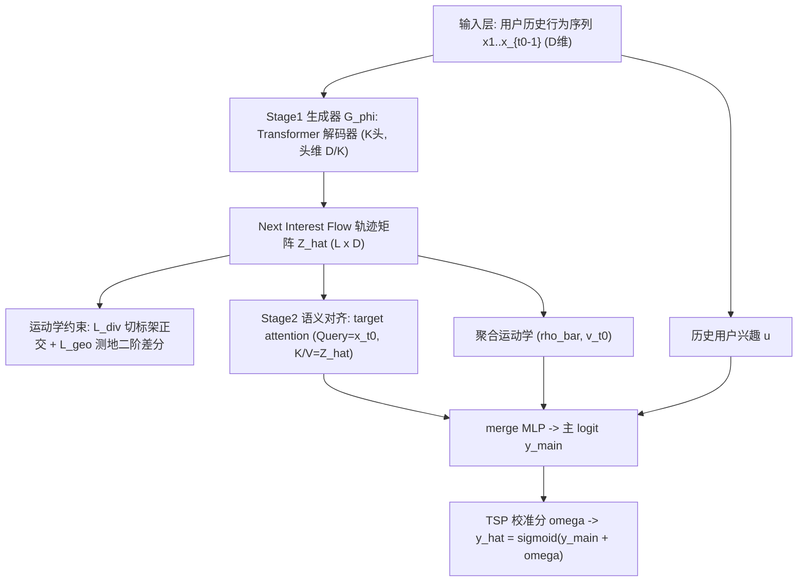
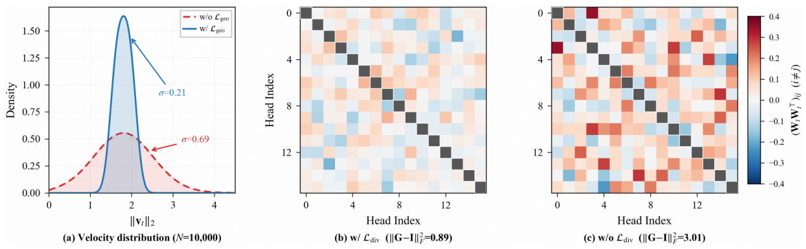
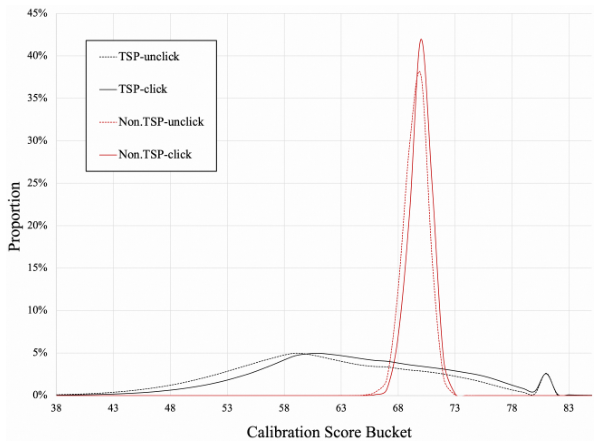
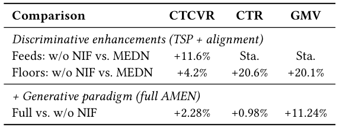

# Next Interest Flow: A Generative Pre-training Paradigm for Recommender Systems by Modeling All-domain Movelines (下一兴趣流：建模全领域行为轨迹的推荐系统生成式预训练范式)

- **会议/期刊**: SIGIR 2026
- **推荐链路定位**: 精排 (CTR/CTCVR 预估) + 生成式预训练 (Generative Pre-training) 两阶段范式
- **研究方向**: 生成式推荐与离散语义ID (主) / CTR 预估与特征交叉 (次)
- **论文原文**: [https://arxiv.org/abs/2510.11317v2](https://arxiv.org/abs/2510.11317v2)
- **开源代码**: 暂未开源（原文与预提取均未发现开源仓库链接）

## TL;DR (核心速览)

针对判别式 CTR 模型只能拟合候选子空间局部决策边界、而现有离散生成式方法（P5/TIGER）因 token 化导致信息坍缩的痛点，本文提出 Next Interest Flow (NIF)：将用户意图建模为高维隐兴趣流形上的连续演化轨迹，用切空间正交（兴趣多样性）与测地二阶差分正则（演化平滑）约束 Transformer 解码器做生成式预训练，再以双向对齐 + Temporal Sequential Pairwise (TSP) 桥接判别式精排。在淘宝 6.7B 样本工业数据上 AUC 0.7708（较生产基线 MEDN +0.87pt），线上 Feeds 场景 CTCVR +11.6%、GMV +11.24%。

## Background & Motivation (背景与动机)

- **领域背景与主流范式**: 工业 CTR 预估长期由判别式范式主导（Wide&Deep、DIN、SIM 系列），在推荐漏斗给定的候选子空间内学习超平面划分；另一条线是生成式范式（P5、TIGER 等），试图建模全局转移模式。
- **现有方法局限 (Limitations of Prior Work)**:
  1. **判别式模型的局部性**：只在候选特定子空间优化边际决策边界，无法重建全领域用户行为轨迹 (all-domain moveline) 的联合概率分布，也难以捕捉长程结构依赖。
  2. **离散生成式的信息坍缩 (discretization-induced information collapse)**：把细粒度电商信号重映射为离散语言 token 或类别 ID，是非双射变换，牺牲了兴趣轨迹的拓扑信息，只能预测孤立量化端点。
  3. **生成目标与判别目标的失配**：分布建模（生成）与逐点分类（判别）之间存在 objective mismatch，简单拼接无法弥合。
- **核心挑战 (Key Challenge)**: 如何在保留兴趣轨迹连续拓扑结构的前提下做生成式建模，并让该生成先验真正服务于下游逐点 CTR 判别？单纯加深网络或加对比学习无法解决，因为问题根源在于**表征空间被离散化破坏**与**两阶段目标不一致**。
- **核心洞察与切入点 (Key Insight)**: 作者将用户兴趣空间视为光滑黎曼子流形 $(\mathcal{M}, g) \subset \mathbb{R}^D$，用户行为序列是流形上的离散采样路径。借助微分几何：用**切空间标架正交性**保证多意图基的非冗余（Hadamard 不等式给出体积最大化的充要条件），用**自然三次样条的弯曲能量最小化**（Holladay 定理）导出二阶差分正则，从而在连续空间中获得"物理可信"的兴趣流。

## Problem Formulation & Method (问题定义与方法架构)

### 1. 符号定义与输入表征 (Notations & Input Representations)

- 用户兴趣流形 $(\mathcal{M}, g) \subset \mathbb{R}^D$；用户行为轨迹 $\mathcal{S} = (\mathbf{x}_1, \dots, \mathbf{x}_T)$，其中 $\mathbf{x}_t \in \mathbb{R}^D$ 为 $t$ 时刻物品 embedding。
- 生成器 $\mathcal{G}_\phi$ 为 Transformer 解码器，含 $K$ 个注意力头，每头维度 $D_k = D/K$（约束 $K \le D_k$）；预测视界 (horizon) 为 $L$。
- 预测轨迹矩阵 $\hat{\mathbf{Z}} = [\hat{\mathbf{z}}_{t_0}, \dots, \hat{\mathbf{z}}_{t_0+L-1}]^\top \in \mathbb{R}^{L \times D}$，每行 $\hat{\mathbf{z}}_t \in \mathbb{R}^D$ 为未来时刻的隐流状态。
- 输出：主 logit $\hat{y}_{\text{main}}$ 经 TSP 校准分 $\omega$ 修正后得 $\hat{y} = \sigma(\hat{y}_{\text{main}} + \omega)$。

### 2. 整体流水线 (Overall Architecture)

两阶段统一框架 AMEN (All-domain Moveline Evolution Network)：**Stage 1 生成式预训练**——冻结前的 Transformer 解码器以"历史真值 + 已生成流状态"的混合输入自回归外推兴趣流，并施加运动学约束；**Stage 2 判别式微调**——冻结生成器 $\mathcal{G}_{\phi^*}$ 产出轨迹矩阵 $\hat{\mathbf{Z}}$、逐状态多样性分 $\{\rho_t\}$ 与速度向量 $\{\mathbf{v}_t\}$，经语义对齐模块与目标物品交互后送入 merge MLP 出主 logit，同时用 TSP 辅助任务注入时序因果。

图 1 展示了 AMEN 的整体架构：(a) Stage 1 生成式预训练、(b) Stage 2 判别式微调、(c) 判别器增强的 TSP 任务。

<figure class="paper-figure" markdown="span">
  <figcaption>图 1</figcaption>
</figure>

### 3. 核心模块设计与数学原理 (Key Designs & Formulations)

**(1) Next Interest Flow 自回归生成与 InfoNCE 预训练目标**

生成器在每个未来时刻 $t \in [t_0, t_0+L-1]$ 的输入由历史真值与已生成流状态拼接而成：

$$\hat{\mathbf{z}}_t = \mathcal{G}_\phi\big(\underbrace{\mathbf{x}_1, \dots, \mathbf{x}_{t_0-1}}_{\text{History (GT)}}, \underbrace{\hat{\mathbf{z}}_{t_0}, \dots, \hat{\mathbf{z}}_{t-1}}_{\text{Generated Flow}}\big), \quad \hat{\mathbf{z}}_t \in \mathbb{R}^D$$

这种混合输入让模型既锚定真实历史、又基于自身预测动量外推。预训练目标最大化预测状态与真实未来观测的互信息：

$$\mathcal{L}_{\text{nif}} = -\sum_{t=t_0}^{t_0+L-1} \log \frac{\exp(\langle \hat{\mathbf{z}}_t, \mathbf{x}_t \rangle / \tau)}{\sum_{\mathbf{x}' \in \{\mathbf{x}_t\} \cup \mathcal{N}_t} \exp(\langle \hat{\mathbf{z}}_t, \mathbf{x}' \rangle / \tau)}$$

其中 $\mathcal{N}_t$ 为负样本集，$\tau$ 为温度。**物理直觉**：在连续 embedding 空间直接预测流，避免离散 token 化的非双射信息损失。

**(2) 运动学约束：切标架正交（兴趣多样性）+ 测地正则（演化平滑）**

- **兴趣多样性**：将 $\hat{\mathbf{z}}_t$ 视为 $K$ 个注意力头输出 $\{q_k\}_{k=1}^K$ 的拼接，解释为切空间 $T_{\gamma(t)}\mathcal{M}$ 上的局部标架。设标架矩阵 $\mathbf{W}_t \in \mathbb{R}^{K \times D_k}$（第 $k$ 行为归一化输出 $\bar{q}_k$），由 Hadamard 不等式，表示体积 $\text{Vol}(\mathbf{W}_t) = \sqrt{\det(\mathbf{W}_t \mathbf{W}_t^\top)}$ 在 $\mathbf{W}_t \mathbf{W}_t^\top = \mathbf{I}_K$ 时取最大（命题 2.1）。用 Frobenius 松弛优化：

$$\mathcal{L}_{\text{div}} = \sum_{t=t_0}^{t_0+L-1} \big\| \mathbf{W}_t \mathbf{W}_t^\top - \mathbf{I}_K \big\|_F^2$$

并导出逐状态多样性分 $\rho_t = 1 - \|\mathbf{W}_t \mathbf{W}_t^\top - \mathbf{I}_K\|_F^2 / K^2$ 供下游使用。

- **演化平滑**：由 Holladay 定理，自然三次样条是唯一最小化弯曲能量 $E[\gamma] = \int \|\ddot{\gamma}(t)\|_2^2 dt$ 的 $C^2$ 曲线；在均匀时间网格上用中心差分 $\ddot{\gamma}(t_i) \approx \hat{\mathbf{z}}_{i+1} - 2\hat{\mathbf{z}}_i + \hat{\mathbf{z}}_{i-1}$ 离散化，得测地正则：

$$\mathcal{L}_{\text{geo}} = \big\| \boldsymbol{\Delta}^2 \hat{\mathbf{Z}} \big\|_F^2$$

其中 $\boldsymbol{\Delta}^2$ 为二阶差分算子。同时提取一阶速度 $\mathbf{v}_t = \hat{\mathbf{z}}_t - \mathbf{x}_{t-1}$（$t=t_0$）或 $\mathbf{v}_t = \hat{\mathbf{z}}_t - \hat{\mathbf{z}}_{t-1}$（$t>t_0$）刻画兴趣漂移。

**(3) 双向对齐 + TSP 时序因果校准**

- **语义对齐模块**：用 target attention 将连续流形轨迹软选择投影到候选目标物品的局部决策上下文：

$$\mathbf{a} = \text{Attention}(\text{Query}=\mathbf{x}_{t_0}, \text{Key}=\hat{\mathbf{Z}}, \text{Value}=\hat{\mathbf{Z}})$$

对齐表征 $\mathbf{a}$、历史兴趣 $\mathbf{u}$、聚合运动学 $(\bar{\rho}, \mathbf{v}_{t_0})$ 与目标物品 $\mathbf{x}_{t_0}$ 一起送入 merge MLP 得 $\hat{y}_{\text{main}}$。另一方向的对齐是**跨阶段权重初始化**：$\mathcal{G}_\phi$ 用预训练判别式基座模型权重初始化，同步两阶段语义原点。

- **TSP 辅助任务**：在同一轨迹视界 $L$ 内选取标签相反的 diff 样本 $\mathbf{x}_1$（时刻 $t_1$），校准网络计算分 $\omega_0, \omega_1$，施加 BPR 式目标：

$$\mathcal{L}_{\text{tsp}} = -\frac{1}{|\mathcal{P}|} \sum_{(\mathbf{x}_0, \mathbf{x}_1) \in \mathcal{P}} \log \sigma\big(\ell_{t_1} \cdot (\omega_1 - \omega_0)\big)$$

其中 $\ell_{t_1} = 2y_{t_1} - 1 \in \{-1, +1\}$ 为标签极性指示。**物理直觉**：让校准分显式编码"时间上更靠后的真实正反馈应获得更高校准"，从而区分真实因果状态转移与伪相关。

### 4. 训练目标、负采样与推理复杂度 (Optimization, Negative Sampling & Complexity)

- **Stage 1 联合目标**：$\mathcal{L}_{\text{stage1}} = \mathcal{L}_{\text{nif}} + \alpha \cdot \mathcal{L}_{\text{div}} + \beta \cdot \mathcal{L}_{\text{geo}}$，最优超参 $\tau=0.1$、$\alpha=0.05$、$\beta=0.01$、$L=48$、$K=16$。
- **Stage 2 微调目标**：$\mathcal{L}_{\text{stage2}} = \mathcal{L}_{\text{CE}} + \lambda \cdot \mathcal{L}_{\text{tsp}}$，$\lambda=0.1$。
- **训练负采样策略**：$\mathcal{L}_{\text{nif}}$ 中负样本集 $\mathcal{N}_t$ 由原文公式给出但**具体采样方式（Uniform / In-batch / Hard Negative）原文未明确报告**；TSP 采用同轨迹内标签相反的 diff 样本作为成对约束，非传统负采样。
- **时间与空间复杂度**：生成器与判别器独立运行，在线仅增加 **+1~2 ms 延迟**。原文强调工业可扩展性：生成式 LLM（TIGER/P5 0.5B）单张 A100 每日约 6 万样本，而 AMEN 在 12,800 核 CPU 集群上每日处理 1 亿样本。离线预训练单 epoch 耗时与峰值显存**原文未报告**。

## Experimental Setup & Evaluation Protocol (实验设置与评估协议)

- **数据集统计与预处理**: 淘宝工业数据集，训练 6.7B 样本（180.7M 用户、21.9M 物品），测试 0.6B 样本（23.2M 用户、7.7M 物品）。原文未报告 5-core 过滤规则、正样本界定阈值（点击/成交）与稀疏度数值。

| 数据集 (Dataset) | 用户数 (#Users) | 物品数 (#Items) | 交互数 (#Interactions) | 稀疏度/密度 (Sparsity) | 模态/辅助特征说明 |
| :--- | :---: | :---: | :---: | :---: | :--- |
| Taobao (Train) | 180.7M | 21.9M | 6.7B | 原文未报告 | 电商行为序列 + 上下文侧信息（MEDN 基线含额外 contextual side info） |
| Taobao (Test) | 23.2M | 7.7M | 0.6B | 原文未报告 | 同上 |

- **数据划分方式 (Splitting Strategy)**: 原文仅说明训练/测试样本量，**未明确标注**是全局时间戳切分还是按比例划分；鉴于工业 CTR 场景与"时序因果"动机，推测为时间切分，但原文未给出防穿越的显式说明，存在**评估协议披露不足**的风险。
- **排名评测协议 (Ranking Protocol)**: 采用工业级 CTR 预估的 **AUC** 作为主指标（逐样本二分类打分），**非** Full-Ranking 或 Sampled Ranking 的 Top-K 排序协议；原文未报告 Recall@K / NDCG@K。
- **评价指标与显著性检验**: 离线 AUC；线上 CTCVR、CTR、GMV。统计显著性方面，作者指出 0.6B 测试样本下 $p \ll 0.001$ 平凡成立，因此**转而强调实际业务显著性 (practical significance)**，线上 A/B 在淘宝最大促销活动期间进行，采用严格分层 A/B 框架，收益在多日与多用户分群上保持一致。Embedding 维度 $D$ 的具体数值**原文未报告**（仅给出 $K=16$、$L=48$）。

## Key Experimental Results (核心实验结果)

### 1. 主实验对比 (Main Results)

表 1 给出离线性能与消融（$\Delta$AUC 相对生产基线 MEDN）：

| 数据集 | 指标 | Wide&Deep | DIN | P5 (生成式) | TIGER (生成式) | MEDN (生产基线) | 本文 AMEN | 相对提升 (Improv.) |
| :--- | :--- | :---: | :---: | :---: | :---: | :---: | :---: | :---: |
| Taobao 离线 | AUC | 0.7216 (-4.05pt) | 0.7410 (-2.11pt) | 0.7565 (-0.56pt) | 0.7638 (+0.17pt) | 0.7621 (-) | **0.7708** | **+0.87pt vs. MEDN** |

AMEN 显著优于离散生成式模型 P5 与 TIGER，验证了"连续流形流建模优于量化符号预测"的核心论点。

### 2. 消融实验与控制变量分析 (Ablation Study)

| 消融配置 | AUC | $\Delta$AUC (vs. MEDN) | 相对 Full 的下降 |
| :--- | :---: | :---: | :---: |
| AMEN (Full) | **0.7708** | +0.87pt | - |
| w/o NIF | 0.7694 | +0.73pt | -0.14pt |
| w/o TSP | 0.7683 | +0.62pt | **-0.25pt（最大）** |
| w/o Semantic Alignment | 0.7702 | +0.81pt | -0.06pt |
| w/o Weight Initialization | 0.7698 | +0.77pt | -0.10pt |
| w/o $\mathcal{L}_{\text{div}}$ | 0.7697 | +0.76pt | -0.11pt |
| w/o $\mathcal{L}_{\text{geo}}$ | 0.7699 | +0.78pt | -0.09pt |

**结论**：NIF 与 TSP 是主要性能驱动（TSP 移除后下降最大，-0.25pt），运动学正则 $\mathcal{L}_{\text{div}}$、$\mathcal{L}_{\text{geo}}$ 提供几何精修。原文**未报告**参数量对齐或图拓扑度数匹配等控制变量消融。

### 3. 稀疏度/冷启动分桶与超参敏感度 (Sparsity Buckets & Hyperparameters)

- **长尾/冷启动分析**: 原文在动机中声称 NIF 为长尾与营销不敏感用户提供流形动力学先验，但**未报告**按用户/物品交互频次分桶的定量实验。
- **关键超参数敏感度**: 原文称对分组超参做了细致消融并给出最优配置（$\tau=0.1$、$\alpha=0.05$、$\beta=0.01$、$\lambda=0.1$、$L=48$、$K=16$），但**未展示**敏感度曲线或趋势表。
- **运动学探针验证 (Probing)**: 在 10,000 名用户上，$\mathcal{L}_{\text{geo}}$ 使速度范数 $\|\mathbf{v}_t\|_2$ 分布显著集中（$\sigma=0.21$，无约束模型 $\sigma=0.69$），抑制随机跳变；$\mathcal{L}_{\text{div}}$ 下切标架保持近正交（$\|\mathbf{G} - \mathbf{I}\|_F^2 = 0.89$），移除后冗余相关性增加 **3.4 倍**导致子空间坍缩（图 2）。图 3 显示 TSP 校准分 $\omega$ 的概率密度边际被显著拉宽。

<figure class="paper-figure" markdown="span">
  <figcaption>图 2</figcaption>
</figure>

<figure class="paper-figure" markdown="span">
  <figcaption>图 3</figcaption>
</figure>

- **线上 A/B 测试结果 (Online A/B Test)**: 表 2 给出淘宝线上结果：

| 对比组 | 场景 | CTCVR | CTR | GMV |
| :--- | :--- | :---: | :---: | :---: |
| w/o NIF vs. MEDN（判别式增强：TSP + alignment） | Feeds | **+11.6%** | 统计不显著 | 统计不显著 |
| w/o NIF vs. MEDN（判别式增强） | Floors | +4.2% | +20.6% | +20.1% |
| Full AMEN vs. w/o NIF（叠加生成式范式） | Feeds | +2.28% | +0.98% | +11.24% |

<figure class="paper-figure" markdown="span">
  <figcaption>表 2</figcaption>
</figure>

## Highlights, Limitations & Critiques (亮点、局限与审稿级批判)

- **核心亮点与可迁移性**:
  1. **连续隐空间生成式预训练**替代离散 token 化，规避信息坍缩，这一思路可迁移到任何"序列→下一物品"的生成式召回/精排场景。
  2. **微分几何约束的工程化**：切标架正交（Hadamard 不等式）与测地二阶差分（Holladay 定理）都有严格数学依据，且以极轻量正则项实现，探针实验（速度分布 $\sigma
